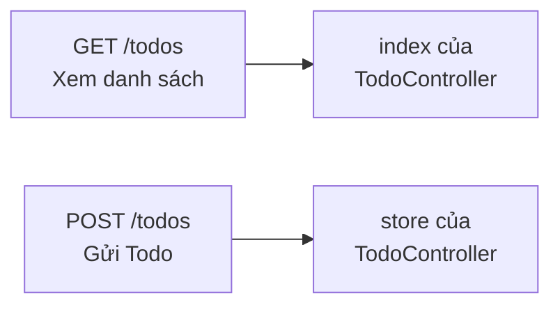
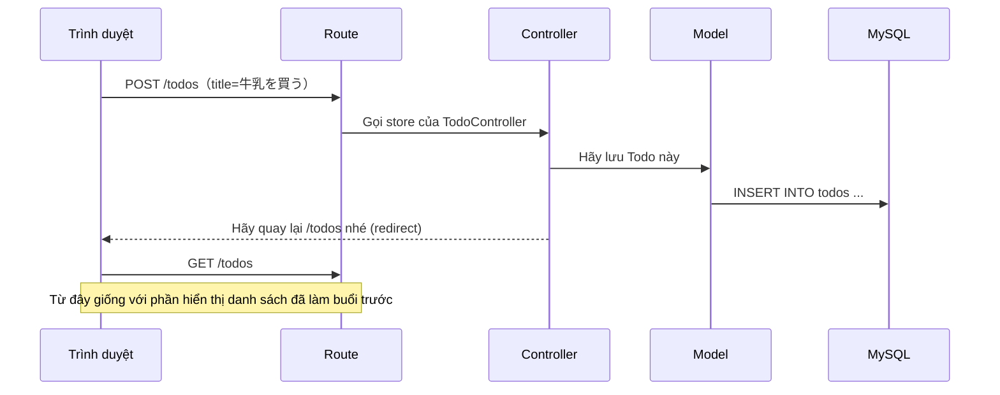
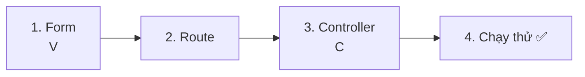
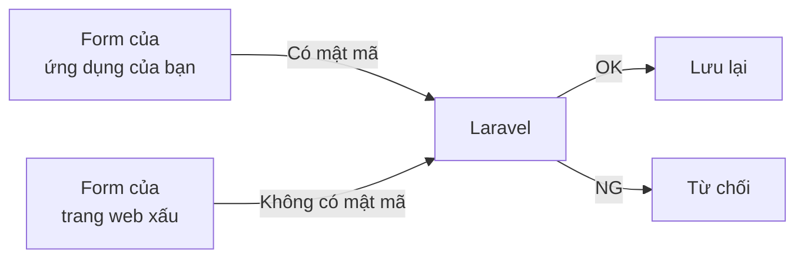
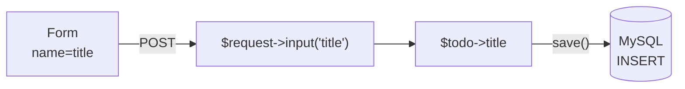
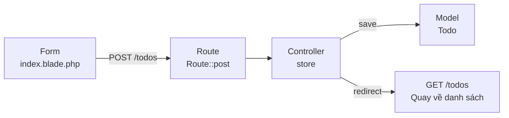

# Nhập môn Laravel — Cùng thêm Todo (CREATE)

> 🇯🇵 Bản gốc (tiếng Nhật): [20261022_資料_1.md](<../../../1年生_データ設計とアプリ開発/後期/20261022/20261022_資料_1.md>) <!-- original-ja-link -->

Chúng ta sẽ bổ sung **chức năng thêm Todo từ form** vào danh sách Todo đã làm ở [buổi trước](../20261015/20261015_資料_2.md).

## Mục tiêu hôm nay
- Hiểu sự khác nhau giữa GET và POST
- Có thể nhận dữ liệu gửi từ form trong Controller và lưu vào cơ sở dữ liệu
- Có thể quay về trang danh sách (redirect) sau khi lưu

> Hãy khởi động mysql và laravel của môi trường luyện tập (`php-study`) trước khi bắt đầu.
> Trước khi bắt đầu, hãy đảm bảo trang danh sách `/todos` đã làm ở buổi trước có thể hiển thị được.

---

## 1. GET và POST

Yêu cầu (request) từ trình duyệt gửi đến server có nhiều loại. Hôm nay chúng ta dùng 2 loại sau.

| Loại | Khi nào dùng | Ví dụ dễ hiểu |
|------|---------|-----------|
| **GET** | Khi **xem** trang (mở URL, nhấp vào link) | Nhờ nhân viên cho xem thực đơn |
| **POST** | Khi **gửi** dữ liệu (nút gửi của form) | Đưa phiếu gọi món |

Trang làm ở buổi trước là trang "xem Todo" nên dùng **GET**.
Hôm nay chúng ta làm chức năng "gửi Todo và lưu lại" nên sẽ dùng **POST**.

Trong Laravel, **ngay cả với cùng một URL, GET và POST vẫn có thể được xử lý theo những cách khác nhau**.



> **Còn todo.php của học kỳ trước thì sao?**
> Ở học kỳ trước, trong một file duy nhất, chúng ta dùng `<input type="hidden" name="action" value="create">` để phân biệt "đó là thao tác nào".
> Trong Laravel, **sự kết hợp giữa URL và GET/POST** sẽ quyết định method nào được chạy.

---

## 2. Luồng xử lý hôm nay

Khi nhấn nút gửi của form, xử lý sẽ diễn ra theo thứ tự sau.



Điểm quan trọng là **redirect** ở cuối.
Sau khi lưu xong, Controller không tạo màn hình mà trả lời trình duyệt rằng "hãy mở lại trang danh sách (`/todos`) nhé".
Vì trình duyệt mở lại trang danh sách, Todo vừa thêm sẽ xuất hiện trong danh sách.

> **todo.php của học kỳ trước cũng đã làm việc này**
> Ở học kỳ trước, chúng ta đã làm điều tương tự bằng `header('Location: index.php');` (mẫu PRG).
> Mục đích là để dù có tải lại trang, cùng một Todo cũng không bị đăng ký hai lần.

---

## 3. Cùng làm thử

Lần này bảng và Model đều đã có, nên chúng ta sẽ làm theo **thứ tự chạy** (View → Route → Controller).



Có 3 file cần chỉnh sửa (bên trong `src`). Hôm nay không sửa Model `Todo.php`.

```
src/
├─ resources/views/todos/
│   └─ index.blade.php ················ 1. Viết thêm form
├─ routes/
│   └─ web.php ························ 2. Viết thêm route POST
└─ app/Http/Controllers/
    └─ TodoController.php ············· 3. Viết thêm method store
```

---

### 1. Tạo form (V)

> Đang ở đây: **🟢 1. Form** → 2. Route → 3. Controller → 4. Chạy thử

Mở `resources/views/todos/index.blade.php` và viết thêm form có dấu ★ ngay bên dưới `<h1>`.

```html
<!DOCTYPE html>
<html lang="ja">
<head>
    <meta charset="UTF-8">
    <title>TODOアプリ</title>
</head>
<body>
    <h1>TODOアプリ</h1>

    {{-- ★ Thêm từ đây --}}
    <form method="POST" action="/todos">
        @csrf
        <input type="text" name="title" placeholder="新しいTODOを入力" required>
        <button type="submit">追加</button>
    </form>
    {{-- ★ Đến đây --}}

    <ul>
        @foreach ($todos as $todo)
            <li>
                <input type="checkbox" @checked($todo->is_done)>
                {{ $todo->title }}
            </li>
        @endforeach
    </ul>
</body>
</html>
```

| Code | Ý nghĩa |
|--------|------|
| `method="POST"` | Gửi bằng POST |
| `action="/todos"` | Gửi đến `/todos` |
| `name="title"` | Gửi với tên `title`. Controller dùng tên này để nhận dữ liệu |
| `required` | Không cho gửi khi ô còn trống |
| `@csrf` | Thêm "mật mã" sẽ được giải thích bên dưới |
| `{{-- --}}` | Comment của Blade. Không hiện ra trên màn hình |

#### `@csrf` là gì?

`@csrf` là cách viết để âm thầm thêm **mật mã (CSRF token)** vào form.
Khi chọn "View page source" trên trình duyệt, bạn sẽ thấy nó đã biến thành 1 dòng như sau.

```html
<input type="hidden" name="_token" value="ランダムな文字列">
```

Khi nhận được POST, Laravel sẽ kiểm tra mật mã này.
Nhờ vậy, có thể ngăn chặn **kiểu tấn công mà trang web xấu tự ý gửi form đến ứng dụng của bạn (CSRF)**.



Hãy nhớ rằng **form POST nhất định phải có `@csrf`**.

> **Đôi khi quên `@csrf` mà vẫn chạy được**
> Ngoài mật mã, Laravel 13 còn hỏi trình duyệt xem "request có được gửi từ cùng một trang web không".
> Vì vậy, trong môi trường luyện tập (`localhost`), đôi khi quên `@csrf` mà vẫn chạy được.
> Nhưng tùy môi trường của server công khai, Laravel có thể chỉ dựa vào mật mã để phán đoán, nên **dù chạy được vẫn nhất định phải viết**.

---

### 2. Viết Route

> Đang ở đây: 1. Form → **🟢 2. Route** → 3. Controller → 4. Chạy thử

Mở `routes/web.php` và viết thêm 1 dòng có dấu ★.

```php
<?php

use Illuminate\Support\Facades\Route;
use App\Http\Controllers\TodoController;

Route::get('/', function () {
    return view('welcome');
});

Route::get('/todos', [TodoController::class, 'index']);
Route::post('/todos', [TodoController::class, 'store']);  // ★ Thêm vào
```

```
Route::post( '/todos' ,  [TodoController::class, 'store'] );
~~~~~~~~~~~   ~~~~~~~     ~~~~~~~~~~~~~~~~~~~~~  ~~~~~~~
Khi được gửi  đến URL     thì TodoController     dùng store để xử lý
bằng POST     này
```

Với `get` và `post`, dù cùng là `/todos` nhưng method phụ trách sẽ khác nhau.

| Route | Phụ trách | Việc làm |
|--------|------|---------|
| `Route::get('/todos', ...)` | `index` | Hiển thị danh sách (buổi trước) |
| `Route::post('/todos', ...)` | `store` | Lưu Todo (hôm nay) |

`store` có nghĩa là "cất đi, lưu lại". Trong Laravel, tên `store` thường được dùng cho method lưu dữ liệu.

---

### 3. Viết Controller (C)

> Đang ở đây: 1. Form → 2. Route → **🟢 3. Controller** → 4. Chạy thử

Mở `app/Http/Controllers/TodoController.php` và viết thêm phần có dấu ★.

```php
<?php

namespace App\Http\Controllers;

use App\Models\Todo;
use Illuminate\Http\Request;  // ★ Thêm vào (để nhận dữ liệu từ form)

class TodoController extends Controller
{
    public function index()
    {
        $todos = Todo::all();

        return view('todos.index', ['todos' => $todos]);
    }

    // ★ Thêm từ đây
    public function store(Request $request)
    {
        // ① Chuẩn bị 1 Todo mới
        $todo = new Todo();

        // ② Đưa tiêu đề đã nhập trong form vào
        $todo->title = $request->input('title');

        // ③ Lưu vào cơ sở dữ liệu
        $todo->save();

        // ④ Quay về trang danh sách
        return redirect('/todos');
    }
    // ★ Đến đây
}
```

| Code | Ý nghĩa |
|--------|------|
| `Request $request` | Chiếc hộp chứa dữ liệu gửi từ form. Laravel tự động truyền vào |
| `$request->input('title')` | Lấy giá trị của `name="title"` trong form. Giống với `$_POST['title']` của học kỳ trước |
| `new Todo()` | Chuẩn bị 1 Todo mới (vẫn chưa được lưu) |
| `$todo->save()` | Lưu vào cơ sở dữ liệu. Giống với `INSERT INTO todos ...` |
| `redirect('/todos')` | Trả lời trình duyệt rằng "hãy mở lại `/todos` nhé" |

Hãy so sánh với `todo.php` của học kỳ trước.

```php
// Học kỳ trước
$title = trim($_POST['title'] ?? '');
$stmt = $pdo->prepare("INSERT INTO todos (title) VALUES (:title)");
$stmt->execute(['title' => $title]);
header('Location: index.php');
exit;

// Laravel
$todo = new Todo();
$todo->title = $request->input('title');
$todo->save();
return redirect('/todos');
```

Không cần viết SQL, `save()` của Model sẽ tạo câu lệnh `INSERT` giúp bạn (ORM).
Prepared statement cũng được Laravel xử lý bên trong, nên rất an toàn.
Ngoài ra, việc `trim()` (xóa khoảng trắng ở đầu và cuối) của học kỳ trước cũng được Laravel tự động làm.



---

### 4. Chạy thử ✅

> Đang ở đây: 1. Form → 2. Route → 3. Controller → **🟢 4. Chạy thử**

1. Mở http://localhost:8000/todos trên trình duyệt
2. Nhập "宿題をする" vào ô nhập rồi nhấn `追加`
3. Nếu "宿題をする" xuất hiện ở cuối danh sách là thành công

```
TODOアプリ

[ 新しいTODOを入力 ] [追加]

☐ 牛乳を買う
☑ レポートを出す
☐ 宿題をする        ← Đã được thêm vào!
```

✅ **Kiểm tra 1**: Hãy mở bảng `todos` trong phpMyAdmin (http://localhost:8080).
Cột `created_at` và `updated_at` của Todo vừa thêm hẳn đã có ngày giờ. Laravel đã tự động điền vào khi gọi `save()`.
Thời gian hiển thị sớm hơn 9 tiếng vì Laravel ghi lại theo UTC (Giờ Phối hợp Quốc tế).
(Những Todo nhập tay bằng phpMyAdmin ở buổi trước vẫn để trống (NULL))

✅ **Kiểm tra 2**: Sau khi thêm, hãy thử tải lại trang trong trình duyệt (F5).
Vì đã redirect, nên cùng một Todo sẽ không bị thêm hai lần.

---

## 4. Khi gặp sự cố

> **🔥 Không chạy thì hãy in log ra!**
> Khi không biết nguyên nhân lỗi, hãy in log ra để kiểm tra "chương trình đã chạy đến đâu" → [[Quan trọng] Cách in log](./【重要】ログの出し方.md)

| Triệu chứng | Nơi gây lỗi | Cách xử lý |
|------|----------|------|
| `The POST method is not supported for route todos.` | Route | Kiểm tra đã viết `Route::post('/todos', ...)` trong `routes/web.php` chưa |
| `Call to undefined method App\Http\Controllers\TodoController::store()` | Controller | Kiểm tra đã viết method `store` trong `TodoController.php` chưa, và tên có viết đúng chính tả không |
| `Class "App\Http\Controllers\Request" does not exist` | Controller | Kiểm tra phía trên `TodoController.php` đã có `use Illuminate\Http\Request;` chưa |
| `Column 'title' cannot be null` | Form | Kiểm tra chính tả của `name="title"` trong `<input>` (phải trùng tên với `input('title')` trong Controller) |
| `419 Page Expired` | Form | Kiểm tra trong form đã có `@csrf` chưa (trong môi trường luyện tập, dù không có `@csrf` cũng có thể không bị lỗi này) |
| Thêm rồi mà không hiện trong danh sách | Controller | Kiểm tra đã viết `$todo->save();` chưa. Kiểm tra thêm trong phpMyAdmin xem dữ liệu đã được lưu chưa |

---

## 5. Tổng kết



| Những gì đã viết hôm nay | Nói ngắn gọn |
|--------------|-----------|
| `<form method="POST">` và `@csrf` | Form để gửi Todo. Form POST nhất định phải có `@csrf` |
| `Route::post('/todos', ...)` | Khi được gửi bằng POST thì `store` phụ trách |
| `$request->input('title')` | Nhận giá trị được gửi từ form |
| `new Todo()` → `save()` | Tạo Todo mới rồi lưu lại (INSERT) |
| `redirect('/todos')` | Lưu xong thì quay về danh sách |

---

## 6. Thử thách thêm (dành cho bạn còn dư thời gian)

Hãy thử làm cho Todo vừa thêm hiện ở **trên cùng**.
Sửa `Todo::all()` trong method `index` như sau.

```php
$todos = Todo::orderBy('id', 'desc')->get();
```

Có nghĩa giống với `ORDER BY id DESC` (theo thứ tự id lớn trước = mới nhất trước).

> **Còn có cách viết `Todo::create()`**
> Khi tìm trên mạng, thay vì `new Todo()` → `save()`, bạn cũng sẽ hay gặp cách viết sau.
> ```php
> Todo::create(['title' => $request->input('title')]);
> ```
> Viết được trong 1 dòng nên rất tiện, nhưng để dùng cách này, cần thiết lập trong Model "được phép đưa dữ liệu vào cột nào" (`Fillable`).
> Nếu không viết, sẽ gặp lỗi `Add [title] to fillable property ...`.
> Hôm nay chúng ta dùng `new Todo()` → `save()` vì dễ hiểu cơ chế hơn.

<!-- nav:start -->

---

📎 Đọc thêm → [[Quan trọng] Cách in log](【重要】ログの出し方.md)

| ⬅️ Trước | 🗺️ Sơ đồ tổng quan | Tiếp ➡️ |
|:--|:--:|--:|
| [10/15 Danh sách Todo](../20261015/20261015_資料_2.md) | [Sơ đồ tổng quan tài liệu](../../README.md) | [10/22 Chi tiết Todo (SHOW)](20261022_資料_2.md) |

<!-- nav:end -->
