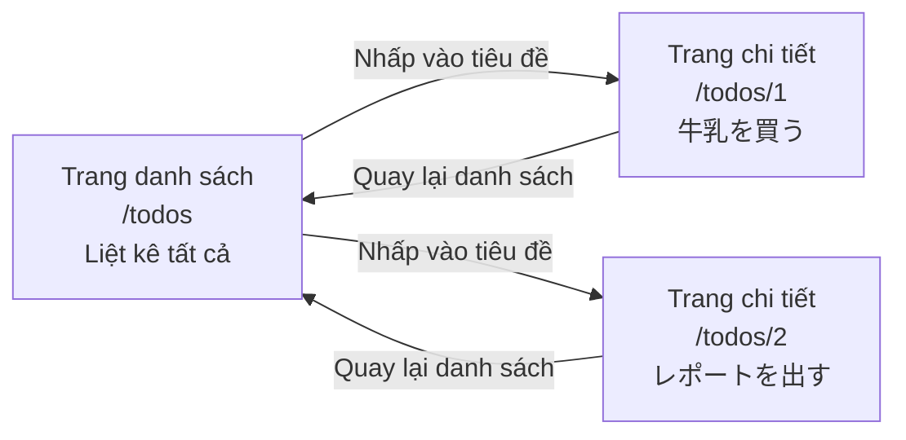
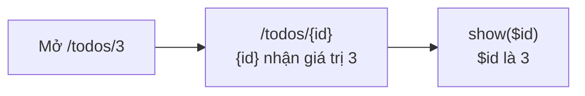
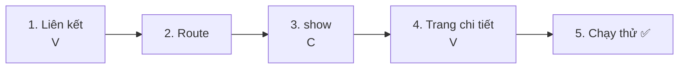
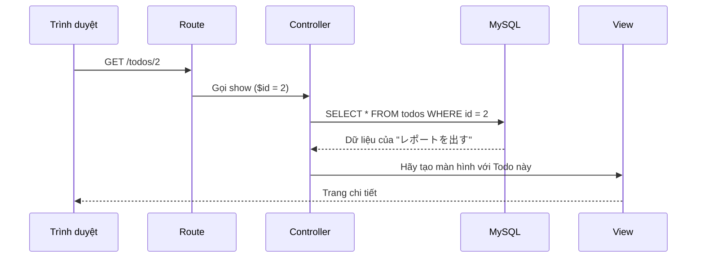
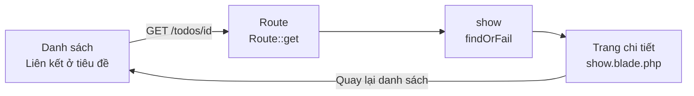

# Nhập môn Laravel — Tạo trang chi tiết của Todo (SHOW)

> 🇯🇵 Bản gốc (tiếng Nhật): [20261022_資料_2.md](<../../../1年生_データ設計とアプリ開発/後期/20261022/20261022_資料_2.md>) <!-- original-ja-link -->

Ở [Tài liệu 1](./20261022_資料_1.md), chúng ta đã có thể thêm Todo. Tiếp theo, chúng ta sẽ tạo **trang xem chi tiết một Todo (trang chi tiết)**.

## Mục tiêu hôm nay
- Đưa `id` vào URL để chọn Todo muốn xem (tham số route)
- Dùng `id` để lấy ra đúng một Todo
- Hiển thị thông tin của một Todo trên trang chi tiết

> Chúng ta bắt đầu từ trạng thái đã làm xong phần "Thêm Todo" ở Tài liệu 1.

---

## 1. Trang danh sách và trang chi tiết

Trang danh sách là trang "liệt kê và hiển thị tất cả Todo".
Trang chi tiết là trang "hiển thị chi tiết **chỉ một Todo**".



| | URL | Phụ trách | Hiển thị gì |
|---|---|---|---|
| Trang danh sách | `/todos` | `index` | Tất cả Todo |
| Trang chi tiết | `/todos/1`, `/todos/2` … | `show` | Một Todo **có `id` trùng với số trong URL** |

Con số ở cuối URL chính là **`id` của Todo bạn muốn xem**.
`/todos/1` là trang chi tiết của Todo có `id` là 1, còn `/todos/2` là trang chi tiết của Todo có `id` là 2.

> **Cửa hàng trên mạng cũng giống vậy**
> Trên các trang mua sắm trực tuyến, khi bạn nhấp vào một sản phẩm trong danh sách, một trang chi tiết riêng cho sản phẩm đó sẽ mở ra.
> Nếu nhìn vào URL, bạn sẽ thấy thường **có một con số** như `/items/12345`.

---

## 2. Kiến thức mới

### Tham số route `{id}`

Viết từng route `/todos/1`, `/todos/2`, `/todos/3`… cho mỗi Todo thì rất vất vả.
Vì vậy, nếu viết `{id}` trong route thì **phần đó của URL có thể nhận bất kỳ giá trị nào**, và controller có thể nhận giá trị đó.

```php
Route::get('/todos/{id}', [TodoController::class, 'show']);
```



### Lấy ra đúng một bản ghi bằng `findOrFail()`

Ở trang danh sách, chúng ta đã dùng `Todo::all()` để lấy **tất cả**.
Ở trang chi tiết, chúng ta dùng `id` để lấy **chỉ một**.

| Cách viết | Lấy ra gì | Nếu viết bằng SQL |
|--------|--------------|------------|
| `Todo::all()` | Tất cả | `SELECT * FROM todos` |
| `Todo::findOrFail($id)` | Một bản ghi có `id` trùng khớp | `SELECT * FROM todos WHERE id = ?` |

---

## 3. Cùng làm thử



Có 4 file cần chỉnh sửa như sau (bên trong `src`).

```
src/
├─ resources/views/todos/
│   ├─ index.blade.php ················ 1. Biến tiêu đề thành liên kết
│   └─ show.blade.php ················· 4. Trang chi tiết (tạo mới)
├─ routes/
│   └─ web.php ························ 2. Viết thêm route
└─ app/Http/Controllers/
    └─ TodoController.php ············· 3. Viết thêm phương thức show
```

---

### 1. Biến tiêu đề trong danh sách thành liên kết (V)

> Bạn đang ở đây: **🟢 1. Liên kết** → 2. Route → 3. show → 4. Trang chi tiết → 5. Chạy thử

Mở `resources/views/todos/index.blade.php` và bọc `{{ $todo->title }}` bằng một liên kết như chỗ đánh dấu ★.

```html
    <ul>
        @foreach ($todos as $todo)
            <li>
                <input type="checkbox" @checked($todo->is_done)>
                <a href="/todos/{{ $todo->id }}">{{ $todo->title }}</a>  {{-- ★ Biến thành liên kết --}}
            </li>
        @endforeach
    </ul>
```

`{{ $todo->id }}` sẽ được thay bằng `id` của Todo đó.
Mở danh sách trên trình duyệt và di chuột lên tiêu đề, bạn sẽ thấy ở góc dưới bên trái hiện URL khác nhau cho từng dòng, như `…/todos/1`, `…/todos/2`.

(Lúc này nếu nhấp vào tiêu đề sẽ ra `404 Not Found`. Vì chúng ta chưa có route.)

---

### 2. Viết route

> Bạn đang ở đây: 1. Liên kết → **🟢 2. Route** → 3. show → 4. Trang chi tiết → 5. Chạy thử

Viết thêm 1 dòng có dấu ★ vào `routes/web.php`.

```php
Route::get('/todos', [TodoController::class, 'index']);
Route::post('/todos', [TodoController::class, 'store']);
Route::get('/todos/{id}', [TodoController::class, 'show']);  // ★ Thêm vào
```

```
Route::get( '/todos/{id}' ,  [TodoController::class, 'show'] );
~~~~~~~~~~   ~~~~~~~~~~~     ~~~~~~~~~~~~~~~~~~~~~  ~~~~~~
Bằng GET,    khi mở URL      thì giao cho           phương thức show
             này             TodoController         xử lý
             ({id} là gì cũng được)
```

Đến đây, chúng ta đã có 3 route.

| Route | Phụ trách | Làm gì |
|--------|------|---------|
| `GET /todos` | `index` | Hiển thị danh sách |
| `POST /todos` | `store` | Thêm mới |
| `GET /todos/{id}` | `show` | Hiển thị chi tiết một Todo |

`show` có nghĩa là "cho xem, hiển thị". Trong Laravel, người ta thường đặt tên `show` cho phương thức hiển thị một bản ghi.

---

### 3. Viết phương thức show (C)

> Bạn đang ở đây: 1. Liên kết → 2. Route → **🟢 3. show** → 4. Trang chi tiết → 5. Chạy thử

Viết thêm phương thức `show` có dấu ★ vào `app/Http/Controllers/TodoController.php`.

```php
    // (Lược bỏ index và store)

    // ★ Thêm từ đây
    public function show($id)
    {
        // ① Dùng id để lấy ra một Todo muốn xem
        $todo = Todo::findOrFail($id);

        // ② Hiển thị trang chi tiết
        return view('todos.show', ['todo' => $todo]);
    }
    // ★ Đến đây
```

| Code | Ý nghĩa |
|--------|------|
| `show($id)` | Phần `{id}` trong URL được đưa vào `$id` |
| `Todo::findOrFail($id)` | Lấy ra một Todo có `id` trùng khớp |
| `view('todos.show', ...)` | Dùng `resources/views/todos/show.blade.php` để tạo màn hình |
| `['todo' => $todo]` | Cho phép dùng biến tên `$todo` bên trong view |

Hãy so sánh với `index`. Cấu trúc của hai phương thức gần như giống nhau.

| | `index` (danh sách) | `show` (chi tiết) |
|---|---|---|
| Lấy ra | `Todo::all()` (tất cả) | `Todo::findOrFail($id)` (một bản ghi) |
| Biến | `$todos` (số nhiều) | `$todo` (số ít) |
| View | `todos.index` | `todos.show` |

> **"OrFail" trong `findOrFail` là gì?**
> Nó có nghĩa là "nếu không tìm thấy thì coi là thất bại (Fail)".
> Khi bạn mở một Todo không tồn tại như `/todos/999`, nó sẽ tự động hiển thị trang `404 Not Found`.
> Còn `Todo::find($id)` trông rất giống, nhưng nếu không tìm thấy thì trả về `null` (rỗng), và sau đó view sẽ bị lỗi.

---

### 4. Tạo trang chi tiết (V)

> Bạn đang ở đây: 1. Liên kết → 2. Route → 3. show → **🟢 4. Trang chi tiết** → 5. Chạy thử

Tạo mới một file tên `show.blade.php` bên trong `resources/views/todos`.

```
resources/views/todos/
  ├─ index.blade.php
  └─ show.blade.php   ← Tạo mới
```

```html
<!DOCTYPE html>
<html lang="ja">
<head>
    <meta charset="UTF-8">
    <title>TODOの詳細</title>
</head>
<body>
    <h1>{{ $todo->title }}</h1>

    <p>番号：{{ $todo->id }}</p>

    <p>
        状態：
        @if ($todo->is_done)
            完了 ✅
        @else
            未完了
        @endif
    </p>

    <a href="/todos">一覧にもどる</a>
</body>
</html>
```

| Code | Ý nghĩa |
|--------|------|
| `{{ $todo->title }}` | Tiêu đề của Todo |
| `{{ $todo->id }}` | Mã số của Todo (`id`) |
| `@if` ~ `@else` ~ `@endif` | Nếu đã xong thì hiển thị "完了 ✅" (đã xong), nếu không thì hiển thị "未完了" (chưa xong) |

Trong view danh sách, chúng ta dùng `@foreach` để lấy ra từng cái một, nhưng `$todo` ở trang chi tiết **ngay từ đầu chỉ có một**, nên không cần `@foreach`.

---

### 5. Chạy thử ✅

> Bạn đang ở đây: 1. Liên kết → 2. Route → 3. show → 4. Trang chi tiết → **🟢 5. Chạy thử**

1. Mở http://localhost:8000/todos
2. Nhấp vào "レポートを出す"
3. Nếu hiện ra trang chi tiết như dưới đây là thành công

```
レポートを出す

番号：2

状態：完了 ✅

一覧にもどる
```



✅ **Kiểm tra 1**: Hãy nhấp thử vào các Todo khác và xác nhận tiêu đề và trạng thái của từng cái có hiện ra không.

✅ **Kiểm tra 2**: Hãy sửa trực tiếp URL trên trình duyệt thành http://localhost:8000/todos/999 rồi mở thử.
Vì không có Todo nào có `id` là 999, trang `404 Not Found` sẽ hiện ra. Đó là dấu hiệu `findOrFail` đang hoạt động.

---

## 4. Khi không chạy được

> **🔥 Không chạy được thì hãy in log ra!**
> Khi không biết nguyên nhân lỗi, hãy dùng `Log::info()` bên trong `show` để kiểm tra giá trị của `$id` → [[Quan trọng] Cách in log](./【重要】ログの出し方.md)

| Triệu chứng | Nơi gây lỗi | Cách xử lý |
|------|----------|------|
| Nhấp vào tiêu đề thì ra `404 Not Found` | Route | Kiểm tra xem đã viết `Route::get('/todos/{id}', ...)` trong `routes/web.php` chưa |
| `Call to undefined method App\Http\Controllers\TodoController::show()` | Controller | Kiểm tra xem đã viết phương thức `show` trong `TodoController.php` chưa, và tên có viết đúng chính tả không |
| `View [todos.show] not found.` | View | Kiểm tra xem đã tạo `resources/views/todos/show.blade.php` chưa, và tên file có đúng không |
| `Undefined variable $todo` | Controller | Kiểm tra chính tả của `'todo'` trong `view('todos.show', ['todo' => $todo])` (có bị viết thành `'todos'` không) |
| Nhấp vào Todo nào cũng ra cùng một Todo | View | Kiểm tra xem liên kết trong danh sách có phải là `href="/todos/{{ $todo->id }}"` không |

---

## 5. Tổng kết



| Những gì đã viết hôm nay | Nói ngắn gọn |
|--------------|-----------|
| `href="/todos/{{ $todo->id }}"` | Tạo liên kết có chứa `id` cho từng Todo |
| `Route::get('/todos/{id}', ...)` | Nhận `id` trong URL thành `$id` ở controller |
| `Todo::findOrFail($id)` | Lấy ra một Todo theo `id`. Nếu không có thì 404 |
| `show.blade.php` | Trang hiển thị chi tiết một Todo |

**`{id}` và `findOrFail()`** học ở đây cũng sẽ được dùng trong phần "Sửa" và "Xóa" mà chúng ta sẽ làm sau này.

---

## 6. Thử thêm nữa (dành cho bạn nào còn thời gian)

Hãy thử hiển thị cả **thời điểm tạo** (`created_at`) trên trang chi tiết.

<details>
<summary>Gợi ý</summary>

Viết thêm 1 dòng sau vào `show.blade.php`.

```html
<p>作った日時：{{ $todo->created_at }}</p>
```

- Todo được thêm bằng form ở Tài liệu 1 sẽ hiển thị thời gian (vì là giờ UTC nên chậm hơn giờ Nhật Bản 9 tiếng)
- Todo đã nhập tay bằng phpMyAdmin ở buổi trước có `created_at` trống (NULL) nên sẽ không hiển thị gì

</details>

<!-- nav:start -->

---

| ⬅️ Trước | 🗺️ Sơ đồ tổng thể | Tiếp ➡️ |
|:--|:--:|--:|
| [10/22 Thêm Todo (CREATE)](20261022_資料_1.md) | [Sơ đồ tổng thể tài liệu](../../README.md) | [10/29 Sửa Todo (UPDATE)](../20261029/20261029_資料_1.md) |

<!-- nav:end -->
