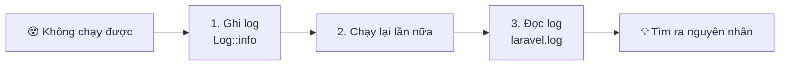
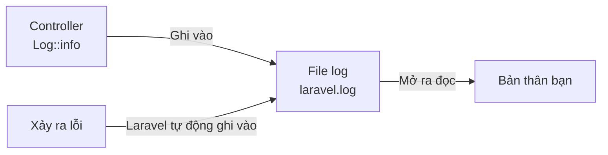
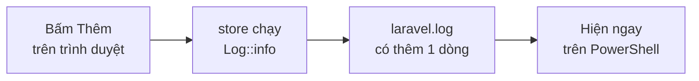
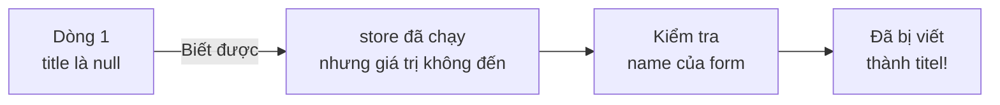
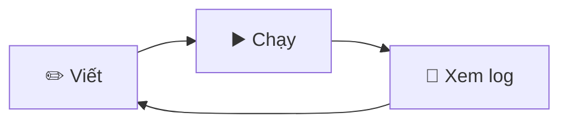

# [Quan trọng] Không chạy được thì hãy in log ra!

> 🇯🇵 Bản gốc (tiếng Nhật): [【重要】ログの出し方.md](<../../../1年生_データ設計とアプリ開発/後期/20261022/【重要】ログの出し方.md>) <!-- original-ja-link -->

[Quay lại bài Thêm Todo (CREATE)](./20261022_資料_1.md)

> ## 🔥 Không chạy được thì hãy in log ra!
> Khi chương trình không chạy đúng, **nếu chỉ sửa code một cách mò mẫm thì gần như sẽ không sửa được.**
> Trước tiên, hãy **in log ra và xem bên trong đang xảy ra chuyện gì**. Đây là con đường ngắn nhất để tìm ra nguyên nhân.
> Trang này sẽ còn hữu ích trong các buổi học sau và cả khi làm dự án tự chọn. Gặp khó khăn, hãy quay lại xem bất cứ lúc nào.
>
> ## 👀 Hãy tập thói quen xem log!
> Không chỉ khi chương trình không chạy, mà **hãy xem log cả trong những lúc bình thường**.
> Bạn sẽ sớm nhận ra cả những lỗi kiểu "tưởng là đã chạy được".



## Mục tiêu của trang này
- Hiểu log dùng để làm gì
- Tự ghi log ra bằng `Log::info()`
- Mở file log và đọc được nội dung bên trong
- Tập thói quen xem log thường xuyên

---

## 1. Log là gì

Đôi khi bấm nút `追加` (Thêm) trên form mà dữ liệu vẫn không được lưu đúng.
Nhưng bạn không thể nhìn vào màn hình để biết bên trong controller đang xảy ra chuyện gì.

- Giá trị trong form có thực sự đến được controller không?
- Phương thức `store` có thực sự đang chạy không?

Lúc đó chúng ta dùng **log**.
Log giống như một **cuốn nhật ký** mà ứng dụng ghi lại "lúc nào, đã làm gì".



File log nằm ở đây, bên trong `src`.

```
src/
└─ storage/
    └─ logs/
        └─ laravel.log   ← Log được ghi vào đây
```

> **Lỗi cũng được tự động ghi vào**
> Dù bạn không làm gì, khi chương trình xảy ra lỗi, Laravel sẽ tự ghi vào `laravel.log`.
> Kể cả khi đã lỡ đóng màn hình lỗi, bạn vẫn có thể kiểm tra lại sau bằng log.
>
> Tuy nhiên, những lỗi như `404 Not Found` (không tìm thấy trang), `405` (`The POST method is not supported ...`), `419 Page Expired`, tức là
> **các lỗi "sai URL hoặc sai cách gửi" sẽ không được ghi vào log**. Với những lỗi này, hãy kiểm tra route và form.

---

## 2. Thử ghi log ra

Chúng ta sẽ thêm các dòng ghi log vào phương thức `store` của buổi trước.
Mở `app/Http/Controllers/TodoController.php` và viết thêm các phần có dấu ★.

```php
<?php

namespace App\Http\Controllers;

use App\Models\Todo;
use Illuminate\Http\Request;
use Illuminate\Support\Facades\Log;  // ★ Thêm vào (để dùng log)

class TodoController extends Controller
{
    // (Lược bỏ index)

    public function store(Request $request)
    {
        // ★ Ghi giá trị nhận được từ form vào log
        Log::info('Todoを追加します', ['title' => $request->input('title')]);

        $todo = new Todo();
        $todo->title = $request->input('title');
        $todo->save();

        // ★ Ghi vào log rằng đã lưu thành công
        Log::info('Todoを保存しました', ['id' => $todo->id]);

        return redirect('/todos');
    }
}
```

| Code | Ý nghĩa |
|--------|------|
| `use Illuminate\Support\Facades\Log;` | Dòng cần có để dùng log |
| `Log::info('thông điệp')` | Ghi vào log dưới dạng "thông báo" |
| `['title' => ...]` | Ghi ra cả giá trị cùng với thông điệp (không có cũng được) |
| `$todo->id` | Sau khi `save()`, ta biết được `id` đã được tự động gán |

---

## 3. Thử xem log

Mở http://localhost:8000/todos trên trình duyệt, nhập "宿題をする" rồi bấm `追加`.
Sau đó, hãy thử xem log. Có 2 cách xem.

### Cách xem 1: Mở bằng trình soạn thảo

Mở `src/storage/logs/laravel.log` bằng một trình soạn thảo như VS Code.
Cuộn xuống cuối cùng, bạn sẽ thấy có thêm những dòng như sau.

```
[2026-10-22 01:15:30] local.INFO: Todoを追加します {"title":"宿題をする"}
[2026-10-22 01:15:30] local.INFO: Todoを保存しました {"id":3}
```

| Phần | Ý nghĩa |
|------|------|
| `[2026-10-22 01:15:30]` | Ngày giờ được ghi |
| `local` | Môi trường đang chạy (môi trường thực hành là `local`) |
| `INFO` | Loại log (thông báo) |
| `Todoを追加します` | Thông điệp do bạn tự viết |
| `{"title":"宿題をする"}` | Giá trị được ghi cùng với thông điệp |

> **Giờ bị lệch 9 tiếng?**
> Laravel ghi thời gian theo **UTC (giờ chuẩn quốc tế)**. Giờ Nhật Bản là giờ UTC cộng thêm 9 tiếng.
> `01:15:30` trong ví dụ trên là `10:15:30` theo giờ Nhật Bản.

### Cách xem 2: Xem theo thời gian thực bằng PowerShell

Ở thư mục laravel, chạy lệnh sau.

```powershell
docker compose exec laravel tail -f storage/logs/laravel.log
```

Mỗi khi log được ghi vào, nó sẽ hiện ra ngay lập tức.
Khi bấm `追加` trên trình duyệt, bạn sẽ thấy có thêm dòng mới.
Muốn dừng xem thì bấm `Ctrl + C`.

> Nếu hiện `tail: cannot open ... No such file or directory` thì nghĩa là file log chưa được tạo.
> File log sẽ được tạo khi dòng log đầu tiên được ghi vào. Hãy bấm `追加` trên trình duyệt một lần rồi chạy lại lệnh.



> **Không dùng được `php artisan pail`**
> Khi tra cứu trên mạng, bạn sẽ thấy `php artisan pail` được giới thiệu là lệnh để xem log.
> Môi trường thực hành không có tính năng PHP (pcntl) cần thiết để chạy pail, nên không dùng được.
> Thay vào đó, chúng ta dùng `tail -f`.

---

## 4. Các loại log

Log có nhiều loại tùy theo mức độ quan trọng. 4 loại hay dùng là như sau.

| Cách viết | Loại | Khi nào dùng |
|--------|------|---------|
| `Log::debug('...')` | Gỡ lỗi (debug) | Khi muốn kiểm tra giá trị trong lúc phát triển |
| `Log::info('...')` | Thông báo | Các sự việc bình thường như "đã lưu Todo" |
| `Log::warning('...')` | Cảnh báo | Không phải lỗi nhưng là điều cần chú ý |
| `Log::error('...')` | Lỗi | Khi xử lý thất bại |

Trong file log, loại log được ghi như `local.DEBUG`, `local.INFO`, `local.WARNING`, `local.ERROR`.
Khi tìm lỗi, hãy tìm kiếm `ERROR` trong file thì sẽ dễ tìm hơn.

---

## 5. Khi không chạy được, hãy tìm nguyên nhân bằng log

### Nếu không in log ra thì…

```
"Chắc là chỗ này sai…"           → Sửa → Vẫn không chạy
"Vậy thì chắc chỗ kia…"          → Sửa → Vẫn không chạy
"Ban đầu code thế nào nhỉ…"      → Không khôi phục lại được 😱
```

Nếu sửa một cách đoán mò, không những tốn thời gian mà còn có thể **làm hỏng luôn cả những phần đang chạy tốt**.

| | Sửa mò mẫm | In log ra |
|---|---|---|
| Việc làm | Sửa chỗ mình nghĩ là có vấn đề | Trước khi sửa, xem bên trong bằng log trước |
| Biết được gì | Không biết được gì | Đã chạy đến đâu, giá trị là gì |
| Kết quả | Sửa được hay không là tùy may rủi | Khoanh vùng được vị trí gây lỗi |

### Khoanh vùng nguyên nhân bằng log

Log có thể dùng để kiểm tra "chương trình đã chạy đến đâu".

Ví dụ, giả sử bạn lỡ viết `name` của form thành `name="titel"` (sai chính tả).
Khi bấm `追加` thì bị lỗi. Xem log thì thấy ghi như sau.

```
[2026-10-22 01:20:05] local.INFO: Todoを追加します {"title":null}
[2026-10-22 01:20:05] local.ERROR: SQLSTATE[23000]: Integrity constraint violation: 1048 Column 'title' cannot be null ...
```



Từ dòng 1, ta biết được rằng **chương trình đã chạy đến `store`, nhưng giá trị của `title` không đến được**.
Vì vậy, có thể nghi ngờ phía gửi giá trị (`name` của form).

Như vậy, **ghi log ở trước và sau chỗ đáng nghi để kiểm tra chương trình chạy đúng đến đâu** chính là bí quyết tìm nguyên nhân.

> **Khi hỏi thầy cô hay bạn bè, cũng hãy cho xem log**
> Nếu chỉ nói "Không chạy được", người được hỏi cũng không biết nguyên nhân.
> Nếu **hỏi kèm theo log**, ví dụ "Log in ra ở đầu `store` cho thấy `title` là `null`", vấn đề sẽ được giải quyết ngay.

---

## 6. Khác nhau giữa log và `dd()`

Để kiểm tra giá trị, còn có cách dùng `dd()`.

```php
dd($request->input('title'));
```

Khi viết `dd()`, **xử lý sẽ dừng lại tại đó** và giá trị được hiển thị trên trình duyệt.

| | `Log::info()` | `dd()` |
|---|---|---|
| Hiện ra ở đâu? | File log | Màn hình trình duyệt |
| Xử lý thì sao? | Không dừng, chạy đến cuối | Dừng tại đó |
| Phù hợp khi nào | Khi muốn theo dõi toàn bộ luồng xử lý, khi muốn xem lại sau | Khi muốn xem nhanh một giá trị ngay tại chỗ |
| Sau đó có xóa không? | Để lại cũng được | **Nhất định phải xóa** (nếu không xóa, chương trình sẽ luôn dừng ở đó) |

---

## 7. Hãy tập thói quen xem log!

Log không phải chỉ để xem khi chương trình không chạy. Nếu **tập thói quen xem log thường xuyên**, bạn sẽ sớm nhận ra lỗi sai.

### Trong lúc phát triển, hãy luôn để log mở

Trong lúc viết chương trình, hãy để `tail -f` chạy liên tục trên PowerShell.
Nên xếp 3 cửa sổ cạnh nhau và lặp lại **viết → chạy → xem log**.

```
┌──────────────┬──────────────┐
│              │              │
│  Trình soạn  │  Trình duyệt │
│  thảo (viết) │  (chạy)      │
│              │              │
├──────────────┴──────────────┤
│  PowerShell (xem log)       │
│  tail -f storage/logs/...   │
└─────────────────────────────┘
```



### Kể cả khi "đã chạy được", cũng hãy xem log

Dù trên màn hình trông như đã chạy được, **bên trong có thể đang chứa giá trị khác**.
Ví dụ: tiêu đề đã nhập có đến nguyên vẹn không, một lần bấm `追加` có bị lưu thành 2 bản ghi không, v.v.
Chỉ khi đã kiểm tra bằng log rằng "giá trị đúng như mình nghĩ", bạn mới có thể nói là "đã chạy được".

### Khi màn hình lỗi hiện ra, trước tiên hãy xem log

Khi màn hình lỗi hiện ra, đừng hoảng, hãy xem **phần cuối cùng** của `laravel.log`.
Dòng có chữ `ERROR` sẽ cho biết chuyện gì đã xảy ra.
(`404`, `405`, `419` không được ghi vào log, nên hãy đọc thông báo trên màn hình rồi kiểm tra route và form.)

### Danh sách kiểm tra thói quen xem log

- [ ] Khi bắt đầu phát triển, đã mở log bằng `tail -f`
- [ ] Sau khi bấm nút hoặc mở trang, đã xem log
- [ ] Kể cả khi "đã chạy được", đã kiểm tra bằng log xem giá trị có đúng như mình nghĩ không
- [ ] Khi có lỗi, trước tiên đã xem phần cuối cùng của `laravel.log`
- [ ] Khi đặt câu hỏi, đã cho xem cả log

---

## 8. Tổng kết

> ## 🔥 Không chạy được thì hãy in log ra!
> ## 👀 Hãy tập thói quen xem log!

- Log là cuốn nhật ký ghi lại ứng dụng "lúc nào, đã làm gì"
- Viết `use Illuminate\Support\Facades\Log;` rồi ghi ra bằng `Log::info('thông điệp', [giá trị])`
- Log được ghi vào `src/storage/logs/laravel.log`. Lỗi cũng được tự động ghi vào
- Có thể xem theo thời gian thực bằng `docker compose exec laravel tail -f storage/logs/laravel.log`
- Thời gian theo UTC (chậm hơn giờ Nhật Bản 9 tiếng)
- Khi không suôn sẻ, hãy ghi log ở trước và sau chỗ đáng nghi để kiểm tra "đã chạy đến đâu"
- Trong lúc phát triển, hãy luôn để `tail -f` mở và lặp lại **viết → chạy → xem log**

<!-- nav:start -->

---

| ⬅️ Quay lại | 🗺️ Sơ đồ tổng thể | Tiếp ➡️ |
|:--|:--:|--:|
| [10/22 Thêm Todo (CREATE)](20261022_資料_1.md) | [Sơ đồ tổng thể tài liệu](../../README.md) | [10/22 Chi tiết Todo (SHOW)](20261022_資料_2.md) |

<!-- nav:end -->
