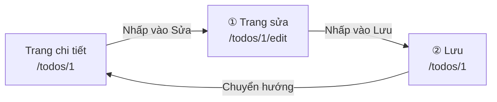
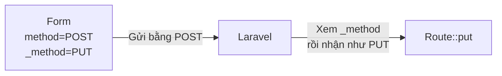
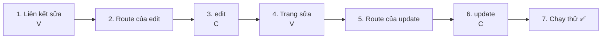
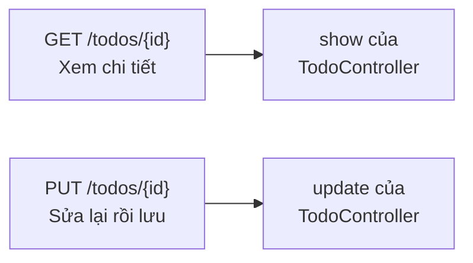
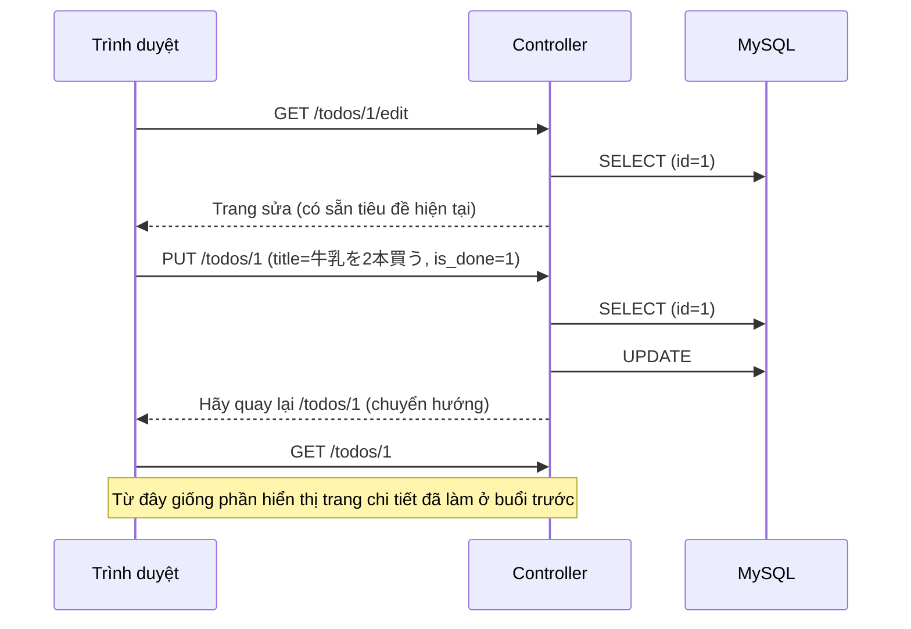
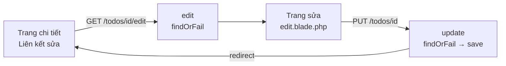

# Nhập môn Laravel — Sửa Todo (UPDATE)

> 🇯🇵 Bản gốc (tiếng Nhật): [20261029_資料_1.md](<../../../1年生_データ設計とアプリ開発/後期/20261029/20261029_資料_1.md>) <!-- original-ja-link -->

Chúng ta sẽ gắn nút "Sửa" vào trang chi tiết đã tạo ở [buổi trước](../20261022/20261022_資料_2.md), và làm **chức năng sửa lại (chỉnh sửa) tiêu đề và trạng thái (đã xong / chưa xong) của Todo đã đăng ký**.

## Mục tiêu hôm nay
- Tạo trang sửa và hiển thị được tiêu đề và trạng thái hiện tại
- Dùng PUT và `@method('PUT')` để gửi được nội dung đã sửa
- Lưu (UPDATE) được tiêu đề và trạng thái đã sửa vào cơ sở dữ liệu
- Hiểu cách nhận giá trị của checkbox

> Chúng ta bắt đầu sau khi đã khởi động mysql và laravel của môi trường thực hành (`php-study`).
> Chúng ta bắt đầu từ trạng thái đã hiển thị được "trang chi tiết (như `/todos/1`)" ở buổi trước.

---

## 1. Chức năng sửa gồm "2 trang"

Chức năng thêm chỉ cần 1 lần "gửi form" là xong.
Chức năng sửa được chia làm 2 lần: **① Mở trang sửa** → **② Sửa rồi gửi đi**.



| | URL | Loại | Phụ trách | Làm gì |
|---|---|---|---|---|
| ① | `/todos/1/edit` | GET | `edit` | Hiển thị trang sửa (điền sẵn tiêu đề hiện tại vào ô nhập) |
| ② | `/todos/1` | PUT | `update` | Lưu tiêu đề đã sửa |

Ở cả hai, số `1` trong URL là **`id` của Todo muốn sửa**.
Giống như trang chi tiết ở buổi trước, chúng ta dùng **tham số route `{id}`** và **`findOrFail()`**.

> **Còn ở todo.php của học kỳ trước thì sao?**
> Ở học kỳ trước, chúng ta chọn Todo cần sửa bằng `?edit=`, như `index.php?edit=3`.
> Trong Laravel, chúng ta **đưa `id` vào trong URL**, như `/todos/3/edit`.

---

## 2. Kiến thức mới: PUT và `@method('PUT')`

Khi "sửa lại dữ liệu đã có", quy ước của Laravel là dùng loại có tên **PUT**.

| Loại | Khi nào dùng | Những gì đã làm đến giờ |
|------|---------|-------------------|
| GET | Xem | Danh sách (`/todos`), chi tiết (`/todos/1`) |
| POST | Thêm mới | Thêm (`/todos`) |
| **PUT** | Sửa lại | **Chức năng sửa hôm nay** |

Tuy nhiên, form HTML **chỉ gửi được GET và POST**.
Vì vậy, chúng ta gửi form bằng POST và dùng `@method('PUT')` để báo cho Laravel biết "thực ra đây là PUT".

```html
<form method="POST" action="/todos/1">
    @csrf
    @method('PUT')
    ...
</form>
```

`@method('PUT')` sẽ được chuyển thành dòng `<input type="hidden" name="_method" value="PUT">`.
Laravel nhìn vào `_method` này và hiểu là "PUT đã được gửi đến".



---

## 3. Cùng làm thử



Có 4 file cần chỉnh sửa như sau (bên trong `src`).

```
src/
├─ resources/views/todos/
│   ├─ show.blade.php ················· 1. Viết thêm liên kết sửa
│   └─ edit.blade.php ················· 4. Trang sửa (tạo mới)
├─ routes/
│   └─ web.php ························ 2・5. Viết thêm route
└─ app/Http/Controllers/
    └─ TodoController.php ············· 3・6. Viết thêm edit và update
```

---

### 1. Gắn liên kết "Sửa" vào trang chi tiết (V)

> Bạn đang ở đây: **🟢 1. Liên kết sửa** → 2. Route của edit → 3. edit → 4. Trang sửa → 5. Route của update → 6. update → 7. Chạy thử

Mở `resources/views/todos/show.blade.php` đã tạo ở buổi trước và viết thêm 1 dòng có dấu ★.

```html
<body>
    <h1>{{ $todo->title }}</h1>

    <p>番号：{{ $todo->id }}</p>

    <p>
        状態：
        @if ($todo->is_done)
            完了 ✅
        @else
            未完了
        @endif
    </p>

    <a href="/todos/{{ $todo->id }}/edit">編集</a>  {{-- ★ Thêm vào --}}
    <a href="/todos">一覧にもどる</a>
</body>
```

Với Todo có `id` là 1, `/todos/{{ $todo->id }}/edit` sẽ trở thành `/todos/1/edit`.

(Lúc này nếu bấm "編集" (Sửa) sẽ ra `404 Not Found`. Vì chúng ta chưa có route.)

---

### 2. Viết route cho trang sửa

> Bạn đang ở đây: 1. Liên kết sửa → **🟢 2. Route của edit** → 3. edit → 4. Trang sửa → 5. Route của update → 6. update → 7. Chạy thử

Viết thêm 1 dòng có dấu ★ vào `routes/web.php`.

```php
Route::get('/todos', [TodoController::class, 'index']);
Route::post('/todos', [TodoController::class, 'store']);
Route::get('/todos/{id}', [TodoController::class, 'show']);
Route::get('/todos/{id}/edit', [TodoController::class, 'edit']);  // ★ Thêm vào
```

```
Route::get( '/todos/{id}/edit' ,  [TodoController::class, 'edit'] );
~~~~~~~~~~   ~~~~~~~~~~~~~~~~     ~~~~~~~~~~~~~~~~~~~~~  ~~~~~~
Bằng GET,    khi mở URL này       thì giao cho           phương thức edit xử lý
                                  TodoController
```

`edit` có nghĩa là "chỉnh sửa". Trong Laravel, người ta thường đặt tên `edit` cho phương thức hiển thị trang sửa.

---

### 3. Viết phương thức edit (C)

> Bạn đang ở đây: 1. Liên kết sửa → 2. Route của edit → **🟢 3. edit** → 4. Trang sửa → 5. Route của update → 6. update → 7. Chạy thử

Viết thêm phương thức `edit` có dấu ★ vào `app/Http/Controllers/TodoController.php`.

```php
    // (Lược bỏ index, store, show)

    // ★ Thêm từ đây
    public function edit($id)
    {
        // ① Dùng id để lấy ra một Todo muốn sửa
        $todo = Todo::findOrFail($id);

        // ② Hiển thị trang sửa
        return view('todos.edit', ['todo' => $todo]);
    }
    // ★ Đến đây
```

Hãy so sánh với `show` của buổi trước. **Chỉ khác nhau ở view được dùng**.

| | `show` (chi tiết) | `edit` (sửa) |
|---|---|---|
| Lấy ra | `Todo::findOrFail($id)` | `Todo::findOrFail($id)` |
| View | `todos.show` | **`todos.edit`** |

---

### 4. Tạo trang sửa (V)

> Bạn đang ở đây: 1. Liên kết sửa → 2. Route của edit → 3. edit → **🟢 4. Trang sửa** → 5. Route của update → 6. update → 7. Chạy thử

Tạo mới một file tên `edit.blade.php` bên trong `resources/views/todos`.

```
resources/views/todos/
  ├─ index.blade.php
  ├─ show.blade.php
  └─ edit.blade.php   ← Tạo mới
```

```html
<!DOCTYPE html>
<html lang="ja">
<head>
    <meta charset="UTF-8">
    <title>TODOの編集</title>
</head>
<body>
    <h1>TODOの編集</h1>

    <form method="POST" action="/todos/{{ $todo->id }}">
        @csrf
        @method('PUT')
        <input type="text" name="title" value="{{ $todo->title }}" required>
        <label>
            <input type="checkbox" name="is_done" value="1" @checked($todo->is_done)>
            完了
        </label>
        <button type="submit">保存</button>
    </form>

    <a href="/todos/{{ $todo->id }}">もどる</a>
</body>
</html>
```

| Code | Ý nghĩa |
|--------|------|
| `action="/todos/{{ $todo->id }}"` | Gửi đến URL có kèm `id` của Todo đang sửa, như `/todos/1` |
| `@csrf` | Token CSRF để xác thực yêu cầu (giống form thêm ở buổi trước) |
| `@method('PUT')` | Báo cho Laravel biết "thực ra đây là PUT" |
| `value="{{ $todo->title }}"` | **Điền sẵn tiêu đề hiện tại** vào ô nhập ngay từ đầu |
| `name="is_done" value="1"` | **Chỉ khi có đánh dấu** thì `is_done=1` mới được gửi đi |
| `@checked($todo->is_done)` | Nếu Todo đã xong thì đánh dấu sẵn ngay từ đầu (giống danh sách ngày 10/15) |
| `<label>` ~ `</label>` | Giúp nhấp vào chữ "完了" (Đã xong) cũng bật/tắt được dấu chọn |

#### Cơ chế quan trọng của checkbox

Checkbox **chỉ gửi giá trị khi có đánh dấu**.
Khi bỏ đánh dấu, bản thân `is_done` **sẽ không được gửi đi**.

| Checkbox | Những gì được gửi |
|----------------|------------|
| ☑ Có đánh dấu | `title=…` và `is_done=1` |
| ☐ Không đánh dấu | Chỉ có `title=…` (`is_done` hoàn toàn không được gửi) |

Vì vậy, ở controller chúng ta sẽ quyết định đã xong hay chưa xong dựa vào việc "`is_done` **có được gửi đến hay không**" (sẽ viết ở bước 6).

Điểm khác với form thêm là 4 điểm sau.

| | Form thêm | Form sửa |
|---|---|---|
| Nơi gửi đến | `/todos` | `/todos/{{ $todo->id }}` |
| `@method('PUT')` | Không có | **Có** |
| Ô nhập | Trống | **Có sẵn tiêu đề hiện tại** (`value`) |
| Trạng thái | Không có (Todo được thêm là chưa xong) | **Checkbox đã xong** (có sẵn trạng thái hiện tại) |

✅ **Kiểm tra**: Bấm "編集" (Sửa) ở trang chi tiết, nếu hiện ra trang sửa với tiêu đề hiện tại trong ô nhập và trạng thái hiện tại ở checkbox là OK.
(Đừng bấm "保存" (Lưu) vội. Bấm vào sẽ bị lỗi.)

---

### 5. Viết route để lưu

> Bạn đang ở đây: 1. Liên kết sửa → 2. Route của edit → 3. edit → 4. Trang sửa → **🟢 5. Route của update** → 6. update → 7. Chạy thử

Viết thêm 1 dòng có dấu ★ vào `routes/web.php`.

```php
Route::get('/todos', [TodoController::class, 'index']);
Route::post('/todos', [TodoController::class, 'store']);
Route::get('/todos/{id}', [TodoController::class, 'show']);
Route::get('/todos/{id}/edit', [TodoController::class, 'edit']);
Route::put('/todos/{id}', [TodoController::class, 'update']);  // ★ Thêm vào
```

Đến đây, chúng ta đã có 5 route.

| Route | Phụ trách | Làm gì |
|--------|------|---------|
| `GET /todos` | `index` | Hiển thị danh sách |
| `POST /todos` | `store` | Thêm mới |
| `GET /todos/{id}` | `show` | Hiển thị chi tiết một Todo |
| `GET /todos/{id}/edit` | `edit` | Hiển thị trang sửa |
| `PUT /todos/{id}` | `update` | Sửa lại rồi lưu |

Với `/todos/{id}`, **nếu là GET thì `show` phụ trách, nếu là PUT thì `update` phụ trách**.
Đây cũng là cơ chế giống với `/todos`: "nếu là GET thì `index`, nếu là POST thì `store`".



---

### 6. Viết phương thức update (C)

> Bạn đang ở đây: 1. Liên kết sửa → 2. Route của edit → 3. edit → 4. Trang sửa → 5. Route của update → **🟢 6. update** → 7. Chạy thử

Viết thêm phương thức `update` có dấu ★ vào `TodoController.php`.

```php
    // ★ Thêm từ đây
    public function update(Request $request, $id)
    {
        // ① Dùng id để lấy ra một Todo muốn sửa
        $todo = Todo::findOrFail($id);

        // ② Sửa lại bằng tiêu đề và trạng thái đã nhập
        $todo->title = $request->input('title');
        $todo->is_done = $request->has('is_done');

        // ③ Lưu vào cơ sở dữ liệu
        $todo->save();

        // ④ Quay lại trang chi tiết
        return redirect('/todos/' . $todo->id);
    }
    // ★ Đến đây
```

| Code | Ý nghĩa |
|--------|------|
| `update(Request $request, $id)` | Nhận cả giá trị của form (`$request`) và `{id}` trong URL (`$id`) |
| `$request->has('is_done')` | Nếu `is_done` được gửi đến thì là `true` (đã xong), nếu không thì là `false` (chưa xong). Giống `isset($_POST['is_done'])` ở học kỳ trước |
| `'/todos/' . $todo->id` | Nối chuỗi để tạo URL như `/todos/1` (`.` là phép nối chuỗi đã học ở học kỳ trước) |

Cấu trúc gần như giống hệt phương thức `store` của chức năng thêm đã tạo ở buổi trước. Chỗ khác nhau là **① và ④**.

| | `store` (thêm) | `update` (sửa) |
|---|---|---|
| ① | `new Todo()` (tạo mới) | `Todo::findOrFail($id)` (lấy Todo đã có) |
| ② | `$todo->title = ...` | `$todo->title = ...` và `$todo->is_done = ...` |
| ③ | `save()` → `INSERT` | `save()` → **`UPDATE`** |
| ④ | Quay lại danh sách (`/todos`) | Quay lại trang chi tiết (như `/todos/1`) |

Cùng là `save()`, nhưng Laravel sẽ tự động dùng **`INSERT` cho Todo mới tạo và `UPDATE` cho Todo đã lấy từ cơ sở dữ liệu**.

Hãy so sánh với `todo.php` của học kỳ trước.

```php
// Học kỳ trước
$id = (int)($_POST['id'] ?? 0);
$title = trim($_POST['title'] ?? '');
$stmt = $pdo->prepare("UPDATE todos SET title = :title WHERE id = :id");
$stmt->execute(['title' => $title, 'id' => $id]);
header('Location: index.php');
exit;

// Laravel
$todo = Todo::findOrFail($id);
$todo->title = $request->input('title');
$todo->is_done = $request->has('is_done');
$todo->save();
return redirect('/todos/' . $todo->id);
```

Chức năng sửa ở học kỳ trước chỉ sửa tiêu đề, nhưng ở phiên bản Laravel, chúng ta sửa **cả trạng thái cùng lúc**.

---

### 7. Chạy thử ✅

> Bạn đang ở đây: 1. Liên kết sửa → 2. Route của edit → 3. edit → 4. Trang sửa → 5. Route của update → 6. update → **🟢 7. Chạy thử**

1. Mở http://localhost:8000/todos
2. Nhấp vào "牛乳を買う" để mở trang chi tiết
3. Bấm "編集" (Sửa)
4. Sửa ô nhập thành "牛乳を2本買う", đánh dấu "完了" (Đã xong), rồi bấm `保存` (Lưu)
5. Nếu quay lại trang chi tiết và thấy tiêu đề đã đổi thành "牛乳を2本買う", trạng thái thành "完了 ✅" là thành công
6. Hãy mở trang sửa thêm một lần nữa, bỏ đánh dấu rồi bấm `保存`, và kiểm tra xem trạng thái có quay lại "未完了" (chưa xong) không



✅ **Kiểm tra 1**: Hãy quay lại trang danh sách và xác nhận tiêu đề và checkbox trong danh sách cũng đã thay đổi.

✅ **Kiểm tra 2**: Hãy mở bảng `todos` bằng phpMyAdmin.
`updated_at` của Todo đã sửa sẽ đổi thành thời điểm lưu (vì là giờ UTC nên chậm hơn giờ Nhật Bản 9 tiếng).
Khi `save()`, Laravel đã tự động điền "thời điểm cập nhật". `created_at` thì vẫn giữ nguyên.

> **Nếu bấm "保存" (Lưu) mà không đổi cả tiêu đề lẫn trạng thái thì sao?**
> Khi không có gì thay đổi, Laravel sẽ không thực hiện `UPDATE`. Vì vậy `updated_at` cũng không thay đổi.

---

## 4. Khi không chạy được

> **🔥 Không chạy được thì hãy in log ra!**
> Khi không biết nguyên nhân lỗi, hãy dùng `Log::info()` bên trong `update` để kiểm tra giá trị của `$id`, `title`, `is_done` → [[Quan trọng] Cách in log](../20261022/【重要】ログの出し方.md)

| Triệu chứng | Nơi gây lỗi | Cách xử lý |
|------|----------|------|
| Bấm "編集" (Sửa) thì ra `404 Not Found` | Route | Kiểm tra xem đã viết `Route::get('/todos/{id}/edit', ...)` trong `routes/web.php` chưa |
| `Call to undefined method App\Http\Controllers\TodoController::edit()` | Controller | Kiểm tra xem đã viết phương thức `edit` trong `TodoController.php` chưa, và tên có viết đúng chính tả không (`update` cũng vậy) |
| `View [todos.edit] not found.` | View | Kiểm tra xem đã tạo `resources/views/todos/edit.blade.php` chưa, và tên file có đúng không |
| Ô nhập ở trang sửa bị trống | View | Kiểm tra xem `<input>` có `value="{{ $todo->title }}"` không |
| Bấm "保存" (Lưu) thì ra `The POST method is not supported for route todos/1.` | View | Kiểm tra xem form của trang sửa có `@method('PUT')` không |
| Bấm "保存" (Lưu) thì ra `The PUT method is not supported for route todos/1.` | Route | Kiểm tra xem đã viết `Route::put('/todos/{id}', ...)` trong `routes/web.php` chưa |
| Đã lưu nhưng tiêu đề không thay đổi | Controller | Kiểm tra xem trong `update` có `$todo->save();` không |
| Đánh dấu rồi lưu nhưng vẫn là chưa xong | View, Controller | Kiểm tra xem `name="is_done"` và `$request->has('is_done')` có viết giống nhau không |
| Bỏ đánh dấu rồi lưu nhưng vẫn là đã xong | Controller | Kiểm tra xem trong `update` có `$todo->is_done = $request->has('is_done');` không |
| Một Todo khác bị sửa | View | Kiểm tra `action="/todos/{{ $todo->id }}"` của trang sửa |

> Các lỗi `404` và `The ... method is not supported` không được ghi vào log. Hãy đọc thông báo trên màn hình rồi kiểm tra route và form.

---

## 5. Tổng kết



| Những gì đã viết hôm nay | Nói ngắn gọn |
|--------------|-----------|
| `Route::get('/todos/{id}/edit', ...)` và `edit` | Hiển thị trang sửa. Gần như giống `show` |
| `value="{{ $todo->title }}"` | Điền sẵn tiêu đề hiện tại vào ô nhập |
| `<input type="checkbox" name="is_done" ...>` | Checkbox để sửa trạng thái. Chỉ được gửi khi có đánh dấu |
| `$request->has('is_done')` | Quyết định đã xong / chưa xong dựa vào việc `is_done` có được gửi đến hay không |
| `@method('PUT')` | Gửi form bằng POST và báo "thực ra là PUT" |
| `Route::put('/todos/{id}', ...)` và `update` | Sửa lại rồi lưu |
| `save()` Todo đã lấy ra | Sẽ thành `UPDATE` (nếu là Todo mới tạo thì thành `INSERT`) |

---

## 6. Thử thêm nữa (dành cho bạn nào còn thời gian)

Hãy thử đổi tiêu đề của trang sửa từ "TODOの編集" (Sửa TODO) thành **tiêu đề có chứa tên Todo đang sửa**, như "『牛乳を買う』の編集" (Sửa "牛乳を買う").

<details>
<summary>Gợi ý</summary>

Dùng `{{ $todo->title }}` bên trong thẻ `<h1>` của `edit.blade.php`.

```html
<h1>『{{ $todo->title }}』の編集</h1>
```

</details>

---

Tiếp theo, chúng ta sẽ làm chức năng chuyển đổi đã xong / chưa xong bằng checkbox ở danh sách → [Chuyển đổi đã xong / chưa xong (PATCH)](./20261029_資料_2.md)

<!-- nav:start -->

---

| ⬅️ Trước | 🗺️ Sơ đồ tổng thể | Tiếp ➡️ |
|:--|:--:|--:|
| [10/22 Chi tiết Todo (SHOW)](../20261022/20261022_資料_2.md) | [Sơ đồ tổng thể tài liệu](../../README.md) | [10/29 Chuyển đổi trạng thái đã xong (PATCH)](20261029_資料_2.md) |

<!-- nav:end -->
