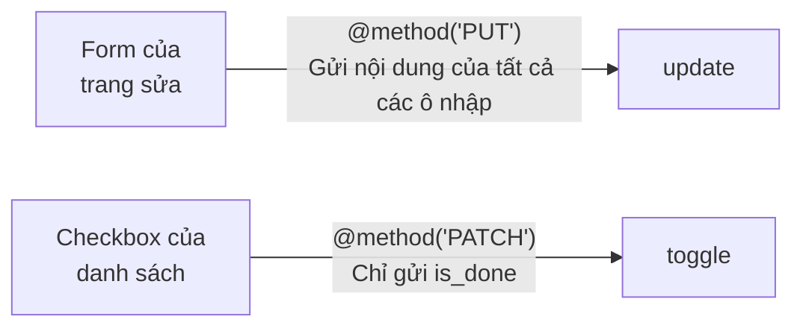
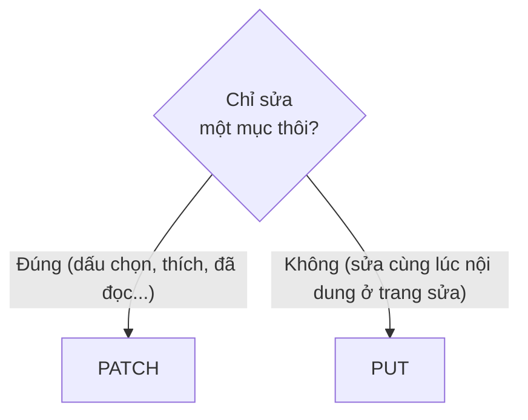
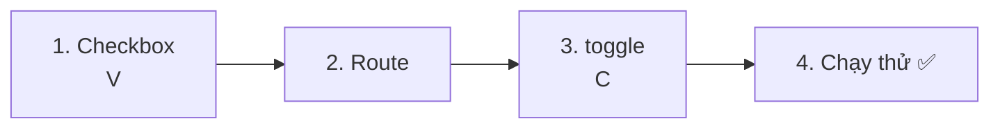
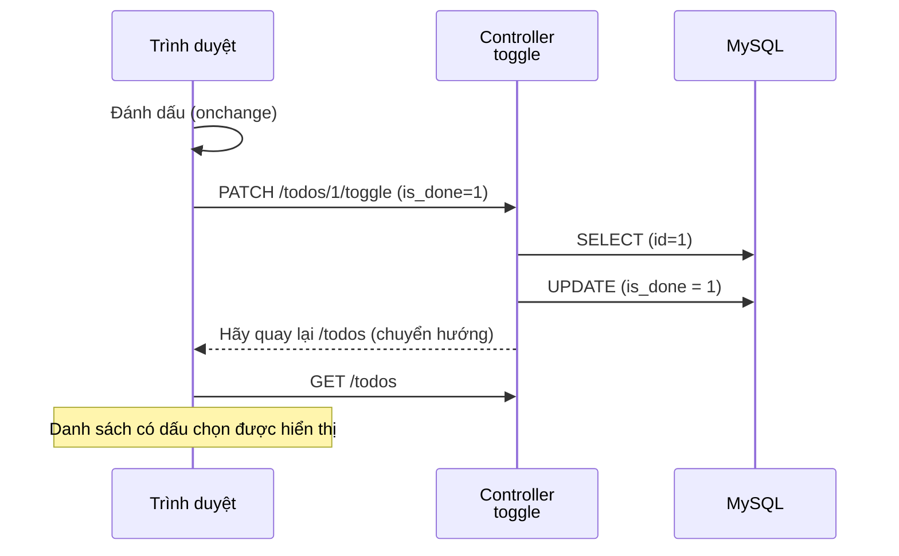
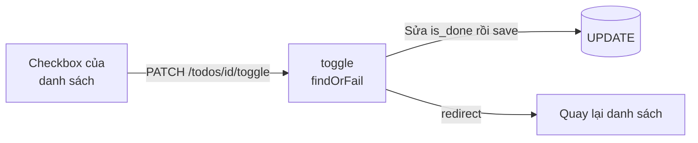

# Nhập môn Laravel — Chuyển đổi đã xong / chưa xong (PATCH)

> 🇯🇵 Bản gốc (tiếng Nhật): [20261029_資料_2.md](<../../../1年生_データ設計とアプリ開発/後期/20261029/20261029_資料_2.md>) <!-- original-ja-link -->

Ở [Tài liệu 1](./20261029_資料_1.md), chúng ta đã có thể sửa tiêu đề của Todo. Tiếp theo, chúng ta sẽ làm **chức năng chuyển đổi đã xong / chưa xong** bằng checkbox ở danh sách.

## Mục tiêu hôm nay
- Hiểu sự khác nhau giữa PUT và PATCH
- Dùng PATCH và `@method('PATCH')` để gửi được yêu cầu chỉ sửa một phần
- Chuyển đổi được đã xong / chưa xong bằng checkbox

> Chúng ta bắt đầu từ trạng thái đã làm xong phần "Sửa Todo" ở Tài liệu 1.

---

## 1. Chuyển đổi đã xong / chưa xong là gì

Ở Tài liệu 1, chúng ta đã có thể đổi trạng thái (`is_done`) từ trang sửa.
Nhưng checkbox ở danh sách thì dù có bấm vào cũng **không được lưu vào cơ sở dữ liệu** (tải lại trang là trở về như cũ).
Ở đây, chúng ta sẽ làm cho checkbox ở danh sách **vừa bấm là chuyển đổi ngay "đã xong ⇄ chưa xong"**.
Không cần phải mở trang sửa mỗi lần, bạn có thể chuyển đổi ngay tại chỗ từ danh sách.

```
TODOアプリ

☐ 牛乳を買う         ← Đánh dấu thì thành "đã xong"
☑ レポートを出す     ← Bỏ đánh dấu thì trở về "chưa xong"
```

Bên trong, đây cũng là **UPDATE** giống `update` đã làm ở Tài liệu 1. Chỉ khác là thứ được sửa không phải `title` mà là `is_done`.

| URL | Loại | Phụ trách | Làm gì |
|-----|------|------|---------|
| `/todos/1/toggle` | **PATCH** | `toggle` | Sửa `is_done` |

`toggle` có nghĩa là "chuyển đổi bật / tắt".

---

## 2. Kiến thức mới: PATCH

Khi sửa dữ liệu, ngoài **PUT** còn có loại **PATCH**.
Cả hai đều là "sửa lại", nhưng khác nhau ở chỗ **sửa nhiều hay ít**.

| Loại | Ý nghĩa | Ví dụ so sánh |
|------|------|-----------|
| PUT | Sửa lại **toàn bộ** dữ liệu | Viết lại giấy tờ mới và **thay thế toàn bộ** |
| **PATCH** | Chỉ sửa **một phần** dữ liệu | Dán băng xóa lên **một chỗ duy nhất** trên giấy tờ |

Trong tiếng Anh, `patch` có nghĩa là "miếng vá (đắp một miếng vải lên chỗ thủng của quần áo để sửa)".

### So sánh bằng thẻ địa chỉ

Ví dụ, giả sử có một "thẻ địa chỉ" như thế này.

```
Tên: 山田 花子
Địa chỉ: 東京都〇〇区…
Điện thoại: 090-xxxx-xxxx
```

Sau khi chuyển nhà, **chỉ có địa chỉ** thay đổi.

```
[PUT] Viết một thẻ mới và thay thế toàn bộ

  ┌───────────────────────────────┐
  │ Tên: 山田 花子                │ ← Không đổi nhưng vẫn viết
  │ Địa chỉ: 大阪府… (mới)        │ ← Chỗ đã thay đổi
  │ Điện thoại: 090-xxxx-xxxx     │ ← Không đổi nhưng vẫn viết
  └───────────────────────────────┘

[PATCH] Chỉ dán băng xóa vào phần địa chỉ trên thẻ hiện tại

  ┌───────────────────────────────┐
  │ Địa chỉ: 大阪府… (mới)        │ ← Chỉ chỗ đã thay đổi
  └───────────────────────────────┘
```

| | PUT | PATCH |
|---|---|---|
| Gửi gì | **Toàn bộ tên, địa chỉ, điện thoại** (viết cả tên và điện thoại dù không đổi) | **Chỉ địa chỉ** |
| Mục không viết thì sao? | Có nghĩa là "để trống" | Có nghĩa là "giữ nguyên" |

Với PUT, ta gửi **toàn bộ** thông tin với ý "đây là thẻ mới", nên mục nào quên viết sẽ bị để trống.
Với PATCH, ta gửi thông tin với ý "chỉ sửa chỗ này thôi", nên mục nào không viết vẫn được giữ nguyên.

### Trong ứng dụng Todo

Áp dụng vào ứng dụng Todo thì sẽ như sau.

| | Sửa (`update`) | Chuyển đổi đã xong / chưa xong (`toggle`) |
|---|---|---|
| Thao tác gì? | Ở trang sửa, **viết lại nội dung Todo** rồi lưu | Ở danh sách, **chỉ chuyển đổi dấu chọn** |
| Gửi gì | **Toàn bộ** các ô nhập ở trang sửa (`title` và `is_done`) | **Chỉ `is_done`** |
| Loại | **PUT** | **PATCH** |
| Cách viết | `@method('PUT')` / `Route::put(...)` | `@method('PATCH')` / `Route::patch(...)` |



> **Trang sửa cũng đổi được trạng thái, vậy tại sao phải làm toggle?**
> Trang sửa là "màn hình viết lại **cùng lúc** cả tiêu đề và trạng thái" (PUT).
> Checkbox ở danh sách là để "đổi nhanh **chỉ trạng thái** ngay tại chỗ" (PATCH).
> Cả hai đều đổi `is_done`, nhưng vì **thứ được gửi đi (toàn bộ hay một phần) khác nhau**, nên chúng ta tách thành xử lý khác và loại khác.
> "Gửi lại cùng lúc các mục trên màn hình" là PUT, còn "đổi đúng một mục duy nhất" là PATCH.

### Khi phân vân



Với các ứng dụng quen thuộc quanh ta, cách phân biệt sẽ như thế này.

| Thao tác | Loại | Lý do |
|------|------|------|
| Bấm "Lưu" ở trang sửa hồ sơ cá nhân | PUT | Gửi lại cùng lúc tên, phần giới thiệu bản thân, v.v. |
| Nhấn "Thích" một bài đăng | PATCH | Chỉ đổi một chỗ là "Thích" |
| Đánh dấu tin nhắn là "đã đọc" | PATCH | Chỉ đổi một chỗ là "đã đọc hay chưa" |
| Đánh dấu một Todo | PATCH | Chỉ đổi một chỗ là `is_done` |

### Dùng PUT hay PATCH thì đều chạy được?

Trong Laravel, dù dùng loại nào thì cũng có thể lưu như nhau bằng `save()`. **Cách chương trình chạy không thay đổi**.
(Ví dụ thẻ địa chỉ nói về "**ý nghĩa** của PUT và PATCH". Trong Laravel, những mục không gửi bằng PUT sẽ không tự động bị để trống.)
Dù vậy, chúng ta vẫn phân biệt để chỉ cần nhìn route là **biết ngay "xử lý này làm gì"**.

```php
Route::put('/todos/{id}', ...);           // "À, viết lại toàn bộ Todo"
Route::patch('/todos/{id}/toggle', ...);  // "À, đổi một phần của Todo"
```

> Trong phát triển thực tế, cũng có nhóm dùng PATCH cho cả trang sửa. Điều quan trọng là **thống nhất quy tắc trong nhóm**.
> Trong môn học này, chúng ta thống nhất: "trang sửa dùng PUT, khi chỉ đổi một mục thì dùng PATCH".

Form HTML cũng không gửi được PATCH, nên giống như PUT, chúng ta dùng `@method('PATCH')`.

> **Ở todo.php của học kỳ trước cũng đã làm rồi**
> Ở học kỳ trước, chúng ta gửi `action=toggle` và quyết định đã xong / chưa xong bằng `isset($_POST['is_done']) ? 1 : 0`.
> Trong Laravel, chúng ta cũng làm theo cùng cách nghĩ đó.

---

## 3. Cùng làm thử



Có 3 file cần chỉnh sửa như sau (bên trong `src`).

```
src/
├─ resources/views/todos/
│   └─ index.blade.php ················ 1. Bọc checkbox bằng form
├─ routes/
│   └─ web.php ························ 2. Viết thêm route
└─ app/Http/Controllers/
    └─ TodoController.php ············· 3. Viết thêm phương thức toggle
```

---

### 1. Cho phép lưu bằng checkbox ở danh sách (V)

> Bạn đang ở đây: **🟢 1. Checkbox** → 2. Route → 3. toggle → 4. Chạy thử

Sửa phần bên trong `<li>` của `resources/views/todos/index.blade.php` như sau.
**Bọc checkbox hiện có bằng một form**, rồi thêm `name`, `value`, `onchange`.

```html
    <ul>
        @foreach ($todos as $todo)
            <li>
                {{-- ★ Sửa từ đây --}}
                <form method="POST" action="/todos/{{ $todo->id }}/toggle" style="display: inline;">
                    @csrf
                    @method('PATCH')
                    <input type="checkbox" name="is_done" value="1" onchange="this.form.submit()" @checked($todo->is_done)>
                </form>
                {{-- ★ Đến đây --}}
                <a href="/todos/{{ $todo->id }}">{{ $todo->title }}</a>
            </li>
        @endforeach
    </ul>
```

| | Từ 10/15 (bấm vào không được lưu) | Từ hôm nay (bấm vào là được lưu) |
|---|---|---|
| Form | Không có | Bọc bằng `<form ...>` |
| `name="is_done" value="1"` | Không có | Có |
| `onchange` | Không có | Có |
| `@checked(...)` | Có | Có (giữ nguyên) |

| Code | Ý nghĩa |
|--------|------|
| `action="/todos/{{ $todo->id }}/toggle"` | Gửi đến URL có kèm `id` của Todo đó, như `/todos/1/toggle` |
| `@method('PATCH')` | Báo cho Laravel biết "thực ra đây là PATCH" (vì chỉ sửa một phần) |
| `name="is_done" value="1"` | **Chỉ khi có đánh dấu** thì `is_done=1` mới được gửi đi |
| `onchange="this.form.submit()"` | Gửi form ngay khoảnh khắc dấu chọn thay đổi (không cần nút gửi) |
| `@checked($todo->is_done)` | Nếu Todo đã xong thì đánh dấu sẵn ngay từ đầu (giống ngày 10/15) |
| `style="display: inline;"` | Không xuống dòng sau form, để xếp ngang hàng với tiêu đề |

> **Cơ chế quan trọng của checkbox (ôn lại Tài liệu 1)**
> Checkbox **chỉ gửi `is_done=1` khi có đánh dấu**. Khi bỏ đánh dấu, bản thân `is_done` sẽ không được gửi đi.
> Vì vậy, giống như `update` ở Tài liệu 1, ở controller chúng ta quyết định đã xong hay chưa xong dựa vào việc "`is_done` **có được gửi đến hay không**".

---

### 2. Viết route

> Bạn đang ở đây: 1. Checkbox → **🟢 2. Route** → 3. toggle → 4. Chạy thử

Viết thêm 1 dòng có dấu ★ vào `routes/web.php`.

```php
Route::get('/todos', [TodoController::class, 'index']);
Route::post('/todos', [TodoController::class, 'store']);
Route::get('/todos/{id}', [TodoController::class, 'show']);
Route::get('/todos/{id}/edit', [TodoController::class, 'edit']);
Route::put('/todos/{id}', [TodoController::class, 'update']);
Route::patch('/todos/{id}/toggle', [TodoController::class, 'toggle']);  // ★ Thêm vào
```

`/todos/{id}` (sửa tiêu đề) và `/todos/{id}/toggle` (chuyển đổi đã xong / chưa xong) có URL khác nhau nên do các phương thức khác nhau phụ trách.

---

### 3. Viết phương thức toggle (C)

> Bạn đang ở đây: 1. Checkbox → 2. Route → **🟢 3. toggle** → 4. Chạy thử

Viết thêm phương thức `toggle` có dấu ★ vào `TodoController.php`.

```php
    // ★ Thêm từ đây
    public function toggle(Request $request, $id)
    {
        // ① Dùng id để lấy ra một Todo muốn chuyển đổi
        $todo = Todo::findOrFail($id);

        // ② Nếu is_done được gửi đến thì là đã xong (true), nếu không thì là chưa xong (false)
        $todo->is_done = $request->has('is_done');

        // ③ Lưu vào cơ sở dữ liệu
        $todo->save();

        // ④ Quay lại trang danh sách
        return redirect('/todos');
    }
    // ★ Đến đây
```

| Code | Ý nghĩa |
|--------|------|
| `$request->has('is_done')` | Nếu `is_done` được gửi đến thì là `true`, nếu không thì là `false`. Giống `isset($_POST['is_done'])` ở học kỳ trước |

Hãy so sánh với `update`.

| | `update` (trang sửa) | `toggle` (checkbox ở danh sách) |
|---|---|---|
| ① | `Todo::findOrFail($id)` | `Todo::findOrFail($id)` |
| ② | Sửa `title` và `is_done` | **Chỉ sửa `is_done`** |
| ③ | `save()` → `UPDATE` | `save()` → `UPDATE` |
| ④ | Quay lại trang chi tiết | Quay lại trang danh sách |

Hãy so sánh với `todo.php` của học kỳ trước.

```php
// Học kỳ trước
$id = (int)($_POST['id'] ?? 0);
$isDone = isset($_POST['is_done']) ? 1 : 0;
$stmt = $pdo->prepare("UPDATE todos SET is_done = :is_done WHERE id = :id");
$stmt->execute(['is_done' => $isDone, 'id' => $id]);
header('Location: index.php');
exit;

// Laravel
$todo = Todo::findOrFail($id);
$todo->is_done = $request->has('is_done');
$todo->save();
return redirect('/todos');
```

---

### 4. Chạy thử ✅

> Bạn đang ở đây: 1. Checkbox → 2. Route → 3. toggle → **🟢 4. Chạy thử**

1. Mở http://localhost:8000/todos
2. Đánh dấu vào checkbox của "牛乳を買う"
3. Nếu trang được tải lại và dấu chọn vẫn còn nguyên là thành công
4. Hãy bỏ dấu chọn một lần nữa và kiểm tra xem checkbox có tiếp tục ở trạng thái không được chọn hay không



✅ **Kiểm tra 1**: Hãy mở trang chi tiết của Todo đã đánh dấu và xác nhận nó đã thành "完了 ✅" chưa.

✅ **Kiểm tra 2**: Hãy mở bảng `todos` bằng phpMyAdmin và xác nhận `is_done` đã đổi thành `1` (đã xong) / `0` (chưa xong) chưa.

---

## 4. Khi không chạy được

> **🔥 Không chạy được thì hãy in log ra!**
> Khi không biết nguyên nhân lỗi, hãy dùng `Log::info()` bên trong `toggle` để kiểm tra xem `is_done` có được gửi đến không → [[Quan trọng] Cách in log](../20261022/【重要】ログの出し方.md)

| Triệu chứng | Nơi gây lỗi | Cách xử lý |
|------|----------|------|
| Đánh dấu mà không có gì xảy ra | View | Kiểm tra xem `<input>` có `onchange="this.form.submit()"` không |
| Đánh dấu thì ra `404 Not Found` | Route | Kiểm tra xem đã viết `Route::patch('/todos/{id}/toggle', ...)` trong `routes/web.php` chưa |
| Đánh dấu thì ra `The POST method is not supported for route todos/1/toggle.` | View | Kiểm tra xem form của checkbox có `@method('PATCH')` không |
| Đánh dấu thì ra `The PATCH method is not supported for route todos/1/toggle.` | Route | Kiểm tra xem `routes/web.php` có bị viết thành `Route::put(...)` không (sửa thành `Route::patch(...)`) |
| Đánh dấu rồi nhưng dấu chọn lại bị bỏ | View, Controller | Kiểm tra xem `name="is_done"` và `$request->has('is_done')` có viết giống nhau không |
| Todo đã xong nhưng không có dấu chọn | View | Kiểm tra xem `<input>` có `@checked($todo->is_done)` không |

---

## 5. Tổng kết



| Những gì đã viết hôm nay | Nói ngắn gọn |
|--------------|-----------|
| PATCH và `@method('PATCH')` | Dùng khi chỉ sửa một phần (sửa toàn bộ thì dùng PUT) |
| `onchange="this.form.submit()"` | Gửi form ngay khoảnh khắc dấu chọn thay đổi |
| `name="is_done" value="1"` | Chỉ khi có đánh dấu thì `is_done=1` mới được gửi đi |
| `Route::patch('/todos/{id}/toggle', ...)` | Khi được gửi bằng PATCH thì `toggle` phụ trách |
| `$request->has('is_done')` | Quyết định đã xong / chưa xong dựa vào việc `is_done` có được gửi đến hay không |

---

Tiếp theo, chúng ta sẽ làm chức năng xóa Todo → [Xóa Todo (DELETE)](./20261029_資料_3.md)

<!-- nav:start -->

---

| ⬅️ Trước | 🗺️ Sơ đồ tổng thể | Tiếp ➡️ |
|:--|:--:|--:|
| [10/29 Sửa Todo (UPDATE)](20261029_資料_1.md) | [Sơ đồ tổng thể tài liệu](../../README.md) | [10/29 Xóa Todo (DELETE)](20261029_資料_3.md) |

<!-- nav:end -->
