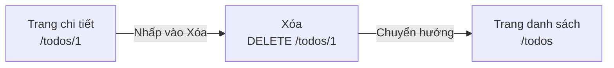
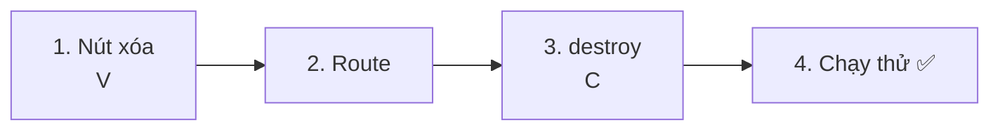
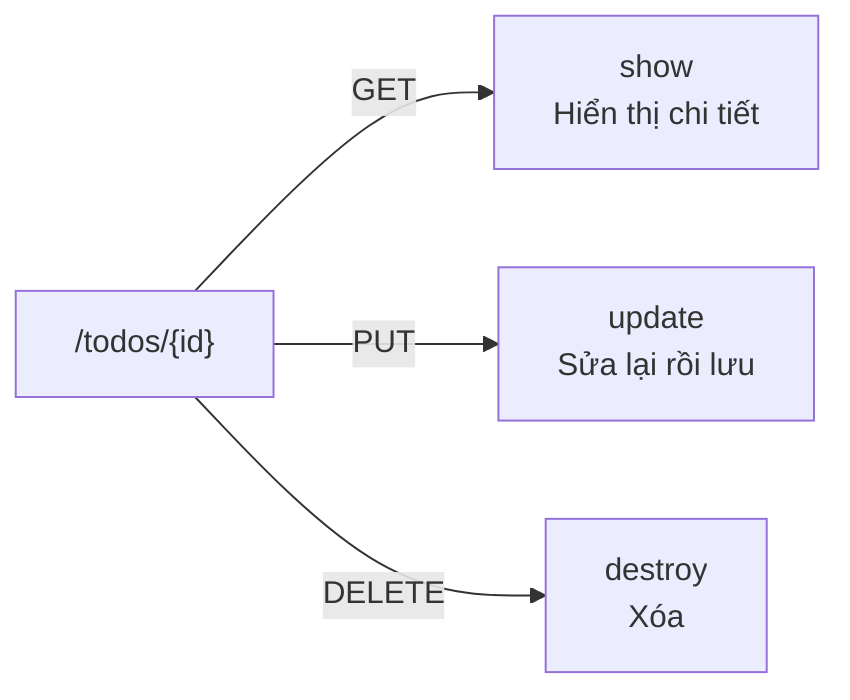
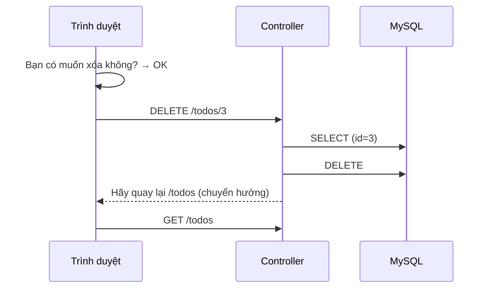
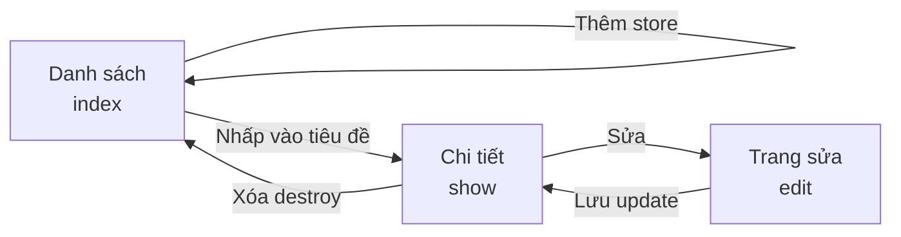

# Nhập môn Laravel — Xóa Todo (DELETE)

> 🇯🇵 Bản gốc (tiếng Nhật): [20261029_資料_3.md](<../../../1年生_データ設計とアプリ開発/後期/20261029/20261029_資料_3.md>) <!-- original-ja-link -->

Ở [Tài liệu 1](./20261029_資料_1.md) và [Tài liệu 2](./20261029_資料_2.md), chúng ta đã có thể sửa Todo. Tiếp theo, chúng ta sẽ làm **chức năng xóa (loại bỏ) Todo**.

## Mục tiêu hôm nay
- Dùng DELETE và `@method('DELETE')` để gửi được yêu cầu xóa
- Xóa được Todo khỏi cơ sở dữ liệu bằng `delete()`
- Hiểu được tổng thể của thêm, hiển thị, sửa, xóa (CRUD)

> Chúng ta bắt đầu từ trạng thái đã làm xong phần "Chuyển đổi đã xong / chưa xong" ở Tài liệu 2.

---

## 1. Cơ chế xóa

Khác với chức năng sửa, chức năng xóa **không cần mở trang nào, chỉ cần bấm 1 nút là xong**.



| URL | Loại | Phụ trách | Làm gì |
|-----|------|------|---------|
| `/todos/1` | **DELETE** | `destroy` | Xóa Todo |

### DELETE và `@method('DELETE')`

Khi "xóa dữ liệu", quy ước của Laravel là dùng loại có tên **DELETE**.
Giống như PUT, form HTML không gửi được DELETE, nên chúng ta dùng `@method('DELETE')`.

| Loại | Khi nào dùng | Cách viết |
|------|---------|--------|
| PUT | Sửa lại | `@method('PUT')` trong form |
| PATCH | Chỉ sửa một phần | `@method('PATCH')` trong form |
| **DELETE** | Xóa | `@method('DELETE')` trong form |

> **Tại sao lại dùng nút trong form mà không dùng liên kết (`<a>`)?**
> Liên kết được mở bằng GET. GET theo quy ước là "chỉ để xem", nên không dùng cho xử lý xóa dữ liệu.
> Nếu có thể xóa bằng liên kết thì chỉ cần mở URL là Todo đã bị xóa mất.
> Hãy nhớ rằng khi thay đổi dữ liệu (thêm, sửa, xóa), chúng ta **gửi yêu cầu bằng nút trong form**.

---

## 2. Cùng làm thử



Có 3 file cần chỉnh sửa như sau (bên trong `src`).

```
src/
├─ resources/views/todos/
│   └─ show.blade.php ················· 1. Viết thêm nút xóa
├─ routes/
│   └─ web.php ························ 2. Viết thêm route
└─ app/Http/Controllers/
    └─ TodoController.php ············· 3. Viết thêm phương thức destroy
```

---

### 1. Gắn nút "Xóa" vào trang chi tiết (V)

> Bạn đang ở đây: **🟢 1. Nút xóa** → 2. Route → 3. destroy → 4. Chạy thử

Viết thêm form có dấu ★ vào `resources/views/todos/show.blade.php`.

```html
    <a href="/todos/{{ $todo->id }}/edit">編集</a>

    {{-- ★ Thêm từ đây --}}
    <form method="POST" action="/todos/{{ $todo->id }}" onsubmit="return confirm('削除しますか？');">
        @csrf
        @method('DELETE')
        <button type="submit">削除</button>
    </form>
    {{-- ★ Đến đây --}}

    <a href="/todos">一覧にもどる</a>
```

| Code | Ý nghĩa |
|--------|------|
| `action="/todos/{{ $todo->id }}"` | Gửi đến URL có kèm `id` của Todo muốn xóa, như `/todos/1` |
| `@method('DELETE')` | Báo cho Laravel biết "thực ra đây là DELETE" |
| `onsubmit="return confirm('削除しますか？');"` | Hiện hộp thoại xác nhận trước khi gửi. Nếu chọn "Cancel" (Hủy) thì không gửi |

Không có ô nhập nào. Vì **chỉ cần `id` trong URL là biết được cần xóa Todo nào**.

> **Ở todo.php của học kỳ trước cũng đã làm rồi**
> Việc xác nhận bằng `confirm()` rồi mới xóa cũng giống như `todo.php` của học kỳ trước.
> Vì đã xóa thì không khôi phục lại được, nên hiện hộp thoại xác nhận sẽ an toàn hơn.

---

### 2. Viết route

> Bạn đang ở đây: 1. Nút xóa → **🟢 2. Route** → 3. destroy → 4. Chạy thử

Viết thêm 1 dòng có dấu ★ vào `routes/web.php`.

```php
Route::get('/todos', [TodoController::class, 'index']);
Route::post('/todos', [TodoController::class, 'store']);
Route::get('/todos/{id}', [TodoController::class, 'show']);
Route::get('/todos/{id}/edit', [TodoController::class, 'edit']);
Route::put('/todos/{id}', [TodoController::class, 'update']);
Route::patch('/todos/{id}/toggle', [TodoController::class, 'toggle']);
Route::delete('/todos/{id}', [TodoController::class, 'destroy']);  // ★ Thêm vào
```

`destroy` có nghĩa là "phá hủy, xóa bỏ". Trong Laravel, người ta thường đặt tên `destroy` cho phương thức xóa.

Như vậy, với `/todos/{id}`, **nếu là GET thì `show`, nếu là PUT thì `update`, nếu là DELETE thì `destroy`** phụ trách.

Dù cùng một URL, phương thức phụ trách sẽ khác nhau tùy theo cách gửi (loại).



---

### 3. Viết phương thức destroy (C)

> Bạn đang ở đây: 1. Nút xóa → 2. Route → **🟢 3. destroy** → 4. Chạy thử

Viết thêm phương thức `destroy` có dấu ★ vào `TodoController.php`.

```php
    // ★ Thêm từ đây
    public function destroy($id)
    {
        // ① Dùng id để lấy ra một Todo muốn xóa
        $todo = Todo::findOrFail($id);

        // ② Xóa khỏi cơ sở dữ liệu
        $todo->delete();

        // ③ Quay lại trang danh sách
        return redirect('/todos');
    }
    // ★ Đến đây
```

| Code | Ý nghĩa |
|--------|------|
| `$todo->delete()` | Xóa khỏi cơ sở dữ liệu. Giống như `DELETE FROM todos WHERE id = ?` |
| `redirect('/todos')` | Quay lại trang danh sách (vì trang chi tiết của Todo đã xóa không còn nữa) |

Hãy so sánh với `todo.php` của học kỳ trước.

```php
// Học kỳ trước
$id = (int)($_POST['id'] ?? 0);
$stmt = $pdo->prepare("DELETE FROM todos WHERE id = :id");
$stmt->execute(['id' => $id]);
header('Location: index.php');
exit;

// Laravel
$todo = Todo::findOrFail($id);
$todo->delete();
return redirect('/todos');
```

---

### 4. Chạy thử ✅

> Bạn đang ở đây: 1. Nút xóa → 2. Route → 3. destroy → **🟢 4. Chạy thử**

1. Mở http://localhost:8000/todos
2. Nhấp vào một Todo có thể xóa được (ví dụ "宿題をする") để mở trang chi tiết
3. Bấm "削除" (Xóa)
4. Khi hiện "削除しますか？" (Bạn có muốn xóa không?) thì bấm `OK`
5. Nếu quay lại trang danh sách và Todo đó đã biến mất là thành công



✅ **Kiểm tra 1**: Hãy mở bảng `todos` bằng phpMyAdmin và xác nhận dòng của Todo đã xóa không còn nữa.

✅ **Kiểm tra 2**: Hãy mở trực tiếp URL trang chi tiết của Todo đã xóa (ví dụ http://localhost:8000/todos/3 ).
Vì Todo đó không còn nữa, `404 Not Found` sẽ hiện ra. `findOrFail` đang hoạt động.

✅ **Kiểm tra 3**: Hãy bấm "削除" (Xóa), rồi bấm `キャンセル` (Hủy) ở hộp thoại xác nhận, và kiểm tra rằng không có gì bị xóa.

---

## 3. Khi không chạy được

> **🔥 Không chạy được thì hãy in log ra!**
> Khi không biết nguyên nhân lỗi, hãy dùng `Log::info()` bên trong `destroy` để kiểm tra giá trị của `$id` → [[Quan trọng] Cách in log](../20261022/【重要】ログの出し方.md)

| Triệu chứng | Nơi gây lỗi | Cách xử lý |
|------|----------|------|
| Bấm "削除" (Xóa) thì ra `The POST method is not supported for route todos/1.` | View | Kiểm tra xem form xóa có `@method('DELETE')` không |
| Bấm "削除" (Xóa) thì ra `The DELETE method is not supported for route todos/1.` | Route | Kiểm tra xem đã viết `Route::delete('/todos/{id}', ...)` trong `routes/web.php` chưa |
| `Call to undefined method App\Http\Controllers\TodoController::destroy()` | Controller | Kiểm tra xem đã viết phương thức `destroy` trong `TodoController.php` chưa, và tên có viết đúng chính tả không |
| Đã xóa nhưng vẫn còn trong danh sách | Controller | Kiểm tra xem trong `destroy` có `$todo->delete();` không |
| Hộp thoại xác nhận không hiện ra | View | Kiểm tra xem `<form>` có `onsubmit="return confirm('削除しますか？');"` không |

---

## 4. Đã đủ CRUD!

Như vậy, chúng ta đã làm được tất cả **thêm, hiển thị, sửa, xóa** Todo.
4 thao tác này được gọi chung là **CRUD**. Hầu hết các ứng dụng web đều được tạo nên từ sự kết hợp của các thao tác CRUD.

| | Ý nghĩa | SQL | Ứng dụng Todo lần này | Buổi đã làm |
|---|---|---|---|---|
| **C**reate | Thêm | `INSERT` | `store` | 10/22 |
| **R**ead | Hiển thị | `SELECT` | `index`, `show` | 10/15, 10/22 |
| **U**pdate | Sửa | `UPDATE` | `edit`, `update`, `toggle` | Hôm nay |
| **D**elete | Xóa | `DELETE` | `destroy` | Hôm nay |

Tổng cộng chúng ta đã có 7 route.

| Route | Phụ trách | Làm gì |
|--------|------|---------|
| `GET /todos` | `index` | Hiển thị danh sách |
| `POST /todos` | `store` | Thêm mới |
| `GET /todos/{id}` | `show` | Hiển thị chi tiết một Todo |
| `GET /todos/{id}/edit` | `edit` | Hiển thị trang sửa |
| `PUT /todos/{id}` | `update` | Sửa lại rồi lưu |
| `PATCH /todos/{id}/toggle` | `toggle` | Chuyển đổi đã xong / chưa xong |
| `DELETE /todos/{id}` | `destroy` | Xóa |



<!-- nav:start -->

---

| ⬅️ Trước | 🗺️ Sơ đồ tổng thể | Tiếp ➡️ |
|:--|:--:|--:|
| [10/29 Chuyển đổi trạng thái đã xong (PATCH)](20261029_資料_2.md) | [Sơ đồ tổng thể tài liệu](../../README.md) | [11/05 Seeder, Factory](../20261105/20261105_資料_1.md) |

<!-- nav:end -->
