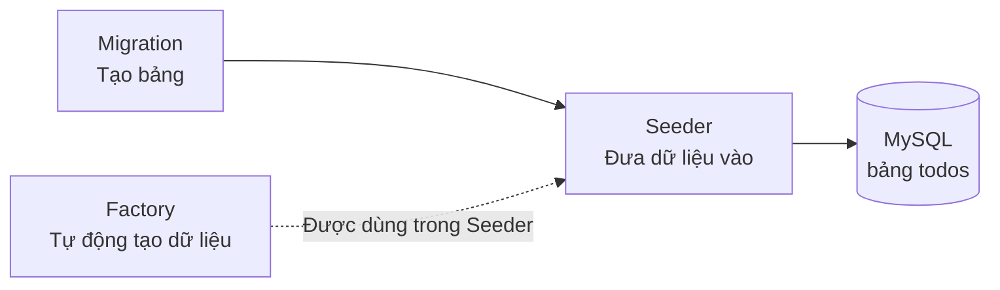
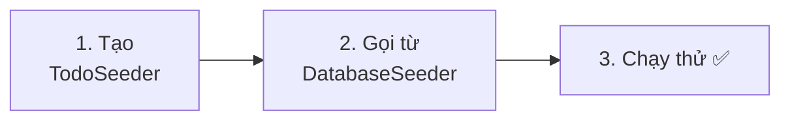
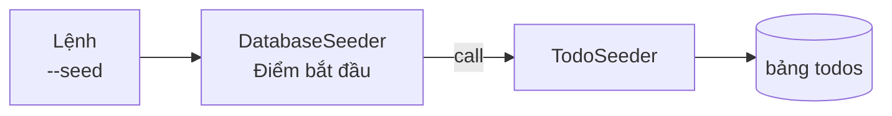
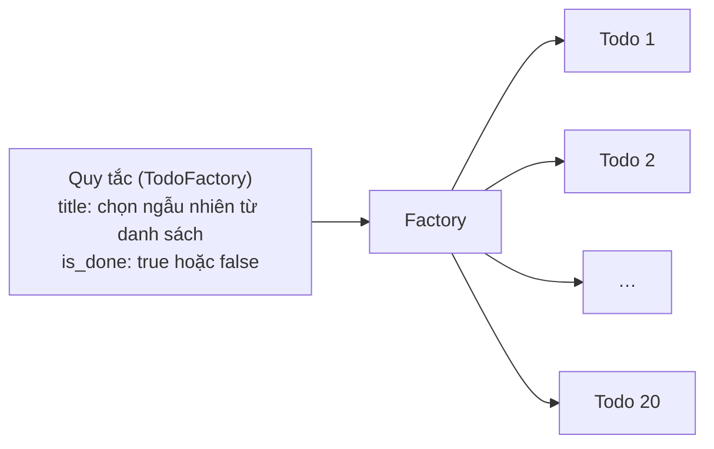
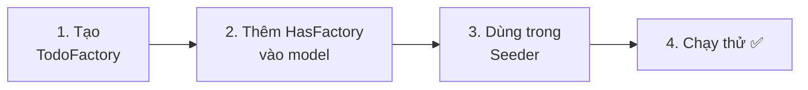
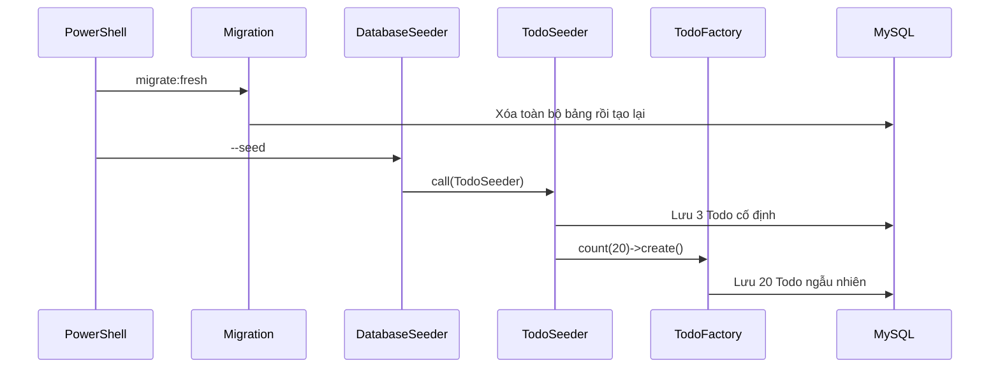
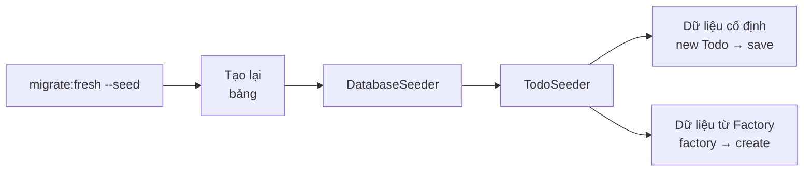

# Nhập môn Laravel — Cùng đưa dữ liệu thử nghiệm vào (Seeder・Factory)

> 🇯🇵 Bản gốc (tiếng Nhật): [20261105_資料_1.md](<../../../1年生_データ設計とアプリ開発/後期/20261105/20261105_資料_1.md>) <!-- original-ja-link -->

Từ trước đến nay, dữ liệu Todo được nhập tay từng dòng bằng phpMyAdmin, hoặc được thêm từ form.
Hôm nay, chúng ta sẽ học **cách đưa dữ liệu thử nghiệm vào chỉ bằng 1 lệnh**.

## Mục tiêu hôm nay
- Dùng Seeder (seeder) để đưa vào dữ liệu thử nghiệm cố định
- Dùng Factory (factory) để tự động tạo ra thật nhiều dữ liệu thử nghiệm
- Dùng `migrate:fresh --seed` để đưa cơ sở dữ liệu về trạng thái ban đầu bất cứ lúc nào

> Hãy khởi động mysql và laravel của môi trường luyện tập (`php-study`) trước khi bắt đầu.
> Các lệnh được chạy sau khi di chuyển đến **thư mục laravel** trong PowerShell.

---

## 1. Vì sao cần cơ chế đưa dữ liệu thử nghiệm vào?

Các bạn đã từng gặp những chuyện như thế này chưa?

```
Bạn A: "Luyện tập xóa xong thì Todo mất hết rồi. Lại phải nhập tay nữa à…?"
Bạn B: "Mình muốn xem giao diện trang danh sách, mà chỉ có 3 Todo thôi"
Bạn C: "Dữ liệu trong máy mình khác với máy của bạn mình"
```

Nếu chuẩn bị sẵn cách **đưa dữ liệu thử nghiệm vào bằng chương trình**, mọi chuyện sẽ như sau.

| | Nhập tay bằng phpMyAdmin | Đưa vào bằng chương trình |
|---|---|---|
| Công sức đưa vào | Nhập từng dòng | Chỉ 1 lệnh |
| Nếu bị mất | Lại nhập tay | 1 lệnh là khôi phục như cũ |
| Muốn có 100 dòng | Rất vất vả | Chỉ cần đổi con số |
| Trên máy của mọi người | Mỗi người một khác | Dữ liệu giống nhau |

Trong Laravel, việc này được thực hiện bằng **Seeder** và **Factory**.

---

## 2. Seeder và Factory

**Seeder** (seeder) có nghĩa là "người gieo hạt" (seed là hạt giống).
Nó gieo "hạt giống" là dữ liệu ban đầu vào một bảng còn trống.

| Tên | Vai trò | Ví như |
|------|------|-----------|
| **Migration** | Tạo bảng (đã học ngày 10/15) | Làm ruộng |
| **Seeder** | Đưa dữ liệu vào bảng | Gieo hạt |
| **Factory** | Tự động tạo thật nhiều dữ liệu | Máy làm ra hàng loạt hạt giống |



Hôm nay, chúng ta sẽ làm theo thứ tự 2 bước sau.

1. Dùng **Seeder** để đưa vào 3 Todo cố định
2. Dùng **Factory** để tự động tạo 20 Todo rồi đưa vào

Vị trí các file nằm ở đây, bên trong `src`.

```
src/
└─ database/
    ├─ migrations/ ··········· bản thiết kế bảng (đã làm ngày 10/15)
    ├─ seeders/
    │   ├─ DatabaseSeeder.php ··· có sẵn từ đầu. Chạy tất cả Seeder từ đây
    │   └─ TodoSeeder.php ······· làm hôm nay
    └─ factories/
        └─ TodoFactory.php ······ làm hôm nay
```

---

## 3. Dùng Seeder để đưa dữ liệu cố định vào



### 1. Tạo TodoSeeder

> Bạn đang ở đây: **🟢 1. TodoSeeder** → 2. DatabaseSeeder → 3. Chạy thử

Tạo file Seeder bằng lệnh sau.

```powershell
docker compose exec laravel php artisan make:seeder TodoSeeder
```

File `database/seeders/TodoSeeder.php` sẽ được tạo ra, hãy sửa nội dung bên trong như sau.

```php
<?php

namespace Database\Seeders;

use App\Models\Todo;  // ← 1 dòng để dùng model Todo
use Illuminate\Database\Seeder;

class TodoSeeder extends Seeder
{
    public function run(): void
    {
        // Chuẩn bị dữ liệu muốn đưa vào dưới dạng mảng
        $todos = [
            ['title' => '牛乳を買う',     'is_done' => false],
            ['title' => 'レポートを出す', 'is_done' => true],
            ['title' => '宿題をする',     'is_done' => false],
        ];

        // Tạo và lưu từng Todo một
        foreach ($todos as $data) {
            $todo = new Todo();
            $todo->title = $data['title'];
            $todo->is_done = $data['is_done'];
            $todo->save();
        }
    }
}
```

| Code | Ý nghĩa |
|--------|------|
| `run()` | Method được thực thi khi chạy Seeder |
| `$todos = [ ... ]` | Mảng chứa dữ liệu muốn đưa vào (mảng kết hợp đã học ở học kỳ trước) |
| `foreach` | Lấy ra từng phần tử của mảng và lặp lại |
| `new Todo()` 〜 `save()` | Lưu 1 Todo theo cùng cách viết với `store` ngày 10/22 |

Ở `store`, chúng ta đưa vào giá trị nhận từ form, còn trong Seeder thì đưa vào **giá trị của mảng**. Khác nhau chỉ có vậy thôi.

---

### 2. Gọi từ DatabaseSeeder

> Bạn đang ở đây: 1. TodoSeeder → **🟢 2. DatabaseSeeder** → 3. Chạy thử

`database/seeders/DatabaseSeeder.php` là **điểm bắt đầu chạy các Seeder**.
Khi gõ lệnh chạy Seeder, file này sẽ chạy đầu tiên.

Khi mở ra, bạn sẽ thấy có sẵn đoạn code "tạo 1 người dùng để thử nghiệm".
Hiện tại chúng ta chưa dùng người dùng, nên hãy sửa nội dung như sau.

```php
<?php

namespace Database\Seeders;

use Illuminate\Database\Seeder;

class DatabaseSeeder extends Seeder
{
    public function run(): void
    {
        // Chạy TodoSeeder
        $this->call(TodoSeeder::class);
    }
}
```

`$this->call(TodoSeeder::class)` có nghĩa là "hãy chạy `TodoSeeder` nhé".
Khi có thêm Seeder, chúng ta sẽ viết thêm `$this->call(...)` vào đây.



---

### 3. Chạy thử ✅

> Bạn đang ở đây: 1. TodoSeeder → 2. DatabaseSeeder → **🟢 3. Chạy thử**

Thực thi lệnh sau.

```powershell
docker compose exec laravel php artisan migrate:fresh --seed
```

| Phần | Ý nghĩa |
|------|------|
| `migrate:fresh` | **Xóa toàn bộ bảng**, rồi tạo lại bằng migration |
| `--seed` | Sau khi tạo lại, đưa dữ liệu vào bằng Seeder |

> ⚠️ **`migrate:fresh` sẽ xóa toàn bộ dữ liệu**
> Các Todo đã nhập bằng phpMyAdmin hay form cũng sẽ bị xóa hết.
> Vì đây là cơ sở dữ liệu luyện tập nên không sao, nhưng **tuyệt đối không dùng trên cơ sở dữ liệu thật (production)**.

✅ **Kiểm tra 1**: Mở http://localhost:8000/todos, nếu thấy 3 Todo hiển thị là OK.

✅ **Kiểm tra 2**: Hãy thử mở bảng `todos` bằng phpMyAdmin.
Vì dữ liệu được đưa vào bằng `save()`, nên `created_at` và `updated_at` cũng có ngày giờ (khi nhập tay thì hai cột này để trống).

✅ **Kiểm tra 3**: Hãy xóa vài Todo, rồi chạy lại `migrate:fresh --seed` thêm một lần nữa.
**Dữ liệu sẽ trở về 3 Todo ban đầu.** Như vậy, bạn có thể làm lại bài luyện tập bất cứ lúc nào.

---

## 4. Dùng Factory để tạo thật nhiều dữ liệu

3 dòng thì có thể viết tay, nhưng đến 20 dòng hay 100 dòng thì rất vất vả.
Với **Factory**, chỉ cần viết 1 quy tắc mô tả dữ liệu muốn tạo, bạn có thể tự động tạo bao nhiêu bản ghi tùy ý.





### 1. Tạo TodoFactory

> Bạn đang ở đây: **🟢 1. TodoFactory** → 2. HasFactory → 3. Dùng trong Seeder → 4. Chạy thử

```powershell
docker compose exec laravel php artisan make:factory TodoFactory
```

File `database/factories/TodoFactory.php` sẽ được tạo ra, hãy sửa phần bên trong `definition()` như sau.

```php
    public function definition(): array
    {
        return [
            'title' => fake()->randomElement([
                '牛乳を買う',
                'レポートを出す',
                '宿題をする',
                '部屋のそうじ',
                '本を返す',
                'ゴミを出す',
            ]),
            'is_done' => fake()->boolean(),
        ];
    }
```

| Code | Ý nghĩa |
|--------|------|
| `definition()` | Nơi viết quy tắc "tạo 1 Todo với những giá trị như thế nào" |
| `fake()` | Công cụ tạo giá trị ngẫu nhiên dùng cho dữ liệu thử nghiệm (Faker) |
| `fake()->randomElement([...])` | Chọn ngẫu nhiên 1 phần tử trong mảng |
| `fake()->boolean()` | Chọn ngẫu nhiên `true` hoặc `false` |

`id`, `created_at`, `updated_at` vẫn được tự động điền như trước nên không cần viết.

---

### 2. Viết HasFactory vào model

> Bạn đang ở đây: 1. TodoFactory → **🟢 2. HasFactory** → 3. Dùng trong Seeder → 4. Chạy thử

Để dùng Factory, model cần có 1 dòng "cho phép dùng Factory".
Hãy mở `app/Models/Todo.php` và viết thêm 2 dòng có dấu ★.

```php
<?php

namespace App\Models;

use Illuminate\Database\Eloquent\Factories\HasFactory;  // ★ Thêm vào
use Illuminate\Database\Eloquent\Model;

class Todo extends Model
{
    use HasFactory;  // ★ Thêm vào
}
```

Như vậy, khi viết `Todo::factory()`, bạn có thể dùng được `TodoFactory`.
(Laravel sẽ tự động tìm `TodoFactory` dựa vào tên model `Todo`)

---

### 3. Dùng Factory trong Seeder

> Bạn đang ở đây: 1. TodoFactory → 2. HasFactory → **🟢 3. Dùng trong Seeder** → 4. Chạy thử

Viết thêm 1 dòng có dấu ★ vào cuối `run()` trong `database/seeders/TodoSeeder.php`.

```php
    public function run(): void
    {
        $todos = [
            ['title' => '牛乳を買う',     'is_done' => false],
            ['title' => 'レポートを出す', 'is_done' => true],
            ['title' => '宿題をする',     'is_done' => false],
        ];

        foreach ($todos as $data) {
            $todo = new Todo();
            $todo->title = $data['title'];
            $todo->is_done = $data['is_done'];
            $todo->save();
        }

        // ★ Dùng Factory để tạo và lưu 20 Todo
        Todo::factory()->count(20)->create();
    }
```

```
Todo::factory() -> count(20) -> create();
~~~~~~~~~~~~~~~    ~~~~~~~~~    ~~~~~~~~
Dùng TodoFactory   20 dòng      tạo và lưu
```

---

### 4. Chạy thử ✅

> Bạn đang ở đây: 1. TodoFactory → 2. HasFactory → 3. Dùng trong Seeder → **🟢 4. Chạy thử**

```powershell
docker compose exec laravel php artisan migrate:fresh --seed
```

✅ **Kiểm tra 1**: Mở http://localhost:8000/todos, nếu thấy **23 Todo** (3 Todo cố định + 20 Todo từ Factory) hiển thị là OK.

✅ **Kiểm tra 2**: Hãy chạy lại `migrate:fresh --seed` thêm một lần nữa.
3 Todo đầu tiên vẫn giống nhau, nhưng 20 Todo được tạo bằng Factory thì **mỗi lần chạy, tiêu đề và trạng thái hoàn thành / chưa hoàn thành sẽ thay đổi**. Đó là vì chúng được tạo ngẫu nhiên.



---

## 5. Tổng hợp các lệnh

| Lệnh | Việc thực hiện |
|---------|---------|
| `php artisan make:seeder TodoSeeder` | Tạo file Seeder |
| `php artisan make:factory TodoFactory` | Tạo file Factory |
| `php artisan migrate:fresh --seed` | Tạo lại toàn bộ bảng, rồi đưa dữ liệu vào bằng Seeder |
| `php artisan db:seed` | Giữ nguyên bảng, **thêm** dữ liệu bằng Seeder |

> **Nếu chỉ gõ `db:seed`, dữ liệu sẽ cứ tăng lên**
> `db:seed` **thêm** dữ liệu mà không xóa dữ liệu hiện có. Gõ 2 lần thì số Todo cũng tăng gấp đôi.
> Khi muốn "trở về trạng thái ban đầu", hãy dùng `migrate:fresh --seed`.

(Lệnh nào cũng được chạy với `docker compose exec laravel` ở phía trước)

---

## 6. Khi không chạy được

> **🔥 Không chạy được thì hãy ghi log!**
> Bên trong Seeder cũng dùng được `Log::info()` → [[Quan trọng] Cách ghi log](../20261022/【重要】ログの出し方.md)

| Triệu chứng | Chỗ gây lỗi | Cách xử lý |
|------|----------|------|
| `Class "Database\Seeders\Todo" not found` | Seeder | Kiểm tra xem phía trên `TodoSeeder.php` có `use App\Models\Todo;` không |
| `Call to undefined method App\Models\Todo::factory()` | Model | Kiểm tra xem đã viết `use HasFactory;` trong `Todo.php` chưa (cũng cần cả `use Illuminate\...\HasFactory;` ở phía trên) |
| `Class "Database\Factories\TodoFactory" not found` | Factory | Kiểm tra xem có `database/factories/TodoFactory.php` không, và kiểm tra tên file và tên class |
| `Duplicate entry 'test@example.com'` | DatabaseSeeder | Đã gõ `db:seed` 2 lần trong khi vẫn còn đoạn code tạo người dùng thử nghiệm. Hãy sửa `DatabaseSeeder.php`, hoặc dùng `migrate:fresh --seed` |
| Số Todo tăng gấp 2, gấp 3 | Lệnh | Đã gõ `db:seed` nhiều lần. Làm lại bằng `migrate:fresh --seed` |
| Chạy rồi mà Todo không được đưa vào | DatabaseSeeder | Kiểm tra xem trong `DatabaseSeeder.php` có `$this->call(TodoSeeder::class);` không |

---

## 7. Tổng kết



| Những gì đã viết hôm nay | Nói ngắn gọn |
|--------------|-----------|
| `TodoSeeder` | Đưa vào dữ liệu thử nghiệm cố định |
| `$this->call(...)` trong `DatabaseSeeder` | Điểm bắt đầu chạy các Seeder. Từ đây, từng Seeder sẽ được chạy |
| `definition()` trong `TodoFactory` | Quy tắc xác định các giá trị khi tạo 1 bản ghi |
| `use HasFactory;` trong model | Cho phép dùng `Todo::factory()` |
| `Todo::factory()->count(20)->create()` | Tạo và lưu 20 dòng theo quy tắc |
| `migrate:fresh --seed` | Đưa cơ sở dữ liệu về trạng thái ban đầu bất cứ lúc nào |

---

## 8. Thử thêm nữa nhé (cho bạn nào còn thời gian)

1. Hãy đổi số dòng tạo bằng Factory thành **100 dòng**, rồi xem trang danh sách trông như thế nào.
2. Hãy thêm 5 Todo do chính bạn nghĩ ra vào danh sách `randomElement` của Factory.

<details>
<summary>Gợi ý</summary>

1. Đổi `count(20)` trong `TodoSeeder.php` thành `count(100)`, rồi chạy `migrate:fresh --seed`.
2. Viết thêm vào mảng `randomElement([...])` trong `TodoFactory.php`, ví dụ như `'買い物に行く',`.

</details>

<!-- nav:start -->

---

| ⬅️ Trước | 🗺️ Sơ đồ tổng thể | Tiếp ➡️ |
|:--|:--:|--:|
| [10/29 Xóa Todo (DELETE)](../20261029/20261029_資料_3.md) | [Sơ đồ tổng thể tài liệu](../../README.md) | [11/05 Validation](20261105_資料_2.md) |

<!-- nav:end -->
