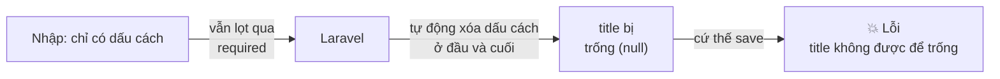
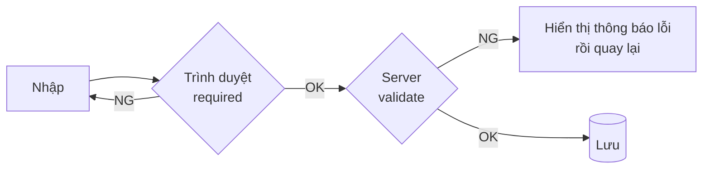
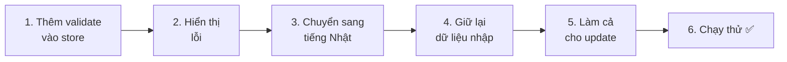
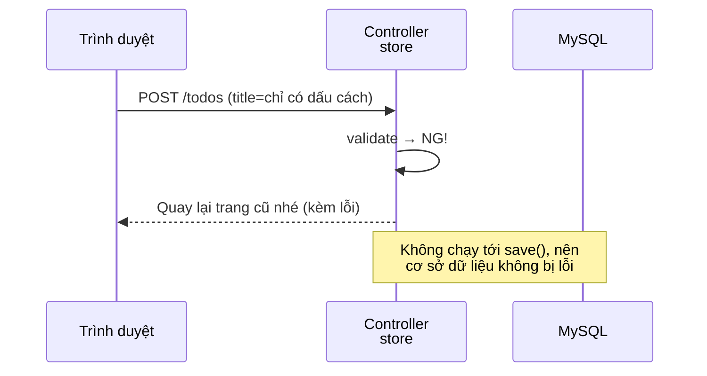
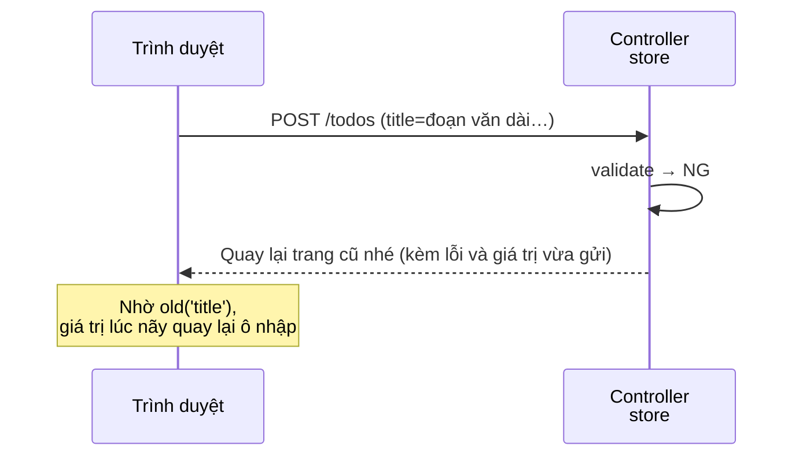
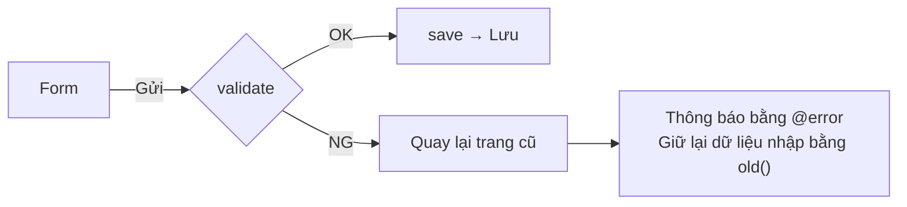

# Nhập môn Laravel — Cùng kiểm tra dữ liệu nhập vào (Validation)

> 🇯🇵 Bản gốc (tiếng Nhật): [20261105_資料_2.md](<../../../1年生_データ設計とアプリ開発/後期/20261105/20261105_資料_2.md>) <!-- original-ja-link -->

Chúng ta đã có thể thêm và sửa Todo, nhưng thật ra vẫn còn một vấn đề: **nếu nhập dữ liệu không hợp lệ, màn hình báo lỗi có thể xuất hiện**.
Hôm nay, chúng ta sẽ học **validation** — kiểm tra giá trị được nhập vào ở phía server.

## Mục tiêu hôm nay
- Hiểu vì sao chỉ kiểm tra ở trình duyệt (`required`) là chưa đủ
- Dùng `$request->validate()` để kiểm tra dữ liệu nhập vào
- Hiển thị thông báo lỗi lên màn hình và giữ lại giá trị đã nhập

> Chúng ta bắt đầu từ trạng thái đã làm xong phần "Sửa Todo" của ngày 10/29.

---

## 1. Thử xem: nếu chỉ nhập dấu cách rồi thêm thì sao…?

Hãy mở http://localhost:8000/todos, nhập **chỉ dấu cách thông thường (half-width)** vào ô nhập rồi bấm `追加` (Thêm).

```
SQLSTATE[23000]: Integrity constraint violation: 1048 Column 'title' cannot be null
```

Màn hình báo lỗi hiện ra. Chuyện gì đã xảy ra vậy?



1. `required` của HTML chỉ xem "có nhập gì đó hay không". Dấu cách cũng được tính là "có nhập", nên vẫn lọt qua
2. Laravel **tự động xóa dấu cách ở đầu và cuối** giá trị được gửi đến (đã học ngày 10/22). Kết quả là tiêu đề bị trống (`null`)
3. Cột `title` của bảng `todos` không được để trống, nên khi lưu sẽ bị lỗi

Ngoài ra, nếu dùng công cụ dành cho nhà phát triển (F12) của trình duyệt, người ta còn có thể xóa `required` rồi gửi đi.

---

## 2. Validation là gì

**Validation** (validation) là "kiểm tra xem giá trị được nhập vào có đúng không, **trước khi lưu**".

Việc kiểm tra có thể làm ở 2 nơi: trình duyệt và server.

| | Kiểm tra ở trình duyệt | Kiểm tra ở server (validation) |
|---|---|---|
| Nơi viết | HTML (`required`, v.v.) | Controller (`$request->validate()`) |
| Ưu điểm | Báo ngay trước khi gửi | **Không thể lách qua** |
| Nhược điểm | Có thể xóa bằng công cụ dành cho nhà phát triển, chỉ dấu cách cũng lọt qua | Phải gửi lên server một lần |



Kiểm tra ở trình duyệt là "sự chu đáo dành cho người dùng", còn kiểm tra ở server là "chìa khóa để bảo vệ ứng dụng".
Hãy nhớ rằng: **nhất định phải viết phần kiểm tra ở server**.

---

## 3. Cùng làm thử



Có 3 file cần chỉnh sửa (bên trong `src`).

```
src/
├─ app/Http/Controllers/
│   └─ TodoController.php ············· 1・3・5. viết thêm validate
└─ resources/views/todos/
    ├─ index.blade.php ················ 2・4. viết thêm phần hiển thị lỗi và old()
    └─ edit.blade.php ················· 5. viết thêm phần hiển thị lỗi và old()
```

---

### 1. Viết validate vào store (C)

> Bạn đang ở đây: **🟢 1. validate** → 2. Hiển thị lỗi → 3. Tiếng Nhật → 4. Giữ lại dữ liệu nhập → 5. Cả update → 6. Chạy thử

Viết thêm phần có dấu ★ vào **ngay đầu** method `store` trong `app/Http/Controllers/TodoController.php`.

```php
    public function store(Request $request)
    {
        // ★ Kiểm tra dữ liệu nhập vào
        $request->validate([
            'title' => 'required|max:255',
        ]);

        $todo = new Todo();
        $todo->title = $request->input('title');
        $todo->save();

        return redirect('/todos');
    }
```

| Code | Ý nghĩa |
|--------|------|
| `$request->validate([...])` | Kiểm tra các giá trị được gửi đến |
| `'title' => ...` | Kiểm tra giá trị của `name="title"` trong form |
| `required` | Không được để trống (chỉ có dấu cách thì cũng bị Laravel xóa nên thành trống) |
| `max:255` | Tối đa 255 ký tự (vì cột `title` là `VARCHAR(255)`) |
| `\|` | Dấu phân cách giữa các quy tắc. Có nghĩa là "`required` và `max:255`" |

**Nếu không qua được bước kiểm tra, xử lý sẽ dừng tại đó và tự động quay lại trang nhập.** `save()` ở bên dưới sẽ không được thực thi.



✅ **Kiểm tra**: Hãy thử nhập lại chỉ dấu cách rồi bấm `追加` (Thêm).
Màn hình báo lỗi không hiện ra, mà quay về trang danh sách. Todo cũng không tăng thêm.
……Nhưng **nhìn màn hình thì không biết vì sao bị quay lại**. Ở bước tiếp theo, chúng ta sẽ hiển thị thông báo lỗi.

---

### 2. Hiển thị thông báo lỗi (V)

> Bạn đang ở đây: 1. validate → **🟢 2. Hiển thị lỗi** → 3. Tiếng Nhật → 4. Giữ lại dữ liệu nhập → 5. Cả update → 6. Chạy thử

Viết thêm phần có dấu ★ vào form trong `resources/views/todos/index.blade.php`.

```html
    <form method="POST" action="/todos">
        @csrf
        <input type="text" name="title" placeholder="新しいTODOを入力" required>
        <button type="submit">追加</button>

        {{-- ★ Thêm từ đây --}}
        @error('title')
            <p style="color: red;">{{ $message }}</p>
        @enderror
        {{-- ★ Đến đây --}}
    </form>
```

| Code | Ý nghĩa |
|--------|------|
| `@error('title')` 〜 `@enderror` | Chỉ hiển thị phần bên trong khi `title` không qua được bước kiểm tra |
| `{{ $message }}` | Thông báo lỗi |

✅ **Kiểm tra**: Khi nhập chỉ dấu cách rồi bấm `追加` (Thêm), dòng chữ màu đỏ sau sẽ hiện ra.

```
The title field is required.
```

Thông báo hiện ra bằng tiếng Anh. Ở bước tiếp theo, chúng ta sẽ chuyển nó sang tiếng Nhật.

---

### 3. Chuyển thông báo lỗi sang tiếng Nhật (C)

> Bạn đang ở đây: 1. validate → 2. Hiển thị lỗi → **🟢 3. Tiếng Nhật** → 4. Giữ lại dữ liệu nhập → 5. Cả update → 6. Chạy thử

Viết thêm **mảng thông báo** làm tham số thứ 2 của `validate`.

```php
        $request->validate([
            'title' => 'required|max:255',
        ], [
            'title.required' => 'タイトルを入力してください。',        // ★ Thêm vào
            'title.max' => 'タイトルは255文字以内で入力してください。',  // ★ Thêm vào
        ]);
```

| Code | Ý nghĩa |
|--------|------|
| `'title.required' => '...'` | Thông báo khi `title` không qua được quy tắc `required` |
| `'title.max' => '...'` | Thông báo khi `title` không qua được quy tắc `max` |

Với dạng `'tên cột.quy tắc'`, bạn có thể đặt thông báo riêng cho từng quy tắc.

✅ **Kiểm tra**: Khi nhập chỉ dấu cách rồi bấm `追加` (Thêm), nếu hiện ra "タイトルを入力してください。" (Hãy nhập tiêu đề.) là OK.

---

### 4. Giữ lại giá trị đã nhập (V)

> Bạn đang ở đây: 1. validate → 2. Hiển thị lỗi → 3. Tiếng Nhật → **🟢 4. Giữ lại dữ liệu nhập** → 5. Cả update → 6. Chạy thử

Khi bị quay lại vì lỗi, ô nhập sẽ trống trơn.
Nếu bạn đang nhập một đoạn văn dài, thì lại phải gõ lại từ đầu.

Viết thêm `value` có dấu ★ vào `<input>` trong `index.blade.php`.

```html
        <input type="text" name="title" value="{{ old('title') }}" placeholder="新しいTODOを入力" required>
        {{--                            ~~~~~~~~~~~~~~~~~~~~~~~~~ ★ Thêm vào --}}
```

`old('title')` là "**giá trị `title` vừa gửi lúc nãy**".
Khi bị quay lại vì lỗi, ô nhập có thể được điền sẵn giá trị lúc nãy.

Khi quay lại, Laravel cũng ghi nhớ luôn "giá trị vừa gửi lúc nãy", nên có thể lấy ra bằng `old()`.



---

### 5. Thêm validation cho cả update

> Bạn đang ở đây: 1. validate → 2. Hiển thị lỗi → 3. Tiếng Nhật → 4. Giữ lại dữ liệu nhập → **🟢 5. Cả update** → 6. Chạy thử

Khi sửa cũng vậy, nếu lưu chỉ với dấu cách thì sẽ bị lỗi giống như trên.
Hãy viết thêm `validate` giống hệt `store` vào `update` trong `TodoController.php`.

```php
    public function update(Request $request, $id)
    {
        // ★ Kiểm tra giống như store
        $request->validate([
            'title' => 'required|max:255',
        ], [
            'title.required' => 'タイトルを入力してください。',
            'title.max' => 'タイトルは255文字以内で入力してください。',
        ]);

        $todo = Todo::findOrFail($id);
        $todo->title = $request->input('title');
        $todo->is_done = $request->has('is_done');
        $todo->save();

        return redirect('/todos/' . $todo->id);
    }
```

Form trong `resources/views/todos/edit.blade.php` cũng sửa lại như phần có dấu ★.

```html
    <form method="POST" action="/todos/{{ $todo->id }}">
        @csrf
        @method('PUT')
        <input type="text" name="title" value="{{ old('title', $todo->title) }}" required>  {{-- ★ Dùng old --}}
        <label>
            <input type="checkbox" name="is_done" value="1" @checked($todo->is_done)>
            完了
        </label>
        <button type="submit">保存</button>

        {{-- ★ Thêm từ đây --}}
        @error('title')
            <p style="color: red;">{{ $message }}</p>
        @enderror
        {{-- ★ Đến đây --}}
    </form>
```

`old('title', $todo->title)` có nghĩa là "nếu có giá trị vừa gửi lúc nãy thì dùng giá trị đó, **nếu không thì dùng tiêu đề hiện tại**".

| Tình huống | Giá trị điền vào ô nhập |
|------|----------------|
| Khi mở trang sửa lần đầu | Tiêu đề hiện tại (`$todo->title`) |
| Khi bị quay lại vì lỗi | Giá trị vừa gửi lúc nãy (`old('title')`) |

---

### 6. Chạy thử ✅

> Bạn đang ở đây: 1. validate → 2. Hiển thị lỗi → 3. Tiếng Nhật → 4. Giữ lại dữ liệu nhập → 5. Cả update → **🟢 6. Chạy thử**

Hãy thử 4 việc sau.

| | Việc cần làm | Như thế này là OK |
|---|---|---|
| ① | Ở phần thêm, chỉ nhập dấu cách rồi bấm `追加` (Thêm) | Hiện ra "タイトルを入力してください。" (Hãy nhập tiêu đề.) Todo không tăng thêm |
| ② | Ở phần thêm, nhập Todo bình thường rồi bấm `追加` (Thêm) | Được thêm vào như trước |
| ③ | Ở phần sửa, đổi tiêu đề thành chỉ có dấu cách rồi bấm `保存` (Lưu) | Quay lại trang sửa, hiện ra "タイトルを入力してください。" (Hãy nhập tiêu đề.) |
| ④ | Dùng công cụ dành cho nhà phát triển (F12) xóa `required` của `<input>`, để trống rồi bấm `追加` (Thêm) | Dù không có kiểm tra ở trình duyệt, vẫn bị chặn lại nhờ kiểm tra ở server |

> **Cách làm ④**
> 1. Nhấp chuột phải vào ô nhập → "Kiểm tra" (Inspect)
> 2. Trong công cụ dành cho nhà phát triển, nhấp đúp vào `required` của `<input ... required>` rồi xóa đi
> 3. Để trống ô nhập rồi bấm `追加` (Thêm)

✅ Nếu ở ④ hiện ra "タイトルを入力してください。" (Hãy nhập tiêu đề.), bạn đã xác nhận được rằng **dù có lách qua được bước kiểm tra ở trình duyệt, ứng dụng vẫn được bảo vệ**.

---

## 4. Khi không chạy được

> **🔥 Không chạy được thì hãy ghi log!** → [[Quan trọng] Cách ghi log](../20261022/【重要】ログの出し方.md)
> Tuy nhiên, việc không qua được validation sẽ không được ghi vào log (vì đó là hoạt động bình thường, không phải lỗi).

| Triệu chứng | Chỗ gây lỗi | Cách xử lý |
|------|----------|------|
| Gửi chỉ dấu cách mà vẫn bị `Column 'title' cannot be null` | Controller | Kiểm tra xem đã viết `validate` ở **trước** `save()` chưa |
| Bị quay lại nhưng không hiện thông báo | View | Kiểm tra xem đã viết `@error('title')` 〜 `@enderror` chưa, và chính tả của `'title'` |
| Thông báo vẫn là tiếng Anh | Controller | Kiểm tra chính tả của `'title.required'` (nối bằng `.`) |
| Khi quay lại, ô nhập bị trống | View | Kiểm tra xem đã viết `value="{{ old('title') }}"` chưa |
| Mở trang sửa thì ô nhập bị trống | View | Kiểm tra xem đã viết tham số thứ 2 (`$todo->title`) của `old('title', $todo->title)` chưa |
| Ở phần sửa, đổi thành chỉ dấu cách thì hiện màn hình báo lỗi | Controller | Kiểm tra xem đã viết `validate` cho cả `update` chưa |

---

## 5. Tổng kết



| Những gì đã viết hôm nay | Nói ngắn gọn |
|--------------|-----------|
| `$request->validate([...])` | Kiểm tra dữ liệu nhập ở server trước khi lưu |
| `'required\|max:255'` | Không được để trống, tối đa 255 ký tự |
| `'title.required' => '...'` | Chuyển thông báo lỗi sang tiếng Nhật |
| `@error('title')` 〜 `@enderror` | Hiển thị thông báo lỗi |
| `old('title')` | Khi bị quay lại vì lỗi, giữ lại dữ liệu vừa nhập |

**Kiểm tra ở trình duyệt là sự chu đáo, kiểm tra ở server là chìa khóa. Nhất định phải viết phần kiểm tra ở server.**

---

## 6. Thử thêm nữa nhé (cho bạn nào còn thời gian)

Hãy giới hạn tiêu đề **tối đa 20 ký tự**. Khi thêm một Todo từ 21 ký tự trở lên, hãy làm cho thông báo "タイトルは20文字以内で入力してください。" (Hãy nhập tiêu đề trong vòng 20 ký tự.) hiện ra.

<details>
<summary>Gợi ý</summary>

Ở cả `store` và `update`, đổi `max:255` thành `max:20`, và đổi luôn thông báo thành "20文字以内" (trong vòng 20 ký tự).

```php
        $request->validate([
            'title' => 'required|max:20',
        ], [
            'title.required' => 'タイトルを入力してください。',
            'title.max' => 'タイトルは20文字以内で入力してください。',
        ]);
```

</details>

<!-- nav:start -->

---

| ⬅️ Trước | 🗺️ Sơ đồ tổng thể | Tiếp ➡️ |
|:--|:--:|--:|
| [11/05 Seeder・Factory](20261105_資料_1.md) | [Sơ đồ tổng thể tài liệu](../../README.md) | [11/12 Tách phần chung ra làm thành phần (@include)](../20261112/20261112_資料_1.md) |

<!-- nav:end -->
