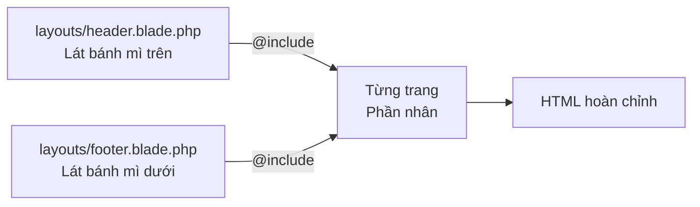
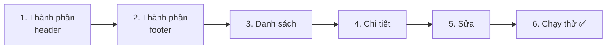
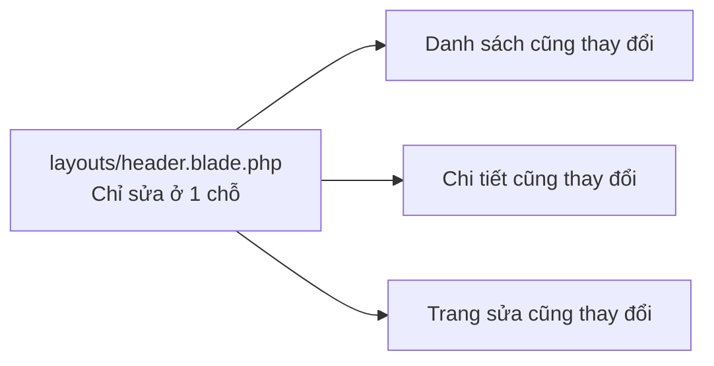
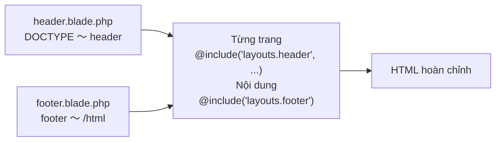

# Nhập môn Laravel — Cùng tách phần chung ra làm thành phần (@include)

> 🇯🇵 Bản gốc (tiếng Nhật): [20261112_資料_1.md](<../../../1年生_データ設計とアプリ開発/後期/20261112/20261112_資料_1.md>) <!-- original-ja-link -->

Chúng ta đã có 3 trang: danh sách, chi tiết và sửa.
Nhưng ở file nào chúng ta cũng viết đi viết lại **cùng một đoạn HTML**. Hôm nay, chúng ta sẽ học cách tách phần chung đó ra thành **file thành phần** rồi nạp vào.

## Mục tiêu hôm nay
- Hiểu được tách phần chung ra làm thành phần thì có lợi gì
- Tách header và footer ra thành file thành phần, rồi nạp vào bằng `@include`
- Truyền giá trị cho `@include` để thay đổi tiêu đề theo từng trang
- Tự kiểm chứng rằng chỉ cần sửa thành phần ở 1 chỗ, tất cả các trang đều thay đổi theo

> Chúng ta bắt đầu từ trạng thái đã làm xong phần "Validation" của ngày 11/5.

---

## 1. Cùng một đoạn HTML mà viết đi viết lại nhiều lần

Hãy so sánh 3 view hiện tại.

```
index.blade.php (Danh sách)   show.blade.php (Chi tiết)     edit.blade.php (Sửa)
┌─────────────────────────┐   ┌─────────────────────────┐   ┌─────────────────────────┐
│ <!DOCTYPE html>         │   │ <!DOCTYPE html>         │   │ <!DOCTYPE html>         │
│ <html lang="ja">        │   │ <html lang="ja">        │   │ <html lang="ja">        │
│ <head>                  │   │ <head>                  │   │ <head>                  │
│   <meta charset=...>    │   │   <meta charset=...>    │   │   <meta charset=...>    │
│   <title>TODOアプリ     │   │   <title>TODOの詳細     │   │   <title>TODOの編集     │
│ </head>                 │   │ </head>                 │   │ </head>                 │
│ <body>                  │   │ <body>                  │   │ <body>                  │
│ ┌─────────────────────┐ │   │ ┌─────────────────────┐ │   │ ┌─────────────────────┐ │
│ │ Nội dung danh sách  │ │   │ │ Nội dung chi tiết   │ │   │ │ Nội dung trang sửa  │ │
│ └─────────────────────┘ │   │ └─────────────────────┘ │   │ └─────────────────────┘ │
│ </body>                 │   │ </body>                 │   │ </body>                 │
│ </html>                 │   │ </html>                 │   │ </html>                 │
└─────────────────────────┘   └─────────────────────────┘   └─────────────────────────┘
```

Điểm khác nhau giữa các trang **chỉ có `<title>` và nội dung bên trong `<body>`**. Ngoài ra, cả 3 trang đều giống nhau.

Nếu cứ viết đi viết lại cùng một thứ, sẽ xảy ra những chuyện như thế này.

```
Bạn A: "Mình muốn thêm link đến 'TODOアプリ' (Ứng dụng TODO) ở phía trên tất cả các trang. Phải sửa hết cả 3 file à…?"
Bạn B: "Mình thêm footer vào phía dưới tất cả các trang, mà lại quên mất trang chi tiết"
Bạn C: "Nếu số trang tăng lên 10, thì sẽ phải sửa ở 10 chỗ"
```

---

## 2. Tách phần chung ra làm "thành phần"

Vì vậy, chúng ta sẽ chia phần chung thành 2 file thành phần: **nửa trên** và **nửa dưới**.
Mỗi trang chỉ cần **nạp** nửa trên ở đầu, và nửa dưới ở cuối.

```
layouts/header.blade.php (thành phần nửa trên)
┌─────────────────────────┐
│ <!DOCTYPE html>         │
│ <html> <head> … </head> │
│ <body>                  │
│ <header>…</header>      │ ← phần hiện ở phía trên màn hình
└─────────────────────────┘
            ＋
todos/index.blade.php (từng trang)
┌─────────────────────────┐
│ Chỉ nội dung danh sách  │
└─────────────────────────┘
            ＋
layouts/footer.blade.php (thành phần nửa dưới)
┌─────────────────────────┐
│ <footer>…</footer>      │ ← phần hiện ở phía dưới màn hình
│ </body>                 │
│ </html>                 │
└─────────────────────────┘
```

Ví dụ cho dễ hiểu, nó giống như **bánh sandwich**.
Lát bánh mì trên (header) và lát bánh mì dưới (footer) lúc nào cũng giống nhau, chỉ có phần nhân kẹp ở giữa (nội dung của từng trang) là khác nhau.

Để nạp thành phần, chúng ta dùng **`@include`** của Blade.

| Cách viết | Ý nghĩa |
|--------|------|
| `@include('layouts.header')` | **Chèn nguyên** nội dung của `resources/views/layouts/header.blade.php` **vào đúng chỗ này** |
| `@include('layouts.header', ['title' => '一覧'])` | Khi chèn thành phần, truyền "一覧" (Danh sách) với tên là `$title` |



> **`<head>` và `<header>` là hai thứ khác nhau**
> Tên gọi giống nhau, nhưng vai trò thì khác.
>
> | Thẻ | Vai trò | Có thấy trên màn hình không? |
> |------|------|-------------|
> | `<head>` | Thông tin của trang (bảng mã ký tự, tiêu đề tab, v.v.). Dành cho trình duyệt | Không thấy |
> | `<header>` | Phần hiện ở phía trên trang (tên ứng dụng, menu, v.v.) | Thấy được |
>
> Trong `header.blade.php` hôm nay sẽ có **cả hai** thẻ này.

---

## 3. Cùng làm thử



Có 5 file cần chỉnh sửa (bên trong `src`).

```
src/
└─ resources/views/
    ├─ layouts/
    │   ├─ header.blade.php ········· 1. thành phần header (tạo mới)
    │   └─ footer.blade.php ········· 2. thành phần footer (tạo mới)
    └─ todos/
        ├─ index.blade.php ·········· 3. sửa lại để nạp thành phần
        ├─ show.blade.php ··········· 4. sửa lại để nạp thành phần
        └─ edit.blade.php ··········· 5. sửa lại để nạp thành phần
```

---

### 1. Tạo thành phần header

> Bạn đang ở đây: **🟢 1. Header** → 2. Footer → 3. Danh sách → 4. Chi tiết → 5. Sửa → 6. Chạy thử

Tạo thư mục `layouts` bên trong `resources/views`, rồi tạo file tên là `header.blade.php`.

```html
<!DOCTYPE html>
<html lang="ja">
<head>
    <meta charset="UTF-8">
    <title>{{ $title }} | TODOアプリ</title>
</head>
<body>
    <header>
        <a href="/todos">TODOアプリ</a>
    </header>
```

| Code | Ý nghĩa |
|--------|------|
| `{{ $title }}` | Tiêu đề được truyền từ từng trang sẽ được đưa vào đây. Hiển thị trên tab của trình duyệt |
| `<header>` 〜 `</header>` | Phần hiện ở phía trên tất cả các trang |

`</body>` và `</html>` thì không viết ở đây. Chúng ta sẽ viết chúng trong **thành phần footer**.

---

### 2. Tạo thành phần footer

> Bạn đang ở đây: 1. Header → **🟢 2. Footer** → 3. Danh sách → 4. Chi tiết → 5. Sửa → 6. Chạy thử

Cũng bên trong `resources/views/layouts`, tạo file `footer.blade.php`.

```html
    <footer>
        <p>© 2026 TODOアプリ</p>
    </footer>
</body>
</html>
```

Đóng `<body>` và `<html>` đã mở ở header tại đây.

---

### 3. Sửa lại trang danh sách

> Bạn đang ở đây: 1. Header → 2. Footer → **🟢 3. Danh sách** → 4. Chi tiết → 5. Sửa → 6. Chạy thử

Sửa lại `resources/views/todos/index.blade.php` như sau.

```html
@include('layouts.header', ['title' => '一覧'])

    <h1>TODOアプリ</h1>

    <form method="POST" action="/todos">
        @csrf
        <input type="text" name="title" value="{{ old('title') }}" placeholder="新しいTODOを入力" required>
        <button type="submit">追加</button>

        @error('title')
            <p style="color: red;">{{ $message }}</p>
        @enderror
    </form>

    <ul>
        @foreach ($todos as $todo)
            <li>
                <form method="POST" action="/todos/{{ $todo->id }}/toggle" style="display: inline;">
                    @csrf
                    @method('PATCH')
                    <input type="checkbox" name="is_done" value="1" onchange="this.form.submit()" @checked($todo->is_done)>
                </form>
                <a href="/todos/{{ $todo->id }}">{{ $todo->title }}</a>
            </li>
        @endforeach
    </ul>

@include('layouts.footer')
```

So với trước khi sửa, nó sẽ như thế này.

| | Trước khi sửa | Sau khi sửa |
|---|---|---|
| `<!DOCTYPE html>` 〜 `<body>` | Có viết | Thay bằng 1 dòng `@include('layouts.header', ['title' => '一覧'])` |
| Nội dung bên trong `<body>` | Giữ nguyên | Giữ nguyên |
| `</body>` `</html>` | Có viết | Thay bằng 1 dòng `@include('layouts.footer')` |

`['title' => '一覧']` có cùng dạng với cách viết `view('todos.index', ['todos' => $todos])` trong controller.
Bên trong thành phần, có thể dùng "一覧" (Danh sách) với tên là `$title`.

✅ **Kiểm tra**: Mở http://localhost:8000/todos, nếu phía trên danh sách có link "TODOアプリ" (Ứng dụng TODO), phía dưới có "© 2026 TODOアプリ" (© 2026 Ứng dụng TODO) là OK.
Hãy kiểm tra cả việc tab của trình duyệt hiện "一覧 | TODOアプリ" (Danh sách | Ứng dụng TODO).

---

### 4. Sửa lại trang chi tiết

> Bạn đang ở đây: 1. Header → 2. Footer → 3. Danh sách → **🟢 4. Chi tiết** → 5. Sửa → 6. Chạy thử

Sửa lại `resources/views/todos/show.blade.php` như sau.

```html
@include('layouts.header', ['title' => $todo->title])

    <h1>{{ $todo->title }}</h1>

    <p>番号：{{ $todo->id }}</p>

    <p>
        状態：
        @if ($todo->is_done)
            完了 ✅
        @else
            未完了
        @endif
    </p>

    <a href="/todos/{{ $todo->id }}/edit">編集</a>

    <form method="POST" action="/todos/{{ $todo->id }}" onsubmit="return confirm('削除しますか？');">
        @csrf
        @method('DELETE')
        <button type="submit">削除</button>
    </form>

    <a href="/todos">一覧にもどる</a>

@include('layouts.footer')
```

Như `['title' => $todo->title]`, bạn cũng có thể truyền cả **biến**.
Nếu là trang chi tiết của "牛乳を買う" (Mua sữa), tab sẽ hiển thị "牛乳を買う | TODOアプリ" (Mua sữa | Ứng dụng TODO).

✅ **Kiểm tra**: Bấm vào một Todo trong danh sách, nếu trang chi tiết cũng có header và footer là OK.

---

### 5. Chỉnh sửa trang chỉnh sửa

> Bạn đang ở đây: 1. Header → 2. Footer → 3. Danh sách → 4. Chi tiết → **🟢 5. Sửa** → 6. Chạy thử

Sửa lại `resources/views/todos/edit.blade.php` như sau.

```html
@include('layouts.header', ['title' => '編集'])

    <h1>TODOの編集</h1>

    <form method="POST" action="/todos/{{ $todo->id }}">
        @csrf
        @method('PUT')
        <input type="text" name="title" value="{{ old('title', $todo->title) }}" required>
        <label>
            <input type="checkbox" name="is_done" value="1" @checked($todo->is_done)>
            完了
        </label>
        <button type="submit">保存</button>

        @error('title')
            <p style="color: red;">{{ $message }}</p>
        @enderror
    </form>

    <a href="/todos/{{ $todo->id }}">もどる</a>

@include('layouts.footer')
```

✅ **Kiểm tra**: Từ trang chi tiết bấm "編集" (Sửa), nếu trang sửa cũng có header và footer là OK.

---

### 6. Chạy thử ✅: Sửa thành phần ở 1 chỗ thì…?

> Bạn đang ở đây: 1. Header → 2. Footer → 3. Danh sách → 4. Chi tiết → 5. Sửa → **🟢 6. Chạy thử**

Đây chính là lợi ích lớn nhất của việc tách phần chung ra làm thành phần.
Hãy mở **chỉ** `layouts/header.blade.php`, rồi thử đổi "TODOアプリ" (Ứng dụng TODO) thành "わたしのTODO" (TODO của tôi).

```html
    <header>
        <a href="/todos">わたしのTODO</a>  {{-- ★ Sửa lại --}}
    </header>
```

✅ **Kiểm tra**: Hãy mở lại **tất cả 3 trang**: danh sách, chi tiết và sửa.
Nếu **trang nào** cũng có header đổi thành "わたしのTODO" (TODO của tôi) là thành công.



Nếu không tách ra làm thành phần, thì đã phải sửa hết cả 3 file.
**Sửa ở 1 chỗ, tất cả các trang đều thay đổi**. Đó chính là sức mạnh của việc tách ra làm thành phần.

---

## 4. Khi không chạy được

> **🔥 Không chạy được thì hãy ghi log!** → [[Quan trọng] Cách ghi log](../20261022/【重要】ログの出し方.md)

| Triệu chứng | Chỗ gây lỗi | Cách xử lý |
|------|----------|------|
| `View [layouts.header] not found.` | Thành phần | Kiểm tra vị trí và tên file `resources/views/layouts/header.blade.php` (`layouts` có chữ `s`. `footer` cũng vậy) |
| `Undefined variable $title` | Từng trang | Kiểm tra xem có quên viết `['title' => ...]` trong `@include('layouts.header', ['title' => ...])` không |
| Tiêu đề trên tab bị sai | Từng trang | Kiểm tra xem `'title'` trong `['title' => ...]` và `{{ $title }}` trong thành phần có cùng tên không |
| Footer không hiện ra | Từng trang | Kiểm tra xem đã viết `@include('layouts.footer')` ở cuối trang chưa |
| `<!DOCTYPE html>` xuất hiện 2 lần | Từng trang | Kiểm tra xem trong từng trang có còn sót `<!DOCTYPE html>` 〜 `<body>` không (vì đã có trong thành phần header nên hãy xóa đi) |

> **`@include` nằm ở 2 chỗ: đầu và cuối**
> Trong mỗi trang, nhất định phải viết ở **2 chỗ**: `@include('layouts.header', ...)` và `@include('layouts.footer')`.
> Nếu quên viết footer, HTML sẽ không có `</body>` và `</html>` (trình duyệt vẫn hiển thị được, nhưng đó không phải là HTML đúng).

---

## 5. Tổng kết



| Những gì đã viết hôm nay | Nói ngắn gọn |
|--------------|-----------|
| `layouts/header.blade.php` | Nửa trên của tất cả các trang (`<!DOCTYPE html>` 〜 `<header>`) |
| `layouts/footer.blade.php` | Nửa dưới của tất cả các trang (`<footer>` 〜 `</html>`) |
| `@include('layouts.header', ['title' => ...])` | Nạp thành phần nửa trên và truyền tiêu đề |
| `@include('layouts.footer')` | Nạp thành phần nửa dưới |

**Phần chung thì tách ra làm thành phần. Sửa ở 1 chỗ, tất cả các trang đều thay đổi.**

> **Còn có những cách viết khác**
> Trong Laravel, còn có cách gom "khung" của cả trang vào 1 file bằng `@extends`, `@section`, `@yield`, hoặc cách làm gọi là **component**, viết kiểu như `<x-layout>`.
> Nếu thấy trên mạng, hãy hiểu rằng "à, họ đang làm cùng một việc nhưng bằng cách viết khác".

<!-- nav:start -->

---

| ⬅️ Trước | 🗺️ Sơ đồ tổng thể | Tiếp ➡️ |
|:--|:--:|--:|
| [11/05 Validation](../20261105/20261105_資料_2.md) | [Sơ đồ tổng thể tài liệu](../../README.md) | [11/12 Gắn danh mục](20261112_資料_2.md) |

<!-- nav:end -->
