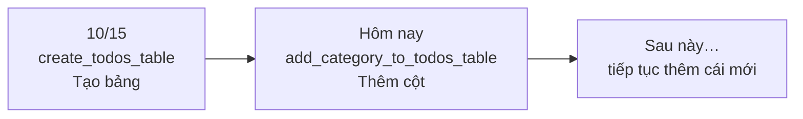
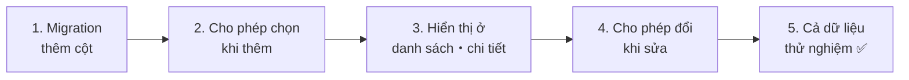
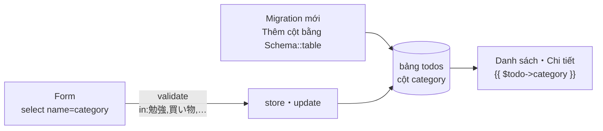

# Nhập môn Laravel — Cùng gắn danh mục cho Todo (migration thêm cột)

> 🇯🇵 Bản gốc (tiếng Nhật): [20261112_資料_2.md](<../../../1年生_データ設計とアプリ開発/後期/20261112/20261112_資料_2.md>) <!-- original-ja-link -->

Khi số Todo tăng lên, chúng ta sẽ muốn **phân loại** chúng, kiểu như "cái này là việc học", "cái này là đi mua sắm".
Hôm nay, chúng ta sẽ làm cho Todo có thể gắn **danh mục**.

## Mục tiêu hôm nay
- Có thể **thêm cột bằng migration** vào một bảng đã có sẵn
- Chọn danh mục từ các lựa chọn cố định bằng select box
- Dùng validation (`in`) để kiểm tra, không cho gửi lên các danh mục ngoài những lựa chọn được phép

> Chúng ta bắt đầu từ trạng thái đã làm xong phần "Cùng tách phần chung ra làm thành phần" của [Tài liệu 1](./20261112_資料_1.md).

---

## 1. Những gì sẽ làm hôm nay

Danh mục sẽ được **chọn từ 4 loại** sau.

| Danh mục |
|---------|
| 勉強 (học tập) |
| 買い物 (mua sắm) |
| 家のこと (việc nhà) |
| その他 (khác) |

```
TODOアプリ

[ 新しいTODOを入力 ] [ 勉強 ▼ ] [追加]

☐ [勉強] レポートを書く
☑ [買い物] 牛乳を買う
☐ [家のこと] 部屋のそうじ
```

Chúng ta sẽ thêm 1 cột `category` (danh mục) vào bảng `todos`.

| id | title | **category** | is_done | created_at | updated_at |
|----|-------|-------------|---------|-----------|-----------|
| 1 | レポートを書く | **勉強** | 0 | … | … |
| 2 | 牛乳を買う | **買い物** | 1 | … | … |

---

## 2. Điều mới: migration thêm cột

Ngày 10/15, chúng ta đã **tạo** bảng `todos` bằng migration.
Hôm nay, chúng ta sẽ **thêm cột** vào bảng `todos` đã có sẵn.

Ở đây có một quy tắc quan trọng.

> **Migration đã chạy một lần thì không sửa lại. Hãy thêm một migration mới.**



Dù có viết thêm `category` vào migration ngày 10/15 (`create_todos_table`), thì **vì nó đã được chạy rồi, nên dù chạy `migrate` cũng không có tác dụng**.
Migration là **bản ghi lại các thay đổi (nhật ký)** của bảng. Chúng ta không sửa lại nhật ký cũ, mà viết thêm vào một trang mới là "hôm nay đã thêm cột".

| | Tạo bảng (10/15) | Thêm cột (hôm nay) |
|---|---|---|
| Tên file | `create_todos_table` | `add_category_to_todos_table` |
| Nội dung | `Schema::create('todos', ...)` | `Schema::table('todos', ...)` |
| Ý nghĩa | Tạo bảng mới | Thay đổi bảng đã có sẵn |

---

## 3. Cùng làm thử



Các file cần chỉnh sửa như sau (bên trong `src`).

```
src/
├─ database/
│   ├─ migrations/
│   │   └─ xxxx_add_category_to_todos_table.php ··· 1. tạo mới
│   ├─ seeders/TodoSeeder.php ····················· 5. thêm danh mục
│   └─ factories/TodoFactory.php ·················· 5. thêm danh mục
├─ resources/views/todos/
│   ├─ index.blade.php ···························· 2・3. select box và hiển thị
│   ├─ show.blade.php ····························· 3. hiển thị
│   └─ edit.blade.php ····························· 4. select box
└─ app/Http/Controllers/
    └─ TodoController.php ························· 2・4. store và update
```

---

### 1. Tạo migration thêm cột

> Bạn đang ở đây: **🟢 1. Migration** → 2. Thêm → 3. Hiển thị → 4. Sửa → 5. Dữ liệu thử nghiệm

Tạo file migration bằng lệnh sau.

```powershell
docker compose exec laravel php artisan make:migration add_category_to_todos_table
```

Nếu đặt tên theo dạng `add_〇〇_to_△△_table`, Laravel sẽ hiểu là "à, sẽ thay đổi bảng `△△`", rồi tạo sẵn khung mẫu cho chúng ta.

File `2026_11_12_xxxxxx_add_category_to_todos_table.php` sẽ được tạo ra trong `database/migrations/`, hãy viết phần bên trong `up()` và `down()` như sau.

```php
    public function up(): void
    {
        Schema::table('todos', function (Blueprint $table) {
            $table->string('category')->default('その他')->after('title');
        });
    }

    public function down(): void
    {
        Schema::table('todos', function (Blueprint $table) {
            $table->dropColumn('category');
        });
    }
```

| Code | Ý nghĩa |
|--------|------|
| `Schema::table('todos', ...)` | Thay đổi bảng `todos` đã có sẵn (khi tạo bảng thì dùng `Schema::create`) |
| `$table->string('category')` | Thêm cột chuỗi ký tự tên là `category` |
| `->default('その他')` | Khi không nhập gì thì đặt là "その他" (Khác) |
| `->after('title')` | Thêm vào sau cột `title` (để dễ nhìn trong phpMyAdmin) |
| `up()` | Việc thực hiện khi chạy `migrate` (thêm cột) |
| `down()` | Việc thực hiện khi hoàn tác (xóa cột) |

> **Vì sao phải thêm `default('その他')`?**
> Trong bảng `todos` đã có sẵn một số Todo rồi.
> Khi thêm cột, thì nên điền gì vào `category` của các Todo hiện có? Nếu có `default`, tất cả các Todo hiện có sẽ thành "その他" (Khác).

Lưu xong thì chạy migration.

```powershell
docker compose exec laravel php artisan migrate
```

✅ **Kiểm tra**: Hãy thử mở bảng `todos` bằng phpMyAdmin.
Nếu cột `category` đã được tạo ở sau `title`, và tất cả các Todo hiện có đều thành "その他" (Khác) là OK.
**Các Todo hiện có không bị mất**. Đó là vì `migrate` chỉ chạy những migration chưa được chạy (1 migration của hôm nay).

| Lệnh | Việc thực hiện | Dữ liệu hiện có |
|---------|---------|------------|
| `migrate` | Chỉ chạy những migration chưa được chạy | **Được giữ lại** |
| `migrate:fresh` | Xóa toàn bộ bảng, rồi chạy lại tất cả migration từ đầu | Bị mất |

---

### 2. Cho phép chọn danh mục khi thêm

> Bạn đang ở đây: 1. Migration → **🟢 2. Thêm** → 3. Hiển thị → 4. Sửa → 5. Dữ liệu thử nghiệm

#### ① Thêm select box vào form thêm (V)

Viết thêm select box có dấu ★ vào form thêm trong `resources/views/todos/index.blade.php`.

```html
    <form method="POST" action="/todos">
        @csrf
        <input type="text" name="title" value="{{ old('title') }}" placeholder="新しいTODOを入力" required>

        {{-- ★ Thêm từ đây --}}
        <select name="category">
            <option value="勉強">勉強</option>
            <option value="買い物">買い物</option>
            <option value="家のこと">家のこと</option>
            <option value="その他">その他</option>
        </select>
        {{-- ★ Đến đây --}}

        <button type="submit">追加</button>

        @error('title')
            <p style="color: red;">{{ $message }}</p>
        @enderror
    </form>
```

| Code | Ý nghĩa |
|--------|------|
| `<select name="category">` | Gửi lựa chọn đã chọn với tên là `category` |
| `<option value="勉強">勉強</option>` | Một lựa chọn (Học tập). Giá trị của `value` sẽ được gửi đi |

#### ② Lưu cả danh mục trong store (C)

Viết thêm phần có dấu ★ vào `store` trong `app/Http/Controllers/TodoController.php`.

```php
    public function store(Request $request)
    {
        $request->validate([
            'title' => 'required|max:255',
            'category' => 'required|in:勉強,買い物,家のこと,その他',  // ★ Thêm vào
        ], [
            'title.required' => 'タイトルを入力してください。',
            'title.max' => 'タイトルは255文字以内で入力してください。',
            'category.required' => 'カテゴリを選んでください。',           // ★ Thêm vào
            'category.in' => 'カテゴリは、リストの中から選んでください。',  // ★ Thêm vào
        ]);

        $todo = new Todo();
        $todo->title = $request->input('title');
        $todo->category = $request->input('category');  // ★ Thêm vào
        $todo->save();

        return redirect('/todos');
    }
```

| Code | Ý nghĩa |
|--------|------|
| `'category' => 'required\|in:勉強,買い物,家のこと,その他'` | `category` bắt buộc phải là **một trong** 4 giá trị này |
| `$todo->category = $request->input('category')` | Đưa danh mục đã chọn vào |

> **Đã là select box rồi, sao vẫn phải kiểm tra bằng `in`?**
> Select box chỉ có 4 lựa chọn, nhưng như đã học ngày 11/5, **kiểm tra ở trình duyệt có thể bị lách qua**.
> Người ta có thể dùng công cụ dành cho nhà phát triển để sửa `<option value="勉強">` (Học tập) thành `<option value="ゲーム">` rồi gửi đi.
> Nhờ `in` ở phía server, những giá trị ngoài 4 giá trị cố định sẽ bị loại bỏ.

---

### 3. Hiển thị danh mục ở trang danh sách và trang chi tiết

> Bạn đang ở đây: 1. Migration → 2. Thêm → **🟢 3. Hiển thị** → 4. Sửa → 5. Dữ liệu thử nghiệm

#### ① Danh sách (V)

Viết thêm phần có dấu ★ vào bên trong `<li>` của `index.blade.php`.

```html
            <li>
                <form method="POST" action="/todos/{{ $todo->id }}/toggle" style="display: inline;">
                    @csrf
                    @method('PATCH')
                    <input type="checkbox" name="is_done" value="1" onchange="this.form.submit()" @checked($todo->is_done)>
                </form>
                [{{ $todo->category }}]  {{-- ★ Thêm vào --}}
                <a href="/todos/{{ $todo->id }}">{{ $todo->title }}</a>
            </li>
```

#### ② Chi tiết (V)

Viết thêm 1 dòng có dấu ★ vào bên dưới dòng "番号" (Số) của `show.blade.php`.

```html
    <p>番号：{{ $todo->id }}</p>

    <p>カテゴリ：{{ $todo->category }}</p>  {{-- ★ Thêm vào --}}
```

✅ **Kiểm tra**: Hãy thử chọn danh mục ở trang danh sách rồi thêm Todo.
Nếu ở trang danh sách hiển thị kiểu như `[勉強] レポートを書く` ([Học tập] Viết báo cáo), và ở trang chi tiết cũng hiện ra "カテゴリ：勉強" (Danh mục: Học tập) là OK.

---

### 4. Cho phép đổi danh mục khi sửa

> Bạn đang ở đây: 1. Migration → 2. Thêm → 3. Hiển thị → **🟢 4. Sửa** → 5. Dữ liệu thử nghiệm

#### ① Thêm select box vào form sửa (V)

Viết thêm select box có dấu ★ vào form trong `edit.blade.php`.

```html
    <form method="POST" action="/todos/{{ $todo->id }}">
        @csrf
        @method('PUT')
        <input type="text" name="title" value="{{ old('title', $todo->title) }}" required>

        {{-- ★ Thêm từ đây --}}
        <select name="category">
            <option value="勉強" @selected($todo->category === '勉強')>勉強</option>
            <option value="買い物" @selected($todo->category === '買い物')>買い物</option>
            <option value="家のこと" @selected($todo->category === '家のこと')>家のこと</option>
            <option value="その他" @selected($todo->category === 'その他')>その他</option>
        </select>
        {{-- ★ Đến đây --}}

        <label>
            <input type="checkbox" name="is_done" value="1" @checked($todo->is_done)>
            完了
        </label>
        <button type="submit">保存</button>

        @error('title')
            <p style="color: red;">{{ $message }}</p>
        @enderror
    </form>
```

| Code | Ý nghĩa |
|--------|------|
| `@selected($todo->category === '勉強')` | Nếu danh mục hiện tại là "勉強" (Học tập), thì chọn sẵn lựa chọn này ngay từ đầu |

`@selected` là phiên bản dành cho select box của `@checked` (dùng cho checkbox).
Chỉ khi điều kiện bên trong `( )` là `true`, nó mới gắn `selected` vào `<option>`.

#### ② Lưu cả danh mục trong update (C)

Viết thêm phần có dấu ★ vào `update` trong `TodoController.php`, giống như `store`.

```php
    public function update(Request $request, $id)
    {
        $request->validate([
            'title' => 'required|max:255',
            'category' => 'required|in:勉強,買い物,家のこと,その他',  // ★ Thêm vào
        ], [
            'title.required' => 'タイトルを入力してください。',
            'title.max' => 'タイトルは255文字以内で入力してください。',
            'category.required' => 'カテゴリを選んでください。',           // ★ Thêm vào
            'category.in' => 'カテゴリは、リストの中から選んでください。',  // ★ Thêm vào
        ]);

        $todo = Todo::findOrFail($id);
        $todo->title = $request->input('title');
        $todo->category = $request->input('category');  // ★ Thêm vào
        $todo->is_done = $request->has('is_done');
        $todo->save();

        return redirect('/todos/' . $todo->id);
    }
```

✅ **Kiểm tra**: Hãy mở trang sửa và kiểm tra xem danh mục hiện tại đã được chọn sẵn từ đầu chưa.
Đổi danh mục rồi bấm `保存` (Lưu), nếu danh mục ở trang chi tiết thay đổi là OK.

---

### 5. Đưa danh mục vào cả dữ liệu thử nghiệm

> Bạn đang ở đây: 1. Migration → 2. Thêm → 3. Hiển thị → 4. Sửa → **🟢 5. Dữ liệu thử nghiệm**

Chúng ta cũng thêm danh mục vào Seeder và Factory đã làm ngày 11/5.

#### ① TodoSeeder (dữ liệu cố định)

Viết thêm phần có dấu ★ vào mảng và `foreach` trong `database/seeders/TodoSeeder.php`.

```php
        $todos = [
            ['title' => '牛乳を買う',     'category' => '買い物', 'is_done' => false],  // ★ Thêm category
            ['title' => 'レポートを出す', 'category' => '勉強',   'is_done' => true],   // ★
            ['title' => '宿題をする',     'category' => '勉強',   'is_done' => false],  // ★
        ];

        foreach ($todos as $data) {
            $todo = new Todo();
            $todo->title = $data['title'];
            $todo->category = $data['category'];  // ★ Thêm vào
            $todo->is_done = $data['is_done'];
            $todo->save();
        }
```

#### ② TodoFactory (dữ liệu được tạo tự động)

Viết thêm 1 dòng có dấu ★ vào `definition()` trong `database/factories/TodoFactory.php`.

```php
        return [
            'title' => fake()->randomElement([
                '牛乳を買う',
                'レポートを出す',
                '宿題をする',
                '部屋のそうじ',
                '本を返す',
                'ゴミを出す',
            ]),
            'category' => fake()->randomElement(['勉強', '買い物', '家のこと', 'その他']),  // ★ Thêm vào
            'is_done' => fake()->boolean(),
        ];
```

```powershell
docker compose exec laravel php artisan migrate:fresh --seed
```

✅ **Kiểm tra**: Mở trang danh sách, nếu mỗi Todo trong 23 Todo đều có danh mục là OK.
Vì `migrate:fresh` chạy lại tất cả migration từ đầu, nên **migration của hôm nay cũng được chạy cùng**.

---

## 4. Khi không chạy được

> **🔥 Không chạy được thì hãy ghi log!** → [[Quan trọng] Cách ghi log](../20261022/【重要】ログの出し方.md)

| Triệu chứng | Chỗ gây lỗi | Cách xử lý |
|------|----------|------|
| `Unknown column 'category'` | Migration | Kiểm tra xem đã chạy `php artisan migrate` chưa |
| Đã chạy `migrate` mà cột `category` không được tạo | Migration | Kiểm tra xem có phải đã viết thêm vào migration ngày 10/15 không (hãy viết vào **migration mới**) |
| Hiện ra "カテゴリは、リストの中から選んでください。" (Hãy chọn danh mục trong danh sách.) | View・Controller | Kiểm tra xem tên danh mục trong `<option value="...">` và trong `in:...` có giống hệt nhau, **không sai một ký tự nào** không |
| Đã thêm mà danh mục đều thành "その他" (Khác) | Controller | Kiểm tra xem trong `store` có `$todo->category = $request->input('category');` không |
| Ở trang sửa, danh mục hiện tại không được chọn sẵn | View | Kiểm tra xem đã viết `@selected($todo->category === '...')` chưa, và kiểm tra tên danh mục |

---

## 5. Tổng kết



| Những gì đã viết hôm nay | Nói ngắn gọn |
|--------------|-----------|
| `make:migration add_category_to_todos_table` | Tạo migration thêm cột vào bảng đã có sẵn |
| `Schema::table(...)` và `->default(...)` | Thêm cột. Dữ liệu hiện có sẽ được điền giá trị `default` |
| `php artisan migrate` | Chỉ chạy những migration chưa được chạy (dữ liệu được giữ lại) |
| `<select>` và `<option>` | Chọn từ các lựa chọn cố định |
| `@selected(...)` | Chọn sẵn giá trị hiện tại ngay từ đầu (phiên bản dành cho select box của `@checked`) |
| `'in:勉強,買い物,…'` | Loại bỏ các giá trị ngoài những giá trị cố định ở phía server |

**Migration đã chạy một lần thì không sửa lại. Thay đổi thì thêm bằng migration mới.**

---

## 6. Thử thêm nữa nhé (cho bạn nào còn thời gian)

Hãy thử thêm "部活" (câu lạc bộ) vào danh mục.
Hãy tự suy nghĩ xem cần sửa những file nào.

<details>
<summary>Gợi ý</summary>

"部活" cần được thêm vào **4 chỗ** sau.

1. `<option>` trong form thêm của `index.blade.php`
2. `<option>` trong form sửa của `edit.blade.php` (cả `@selected` nữa)
3. `in:...` trong `store` của `TodoController.php`
4. `in:...` trong `update` của `TodoController.php`

(Nếu muốn Factory cũng tạo ra "部活", thì thêm vào cả `randomElement` của `TodoFactory.php`)

Bạn có nhận ra là danh sách danh mục giống nhau đang được **viết ở 4 chỗ** không?
Chỉ cần quên thêm ở 1 chỗ, là sẽ thành bug kiểu như "chọn được mà không lưu được". Những chỗ như thế này, thật ra cũng là chỗ chúng ta muốn **dùng chung** giống như Tài liệu 1.

</details>

<!-- nav:start -->

---

| ⬅️ Trước | 🗺️ Sơ đồ tổng thể | Tiếp ➡️ |
|:--|:--:|--:|
| [11/12 Tách phần chung ra làm thành phần (@include)](20261112_資料_1.md) | [Sơ đồ tổng thể tài liệu](../../README.md) | [11/19 Quản lý học sinh ① Danh sách・Chi tiết](../20261119/20261119_資料_1.md) |

<!-- nav:end -->
