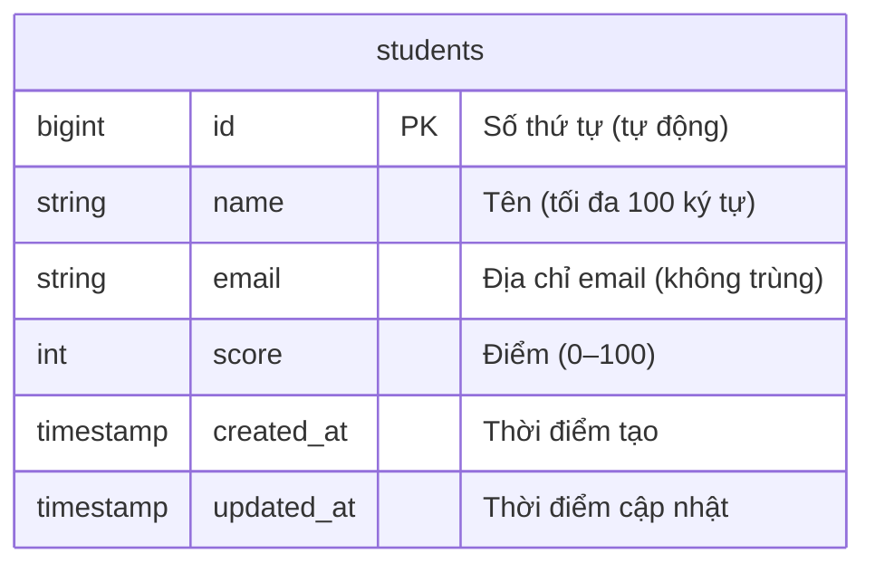
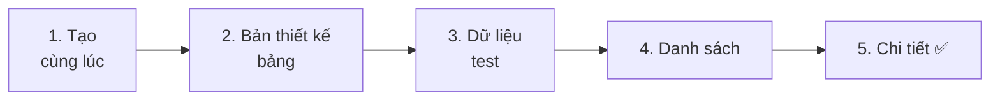
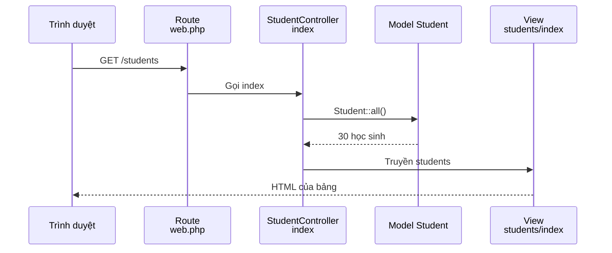

# Cùng làm ứng dụng quản lý học sinh ① — Chuẩn bị, danh sách và chi tiết

> 🇯🇵 Bản gốc (tiếng Nhật): [20261119_資料_1.md](<../../../1年生_データ設計とアプリ開発/後期/20261119/20261119_資料_1.md>) <!-- original-ja-link -->

Từ hôm nay, chúng ta sẽ bắt đầu làm một ứng dụng mới: **ứng dụng quản lý học sinh**.
Lần này, hãy vận dụng những gì đã học từ ứng dụng Todo để **tự mình** làm nhé.

## Mục tiêu hôm nay
- Dùng `make:model -mf` để tạo model, migration và Factory cùng một lúc
- Tạo bảng học sinh và đưa dữ liệu test vào
- Làm được trang danh sách và trang chi tiết học sinh

> Hãy khởi động mysql và laravel của môi trường luyện tập (`php-study`) trước khi bắt đầu.
> Chúng ta sẽ thêm ứng dụng quản lý học sinh vào **cùng project (`src`)** với ứng dụng Todo.

---

## 1. Ứng dụng quản lý học sinh là gì?

Đây là ứng dụng để giáo viên quản lý **tên, địa chỉ email và điểm** của học sinh.

```
生徒管理アプリ

[ 生徒を追加 ]

| 名前       | 点数 |
|------------|------|
| 山田 太郎  |  85  |
| 佐藤 花子  |  92  |
| 鈴木 一郎  |  70  |
```

Chúng ta sẽ phát triển ứng dụng này từng chút một trong 3 buổi, bắt đầu từ hôm nay.

| Buổi | Nội dung sẽ làm |
|----|---------|
| **Buổi 1 (hôm nay)** | Danh sách, chi tiết, thêm, sửa, xóa học sinh (CRUD) |
| Buổi 2 | Đăng nhập (chỉ giáo viên mới dùng được) |
| Buổi 3 | Quan hệ (ghi lại học sinh nào do giáo viên nào đăng ký) |

> **Ứng dụng sẽ tiếp tục dùng ở năm 2**
> Lên năm 2, các em sẽ chuyển ứng dụng này thành **API** (cơ chế chỉ trả về dữ liệu, không trả về màn hình).
> Bảng và URL làm hôm nay cũng sẽ được dùng nguyên như vậy ở năm 2.

### Thử so sánh với ứng dụng Todo

Cách làm gần như giống hệt ứng dụng Todo.

| | Ứng dụng Todo | Ứng dụng quản lý học sinh |
|---|---|---|
| Bảng | `todos` | `students` |
| Model | `Todo` | `Student` |
| Controller | `TodoController` | `StudentController` |
| URL | `/todos` | `/students` |
| Thư mục view | `resources/views/todos/` | `resources/views/students/` |

### Bảng học sinh



So với bảng Todo, có những điểm khác sau.

| Cột | Điểm mới |
|----|------------|
| `email` | **Không thể đăng ký 2 học sinh có cùng địa chỉ email** (không trùng) |
| `score` | Lưu **số nguyên** (`integer`), không phải chữ |

---

## 2. Cùng làm thử



### 1. Tạo model, migration và Factory cùng một lúc

> Đang ở đây: **🟢 1. Tạo cùng lúc** → 2. Bản thiết kế → 3. Dữ liệu test → 4. Danh sách → 5. Chi tiết

Với Todo, chúng ta đã tạo migration, model và Factory từng cái một.
Lần này, chúng ta sẽ tạo **cùng lúc bằng 1 lệnh**.

```powershell
docker compose exec laravel php artisan make:model Student -mf
```

| Phần | Ý nghĩa |
|------|------|
| `make:model Student` | Tạo model `Student` |
| `-m` | Tạo luôn cả migration (**m**igration) |
| `-f` | Tạo luôn cả Factory (**f**actory) |

Sẽ có 3 file sau được tạo ra.

```
src/
├─ app/Models/Student.php ··································· Model
├─ database/migrations/xxxx_create_students_table.php ······· Migration
└─ database/factories/StudentFactory.php ···················· Factory
```

Vì đã thêm `-f`, nên model có sẵn `HasFactory` ngay từ đầu (với Todo, chúng ta đã phải tự viết thêm).

```php
class Student extends Model
{
    /** @use HasFactory<\Database\Factories\StudentFactory> */
    use HasFactory;
}
```

---

### 2. Viết bản thiết kế bảng (migration)

> Đang ở đây: 1. Tạo cùng lúc → **🟢 2. Bản thiết kế** → 3. Dữ liệu test → 4. Danh sách → 5. Chi tiết

Mở `database/migrations/xxxx_create_students_table.php` và sửa phần bên trong `up()` như sau.

```php
    public function up(): void
    {
        Schema::create('students', function (Blueprint $table) {
            $table->id();
            $table->string('name', 100);
            $table->string('email')->unique();
            $table->integer('score')->default(0);
            $table->timestamps();
        });
    }
```

| Code | Ý nghĩa |
|--------|------|
| `$table->string('name', 100)` | Tên. Tối đa 100 ký tự |
| `$table->string('email')->unique()` | Địa chỉ email. **Không thể nhập cùng một giá trị 2 lần** |
| `$table->integer('score')->default(0)` | Điểm. Là số nguyên, nếu không nhập gì thì là 0 |

👀 **Xem trước khi chạy**: Hãy kiểm tra trong database `laravel` trên phpMyAdmin (http://localhost:8080) rằng bảng `students` **vẫn chưa có**.
Chỉ viết bản thiết kế thôi thì bảng vẫn chưa được tạo.

```powershell
docker compose exec laravel php artisan migrate
```

✅ **Kiểm tra**: Nếu trên phpMyAdmin đã có bảng `students` thì OK.

---

### 3. Đưa dữ liệu test vào (Factory, Seeder)

> Đang ở đây: 1. Tạo cùng lúc → 2. Bản thiết kế → **🟢 3. Dữ liệu test** → 4. Danh sách → 5. Chi tiết

#### ① Viết cách tạo học sinh vào Factory

Sửa phần bên trong `definition()` của `database/factories/StudentFactory.php` như sau.

```php
    public function definition(): array
    {
        return [
            'name' => fake('ja_JP')->name(),
            'email' => fake()->unique()->safeEmail(),
            'score' => fake()->numberBetween(0, 100),
        ];
    }
```

| Code | Ý nghĩa |
|--------|------|
| `fake('ja_JP')->name()` | Tạo ngẫu nhiên **tên tiếng Nhật** (ví dụ: 山田 太郎) |
| `fake()->unique()->safeEmail()` | Tạo ngẫu nhiên địa chỉ email. Dùng `unique()` để đảm bảo các địa chỉ được tạo không trùng nhau |
| `fake()->numberBetween(0, 100)` | Tạo ngẫu nhiên số nguyên từ 0 đến 100 |

> Không dùng tên hay địa chỉ email của học sinh thật để luyện tập. Chúng ta tạo **dữ liệu giả** bằng Factory.

#### ② Tạo Seeder và thêm 30 học sinh

```powershell
docker compose exec laravel php artisan make:seeder StudentSeeder
```

Sửa phần bên trong `run()` của `database/seeders/StudentSeeder.php` như sau.

```php
<?php

namespace Database\Seeders;

use App\Models\Student;
use Illuminate\Database\Seeder;

class StudentSeeder extends Seeder
{
    public function run(): void
    {
        Student::factory()->count(30)->create();
    }
}
```

Viết thêm 1 dòng có dấu ★ vào `database/seeders/DatabaseSeeder.php`.

```php
    public function run(): void
    {
        $this->call(TodoSeeder::class);
        $this->call(StudentSeeder::class);  // ★ Thêm
    }
```

```powershell
docker compose exec laravel php artisan migrate:fresh --seed
```

✅ **Kiểm tra**: Mở bảng `students` trên phpMyAdmin, nếu có 30 học sinh thì OK.
(Vì dùng `migrate:fresh` nên dữ liệu Todo cũng sẽ trở về trạng thái ban đầu)

---

### 4. Làm trang danh sách

> Đang ở đây: 1. Tạo cùng lúc → 2. Bản thiết kế → 3. Dữ liệu test → **🟢 4. Danh sách** → 5. Chi tiết

#### ① Tạo controller

```powershell
docker compose exec laravel php artisan make:controller StudentController
```

Sửa `app/Http/Controllers/StudentController.php` như sau.

```php
<?php

namespace App\Http\Controllers;

use App\Models\Student;
use Illuminate\Http\Request;

class StudentController extends Controller
{
    public function index()
    {
        $students = Student::all();

        return view('students.index', ['students' => $students]);
    }
}
```

So với `index` của `TodoController`, chỉ khác là `Todo` đổi thành `Student`.

#### ② Viết route

Viết thêm 2 dòng có dấu ★ vào `routes/web.php`.

```php
use App\Http\Controllers\StudentController;  // ★ Thêm (viết ở phía trên)

// (Lược bỏ phần route của Todo)

Route::get('/students', [StudentController::class, 'index']);  // ★ Thêm
```

#### ③ Tạo view

Tạo thư mục `students` bên trong `resources/views`, rồi tạo file `index.blade.php`.
Ở đây chúng ta cũng dùng **các thành phần header và footer** đã làm vào ngày 12/11.

```html
@include('layouts.header', ['title' => '生徒一覧'])

    <h1>生徒一覧</h1>

    <table border="1">
        <tr>
            <th>名前</th>
            <th>点数</th>
        </tr>
        @foreach ($students as $student)
            <tr>
                <td><a href="/students/{{ $student->id }}">{{ $student->name }}</a></td>
                <td>{{ $student->score }}</td>
            </tr>
        @endforeach
    </table>

@include('layouts.footer')
```

| Code | Ý nghĩa |
|--------|------|
| `<table>` | Tạo bảng. `<tr>` là 1 hàng, `<th>` là tiêu đề, `<td>` là ô |
| `border="1"` | Thêm đường viền cho bảng |

#### ④ Thêm link 「生徒管理」(Quản lý học sinh) vào header

Viết thêm link có dấu ★ vào `resources/views/layouts/header.blade.php`.

```html
    <header>
        <a href="/todos">TODOアプリ</a>
        <a href="/students">生徒管理</a>  {{-- ★ Thêm --}}
    </header>
```

**Chỉ cần sửa 1 chỗ trong thành phần, link sẽ hiện ra ở cả trang Todo lẫn trang học sinh** (đây chính là sức mạnh của việc dùng chung đã học vào ngày 12/11).

Luồng xử lý từ khi mở `/students` đến khi danh sách được hiển thị cũng giống như với Todo.



✅ **Kiểm tra**: Mở http://localhost:8000/students, nếu 30 học sinh được hiển thị dưới dạng bảng thì OK.

---

### 5. Làm trang chi tiết

> Đang ở đây: 1. Tạo cùng lúc → 2. Bản thiết kế → 3. Dữ liệu test → 4. Danh sách → **🟢 5. Chi tiết**

#### ① Viết thêm show vào controller

Viết thêm `show` có dấu ★ vào `StudentController.php`.

```php
    // ★ Thêm từ đây
    public function show($id)
    {
        $student = Student::findOrFail($id);

        return view('students.show', ['student' => $student]);
    }
    // ★ Đến đây
```

#### ② Viết thêm route

```php
Route::get('/students', [StudentController::class, 'index']);
Route::get('/students/{id}', [StudentController::class, 'show']);  // ★ Thêm
```

#### ③ Tạo view

Tạo file `resources/views/students/show.blade.php`.

```html
@include('layouts.header', ['title' => $student->name])

    <h1>{{ $student->name }}</h1>

    <p>番号：{{ $student->id }}</p>
    <p>メールアドレス：{{ $student->email }}</p>
    <p>点数：{{ $student->score }}点</p>

    <a href="/students">一覧にもどる</a>

@include('layouts.footer')
```

✅ **Kiểm tra**: Bấm vào tên học sinh trong danh sách, nếu trang chi tiết hiện ra thì OK.
Hãy thử mở URL của học sinh không tồn tại, ví dụ http://localhost:8000/students/999, và kiểm tra xem có ra `404 Not Found` không nhé.

---

## 3. Khi không chạy được

> **🔥 Không chạy được thì hãy xuất log!** → [【Quan trọng】Cách xuất log](../20261022/【重要】ログの出し方.md)

| Triệu chứng | Nơi gây lỗi | Cách xử lý |
|------|----------|------|
| `Table 'laravel.students' doesn't exist` | Migration | Kiểm tra xem đã chạy `php artisan migrate` (hoặc `migrate:fresh --seed`) chưa |
| `Call to undefined method App\Models\Student::factory()` | Model | Quên thêm `-f` vào `make:model`. Hãy viết thêm `use HasFactory;` vào `Student.php` |
| Tên được tạo bằng tiếng Anh (ví dụ: John Smith) | Factory | Kiểm tra xem đã viết `'ja_JP'` trong `fake('ja_JP')->name()` chưa |
| `Target class [StudentController] does not exist.` | Route | Kiểm tra xem ở đầu file `web.php` đã có `use App\Http\Controllers\StudentController;` chưa |
| `View [students.index] not found.` | View | Kiểm tra vị trí của `resources/views/students/index.blade.php` (`students` có chữ `s` ở cuối) |
| `Undefined variable $title` | View | Kiểm tra xem có quên viết phần `['title' => ...]` trong `@include('layouts.header', ['title' => ...])` không |

---

## 4. Tổng kết

| Những gì đã viết hôm nay | Tóm tắt ngắn gọn |
|--------------|-----------|
| `make:model Student -mf` | Tạo model, migration và Factory cùng một lúc |
| `->unique()` (migration) | Biến cột thành cột không thể nhập cùng một giá trị 2 lần |
| `$table->integer(...)` | Cột số nguyên |
| `fake('ja_JP')->name()` | Tạo ngẫu nhiên tên tiếng Nhật |
| `index` và `show` | Làm danh sách và chi tiết theo cùng kiểu với Todo |
| `<table>` | Hiển thị danh sách dưới dạng bảng |

**Cách làm giống hệt Todo. Chỉ cần đổi tên từ `Todo` thành `Student` khi suy nghĩ, các em có thể tự làm được.**

Tiếp theo, chúng ta sẽ bổ sung chức năng thêm, sửa và xóa học sinh → [Cùng làm ứng dụng quản lý học sinh ② — Thêm, sửa, xóa](./20261119_資料_2.md)

<!-- nav:start -->

---

| ⬅️ Trước | 🗺️ Sơ đồ tổng thể | Tiếp ➡️ |
|:--|:--:|--:|
| [12/11 Thêm danh mục](../20261112/20261112_資料_2.md) | [Sơ đồ tổng thể tài liệu](../../README.md) | [19/11 Quản lý học sinh ② Thêm, sửa, xóa](20261119_資料_2.md) |

<!-- nav:end -->
