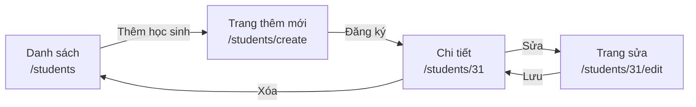
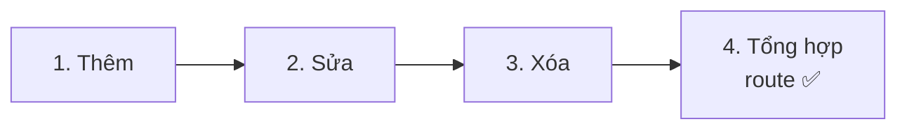
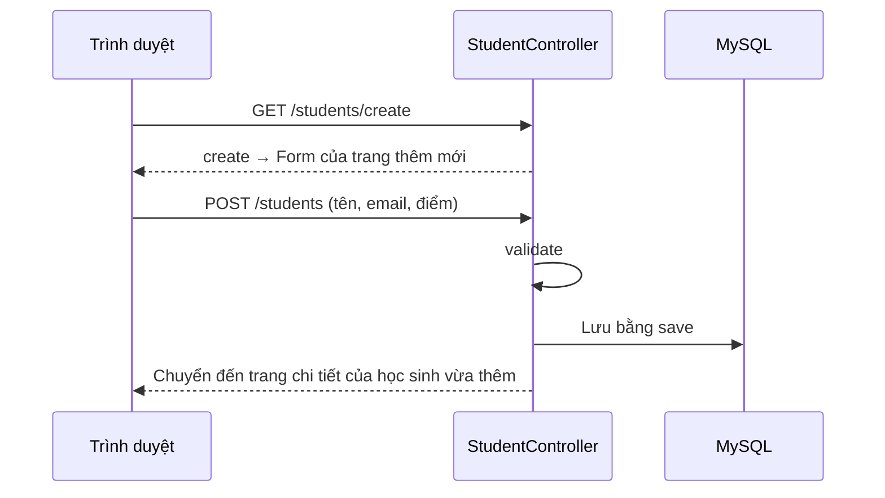
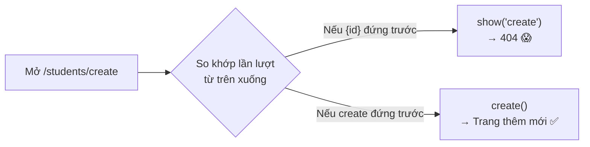
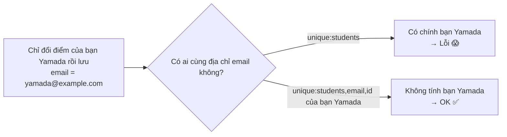

# Cùng làm ứng dụng quản lý học sinh ② — Thêm, sửa, xóa

> 🇯🇵 Bản gốc (tiếng Nhật): [20261119_資料_2.md](<../../../1年生_データ設計とアプリ開発/後期/20261119/20261119_資料_2.md>) <!-- original-ja-link -->

Ở [Tài liệu 1](./20261119_資料_1.md), chúng ta đã làm xong danh sách và chi tiết học sinh.
Tiếp theo, chúng ta sẽ làm chức năng **thêm, sửa, xóa** học sinh.

## Mục tiêu hôm nay
- Làm được form có nhiều ô nhập dưới dạng một trang riêng để thêm mới
- Kiểm tra được email bị trùng (`unique`) và phạm vi điểm (`integer`, `min`, `max`)
- Khi sửa, có thể **loại địa chỉ email của chính học sinh đang sửa ra khỏi việc kiểm tra trùng**

> Chúng ta bắt đầu từ trạng thái đã làm xong phần "danh sách, chi tiết" của Tài liệu 1.

---

## 1. Khác biệt so với Todo

Cách làm gần như giống Todo, nhưng có 2 điểm khác.

| | Ứng dụng Todo | Ứng dụng quản lý học sinh |
|---|---|---|
| Vị trí form thêm mới | Phía trên trang danh sách | Tạo **trang riêng để thêm mới** (`/students/create`) |
| Ô nhập | Chỉ có tiêu đề | **3 ô**: tên, địa chỉ email, điểm |

Vì có nhiều ô nhập, nếu đặt phía trên danh sách sẽ khó nhìn. Vì vậy, chúng ta tạo riêng một **trang để thêm mới**.



---

## 2. Cùng làm thử



### 1. Làm chức năng thêm

> Đang ở đây: **🟢 1. Thêm** → 2. Sửa → 3. Xóa → 4. Tổng hợp route

#### ① Hiển thị trang thêm mới (create)

Viết thêm `create` có dấu ★ vào `StudentController.php`.

```php
    // ★ Thêm từ đây
    public function create()
    {
        return view('students.create');
    }
    // ★ Đến đây
```

`create` là method **chỉ để hiển thị form thêm mới**. Nó không dùng đến database.

#### ② Tạo view cho trang thêm mới

Tạo file `resources/views/students/create.blade.php`.

```html
@include('layouts.header', ['title' => '生徒の追加'])

    <h1>生徒の追加</h1>

    <form method="POST" action="/students">
        @csrf

        <p>
            名前：
            <input type="text" name="name" value="{{ old('name') }}" required>
            @error('name') <span style="color: red;">{{ $message }}</span> @enderror
        </p>

        <p>
            メールアドレス：
            <input type="email" name="email" value="{{ old('email') }}" required>
            @error('email') <span style="color: red;">{{ $message }}</span> @enderror
        </p>

        <p>
            点数：
            <input type="number" name="score" value="{{ old('score') }}" min="0" max="100" required>
            @error('score') <span style="color: red;">{{ $message }}</span> @enderror
        </p>

        <button type="submit">登録</button>
    </form>

    <a href="/students">一覧にもどる</a>

@include('layouts.footer')
```

| Code | Ý nghĩa |
|--------|------|
| `type="email"` | Ô nhập dành cho email. Trình duyệt sẽ kiểm tra giúp xem có đúng định dạng email không |
| `type="number" min="0" max="100"` | Ô nhập dành cho số. Chỉ cho nhập từ 0 đến 100 |
| `@error('name')` ~ `@enderror` | Hiển thị thông báo lỗi cho từng ô nhập (giống ngày 5/11) |
| `old('name')` | Giữ lại giá trị đã nhập khi quay lại do lỗi (giống ngày 5/11) |

Hãy thêm cả link đến trang thêm mới vào bên dưới `<h1>` của trang danh sách (`students/index.blade.php`).

```html
    <h1>生徒一覧</h1>

    <a href="/students/create">生徒を追加</a>  {{-- ★ Thêm --}}
```

#### ③ Lưu (store)

Viết thêm `store` có dấu ★ vào `StudentController.php`.

```php
    // ★ Thêm từ đây
    public function store(Request $request)
    {
        $request->validate([
            'name' => 'required|max:100',
            'email' => 'required|email|unique:students',
            'score' => 'required|integer|min:0|max:100',
        ], [
            'name.required' => '名前を入力してください。',
            'name.max' => '名前は100文字以内で入力してください。',
            'email.required' => 'メールアドレスを入力してください。',
            'email.email' => 'メールアドレスの形で入力してください。',
            'email.unique' => 'そのメールアドレスは、すでに登録されています。',
            'score.required' => '点数を入力してください。',
            'score.integer' => '点数は整数で入力してください。',
            'score.min' => '点数は0以上で入力してください。',
            'score.max' => '点数は100以下で入力してください。',
        ]);

        $student = new Student();
        $student->name = $request->input('name');
        $student->email = $request->input('email');
        $student->score = $request->input('score');
        $student->save();

        return redirect('/students/' . $student->id);
    }
    // ★ Đến đây
```

Đây là các quy tắc validation mới xuất hiện.

| Quy tắc | Ý nghĩa |
|--------|------|
| `email` | Có đúng định dạng email không (có `@` hay không, v.v.) |
| `unique:students` | Trong bảng `students`, **đã có giá trị giống vậy chưa** |
| `integer` | Có phải số nguyên không |
| `min:0`, `max:100` | Có nằm trong khoảng từ 0 đến 100 không (khi dùng cùng `integer`, sẽ kiểm tra theo **độ lớn của số**) |

> **`max:100` mang ý nghĩa khác nhau ở 2 chỗ**
> `max:100` của `name` là "tối đa **100 ký tự**", còn `max:100` của `score` là "**từ 100 trở xuống**".
> Nếu có `integer` thì kiểm tra theo độ lớn của số, nếu không có thì kiểm tra theo số ký tự.

Sau khi lưu, trang sẽ chuyển đến trang chi tiết của học sinh vừa thêm.

Việc thêm mới được chia thành **2 lần trao đổi**: "hiển thị form (`create`)" và "lưu (`store`)".



#### ④ Viết thêm route

Viết thêm 2 dòng có dấu ★ vào `routes/web.php`. Hãy **chú ý thứ tự viết**.

```php
Route::get('/students', [StudentController::class, 'index']);
Route::get('/students/create', [StudentController::class, 'create']);  // ★ Thêm (đặt phía trên {id}!)
Route::post('/students', [StudentController::class, 'store']);         // ★ Thêm
Route::get('/students/{id}', [StudentController::class, 'show']);
```

> ⚠️ **Viết `/students/create` phía trên `/students/{id}`**
> Các route được so khớp **lần lượt từ trên xuống**.
> Nếu viết `/students/{id}` trước, thì `create` trong `/students/create` sẽ bị hiểu là `{id}`.
> Khi đó, `show('create')` sẽ chạy và tìm học sinh có `id` là `create`, dẫn đến `404 Not Found`.



✅ **Kiểm tra**: Hãy thử đăng ký 1 học sinh từ link 「生徒を追加」(Thêm học sinh) trên trang danh sách. Thử thêm 3 việc sau nữa.

| Việc cần làm | Kết quả như sau là OK |
|---------|------------|
| Đăng ký bình thường | Trang chi tiết hiện ra |
| Đăng ký với **cùng địa chỉ email** với một học sinh đã có trong danh sách | Hiện 「そのメールアドレスは、すでに登録されています。」(Địa chỉ email đó đã được đăng ký rồi.) |
| Dùng Developer Tools xóa `max="100"` của ô điểm, rồi đăng ký với `150` | Hiện 「点数は100以下で入力してください。」(Hãy nhập điểm từ 100 trở xuống.) |

---

### 2. Làm chức năng sửa

> Đang ở đây: 1. Thêm → **🟢 2. Sửa** → 3. Xóa → 4. Tổng hợp route

#### ① Hiển thị trang sửa (edit)

Viết thêm `edit` có dấu ★ vào `StudentController.php`.

```php
    // ★ Thêm từ đây
    public function edit($id)
    {
        $student = Student::findOrFail($id);

        return view('students.edit', ['student' => $student]);
    }
    // ★ Đến đây
```

#### ② Tạo view cho trang sửa

Tạo file `resources/views/students/edit.blade.php`. Những chỗ khác với trang thêm mới được đánh dấu ★.

```html
@include('layouts.header', ['title' => '生徒の編集'])

    <h1>生徒の編集</h1>

    <form method="POST" action="/students/{{ $student->id }}">  {{-- ★ Nơi gửi đến --}}
        @csrf
        @method('PUT')  {{-- ★ PUT --}}

        <p>
            名前：
            <input type="text" name="name" value="{{ old('name', $student->name) }}" required>  {{-- ★ Giá trị hiện tại --}}
            @error('name') <span style="color: red;">{{ $message }}</span> @enderror
        </p>

        <p>
            メールアドレス：
            <input type="email" name="email" value="{{ old('email', $student->email) }}" required>  {{-- ★ Giá trị hiện tại --}}
            @error('email') <span style="color: red;">{{ $message }}</span> @enderror
        </p>

        <p>
            点数：
            <input type="number" name="score" value="{{ old('score', $student->score) }}" min="0" max="100" required>  {{-- ★ Giá trị hiện tại --}}
            @error('score') <span style="color: red;">{{ $message }}</span> @enderror
        </p>

        <button type="submit">保存</button>
    </form>

    <a href="/students/{{ $student->id }}">もどる</a>

@include('layouts.footer')
```

Hãy thêm cả link đến trang sửa vào trang chi tiết (`students/show.blade.php`).

```html
    <p>点数：{{ $student->score }}点</p>

    <a href="/students/{{ $student->id }}/edit">編集</a>  {{-- ★ Thêm --}}
```

#### ③ Lưu (update)

Viết thêm `update` có dấu ★ vào `StudentController.php`.

```php
    // ★ Thêm từ đây
    public function update(Request $request, $id)
    {
        // ① Trước tiên, lấy học sinh cần sửa
        $student = Student::findOrFail($id);

        // ② Kiểm tra (với email, loại chính học sinh này ra khỏi việc kiểm tra trùng)
        $request->validate([
            'name' => 'required|max:100',
            'email' => 'required|email|unique:students,email,' . $student->id,
            'score' => 'required|integer|min:0|max:100',
        ], [
            'name.required' => '名前を入力してください。',
            'name.max' => '名前は100文字以内で入力してください。',
            'email.required' => 'メールアドレスを入力してください。',
            'email.email' => 'メールアドレスの形で入力してください。',
            'email.unique' => 'そのメールアドレスは、すでに登録されています。',
            'score.required' => '点数を入力してください。',
            'score.integer' => '点数は整数で入力してください。',
            'score.min' => '点数は0以上で入力してください。',
            'score.max' => '点数は100以下で入力してください。',
        ]);

        // ③ Ghi đè rồi lưu
        $student->name = $request->input('name');
        $student->email = $request->input('email');
        $student->score = $request->input('score');
        $student->save();

        return redirect('/students/' . $student->id);
    }
    // ★ Đến đây
```

##### Lý do thêm `$student->id` vào sau `unique:students,email,`

Giả sử trên trang sửa, em **chỉ đổi điểm** rồi lưu.
Vì không đổi địa chỉ email, nên trong bảng `students` đã có sẵn **địa chỉ email của chính học sinh đang sửa**.
Nếu vẫn để `unique:students` giống như ở `store`, sẽ bị báo là "đã được đăng ký rồi".



| Cách viết | Ý nghĩa |
|--------|------|
| `unique:students` | Trong bảng `students` có giá trị giống vậy không |
| `unique:students,email,` . `$student->id` | Trong cột `email` của bảng `students` có giá trị giống vậy không. **Nhưng không tính học sinh này (`$student->id`)** |

> **Tại sao dùng `$student->id` chứ không dùng `$id`?**
> `$id` là giá trị đến từ URL. Người dùng có thể tùy ý sửa URL.
> Còn `$student->id`, sau khi được lấy bằng `findOrFail`, là **giá trị đáng tin cậy, đến từ database**.
> Tài liệu chính thức của Laravel cũng lưu ý rằng ID dùng để loại ra khỏi việc kiểm tra trùng thì "không được dùng giá trị do người dùng gửi lên".
> Vì vậy, chúng ta sắp xếp theo thứ tự **lấy về bằng `findOrFail` trước**.

#### ④ Viết thêm route

```php
Route::get('/students/{id}', [StudentController::class, 'show']);
Route::get('/students/{id}/edit', [StudentController::class, 'edit']);  // ★ Thêm
Route::put('/students/{id}', [StudentController::class, 'update']);     // ★ Thêm
```

✅ **Kiểm tra**: Hãy thử 3 việc sau.

| Việc cần làm | Kết quả như sau là OK |
|---------|------------|
| Chỉ đổi điểm rồi lưu | Không bị lỗi, điểm trên trang chi tiết thay đổi |
| Đổi tên rồi lưu | Tên trên trang chi tiết thay đổi |
| Đổi địa chỉ email cho giống với **học sinh khác** rồi lưu | Hiện 「そのメールアドレスは、すでに登録されています。」(Địa chỉ email đó đã được đăng ký rồi.) |

---

### 3. Làm chức năng xóa

> Đang ở đây: 1. Thêm → 2. Sửa → **🟢 3. Xóa** → 4. Tổng hợp route

#### ① Viết destroy

Viết thêm `destroy` có dấu ★ vào `StudentController.php`.

```php
    // ★ Thêm từ đây
    public function destroy($id)
    {
        $student = Student::findOrFail($id);
        $student->delete();

        return redirect('/students');
    }
    // ★ Đến đây
```

#### ② Thêm nút xóa vào trang chi tiết

Viết thêm form có dấu ★ vào bên dưới link sửa trong `students/show.blade.php`.

```html
    <a href="/students/{{ $student->id }}/edit">編集</a>

    {{-- ★ Thêm từ đây --}}
    <form method="POST" action="/students/{{ $student->id }}" onsubmit="return confirm('削除しますか？');">
        @csrf
        @method('DELETE')
        <button type="submit">削除</button>
    </form>
    {{-- ★ Đến đây --}}
```

#### ③ Viết thêm route

```php
Route::delete('/students/{id}', [StudentController::class, 'destroy']);  // ★ Thêm
```

✅ **Kiểm tra**: Bấm 「削除」(Xóa) trên trang chi tiết, nếu học sinh đó biến mất khỏi danh sách thì OK.

---

### 4. Tổng hợp route ✅

> Đang ở đây: 1. Thêm → 2. Sửa → 3. Xóa → **🟢 4. Tổng hợp route**

Ứng dụng quản lý học sinh giờ có tổng cộng **7 route**. `routes/web.php` sẽ như sau.

```php
Route::get('/students', [StudentController::class, 'index']);
Route::get('/students/create', [StudentController::class, 'create']);
Route::post('/students', [StudentController::class, 'store']);
Route::get('/students/{id}', [StudentController::class, 'show']);
Route::get('/students/{id}/edit', [StudentController::class, 'edit']);
Route::put('/students/{id}', [StudentController::class, 'update']);
Route::delete('/students/{id}', [StudentController::class, 'destroy']);
```

| Route | Phụ trách | Việc làm | Màn hình |
|--------|------|---------|------|
| `GET /students` | `index` | Hiển thị danh sách | Có |
| `GET /students/create` | `create` | Hiển thị trang thêm mới | Có |
| `POST /students` | `store` | Thêm và lưu | Không (chuyển đến chi tiết) |
| `GET /students/{id}` | `show` | Hiển thị chi tiết | Có |
| `GET /students/{id}/edit` | `edit` | Hiển thị trang sửa | Có |
| `PUT /students/{id}` | `update` | Ghi đè rồi lưu | Không (chuyển đến chi tiết) |
| `DELETE /students/{id}` | `destroy` | Xóa | Không (chuyển đến danh sách) |

> **7 route này là khuôn mẫu cố định của Laravel**
> Khi có đủ danh sách, thêm, chi tiết, sửa, xóa, thì hầu hết ứng dụng đều có 7 route này.
> Vì vậy, Laravel còn có cách viết `Route::resource('students', StudentController::class);` để **viết 7 route này chỉ bằng 1 dòng**.
> Hôm nay, chúng ta viết thành 7 dòng để hiểu ý nghĩa của từng route.
>
> **Ở năm 2**, trong số này, chúng ta sẽ chuyển **5 route (không dùng `create`, `edit` vốn chỉ để hiển thị màn hình)** thành API.

---

## 3. Khi không chạy được

> **🔥 Không chạy được thì hãy xuất log!** → [【Quan trọng】Cách xuất log](../20261022/【重要】ログの出し方.md)

| Triệu chứng | Nơi gây lỗi | Cách xử lý |
|------|----------|------|
| Bấm 「生徒を追加」(Thêm học sinh) thì ra `404 Not Found` | Route | Kiểm tra xem route `/students/create` có nằm **phía trên** `/students/{id}` không |
| Chỉ đổi điểm rồi lưu thì bị báo "đã được đăng ký rồi" | Controller | Kiểm tra xem phía sau `unique:students,email,` trong `update` đã có `. $student->id` chưa |
| Vẫn đăng ký được với địa chỉ email giống học sinh khác | Controller | Kiểm tra xem trong `store` đã có `unique:students` chưa |
| `SQLSTATE[23000]: ... Duplicate entry` | Controller | Kiểm tra xem có quên viết `unique` trong validation không (đang bị chặn bởi `unique` phía database) |
| Nhập `150` vào điểm mà vẫn đăng ký được | Controller | Kiểm tra xem `score` đã có `integer` chưa (nếu không có, sẽ kiểm tra theo **số ký tự** (3 ký tự) chứ không theo độ lớn của số) |
| Khi quay lại do lỗi, ô nhập bị trống | View | Kiểm tra xem đã viết `value="{{ old('...') }}"` chưa |

---

## 4. Tổng kết

| Những gì đã viết hôm nay | Tóm tắt ngắn gọn |
|--------------|-----------|
| `create` và `create.blade.php` | Trang chỉ để hiển thị form thêm mới |
| `email`, `unique:students` | Có đúng định dạng email không, có bị trùng không |
| `integer`, `min:0`, `max:100` | Có phải số nguyên từ 0 đến 100 không |
| `unique:students,email,` . `$student->id` | Khi sửa, loại chính mình ra khỏi việc kiểm tra trùng |
| Đặt `/students/create` phía trên `{id}` | Các route được so khớp lần lượt từ trên xuống |
| 7 route | Khuôn mẫu cố định của Laravel cho danh sách, thêm, chi tiết, sửa, xóa |

**Chỉ với những gì đã học từ Todo, chúng ta đã làm được một ứng dụng mới.** Buổi sau, chúng ta sẽ thêm **đăng nhập** vào ứng dụng này để chỉ giáo viên mới dùng được.

<!-- nav:start -->

---

| ⬅️ Trước | 🗺️ Sơ đồ tổng thể | Tiếp ➡️ |
|:--|:--:|--:|
| [19/11 Quản lý học sinh ① Danh sách, chi tiết](20261119_資料_1.md) | [Sơ đồ tổng thể tài liệu](../../README.md) | [26/11 Quản lý học sinh ③ Đăng nhập](../20261126/20261126_資料_1.md) |

<!-- nav:end -->
