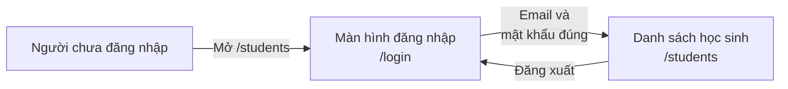
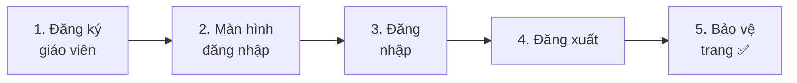
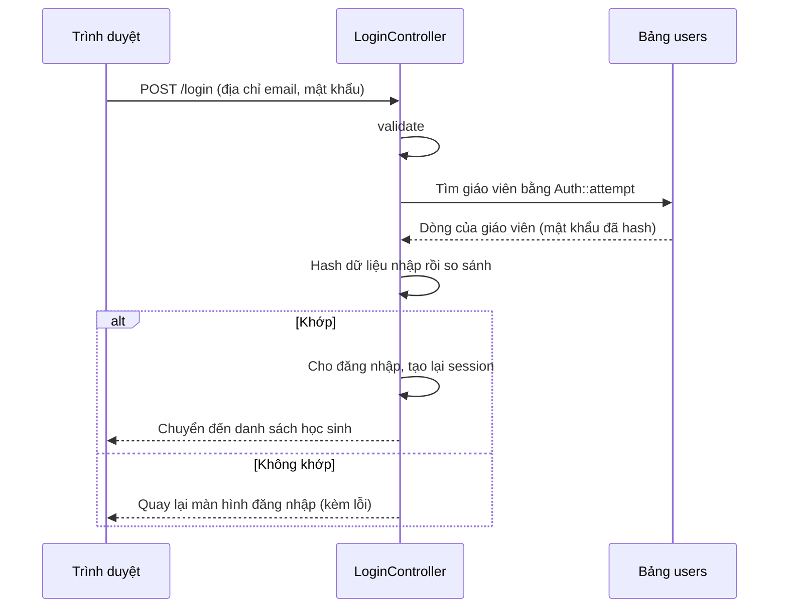
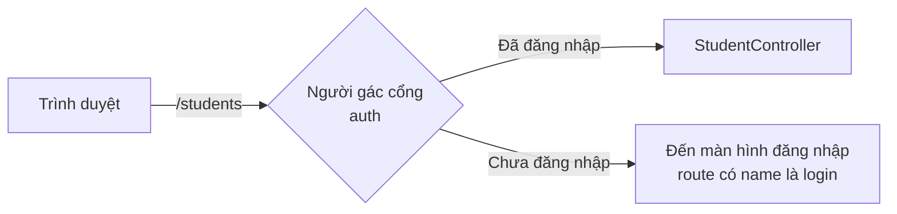
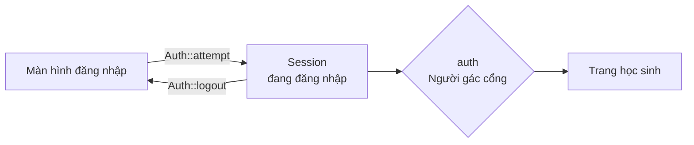

# Cùng làm ứng dụng quản lý học sinh ③ — Đăng nhập

> 🇯🇵 Bản gốc (tiếng Nhật): [20261126_資料_1.md](<../../../1年生_データ設計とアプリ開発/後期/20261126/20261126_資料_1.md>) <!-- original-ja-link -->

Tên và địa chỉ email của học sinh là **thông tin không được để bất kỳ ai cũng có thể xem**.
Hôm nay, chúng ta sẽ thêm **đăng nhập** vào ứng dụng quản lý học sinh để chỉ giáo viên mới dùng được.

## Mục tiêu hôm nay
- Hiểu cơ chế đăng nhập (hash mật khẩu, session)
- Làm được màn hình đăng nhập và chức năng đăng xuất
- Chặn người chưa đăng nhập không cho xem các trang học sinh (`auth`)

> Chúng ta bắt đầu từ trạng thái đã làm xong "ứng dụng quản lý học sinh (thêm, sửa, xóa)" của ngày 19/11.

---

## 1. Cơ chế đăng nhập

### Những gì làm hôm nay



- Khi người chưa đăng nhập mở `/students`, họ sẽ **bị chuyển sang màn hình đăng nhập**
- Nhập đúng địa chỉ email và mật khẩu thì sẽ dùng được các trang học sinh
- Các trang của ứng dụng Todo vẫn ai cũng dùng được như trước

### Giáo viên được lưu vào bảng `users`

Giáo viên đăng nhập sẽ được lưu vào **bảng `users` có sẵn từ đầu** trong Laravel.
(Thật ra, bảng này đã có từ lần đầu tiên các em khởi động môi trường luyện tập)

| Cột | Ý nghĩa |
|----|------|
| `name` | Tên giáo viên |
| `email` | Địa chỉ email dùng để đăng nhập |
| `password` | Mật khẩu (được **hash** rồi mới lưu) |

### "Hash" mật khẩu

Mật khẩu **không được lưu nguyên như vậy vào database**.
Vì nếu nội dung database bị lộ ra ngoài, người khác sẽ biết được mật khẩu của tất cả mọi người.

Vì vậy, chúng ta **hash** mật khẩu (biến đổi thành một chuỗi ký tự lộn xộn, không thể khôi phục lại như cũ) rồi mới lưu.

```
Mật khẩu đã nhập           Giá trị lưu vào database
password          ─→     $2y$12$Kx8f3...(chuỗi ký tự lộn xộn khoảng 60 ký tự)
```

| | Mã hóa thông thường | Hash |
|---|---|---|
| Có khôi phục lại được không? | Được (nếu có khóa) | **Không được** |
| Khi đăng nhập thì sao? | — | Hash mật khẩu vừa nhập theo cùng cách đó rồi **so sánh** |

Laravel sẽ tự động hash giúp chúng ta.

### Session: cơ chế ghi nhớ "đang đăng nhập"

Sau khi đăng nhập một lần, nếu mỗi lần chuyển trang lại phải nhập lại mật khẩu thì rất phiền.
Laravel dùng một cơ chế gọi là **session** để ghi nhớ rằng "người này đang đăng nhập".

> Có thể ví nó như **vòng đeo tay vào cửa ở công viên giải trí**.
> Ở cổng vào (màn hình đăng nhập), khi đưa vé (mật khẩu) ra, em sẽ nhận được vòng đeo tay.
> Sau đó, chỉ cần đưa vòng đeo tay ra là có thể vào bất kỳ trò chơi (trang) nào.

---

## 2. Cùng làm thử



Các file cần thao tác như sau (nằm trong `src`).

```
src/
├─ database/seeders/
│   ├─ UserSeeder.php ·················· 1. Đăng ký giáo viên (tạo mới)
│   └─ DatabaseSeeder.php ·············· 1. Gọi UserSeeder
├─ app/Http/Controllers/
│   └─ LoginController.php ············· 2, 3, 4. Đăng nhập, đăng xuất (tạo mới)
├─ resources/views/
│   ├─ login.blade.php ················· 2. Màn hình đăng nhập (tạo mới)
│   └─ layouts/header.blade.php ········ 4. Tên giáo viên và nút đăng xuất
└─ routes/web.php ······················ 2, 3, 4, 5. Route
```

---

### 1. Đăng ký giáo viên (Seeder)

> Đang ở đây: **🟢 1. Đăng ký giáo viên** → 2. Màn hình đăng nhập → 3. Đăng nhập → 4. Đăng xuất → 5. Bảo vệ trang

```powershell
docker compose exec laravel php artisan make:seeder UserSeeder
```

Sửa `database/seeders/UserSeeder.php` như sau.

```php
<?php

namespace Database\Seeders;

use App\Models\User;
use Illuminate\Database\Seeder;

class UserSeeder extends Seeder
{
    public function run(): void
    {
        $user = new User();
        $user->name = '山田先生';
        $user->email = 'teacher@example.com';
        $user->password = 'password';  // Khi lưu sẽ được tự động hash
        $user->save();
    }
}
```

Viết thêm 1 dòng có dấu ★ vào **trên cùng** trong `database/seeders/DatabaseSeeder.php`.

```php
    public function run(): void
    {
        $this->call(UserSeeder::class);  // ★ Thêm
        $this->call(TodoSeeder::class);
        $this->call(StudentSeeder::class);
    }
```

```powershell
docker compose exec laravel php artisan migrate:fresh --seed
```

✅ **Kiểm tra**: Hãy mở bảng `users` trên phpMyAdmin.
Nếu `password` của 山田先生 (thầy Yamada) không phải là `password` mà là **một chuỗi ký tự lộn xộn kiểu `$2y$12$...`** thì OK.

> **Tại sao lại được tự động hash?**
> Mở `app/Models/User.php` ra, em sẽ thấy có 1 dòng `'password' => 'hashed'`.
> Đây là thiết lập "khi đưa giá trị vào `password` thì hãy tự động hash nhé". Laravel đã viết sẵn từ đầu.

> ⚠️ **Không thêm giáo viên trực tiếp trên phpMyAdmin**
> Nếu nhập `password` vào cột `password` trên phpMyAdmin, giá trị sẽ được lưu nguyên như vậy mà không được hash, nên sẽ không đăng nhập được.
> Hãy đăng ký giáo viên bằng Seeder (hoặc qua một màn hình giống như màn hình chúng ta sẽ làm sau đây).

---

### 2. Làm màn hình đăng nhập

> Đang ở đây: 1. Đăng ký giáo viên → **🟢 2. Màn hình đăng nhập** → 3. Đăng nhập → 4. Đăng xuất → 5. Bảo vệ trang

#### ① Tạo controller

```powershell
docker compose exec laravel php artisan make:controller LoginController
```

Sửa `app/Http/Controllers/LoginController.php` như sau.

```php
<?php

namespace App\Http\Controllers;

use Illuminate\Http\Request;
use Illuminate\Support\Facades\Auth;

class LoginController extends Controller
{
    // Hiển thị màn hình đăng nhập
    public function showForm()
    {
        return view('login');
    }
}
```

#### ② Tạo view

Tạo file `resources/views/login.blade.php`.

```html
@include('layouts.header', ['title' => 'ログイン'])

    <h1>ログイン</h1>

    <form method="POST" action="/login">
        @csrf

        <p>
            メールアドレス：
            <input type="email" name="email" value="{{ old('email') }}" required>
        </p>

        <p>
            パスワード：
            <input type="password" name="password" required>
        </p>

        @error('email')
            <p style="color: red;">{{ $message }}</p>
        @enderror

        <button type="submit">ログイン</button>
    </form>

@include('layouts.footer')
```

| Code | Ý nghĩa |
|--------|------|
| `type="password"` | Ô nhập mà chữ đã nhập sẽ hiển thị thành `●●●` |
| Mật khẩu không có `old()` | Vì lý do an toàn, mật khẩu không được giữ lại khi quay về màn hình do lỗi |

#### ③ Viết route

Viết thêm phần có dấu ★ vào `routes/web.php`.

```php
use App\Http\Controllers\LoginController;  // ★ Thêm (viết ở phía trên)

Route::get('/login', [LoginController::class, 'showForm'])->name('login');  // ★ Thêm
```

| Code | Ý nghĩa |
|--------|------|
| `->name('login')` | Đặt **tên** `login` cho route này |

> **Tại sao phải đặt tên?**
> Ở phần "5. Bảo vệ trang" sau đây, chúng ta sẽ dùng cơ chế **chuyển người chưa đăng nhập sang màn hình đăng nhập**.
> Khi đó, Laravel sẽ tìm route có tên `login` và chuyển người dùng đến đó. Nếu không có tên, Laravel sẽ không biết chuyển đến đâu.

✅ **Kiểm tra**: Mở http://localhost:8000/login, nếu màn hình đăng nhập hiện ra thì OK.

---

### 3. Làm chức năng đăng nhập

> Đang ở đây: 1. Đăng ký giáo viên → 2. Màn hình đăng nhập → **🟢 3. Đăng nhập** → 4. Đăng xuất → 5. Bảo vệ trang

#### ① Viết method login

Viết thêm `login` có dấu ★ vào `LoginController.php`.

```php
    // ★ Thêm từ đây
    public function login(Request $request)
    {
        // ① Kiểm tra dữ liệu nhập
        $credentials = $request->validate([
            'email' => 'required|email',
            'password' => 'required',
        ]);

        // ② Xác nhận xem địa chỉ email và mật khẩu có đúng không
        if (Auth::attempt($credentials)) {
            // ③ Nếu đúng, tạo lại session rồi chuyển đến danh sách học sinh
            $request->session()->regenerate();

            return redirect()->intended('/students');
        }

        // ④ Nếu sai, quay lại màn hình đăng nhập
        return back()->withErrors([
            'email' => 'メールアドレスかパスワードがちがいます。',
        ])->onlyInput('email');
    }
    // ★ Đến đây
```

| Code | Ý nghĩa |
|--------|------|
| `$credentials = $request->validate([...])` | Sau khi kiểm tra, lấy ra `email` và `password` |
| `Auth::attempt($credentials)` | Tìm giáo viên có địa chỉ email đó trong bảng `users`, rồi hash mật khẩu để so sánh. Nếu khớp thì **cho đăng nhập** và trả về `true` |
| `$request->session()->regenerate()` | Tạo lại session (vòng đeo tay) để ngăn người khác sử dụng vòng đeo tay của mình |
| `redirect()->intended('/students')` | Quay lại trang mà người dùng định mở trước khi đăng nhập. Nếu không có thì đến `/students` |
| `back()->withErrors([...])` | Quay lại trang trước (màn hình đăng nhập) và hiển thị thông báo lỗi |
| `->onlyInput('email')` | Khi quay lại, chỉ giữ lại địa chỉ email (không giữ mật khẩu) |

Nếu vẽ luồng đăng nhập thành sơ đồ, sẽ như sau.



> **Lý do gộp chung thành "Địa chỉ email hoặc mật khẩu không đúng"**
> Nếu báo "Địa chỉ email này chưa được đăng ký", kẻ xấu sẽ suy ra được những địa chỉ email nào "đã được đăng ký".
> Chúng ta cố ý không cho biết cái nào sai.

#### ② Viết thêm route

```php
Route::get('/login', [LoginController::class, 'showForm'])->name('login');
Route::post('/login', [LoginController::class, 'login']);  // ★ Thêm
```

✅ **Kiểm tra**: Trên màn hình đăng nhập, hãy thử 2 trường hợp sau.

| Dữ liệu nhập | Kết quả như sau là OK |
|------|------------|
| `teacher@example.com` ／ `password` | Chuyển đến danh sách học sinh |
| `teacher@example.com` ／ `abc` | Hiện 「メールアドレスかパスワードがちがいます。」(Địa chỉ email hoặc mật khẩu không đúng.) |

---

### 4. Đăng xuất và hiển thị trạng thái đang đăng nhập

> Đang ở đây: 1. Đăng ký giáo viên → 2. Màn hình đăng nhập → 3. Đăng nhập → **🟢 4. Đăng xuất** → 5. Bảo vệ trang

#### ① Viết method logout

Viết thêm `logout` có dấu ★ vào `LoginController.php`.

```php
    // ★ Thêm từ đây
    public function logout(Request $request)
    {
        Auth::logout();

        $request->session()->invalidate();
        $request->session()->regenerateToken();

        return redirect('/login');
    }
    // ★ Đến đây
```

| Code | Ý nghĩa |
|--------|------|
| `Auth::logout()` | Đăng xuất |
| `$request->session()->invalidate()` | Làm cho session (vòng đeo tay) không dùng được nữa |
| `$request->session()->regenerateToken()` | Tạo lại cả "mật hiệu" của `@csrf` |

#### ② Viết thêm route

```php
Route::post('/logout', [LoginController::class, 'logout']);  // ★ Thêm
```

> **Đăng xuất cũng dùng POST**
> Đăng xuất là xử lý **thay đổi trạng thái** "đang đăng nhập", nên phải gửi bằng nút của form (POST) chứ không dùng link (GET).
> (Cùng cách suy nghĩ với bài ngày 29/10: "Khi thay đổi dữ liệu thì gửi bằng nút của form")

#### ③ Hiển thị tên giáo viên và nút đăng xuất trên header

Viết thêm phần có dấu ★ vào `resources/views/layouts/header.blade.php`.

```html
    <header>
        <a href="/todos">TODOアプリ</a>
        <a href="/students">生徒管理</a>

        {{-- ★ Thêm từ đây --}}
        @auth
            {{ Auth::user()->name }} さん
            <form method="POST" action="/logout" style="display: inline;">
                @csrf
                <button type="submit">ログアウト</button>
            </form>
        @endauth

        @guest
            <a href="/login">ログイン</a>
        @endguest
        {{-- ★ Đến đây --}}
    </header>
```

| Code | Ý nghĩa |
|--------|------|
| `@auth` ~ `@endauth` | Chỉ hiển thị **khi đã đăng nhập** |
| `@guest` ~ `@endguest` | Chỉ hiển thị **khi chưa đăng nhập** |
| `Auth::user()->name` | Tên của giáo viên đang đăng nhập |

✅ **Kiểm tra**: Khi đăng nhập, trên header sẽ hiện 「山田先生 さん」(thầy Yamada) và nút 「ログアウト」(Đăng xuất).
Bấm 「ログアウト」(Đăng xuất), nếu quay lại màn hình đăng nhập và header đổi thành link 「ログイン」(Đăng nhập) thì OK.
(Vì header là thành phần dùng chung, nên nó cũng hiện giống vậy trên các trang Todo)

---

### 5. Bảo vệ trang khỏi người chưa đăng nhập

> Đang ở đây: 1. Đăng ký giáo viên → 2. Màn hình đăng nhập → 3. Đăng nhập → 4. Đăng xuất → **🟢 5. Bảo vệ trang**

Đến đây thì dù chưa đăng nhập vẫn mở được `/students`.
Hãy bao các route học sinh trong `routes/web.php` bằng **nhóm `auth`** như phần có dấu ★.

```php
// ★ Từ đây: các route chỉ người đã đăng nhập mới dùng được
Route::middleware('auth')->group(function () {
    Route::get('/students', [StudentController::class, 'index']);
    Route::get('/students/create', [StudentController::class, 'create']);
    Route::post('/students', [StudentController::class, 'store']);
    Route::get('/students/{id}', [StudentController::class, 'show']);
    Route::get('/students/{id}/edit', [StudentController::class, 'edit']);
    Route::put('/students/{id}', [StudentController::class, 'update']);
    Route::delete('/students/{id}', [StudentController::class, 'destroy']);
});
// ★ Đến đây
```

| Code | Ý nghĩa |
|--------|------|
| `Route::middleware('auth')` | Kiểm tra "đã đăng nhập chưa" **trước khi** vào route |
| `->group(function () { ... })` | Gắn việc kiểm tra đó cho **tất cả** các route bên trong `{ }` |

**Middleware** giống như **người gác cổng đứng trước** controller.



✅ **Kiểm tra**: Hãy thử theo thứ tự sau.

1. Đăng xuất, rồi mở http://localhost:8000/students → **Bị chuyển sang màn hình đăng nhập**
2. Đăng nhập luôn → **Quay lại danh sách học sinh** (nhờ có `intended`)
3. Đăng xuất, rồi mở http://localhost:8000/todos → **Todo dùng được mà không cần đăng nhập**

---

## 3. Tổng hợp route

Các route đăng nhập và học sinh trong `routes/web.php` giờ như sau.

```php
// Đăng nhập, đăng xuất
Route::get('/login', [LoginController::class, 'showForm'])->name('login');
Route::post('/login', [LoginController::class, 'login']);
Route::post('/logout', [LoginController::class, 'logout']);

// Chỉ người đã đăng nhập
Route::middleware('auth')->group(function () {
    Route::get('/students', [StudentController::class, 'index']);
    // … (7 route của học sinh)
});
```

---

## 4. Khi không chạy được

> **🔥 Không chạy được thì hãy xuất log!** → [【Quan trọng】Cách xuất log](../20261022/【重要】ログの出し方.md)

| Triệu chứng | Nơi gây lỗi | Cách xử lý |
|------|----------|------|
| `Route [login] not defined.` | Route | Kiểm tra xem đã thêm `->name('login')` vào route `/login` chưa |
| Nhập đúng mà vẫn không đăng nhập được | Dữ liệu | Trên phpMyAdmin, kiểm tra xem `password` của giáo viên có phải dạng `$2y$...` không. Nếu vẫn là chữ nguyên gốc, hãy chạy `migrate:fresh --seed` để đưa lại dữ liệu từ Seeder |
| `Class "App\Http\Controllers\Auth" not found` | Controller | Kiểm tra xem phía trên `LoginController.php` đã có `use Illuminate\Support\Facades\Auth;` chưa |
| Bấm đăng xuất thì ra `419 Page Expired` | View | Kiểm tra xem form đăng xuất có `@csrf` chưa (trong môi trường luyện tập, đôi khi thiếu `@csrf` cũng không bị lỗi này) |
| Bấm link đăng xuất thì ra `The GET method is not supported` | View | Đăng xuất phải dùng nút trong `<form method="POST">` chứ không dùng `<a>` |
| Chưa đăng nhập mà vẫn xem được trang học sinh | Route | Kiểm tra xem các route học sinh có nằm **bên trong** `{ }` của `Route::middleware('auth')->group(...)` không |

---

## 5. Tổng kết



| Những gì đã viết hôm nay | Tóm tắt ngắn gọn |
|--------------|-----------|
| `'password' => 'hashed'` (model User) | Tự động hash mật khẩu (đã được viết sẵn từ đầu) |
| `Auth::attempt($credentials)` | Nếu địa chỉ email và mật khẩu đúng thì cho đăng nhập |
| `$request->session()->regenerate()` | Sau khi đăng nhập, tạo lại session |
| `Auth::logout()` | Đăng xuất |
| `@auth`, `@guest` | Chỉ hiển thị khi đã đăng nhập / khi chưa đăng nhập |
| `Auth::user()` | Giáo viên đang đăng nhập |
| `Route::middleware('auth')->group(...)` | Biến thành route chỉ người đã đăng nhập mới dùng được |
| `->name('login')` | Nơi chuyển người chưa đăng nhập đến |

**Mật khẩu thì hash. Trạng thái đang đăng nhập thì dùng session. Bảo vệ trang là việc của middleware.**

> **Ở năm 2**, chúng ta sẽ thay session này bằng cơ chế xác nhận đăng nhập bằng **token** (Sanctum).
> Vì với API không có màn hình, thay cho "vòng đeo tay", mỗi lần gửi request đều phải gửi kèm một "chuỗi mật hiệu".

Buổi sau, chúng ta sẽ bổ sung chức năng ghi lại **giáo viên nào đã đăng ký** từng học sinh (quan hệ).

<!-- nav:start -->

---

| ⬅️ Trước | 🗺️ Sơ đồ tổng thể | Tiếp ➡️ |
|:--|:--:|--:|
| [19/11 Quản lý học sinh ② Thêm, sửa, xóa](../20261119/20261119_資料_2.md) | [Sơ đồ tổng thể tài liệu](../../README.md) | [03/12 Quản lý học sinh ④ Quan hệ](../20261203/20261203_資料_1.md) |

<!-- nav:end -->
