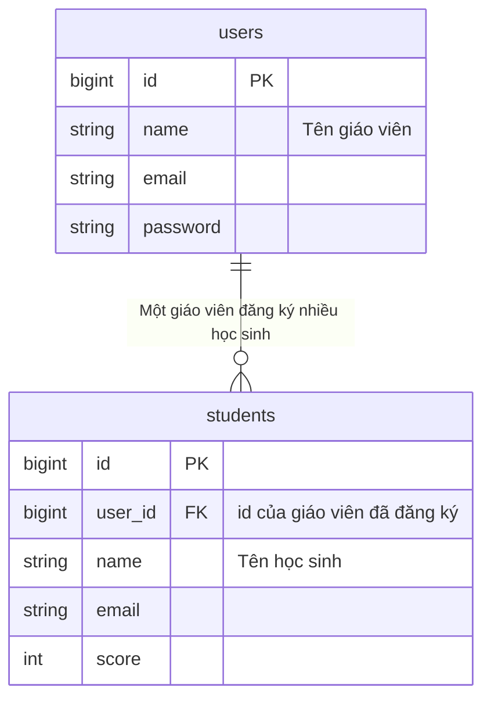
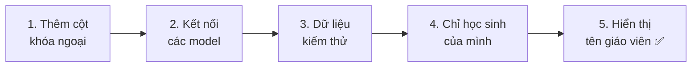
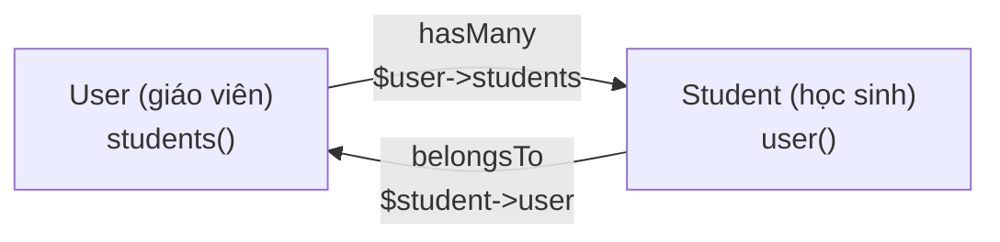
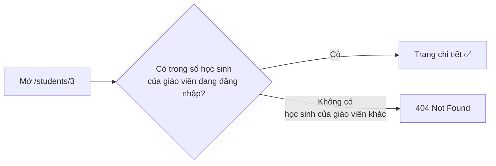
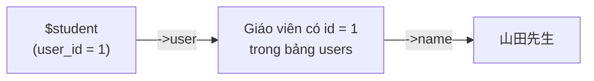
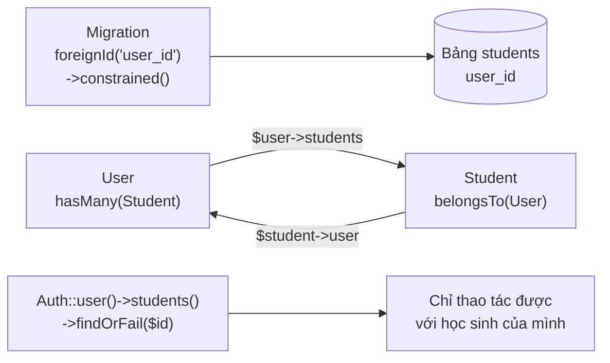

# Cùng làm ứng dụng quản lý học sinh ④ — Quan hệ (kết nối giáo viên và học sinh)

> 🇯🇵 Bản gốc (tiếng Nhật): [20261203_資料_1.md](<../../../1年生_データ設計とアプリ開発/後期/20261203/20261203_資料_1.md>) <!-- original-ja-link -->

Ở buổi trước, giáo viên đã có thể đăng nhập.
Nhưng hiện tại, **giáo viên nào đăng nhập cũng thấy được toàn bộ học sinh**.
Hôm nay, chúng ta sẽ ghi lại **giáo viên nào đã đăng ký** từng học sinh, để mỗi giáo viên chỉ quản lý **học sinh của mình**.

## Mục tiêu hôm nay
- Biểu diễn được quan hệ một-nhiều bằng sơ đồ ER và bảng (khóa ngoại)
- Kết nối được các model với nhau bằng `hasMany` và `belongsTo`
- Chỉ xem danh sách, xem chi tiết, sửa, xóa được học sinh của giáo viên đang đăng nhập

> Chúng ta bắt đầu từ trạng thái đã làm xong phần "đăng nhập" của buổi 26/11.

---

## 1. Quan hệ giữa giáo viên và học sinh

### Một giáo viên phụ trách nhiều học sinh



| Giáo viên (users) | Học sinh (students) |
|--------------|-----------------|
| Thầy Yamada (id: 1) | Thầy Yamada có 15 học sinh |
| Thầy Sato (id: 2) | Thầy Sato có 15 học sinh |

Quan hệ như thế này gọi là **một-nhiều** (1-n).

- Xét từ phía giáo viên, một giáo viên có **nhiều** học sinh (nhiều)
- Xét từ phía học sinh, mỗi học sinh có **một** giáo viên (một)

### Khóa ngoại: cho học sinh giữ "mã số của giáo viên"

Chúng ta thêm vào bảng học sinh một cột (`user_id`) để lưu **`id` của giáo viên đã đăng ký**.

| id | **user_id** | name | email | score |
|----|------------|------|-------|-------|
| 1 | **1** | 田中 一郎 | … | 85 |
| 2 | **1** | 鈴木 花子 | … | 92 |
| 3 | **2** | 高橋 次郎 | … | 70 |

Học sinh có `user_id` là `1` là học sinh của thầy Yamada, học sinh có `user_id` là `2` là học sinh của thầy Sato.

Một **cột chứa `id` của bảng khác** như vậy được gọi là **khóa ngoại**.

> **Tại sao lại lưu "id" chứ không phải "tên" của giáo viên?**
> Nếu lưu tên, khi giáo viên đổi tên, ta phải sửa lại tất cả các dòng học sinh.
> Nếu lưu `id`, dù tên giáo viên có đổi thì cũng không cần sửa các dòng học sinh.

---

## 2. Cùng làm thử



Các file cần chỉnh như sau (bên trong `src`).

```
src/
├─ database/
│   ├─ migrations/xxxx_add_user_id_to_students_table.php ··· 1. Tạo mới
│   ├─ factories/StudentFactory.php ························· 3. Thêm user_id
│   └─ seeders/
│       ├─ UserSeeder.php ··································· 3. Tăng lên 2 giáo viên
│       └─ StudentSeeder.php ································ 3. Tạo học sinh cho từng giáo viên
├─ app/Models/
│   ├─ User.php ············································· 2. Thêm students()
│   └─ Student.php ·········································· 2. Thêm user()
├─ app/Http/Controllers/StudentController.php ··············· 4. Chỉ học sinh của mình
└─ resources/views/students/show.blade.php ·················· 5. Hiển thị tên giáo viên
```

---

### 1. Thêm cột khóa ngoại (migration)

> Bạn đang ở đây: **🟢 1. Khóa ngoại** → 2. Model → 3. Dữ liệu kiểm thử → 4. Chỉ học sinh của mình → 5. Tên giáo viên

Chúng ta tạo một "**migration thêm cột**" như đã học ở buổi 12/11.

```powershell
docker compose exec laravel php artisan make:migration add_user_id_to_students_table
```

Viết nội dung bên trong `up()` và `down()` như sau.

```php
    public function up(): void
    {
        Schema::table('students', function (Blueprint $table) {
            $table->foreignId('user_id')
                ->after('id')
                ->constrained()
                ->cascadeOnDelete();
        });
    }

    public function down(): void
    {
        Schema::table('students', function (Blueprint $table) {
            $table->dropForeign(['user_id']);
            $table->dropColumn('user_id');
        });
    }
```

| Code | Ý nghĩa |
|--------|------|
| `foreignId('user_id')` | Thêm cột `user_id` dùng làm khóa ngoại (cột số nguyên lớn, giống `id`) |
| `->after('id')` | Thêm vào ngay sau cột `id` (cho dễ nhìn) |
| `->constrained()` | Làm cho `user_id` **chỉ nhận những `id` có trong bảng `users`** (ràng buộc khóa ngoại) |
| `->cascadeOnDelete()` | Khi giáo viên bị xóa, học sinh của giáo viên đó cũng bị xóa theo |
| `dropForeign` → `dropColumn` | Khi hoàn tác, gỡ ràng buộc trước rồi mới xóa cột |

> **Tại sao `constrained()` biết đó là "bảng `users`"?**
> Vì tên cột là `user_id`. Laravel sẽ tự hiểu: "`user_id` thì là `id` của bảng `users`".

**Khoan chạy `migrate`.** Lý do sẽ được giải thích ở phần "3. Dữ liệu kiểm thử".

---

### 2. Kết nối các model (hasMany・belongsTo)

> Bạn đang ở đây: 1. Khóa ngoại → **🟢 2. Model** → 3. Dữ liệu kiểm thử → 4. Chỉ học sinh của mình → 5. Tên giáo viên

Chỉ nối các bảng thôi thì code PHP vẫn chưa lấy ra được "học sinh của giáo viên này".
**Chúng ta cũng phải khai báo quan hệ trong model.**

#### ① Khai báo cho giáo viên (User) là "có nhiều học sinh"

Viết thêm phần có dấu ★ vào `app/Models/User.php`.

```php
use Illuminate\Database\Eloquent\Relations\HasMany;  // ★ Thêm (vào nhóm các dòng use ở phía trên)

class User extends Authenticatable
{
    // (Giữ nguyên code có sẵn từ đầu)

    // ★ Thêm từ đây: các học sinh do giáo viên này đăng ký
    public function students(): HasMany
    {
        return $this->hasMany(Student::class);
    }
    // ★ Đến đây
}
```

#### ② Khai báo cho học sinh (Student) là "chỉ có một giáo viên"

Viết thêm phần có dấu ★ vào `app/Models/Student.php`.

```php
<?php

namespace App\Models;

use Illuminate\Database\Eloquent\Factories\HasFactory;
use Illuminate\Database\Eloquent\Model;
use Illuminate\Database\Eloquent\Relations\BelongsTo;  // ★ Thêm

class Student extends Model
{
    /** @use HasFactory<\Database\Factories\StudentFactory> */
    use HasFactory;

    // ★ Thêm từ đây: giáo viên đã đăng ký học sinh này
    public function user(): BelongsTo
    {
        return $this->belongsTo(User::class);
    }
    // ★ Đến đây
}
```

| Model | Đã viết gì | Ý nghĩa | Cách dùng |
|--------|----------|------|-------|
| `User` | `hasMany(Student::class)` | Giáo viên **có nhiều** học sinh (has many) | `$user->students` lấy **tất cả** học sinh của giáo viên đó |
| `Student` | `belongsTo(User::class)` | Học sinh **thuộc về** một giáo viên (belongs to) | `$student->user` lấy **một** giáo viên của học sinh đó |



> **Quy tắc đặt tên**
> Phía "nhiều" dùng **số nhiều** (`students`), phía "một" dùng **số ít** (`user`).
> Khi đọc bằng tiếng Anh, `$user->students` (các học sinh của giáo viên) và `$student->user` (giáo viên của học sinh) đọc lên rất tự nhiên.

---

### 3. Tạo lại dữ liệu kiểm thử

> Bạn đang ở đây: 1. Khóa ngoại → 2. Model → **🟢 3. Dữ liệu kiểm thử** → 4. Chỉ học sinh của mình → 5. Tên giáo viên

#### Tại sao dùng `migrate:fresh` mà không phải `migrate`?

Bảng `students` hiện đang có 30 học sinh.
Nếu thêm cột `user_id` vào đây, **thì `user_id` của 30 học sinh hiện có sẽ nhận giá trị gì?**
Vì có `constrained()`, ta không thể đưa vào số không có trong bảng `users`.

Vì vậy, lần này chúng ta dùng `migrate:fresh --seed` để **tạo lại bảng và nạp lại học sinh kèm thông tin giáo viên**.
Để làm được vậy, trước hết ta sửa Seeder và Factory.

#### ① Tăng lên 2 giáo viên (UserSeeder)

Viết thêm giáo viên thứ 2 có dấu ★ vào `run()` của `database/seeders/UserSeeder.php`.

```php
    public function run(): void
    {
        $user = new User();
        $user->name = '山田先生';
        $user->email = 'teacher@example.com';
        $user->password = 'password';
        $user->save();

        // ★ Thêm từ đây
        $user = new User();
        $user->name = '佐藤先生';
        $user->email = 'teacher2@example.com';
        $user->password = 'password';
        $user->save();
        // ★ Đến đây
    }
```

#### ② Tạo 15 học sinh cho mỗi giáo viên (StudentSeeder)

Viết lại `run()` của `database/seeders/StudentSeeder.php` như sau.

```php
<?php

namespace Database\Seeders;

use App\Models\Student;
use App\Models\User;  // ★ Thêm
use Illuminate\Database\Seeder;

class StudentSeeder extends Seeder
{
    public function run(): void
    {
        // Tạo 15 học sinh cho mỗi giáo viên
        foreach (User::all() as $user) {
            Student::factory()->count(15)->for($user)->create();
        }
    }
}
```

| Code | Ý nghĩa |
|--------|------|
| `User::all()` | Lấy tất cả giáo viên |
| `->for($user)` | "Hãy tạo học sinh thuộc giáo viên này". `$user->id` sẽ được đưa vào `user_id` |

#### ③ Thêm user_id vào cả Factory (StudentFactory)

Viết thêm 1 dòng có dấu ★ vào `definition()` của `database/factories/StudentFactory.php`.

```php
use App\Models\User;  // ★ Thêm (viết ở phía trên)

    public function definition(): array
    {
        return [
            'user_id' => User::factory(),  // ★ Thêm
            'name' => fake('ja_JP')->name(),
            'email' => fake()->unique()->safeEmail(),
            'score' => fake()->numberBetween(0, 100),
        ];
    }
```

`User::factory()` có nghĩa là "nếu chưa chỉ định giáo viên thì tạo luôn một giáo viên".
Trong Seeder hôm nay, ta đã chỉ định giáo viên bằng `->for($user)`, nên sẽ không có giáo viên mới nào được tạo ra.

#### ④ Tạo lại

```powershell
docker compose exec laravel php artisan migrate:fresh --seed
```

✅ **Kiểm tra**: Hãy kiểm tra 2 điều sau trên phpMyAdmin.

- Bảng `users` có 2 giáo viên là thầy Yamada và thầy Sato
- Bảng `students` có cột `user_id`, có 15 học sinh mang giá trị `1` và 15 học sinh mang giá trị `2`

---

### 4. Chỉ cho xem học sinh của mình

> Bạn đang ở đây: 1. Khóa ngoại → 2. Model → 3. Dữ liệu kiểm thử → **🟢 4. Chỉ học sinh của mình** → 5. Tên giáo viên

Chúng ta sẽ viết lại `app/Http/Controllers/StudentController.php`.
Trước tiên, thêm `use Illuminate\Support\Facades\Auth;` ở phía trên, sau đó sửa các chỗ có dấu ★.

```php
use Illuminate\Support\Facades\Auth;  // ★ Thêm
```

#### ① Danh sách (index): chỉ học sinh của mình

```php
    public function index()
    {
        $students = Auth::user()->students;  // ★ Đổi từ Student::all()

        return view('students.index', ['students' => $students]);
    }
```

`Auth::user()` là giáo viên đang đăng nhập.
Với `->students`, ta lấy được **chỉ học sinh của giáo viên đó**. Đó là nhờ `hasMany` đã viết ở bước 2.

#### ② Thêm (store): ghi lại giáo viên đã đăng ký

```php
        $student = new Student();
        $student->user_id = Auth::id();  // ★ Thêm: id của giáo viên đang đăng nhập
        $student->name = $request->input('name');
        $student->email = $request->input('email');
        $student->score = $request->input('score');
        $student->save();
```

| Code | Ý nghĩa |
|--------|------|
| `Auth::id()` | `id` của giáo viên đang đăng nhập |

#### ③ Chi tiết, sửa, xóa: chỉ được thao tác với học sinh của mình

Đổi **tất cả** `Student::findOrFail($id)` trong 4 phương thức `show`, `edit`, `update`, `destroy` thành như sau.

```php
        // Trước khi sửa
        $student = Student::findOrFail($id);

        // Sau khi sửa
        $student = Auth::user()->students()->findOrFail($id);
```

`Auth::user()->students()` nghĩa là "trong số học sinh của giáo viên đang đăng nhập", còn `findOrFail($id)` nghĩa là "tìm học sinh có `id` trùng khớp".
**Dù có cố mở `id` của học sinh thuộc giáo viên khác thì cũng không tìm thấy, nên sẽ ra `404 Not Found`**.



> **Khác nhau giữa `students` và `students()`**
>
> | Cách viết | Ý nghĩa | Khi nào dùng |
> |-------|------|---------|
> | `Auth::user()->students` | **Lấy về tất cả** học sinh của giáo viên đó | Danh sách (cần tất cả) |
> | `Auth::user()->students()` | **Chỉ gắn điều kiện** "trong số học sinh của giáo viên đó". Có thể viết tiếp `->findOrFail($id)` v.v. phía sau | Chi tiết, sửa, xóa (muốn tìm một người) |

✅ **Kiểm tra**: Hãy thử theo thứ tự sau.

| Việc cần làm | Kết quả đúng |
|---------|------------|
| Đăng nhập bằng thầy Yamada (`teacher@example.com`) và mở danh sách | Chỉ hiển thị 15 học sinh |
| Thêm 1 học sinh | Trên phpMyAdmin, `user_id` của học sinh vừa thêm là `1` |
| Trong danh sách, mở trang chi tiết của một học sinh và ghi lại số trên URL (ví dụ: `/students/3`) | — |
| Đăng xuất, rồi đăng nhập bằng thầy Sato (`teacher2@example.com`) | Danh sách hiển thị 15 học sinh khác với của thầy Yamada |
| Mở trực tiếp URL đã ghi lại của học sinh thuộc thầy Yamada | Ra **`404 Not Found`** (không xem được học sinh của giáo viên khác) |

---

### 5. Hiển thị tên giáo viên đã đăng ký trên trang chi tiết

> Bạn đang ở đây: 1. Khóa ngoại → 2. Model → 3. Dữ liệu kiểm thử → 4. Chỉ học sinh của mình → **🟢 5. Tên giáo viên**

Viết thêm 1 dòng có dấu ★ vào `resources/views/students/show.blade.php`.

```html
    <p>番号：{{ $student->id }}</p>
    <p>メールアドレス：{{ $student->email }}</p>
    <p>点数：{{ $student->score }}点</p>
    <p>登録した先生：{{ $student->user->name }}</p>  {{-- ★ Thêm --}}
```

Với `$student->user`, ta lấy được giáo viên của học sinh đó (`belongsTo`), và với `->name` ta lấy được tên của giáo viên đó.
Không cần viết `JOIN` trong SQL, Laravel vẫn tự lấy dữ liệu từ bảng `users` cho chúng ta.

✅ **Kiểm tra**: Trang chi tiết hiển thị kiểu như "登録した先生：山田先生" (Giáo viên đã đăng ký: thầy Yamada) là OK.



---

## 3. Khi gặp lỗi

> **🔥 Không chạy thì hãy xem log!** → [[Quan trọng] Cách xuất log](../20261022/【重要】ログの出し方.md)

| Triệu chứng | Chỗ gây lỗi | Cách xử lý |
|------|----------|------|
| `migrate` báo `Cannot add or update a child row: a foreign key constraint fails` | Migration | Không có giáo viên để gán cho các học sinh hiện có. Tạo lại bằng `migrate:fresh --seed` |
| `Call to undefined method App\Models\User::students()` | Model | Kiểm tra xem đã viết phương thức `students()` trong `User.php` chưa |
| `Return value must be of type App\Models\HasMany` | Model | Kiểm tra xem phía trên `User.php` đã có `use Illuminate\Database\Eloquent\Relations\HasMany;` chưa (`BelongsTo` trong `Student.php` cũng vậy) |
| Danh sách hiện tất cả (30 học sinh) | Controller | Kiểm tra xem `index` đã là `Auth::user()->students` chưa |
| Xem được trang chi tiết của học sinh thuộc giáo viên khác | Controller | Kiểm tra xem đã đổi **cả 4** `show`, `edit`, `update`, `destroy` thành `Auth::user()->students()->findOrFail($id)` chưa |
| Khi thêm học sinh thì báo `Field 'user_id' doesn't have a default value` | Controller | Kiểm tra xem trong `store` đã có `$student->user_id = Auth::id();` chưa |
| Chỗ tên giáo viên báo `Attempt to read property "name" on null` | Model, dữ liệu | Kiểm tra xem đã viết `user()` trong `Student.php` chưa, và giáo viên ứng với `user_id` của học sinh đó có tồn tại không |

---

## 4. Tổng kết



| Những gì đã viết hôm nay | Nói ngắn gọn |
|--------------|-----------|
| `foreignId('user_id')->constrained()` | Thêm cột khóa ngoại, chỉ cho phép nhận `id` có trong `users` |
| `hasMany(Student::class)` | Giáo viên có nhiều học sinh (`$user->students`) |
| `belongsTo(User::class)` | Học sinh thuộc về một giáo viên (`$student->user`) |
| `->for($user)` (Factory) | Tạo dữ liệu kiểm thử cho học sinh thuộc giáo viên này |
| `Auth::id()` | `id` của giáo viên đang đăng nhập |
| `Auth::user()->students` | Tất cả học sinh của giáo viên đang đăng nhập |
| `Auth::user()->students()->findOrFail($id)` | Tìm một người trong số học sinh của mình. Nếu là học sinh của giáo viên khác thì ra 404 |

**Bảng thì nối bằng khóa ngoại. Model thì nối bằng hasMany và belongsTo.**

Vậy là ứng dụng quản lý học sinh đã hoàn thành 🎉
Danh sách, thêm, chi tiết, sửa, xóa (CRUD), đăng nhập và quan hệ — chúng ta đã có đủ những cơ chế quan trọng của một ứng dụng Web.

> **Lên năm 2**, chúng ta sẽ làm lại ứng dụng này thành **API**.
> Các bảng (`users`, `students`) và quan hệ (`hasMany`, `belongsTo`) sẽ được dùng **nguyên như cũ**.
> Điều thay đổi là phần "trả về màn hình HTML" sẽ thành "trả về dữ liệu JSON", và việc đăng nhập sẽ chuyển từ session sang token.

<!-- nav:start -->

---

| ⬅️ Trước | 🗺️ Tổng quan | Tiếp ➡️ |
|:--|:--:|--:|
| [26/11 Quản lý học sinh ③ Đăng nhập](../20261126/20261126_資料_1.md) | [Sơ đồ tổng quan tài liệu](../../README.md) | [10/12 Quản lý học sinh ⑤ Đăng ký giáo viên mới](../20261210/20261210_資料_1.md) |

<!-- nav:end -->
