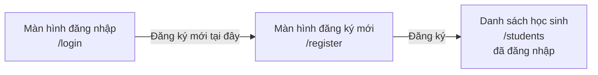
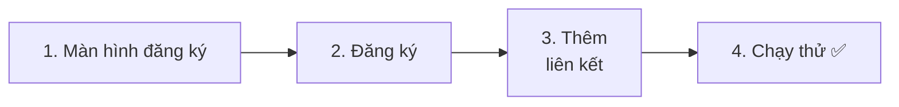
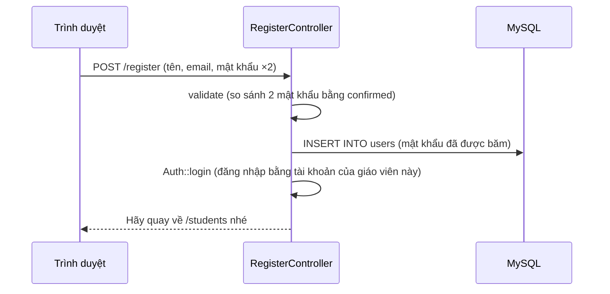

# Cùng làm ứng dụng quản lý học sinh ⑤ — Đăng ký giáo viên mới

> 🇯🇵 Bản gốc (tiếng Nhật): [20261210_資料_1.md](<../../../1年生_データ設計とアプリ開発/後期/20261210/20261210_資料_1.md>) <!-- original-ja-link -->

Hiện tại, giáo viên **chỉ có thể được đăng ký bằng Seeder**. Mỗi lần có giáo viên mới lại phải sửa chương trình thì rất vất vả.
Hôm nay, chúng ta sẽ làm cho **giáo viên có thể tự tạo tài khoản** (đăng ký mới) ngay trên màn hình.

## Mục tiêu hôm nay
- Tạo màn hình đăng ký mới và lưu giáo viên vào bảng `users`
- Kiểm tra được phần "nhập lại mật khẩu" bằng validation (`confirmed`)
- Sau khi đăng ký, chuyển ngay sang trạng thái đã đăng nhập (`Auth::login`)

> Chúng ta bắt đầu từ trạng thái đã làm xong đến phần "quan hệ" của buổi 3/12.

---

## 1. Hôm nay chúng ta làm gì



```
新規登録

名前：             [ 鈴木先生            ]
メールアドレス：   [ suzuki@example.com  ]
パスワード：       [ ●●●●●●●●            ]
パスワード（確認）：[ ●●●●●●●●            ]

[登録]
```

### Khác gì so với đăng nhập

Hình thức gần như giống hệt phần đăng nhập của buổi 26/11.

| | Đăng nhập (26/11) | Đăng ký mới (hôm nay) |
|---|---|---|
| URL | `/login` | `/register` |
| Việc cần làm | **Xác nhận** có phải giáo viên đã có trong `users` không | **Thêm** giáo viên mới vào `users` |
| Ô nhập | Email, mật khẩu | Tên, email, mật khẩu, **mật khẩu (xác nhận)** |
| Cuối cùng | Đăng nhập bằng `Auth::attempt()` | Đăng nhập bằng `Auth::login()` |

> **Lên năm 2**, phần đăng ký mới này cũng sẽ được làm lại thành API (`POST /api/register`).
> Các quy tắc kiểm tra (validation) vẫn được dùng nguyên như vậy ở năm 2.

---

## 2. Cùng làm thử



Các file cần chỉnh như sau (bên trong `src`).

```
src/
├─ app/Http/Controllers/
│   └─ RegisterController.php ·········· 1・2. Đăng ký mới (tạo mới)
├─ resources/views/
│   ├─ register.blade.php ·············· 1. Màn hình đăng ký mới (tạo mới)
│   ├─ login.blade.php ················· 3. Liên kết đến trang đăng ký mới
│   └─ layouts/header.blade.php ········ 3. Liên kết đến trang đăng ký mới
└─ routes/web.php ······················ 1・2. Route
```

---

### 1. Tạo màn hình đăng ký mới

> Bạn đang ở đây: **🟢 1. Màn hình đăng ký** → 2. Đăng ký → 3. Liên kết → 4. Chạy thử

#### ① Tạo controller

```powershell
docker compose exec laravel php artisan make:controller RegisterController
```

Viết `app/Http/Controllers/RegisterController.php` như sau.

```php
<?php

namespace App\Http\Controllers;

use App\Models\User;
use Illuminate\Http\Request;
use Illuminate\Support\Facades\Auth;

class RegisterController extends Controller
{
    // Hiển thị màn hình đăng ký mới
    public function showForm()
    {
        return view('register');
    }
}
```

#### ② Tạo view

Tạo file `resources/views/register.blade.php`.

```html
@include('layouts.header', ['title' => '新規登録'])

    <h1>新規登録</h1>

    <form method="POST" action="/register">
        @csrf

        <p>
            名前：
            <input type="text" name="name" value="{{ old('name') }}" required>
            @error('name') <span style="color: red;">{{ $message }}</span> @enderror
        </p>

        <p>
            メールアドレス：
            <input type="email" name="email" value="{{ old('email') }}" required>
            @error('email') <span style="color: red;">{{ $message }}</span> @enderror
        </p>

        <p>
            パスワード（8文字以上）：
            <input type="password" name="password" required>
            @error('password') <span style="color: red;">{{ $message }}</span> @enderror
        </p>

        <p>
            パスワード（確認）：
            <input type="password" name="password_confirmation" required>
        </p>

        <button type="submit">登録</button>
    </form>

    <a href="/login">ログインはこちら</a>

@include('layouts.footer')
```

| Code | Ý nghĩa |
|--------|------|
| `name="password"` | Mật khẩu |
| `name="password_confirmation"` | Ô **nhập lại** mật khẩu. Theo **quy ước**, tên ô là `password` thêm `_confirmation` ở phía sau |

> **Tại sao phải nhập mật khẩu 2 lần?**
> Mật khẩu được hiển thị dưới dạng `●●●`, nên dù gõ sai ta cũng không nhận ra.
> Khi nhập 2 lần và so sánh xem **có giống nhau không**, ta sẽ phát hiện được lỗi gõ sai.

#### ③ Viết route

Viết thêm phần có dấu ★ vào `routes/web.php`.

```php
use App\Http\Controllers\RegisterController;  // ★ Thêm (viết ở phía trên)

Route::get('/register', [RegisterController::class, 'showForm']);  // ★ Thêm
```

✅ **Kiểm tra**: Mở http://localhost:8000/register, nếu màn hình đăng ký mới hiện ra là OK.

---

### 2. Xử lý đăng ký

> Bạn đang ở đây: 1. Màn hình đăng ký → **🟢 2. Đăng ký** → 3. Liên kết → 4. Chạy thử

#### ① Viết phương thức register

Viết thêm phương thức `register` có dấu ★ vào `RegisterController.php`.

```php
    // ★ Thêm từ đây
    public function register(Request $request)
    {
        // ① Kiểm tra dữ liệu nhập
        $request->validate([
            'name' => 'required|string|max:255',
            'email' => 'required|email|unique:users,email',
            'password' => 'required|min:8|confirmed',
        ], [
            'name.required' => '名前を入力してください。',
            'name.max' => '名前は255文字以内で入力してください。',
            'email.required' => 'メールアドレスを入力してください。',
            'email.email' => 'メールアドレスの形で入力してください。',
            'email.unique' => 'そのメールアドレスは、すでに登録されています。',
            'password.required' => 'パスワードを入力してください。',
            'password.min' => 'パスワードは8文字以上で入力してください。',
            'password.confirmed' => 'パスワード（確認）が一致しません。',
        ]);

        // ② Lưu giáo viên
        $user = new User();
        $user->name = $request->input('name');
        $user->email = $request->input('email');
        $user->password = $request->input('password');  // Khi lưu sẽ tự động được băm (hash)
        $user->save();

        // ③ Cho đăng nhập luôn
        Auth::login($user);
        $request->session()->regenerate();

        // ④ Chuyển đến danh sách học sinh
        return redirect('/students');
    }
    // ★ Đến đây
```

Đây là những thứ mới xuất hiện.

| Code | Ý nghĩa |
|--------|------|
| `string` | Phải là chuỗi ký tự |
| `unique:users,email` | Kiểm tra trong cột `email` của bảng `users` không có giá trị trùng (không thể đăng ký 2 lần cùng một email) |
| `min:8` | Từ 8 ký tự trở lên (vì không có `integer` nên sẽ kiểm tra theo **số ký tự**) |
| `confirmed` | Kiểm tra `password` và `password_confirmation` **có giống nhau không** |
| `Auth::login($user)` | **Cho đăng nhập bằng tài khoản của giáo viên này** mà không cần kiểm tra mật khẩu |

> **Khác nhau giữa `Auth::attempt` và `Auth::login`**
>
> | | `Auth::attempt($credentials)` (26/11) | `Auth::login($user)` (hôm nay) |
> |---|---|---|
> | Mật khẩu | Có kiểm tra | Không kiểm tra |
> | Khi nào dùng | Màn hình đăng nhập (chưa biết có đúng là chính chủ không) | Ngay sau khi đăng ký mới (biết chắc là chính người vừa đăng ký) |
>
> Vừa đăng ký xong mà lại bắt nhập mật khẩu ở màn hình đăng nhập một lần nữa thì phiền lắm đúng không.
> Vì đây chính là người vừa mới đăng ký, nên ta cho đăng nhập luôn.

> **Đưa mật khẩu vào nguyên như vậy có ổn không?**
> Như đã học ở buổi 26/11, nhờ có `'password' => 'hashed'` trong model `User`, mật khẩu sẽ **tự động được băm khi lưu**.
> Trong tài liệu năm 2, chúng ta tự băm bằng `Hash::make(...)`, nhưng Laravel không băm lại lần nữa một "giá trị đã được băm", nên viết theo cách nào cũng chạy đúng.

#### ② Viết thêm route

```php
Route::get('/register', [RegisterController::class, 'showForm']);
Route::post('/register', [RegisterController::class, 'register']);  // ★ Thêm
```



---

### 3. Thêm liên kết đến trang đăng ký mới

> Bạn đang ở đây: 1. Màn hình đăng ký → 2. Đăng ký → **🟢 3. Liên kết** → 4. Chạy thử

#### ① Trên màn hình đăng nhập

Viết thêm 1 dòng có dấu ★ bên dưới `</form>` trong `resources/views/login.blade.php`.

```html
        <button type="submit">ログイン</button>
    </form>

    <a href="/register">新規登録はこちら</a>  {{-- ★ Thêm --}}
```

#### ② Trên header

Viết thêm 1 dòng có dấu ★ vào bên trong `@guest` của `resources/views/layouts/header.blade.php`.

```html
        @guest
            <a href="/login">ログイン</a>
            <a href="/register">新規登録</a>  {{-- ★ Thêm --}}
        @endguest
```

Chỉ khi chưa đăng nhập thì header mới hiện "新規登録" (Đăng ký mới).

---

### 4. Chạy thử ✅

> Bạn đang ở đây: 1. Màn hình đăng ký → 2. Đăng ký → 3. Liên kết → **🟢 4. Chạy thử**

Sau khi đăng xuất, hãy thử theo thứ tự sau.

| | Việc cần làm | Kết quả đúng |
|---|---|---|
| ① | Ở màn hình đăng ký mới, đăng ký với tên "鈴木先生", email `suzuki@example.com`, mật khẩu `password123` (cả 2 lần giống nhau) | Chuyển sang danh sách học sinh, header hiện "鈴木先生 さん" |
| ② | Xem danh sách học sinh | **Có 0 học sinh** (vì thầy Suzuki chưa đăng ký học sinh nào. Đó là nhờ phần quan hệ của buổi 3/12) |
| ③ | Xem bảng `users` trên phpMyAdmin | Có thầy Suzuki, và `password` đã được băm (`$2y$12$...`) |
| ④ | Đăng xuất, rồi đăng nhập bằng email và mật khẩu của thầy Suzuki | Đăng nhập được |
| ⑤ | Đăng ký mới thêm một lần nữa bằng `suzuki@example.com` | Hiện "そのメールアドレスは、すでに登録されています。" (Email này đã được đăng ký rồi.) |
| ⑥ | Nhập mật khẩu và mật khẩu xác nhận khác nhau rồi đăng ký | Hiện "パスワード（確認）が一致しません。" (Mật khẩu (xác nhận) không khớp.) |
| ⑦ | Đặt mật khẩu là `abc` rồi đăng ký | Hiện "パスワードは8文字以上で入力してください。" (Vui lòng nhập mật khẩu từ 8 ký tự trở lên.) |

---

## 3. Tổng kết về route

Các route liên quan đến đăng nhập và đăng ký mới giờ đã như sau.

```php
// Đăng nhập, đăng xuất
Route::get('/login', [LoginController::class, 'showForm'])->name('login');
Route::post('/login', [LoginController::class, 'login']);
Route::post('/logout', [LoginController::class, 'logout']);

// Đăng ký mới
Route::get('/register', [RegisterController::class, 'showForm']);
Route::post('/register', [RegisterController::class, 'register']);
```

Route đăng ký mới được viết ở **bên ngoài** `Route::middleware('auth')`.
Vì đây là trang dành cho người chưa có tài khoản (chưa đăng nhập được).

---

## 4. Khi gặp lỗi

> **🔥 Không chạy thì hãy xem log!** → [[Quan trọng] Cách xuất log](../20261022/【重要】ログの出し方.md)

| Triệu chứng | Chỗ gây lỗi | Cách xử lý |
|------|----------|------|
| Đã nhập cùng một mật khẩu mà vẫn báo "không khớp" | View | Kiểm tra xem tên ô xác nhận đã là `password_confirmation` chưa (chỉ cần sai chính tả 1 ký tự là không so sánh được) |
| Mở màn hình đăng ký mới thì bị chuyển sang màn hình đăng nhập | Route | Kiểm tra xem route `/register` có nằm **bên ngoài** `{ }` của `Route::middleware('auth')` không |
| Đã đăng ký mà không ở trạng thái đăng nhập | Controller | Kiểm tra xem đã viết `Auth::login($user);` chưa |
| Không đăng nhập được bằng tài khoản giáo viên vừa đăng ký | Dữ liệu | Kiểm tra trên phpMyAdmin xem `password` đã được băm chưa. Kiểm tra xem có lỡ xóa `'password' => 'hashed'` trong `User.php` không |
| `Class "App\Http\Controllers\User" not found` | Controller | Kiểm tra xem phía trên `RegisterController.php` đã có `use App\Models\User;` chưa |
| `Target class [RegisterController] does not exist.` | Route | Kiểm tra xem phía trên `web.php` đã có `use App\Http\Controllers\RegisterController;` chưa |

---

## 5. Tổng kết

| Những gì đã viết hôm nay | Nói ngắn gọn |
|--------------|-----------|
| `name="password_confirmation"` | Ô nhập lại mật khẩu. Tên ô là theo quy ước |
| `confirmed` | Kiểm tra `password` và `password_confirmation` có giống nhau không |
| `unique:users,email` | Không thể đăng ký 2 giáo viên có cùng một email |
| `min:8` | Mật khẩu từ 8 ký tự trở lên |
| `new User()` → `save()` | Lưu giáo viên (mật khẩu tự động được băm) |
| `Auth::login($user)` | Cho đăng nhập bằng tài khoản của giáo viên đó mà không kiểm tra mật khẩu |

**Đăng ký mới là "thêm người dùng rồi cho đăng nhập luôn". Đăng nhập là "xác nhận đúng chính chủ rồi mới cho đăng nhập".**

Vậy là ứng dụng đã cho phép giáo viên tự tạo tài khoản và quản lý học sinh của mình.

<!-- nav:start -->

---

| ⬅️ Trước | 🗺️ Tổng quan | Tiếp ➡️ |
|:--|:--:|--:|
| [03/12 Quản lý học sinh ④ Quan hệ](../20261203/20261203_資料_1.md) | [Sơ đồ tổng quan tài liệu](../../README.md) | — |

<!-- nav:end -->
