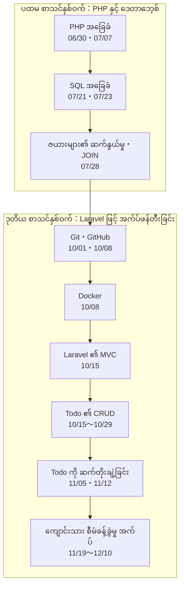

# ပထမနှစ်｜ဒေတာဒီဇိုင်းနှင့် အက်ပ်ဖန်တီးခြင်း — သင်ခန်းစာများ၏ ခြုံငုံပုံ

> 🇯🇵 မူရင်း (ဂျပန်ဘာသာဖြင့်): [README.md](<../1年生_データ設計とアプリ開発/README.md>) <!-- original-ja-link -->

ဒီဘာသာရပ်မှာ **PHP နဲ့ အလုပ်လုပ်တဲ့ စာမျက်နှာ ဖန်တီးမယ် → ဒေတာဘေ့စ်ထဲမှာ ဒေတာ သိမ်းမယ် → Laravel နဲ့ အက်ပ် ဖန်တီးမယ်** ဆိုတဲ့ အစီအစဉ်အတိုင်း သွားပါမယ်။

သင်ခန်းစာတိုင်းမှာ **စာမျက်နှာရဲ့ အောက်ဆုံးက လမ်းညွှန်** ကနေ ရှေ့/နောက် သင်ခန်းစာတွေ ဒါမှမဟုတ် ဒီစာမျက်နှာကို သွားလို့ရပါတယ်။
ဘယ်ကိုသွားရမလဲ မသိဖြစ်ရင် ဒီစာမျက်နှာကို ပြန်လာပါ။

## တစ်ခုလုံး၏ အစီအစဉ်

အခက်အခဲရှိတဲ့အခါ ကြည့်ရမယ့် စာမျက်နှာများ

| ဒီလိုအခါ | ကြည့်ရမယ့် စာမျက်နှာ |
|:--|:--|
| command ကို မေ့သွားတယ် | [အရေးကြီး command စာရင်း](後期/重要コマンド一覧.md) |
| Laravel က မျှော်လင့်ထားသလို အလုပ်မလုပ်ဘူး | [【အရေးကြီး】Log ထုတ်နည်း](後期/20261022/【重要】ログの出し方.md) |
| ပထမ စာသင်နှစ်ဝက်က PHP・MySQL စတင်နည်းကို မေ့သွားတယ် | [Todo စီမံခန့်ခွဲမှု App ကို စတင်ဖွင့်ပုံ အဆင့်များ](前期/20260723/Todo管理アプリ起動する流れ.md) |

---

## ပထမ စာသင်နှစ်ဝက်：PHP နှင့် ဒေတာဘေ့စ်

| ရက်စွဲ | သင်ခန်းစာ | လေ့ကျင့်ခန်း・အဖြေ | ဖြည့်စွက်ချက် |
|:--|:--|:--|:--|
| 06/30 | [PHP မိတ်ဆက်](前期/20260630/20260630_資料.md) | [လေ့ကျင့်ခန်း](前期/20260630/20260630_演習.md)・[အဖြေ](前期/20260630/20260630_解答.md) | [PHP Development Server တည်ဆောက်နည်း](前期/PHP開発サーバーの立て方.md) |
| 07/07 | [PHP အခြေခံနှင့် form](前期/20260707/20260707_資料.md) | [လေ့ကျင့်ခန်း](前期/20260707/20260707_演習.md)・[အဖြေ](前期/20260707/20260707_解答.md) | |
| 07/14 | [လေ့ကျင့်ခန်း ပုစ္ဆာများ](前期/20260714/20260714_資料_1.md) | | |
| 07/21 | [DB ဘာကြောင့် လိုအပ်သလဲ](前期/20260721/20260721_資料.md) [SQL အခြေခံ①（SELECT）](前期/20260721/20260721_資料_2.md) | [လေ့ကျင့်ခန်း](前期/20260721/20260721_演習.md)・[အဖြေ](前期/20260721/20260721_解答.md) | [Database Server တည်ဆောက်နည်း (XAMPP အပိုင်း)](前期/データベースサーバーの立て方/データベースサーバーの立て方.md) [Relational database အခြေခံ](前期/20260721/リレーショナルデータベース入門.md) |
| 07/23 | [SQL အခြေခံ②（INSERT・UPDATE・DELETE）](前期/20260723/20260723_資料.md) | [လေ့ကျင့်ခန်း](前期/20260723/20260723_演習.md)・[အဖြေ](前期/20260723/20260723_解答.md) | [Todo စီမံခန့်ခွဲမှု App ကို စတင်ဖွင့်ပုံ အဆင့်များ](前期/20260723/Todo管理アプリ起動する流れ.md) [PDO_MySQL ချိတ်ဆက်မှု Error ဖြေရှင်းနည်း](前期/20260723/PDO_MySQL接続エラー対処法.md) |
| 07/28 | [Table ဆက်နွယ်မှု・JOIN](前期/20260728/20260728_資料.md) | [လေ့ကျင့်ခန်း](前期/20260728/20260728_演習.md)・[အဖြေ](前期/20260728/20260728_解答.md) | [JOIN မိတ်ဆက်](前期/20260728/JOIN入門.md) |

## ဒုတိယ စာသင်နှစ်ဝက်：Laravel ဖြင့် အက်ပ်ဖန်တီးခြင်း

| ရက်စွဲ | သင်ခန်းစာ | ဖြည့်စွက်ချက် |
|:--|:--|:--|
| 10/01 | [ပထမ Semester ကို ပြန်လည်သုံးသပ်ခြင်း](後期/20261001/20261001_復習.md) [Source Control မိတ်ဆက်](後期/20261001/20261001_資料_1.md) | |
| 10/08 | [GitHub account နဲ့ repository](後期/20261008/20261008_資料_1.md) [လေ့ကျင့်ရေး environment ကို push လုပ်ခြင်း](後期/20261008/20261008_資料_2.md) [Docker မိတ်ဆက်](後期/20261008/20261008_資料_3.md) | |
| 10/15 | [MVC အလုပ်လုပ်ပုံ](後期/20261015/20261015_資料_1.md) [Todo စာရင်း](後期/20261015/20261015_資料_2.md) | |
| 10/22 | [Todo ထည့်ခြင်း（CREATE）](後期/20261022/20261022_資料_1.md) [Todo အသေးစိတ်（SHOW）](後期/20261022/20261022_資料_2.md) | [【အရေးကြီး】Log ထုတ်နည်း](後期/20261022/【重要】ログの出し方.md) |
| 10/29 | [Todo ပြင်ဆင်ခြင်း（UPDATE）](後期/20261029/20261029_資料_1.md) [ပြီးဆုံး/မပြီးဆုံး ပြောင်းခြင်း（PATCH）](後期/20261029/20261029_資料_2.md) [Todo ဖျက်ခြင်း（DELETE）](後期/20261029/20261029_資料_3.md) | |
| 11/05 | [Seeder・Factory](後期/20261105/20261105_資料_1.md) [Validation](後期/20261105/20261105_資料_2.md) | |
| 11/12 | [ဘုံအပိုင်းကို အစိတ်အပိုင်းအဖြစ် ခွဲထုတ်ခြင်း (@include)](後期/20261112/20261112_資料_1.md) [Category ထည့်ခြင်း](後期/20261112/20261112_資料_2.md) | |
| 11/19 | [ကျောင်းသားစီမံခန့်ခွဲမှု ① စာရင်း・အသေးစိတ်](後期/20261119/20261119_資料_1.md) [ကျောင်းသားစီမံခန့်ခွဲမှု ② ထည့်ခြင်း・ပြင်ဆင်ခြင်း・ဖျက်ခြင်း](後期/20261119/20261119_資料_2.md) | |
| 11/26 | [ကျောင်းသားစီမံခန့်ခွဲမှု ③ Login](後期/20261126/20261126_資料_1.md) | |
| 12/03 | [ကျောင်းသားစီမံခန့်ခွဲမှု ④ Relation](後期/20261203/20261203_資料_1.md) | |
| 12/10 | [ကျောင်းသားစီမံခန့်ခွဲမှု ⑤ ဆရာ အသစ်မှတ်ပုံတင်ခြင်း](後期/20261210/20261210_資料_1.md) | |

အချိန်မရွေး သုံးလို့ရတဲ့ စာမျက်နှာ：[အရေးကြီး command စာရင်း](後期/重要コマンド一覧.md)
