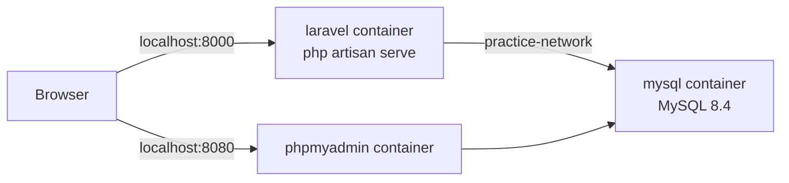
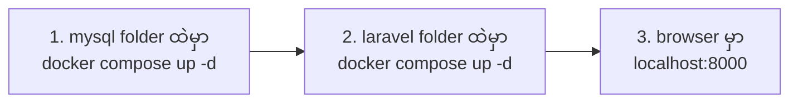

# Laravel × MySQL လေ့ကျင့်ရေး ပတ်ဝန်းကျင်（Docker）

> 🇯🇵 မူရင်း (ဂျပန်ဘာသာဖြင့်): [README.md](<../../1年生_データ設計とアプリ開発/practice/README.md>) <!-- original-ja-link -->

Laravel နဲ့ MySQL ကို **သီးခြား container နှစ်ခု** အဖြစ် စတင်ပါမယ်။
Container နှစ်ခုကို `practice-network` ဆိုတဲ့ network နဲ့ ချိတ်ဆက်ထားပါတယ်။



```
practice/
  mysql/
    compose.yaml    ← MySQL နှင့် phpMyAdmin
  laravel/
    compose.yaml    ← Laravel
    Dockerfile
    entrypoint.sh
    src/            ← ပထမဆုံး စတင်ချိန်မှာ Laravel ကို အလိုအလျောက် ဖန်တီးပေးမယ်
```

> Docker Desktop ကို ဖွင့်ပြီး ဘယ်ဘက်အောက်ထောင့်မှာ **Engine running** ဖြစ်နေတာကို စစ်ဆေးပြီးမှ စပါ။
> Docker Desktop ထည့်သွင်းနည်း → [Docker Desktop ကို install လုပ်ခြင်း](../後期/20261008/20261008_資料.md)

> **XAMPP ကို ရပ်ထားပါ**
> XAMPP သုံးနေတယ်ဆိုရင် XAMPP Control Panel ကိုဖွင့်ပြီး အလုပ်လုပ်နေတာတွေ（Apache・MySQL စသည်）အားလုံးကို **Stop** လုပ်ပြီးမှ စပါ။
> XAMPP ရဲ့ MySQL အလုပ်လုပ်နေရင် port `3306` တစ်ခုတည်းကို သုံးတာကြောင့် MySQL container စတင်လို့ မရပါဘူး။

---

## 1. သိမ်းဆည်းမယ့်နေရာ

C drive မှာ `git` ဆိုတဲ့ folder တစ်ခု ဖန်တီးပြီး အဲ့ဒီထဲမှာ project တစ်ခုချင်းစီကို ထည့်သွားပါမယ်။

```
C:\git\practice
```

Desktop ပေါ်မှာ ထားလည်း ရပါတယ်။

> **ဘယ်မှာ သိမ်းထားလဲဆိုတာ မှတ်ထားပါ**
> စတင်တိုင်း၊ ရပ်တိုင်း အဲ့ဒီ folder ကို `cd` နဲ့ သွားရပါတယ်။ သိမ်းထားတဲ့နေရာကို မသိတော့ရင် ဆက်လုပ်လို့ မရပါဘူး။

> **OneDrive ထဲမှာ မထားပါနဲ့**
> `C:\Users\<အသုံးပြုသူအမည်>\OneDrive\...` ထဲမှာ ထားရင် sync လုပ်တဲ့အခါ ပဋိပက္ခဖြစ်ပြီး နှေးသွားတာ ဒါမှမဟုတ် error ဖြစ်တာမျိုး ရှိပါတယ်။
> PC တချို့မှာ Desktop က OneDrive ထဲမှာ ရှိနေတတ်လို့ မသေချာရင် `C:\git` မှာ ထားပါ။

---

## 2. စတင်ခြင်း（အစီအစဉ် အရေးကြီးတယ်）

**mysql → laravel အစီအစဉ်အတိုင်း မဖြစ်မနေ** စတင်ပါ။
ဘာလို့လဲဆိုတော့ network `practice-network` ကို mysql ဘက်က ဖန်တီးပေးလို့ပါ။



PowerShell မှာ run ပါ။（`C:\git\practice` မဟုတ်တဲ့နေရာမှာ သိမ်းထားရင် command ထဲမှာ ကိုယ်သိမ်းထားတဲ့နေရာနဲ့ အစားထိုးပါ）

```powershell
cd C:\git\practice\mysql
docker compose up -d
```

```powershell
cd C:\git\practice\laravel
docker compose up -d
```

**ပထမဆုံးအကြိမ်မှာပဲ** Laravel install လုပ်ဖို့ မိနစ်အနည်းငယ် ကြာပါတယ်။ ဘယ်လောက်ရောက်နေပြီလဲဆိုတာ အောက်က command နဲ့ ကြည့်လို့ရပါတယ်（ကြည့်တာ ရပ်ချင်ရင် `Ctrl + C`）။

```powershell
docker compose logs -f
```

`Server running on [http://0.0.0.0:8000]` လို့ ပေါ်လာရင် အသင့်ဖြစ်ပါပြီ။

| ဖွင့်ရမယ့် URL | ပေါ်လာမယ့်အရာ |
|---------|--------------|
| http://localhost:8000 | Laravel ရဲ့ ပင်မစာမျက်နှာ ✅ |
| http://localhost:8080 | phpMyAdmin（`laravel` ဒေတာဘေ့စ်ထဲမှာ ဇယားတွေ ဖန်တီးပြီးသား ✅） |

---

## 3. ရပ်ခြင်း

စတင်တုန်းကနဲ့ **ပြောင်းပြန် အစီအစဉ်**（laravel → mysql）နဲ့ ရပ်ပါ။

```powershell
cd C:\git\practice\laravel
docker compose down
```

```powershell
cd C:\git\practice\mysql
docker compose down
```

`down` လုပ်လည်း ဒေတာဘေ့စ်ထဲက ဒေတာတွေ မပျက်ပါဘူး（`mysql-data` volume ထဲမှာ ကျန်နေပါတယ်）။

---

## 4. ချိတ်ဆက်မှု အချက်အလက်

| အကြောင်းအရာ | Laravel ကနေ | PC（A5:SQL Mk-2 စသည်）ကနေ |
|------|-------------|--------------------------|
| Host | `mysql` | `127.0.0.1` |
| Port | `3306` | `3306` |
| ဒေတာဘေ့စ် | `laravel` | `laravel` |
| အသုံးပြုသူအမည် | `laravel` | `laravel` |
| စကားဝှက် | `password` | `password` |

PC ဘက်က port က XAMPP ရဲ့ MySQL နဲ့ အတူတူ `3306` ဖြစ်ပါတယ်။ ဒါကြောင့် XAMPP ရဲ့ MySQL ကို ရပ်ထားပါ။
Laravel ရဲ့ setting တွေကို `laravel/src/.env` ထဲမှာ ရေးထားပါတယ်။

---

## 5. artisan command ကို သုံးခြင်း

`php artisan` ကို laravel container ထဲမှာ run ပါတယ်။ laravel folder ထဲမှာ အောက်ပါအတိုင်း ရိုက်ပါ။

```powershell
docker compose exec laravel php artisan migrate
docker compose exec laravel php artisan make:controller TodoController
```

---

## 6. အဆင်မပြေတဲ့အခါ

| ဖြစ်နေတဲ့ ပြဿနာ | ဖြေရှင်းနည်း |
|------|------|
| `network practice-network declared as external, but could not be found` | mysql ကို အရင် မစတင်ရသေးဘူး → mysql folder ထဲမှာ `docker compose up -d` |
| log မှာ `MySQL の起動を待っています...`（MySQL စတင်တာကို စောင့်နေပါတယ်...）ဆက်တိုက် ပေါ်နေတယ် | mysql container အလုပ်လုပ်နေလားဆိုတာ Docker Desktop ရဲ့ `Containers` မှာ စစ်ကြည့်ပါ |
| `port is already allocated`（port ကို သုံးနေပြီးသား） | XAMPP Control Panel မှာ MySQL စသည်တို့ကို Stop လုပ်ပါ။ `php -S` လိုမျိုး port တစ်ခုတည်းကို သုံးနေတာတွေကိုလည်း ရပ်ပါ |
| ပထမဆုံး install လုပ်နေစဉ် မအောင်မြင်ခဲ့ဘူး | laravel folder ထဲမှာ `docker compose down` → `src` folder ကို ဖျက် → `docker compose up -d` ကို ထပ်လုပ်ပါ |
| ဒေတာဘေ့စ်ကို အစကနေ ပြန်စချင်တယ် | mysql folder ထဲမှာ `docker compose down -v`（**ဒေတာ အားလုံး ပျက်သွားပါမယ်**） |
