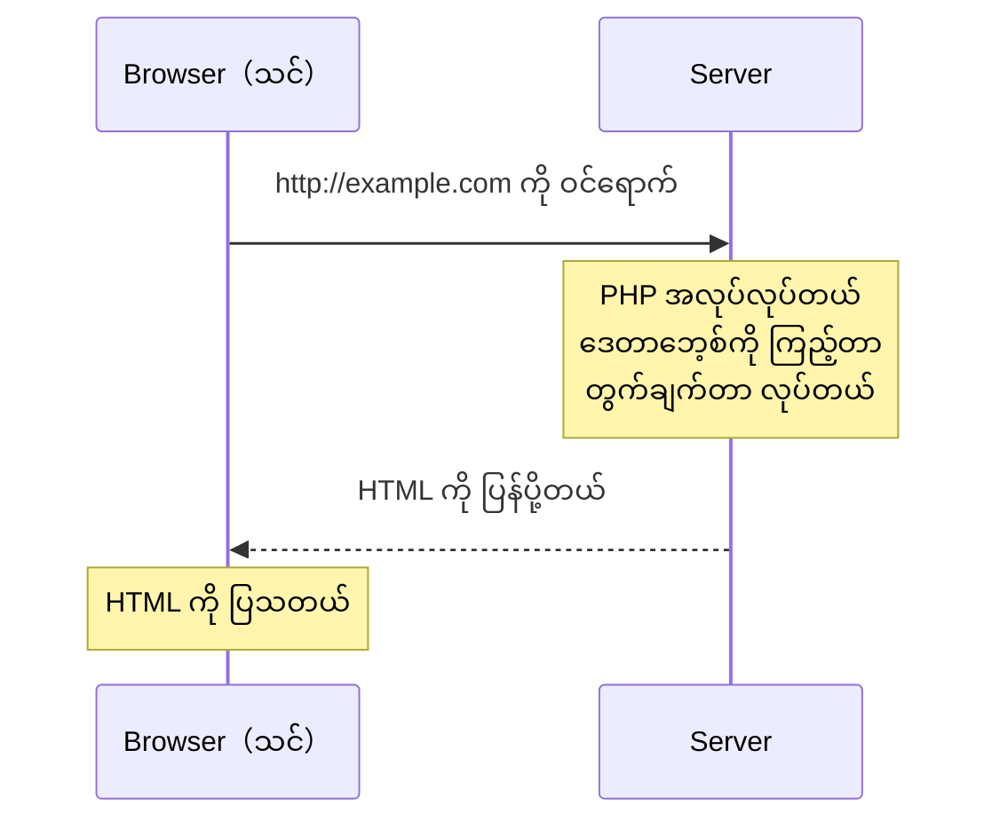

# ပထမနှစ်｜ဒေတာဒီဇိုင်းနှင့် အက်ပ်ဖန်တီးခြင်း — 2026/06/30

> 🇯🇵 မူရင်း (ဂျပန်ဘာသာဖြင့်): [20260630_資料.md](<../../../1年生_データ設計とアプリ開発/前期/20260630/20260630_資料.md>) <!-- original-ja-link -->

---

## ဒီဘာသာရပ်ရဲ့ အမှတ်ပေးပုံ

| အကြောင်းအရာ | ရာခိုင်နှုန်း |
| --- | --- |
| တက်ရောက်မှုနှုန်း | 30% |
| စာသင်ချိန်အတွင်း သဘောထား | 10% |
| တင်သွင်းရမယ့် အလုပ်များ | 60% |

> ⚠️ **အရေးကြီး：တက်ရောက်မှုနှုန်း 60% အောက် ရောက်သွားရင် တင်သွင်းတဲ့ အလုပ်တွေ၊ စာသင်ချိန်အတွင်း သဘောထားရဲ့ အမှတ် ဘယ်လောက်ပဲရရ credit ရမှာ မဟုတ်ပါဘူး။**\
> နောက်ကျတာ・စောပြန်တာကို ဘာသာရပ်တာဝန်ခံ ဆရာရဲ့ ဆုံးဖြတ်ချက်အရ ပျက်ကွက်တယ်လို့ သတ်မှတ်နိုင်ပါတယ်။ အချိန်မှန် မဖြစ်မနေ တက်ရောက်ပါ။

---

## ဒီနေ့ရဲ့ ပန်းတိုင်

- Server-side နဲ့ client-side ရဲ့ ကွာခြားချက်ကို ရှင်းပြနိုင်မယ်
- PHP အလုပ်လုပ်မယ့် ပတ်ဝန်းကျင်ကို တည်ဆောက်နိုင်မယ်
- ပထမဆုံး PHP file ကို run နိုင်မယ်

---

## 1. Client-side နဲ့ server-side ရဲ့ ကွာခြားချက်

```
Client-side（ပထမ စာသင်နှစ်ဝက်မှာ သင်ခဲ့တာ）
  Browser မှာ အလုပ်လုပ်တယ် → HTML / CSS / JavaScript
  အသုံးပြုသူရဲ့ စက်ပေါ်မှာ run တယ်

Server-side（ဒီစာသင်နှစ်ဝက်ကစပြီး သင်မယ့်အရာ）
  Server မှာ အလုပ်လုပ်တယ် → PHP / Python / Ruby / Go စသည်
  Server မှာ run ပြီးမှ ရလဒ်ကို browser ဆီ ပို့ပေးတယ်
```

**Server-side က ဘာကြောင့် လိုအပ်သလဲ？**

| လုပ်ချင်တာ | Client တစ်ခုတည်းနဲ့ | Server လိုအပ်လား |
| --- | --- | --- |
| စာသား ပြသခြင်း | ✅ လုပ်နိုင်တယ် | — |
| ဒေတာဘေ့စ်ကို ဖတ်ခြင်း | ❌ မလုပ်နိုင်ဘူး | ✅ လိုအပ်တယ် |
| စကားဝှက်ကို လုံခြုံစွာ စီမံခြင်း | ❌ အန္တရာယ်ရှိတယ် | ✅ လိုအပ်တယ် |
| Login လုပ်ဆောင်ချက် | ❌ မလုပ်နိုင်ဘူး | ✅ လိုအပ်တယ် |

---

## 2. PHP ဆိုတာ ဘာလဲ

**PHP = server-side programming language တစ်ခု။ Web အက်ပ် ဖန်တီးဖို့ အထူးပြုထားတယ်။**

Browser နဲ့ server ကြား ဆက်သွယ်ပုံက အောက်ပါအတိုင်း ဖြစ်ပါတယ်။



**JavaScript နဲ့ နှိုင်းယှဉ်ကြည့်ရအောင်：**

| အကြောင်းအရာ | JavaScript | PHP |
| --- | --- | --- |
| အလုပ်လုပ်တဲ့နေရာ | Browser | Server |
| Variable ရေးပုံ | `let x = 5;` | `$x = 5;` |
| String ဆက်ခြင်း | `"Hello" + "World"` | `"Hello" . "World"` |
| Array | `let arr = [1, 2, 3]` | `$arr = [1, 2, 3]` |
| Output | `console.log()` | `echo` |

---

## 3. ပတ်ဝန်းကျင် တည်ဆောက်ခြင်း：PHP ကို install လုပ်ခြင်း

### Mac ဆိုရင်（Homebrew ကို သုံးမယ်）

Homebrew မထည့်ရသေးရင် [brew.sh](https://brew.sh) ရဲ့ အဆင့်တွေအတိုင်း အရင် install လုပ်ပါ။

```bash
brew install php
```

### Windows ဆိုရင်

1. [windows.php.net/download](https://windows.php.net/download/) ကို ဝင်ပါ
2. 「VS16 x64 Non Thread Safe」ရဲ့ ZIP ကို download လုပ်ပါ
3. `C:\php` ထဲမှာ ဖြည်ပါ
4. Environment variable PATH ထဲကို `C:\php` ထည့်ပါ

### အလုပ်လုပ်မလုပ် စစ်ဆေးခြင်း

```bash
php --version
# → PHP 8.x.x ... လို့ ပေါ်လာရင် OK
```

---

## 4. ပထမဆုံး PHP file

### အလုပ်လုပ်မယ့် folder ဖန်တီးပါ（ဘယ်နေရာမှာ ဖြစ်ဖြစ် ရပါတယ်）

```
Mac:     ~/study/
Windows: C:\Users\အသုံးပြုသူအမည်\study\
```

### `index.php` ကို ဖန်တီးပါ

```php
<?php
// PHP code ကို <?php နဲ့ စတယ်
// JS ရဲ့ console.log နဲ့ ညီမျှတာက echo（「こんにちは」＝ မင်္ဂလာပါ）

echo "こんにちは PHP！";

// Variable တွေကို $ နဲ့ စရေးတယ်（JavaScript နဲ့ အဓိကကွာခြားချက်）
$namae = "田中太郎";
$nenrei = 20;

// String ထဲမှာ variable ကို ထည့်ရေးခြင်း（double quote မှာပဲ ရတယ်）※「名前」＝ အမည်၊「年齢」＝ အသက်၊「歳」＝ နှစ်၊「田中太郎」＝ လူအမည်
echo "名前: $namae";
echo "年齢: {$nenrei}歳";  // {} နဲ့ ဝိုင်းထားရင် သေချာတယ်

// JS ရဲ့ template literal နဲ့ ညီမျှတယ်
// JS: `名前: ${namae}`
// PHP: "名前: {$namae}"
?>
```

**Local server ကို စတင်ပြီး browser မှာ စစ်ကြည့်ပါ：**

```bash
# study folder ထဲကို ဝင်ပြီးမှ run ပါ
cd ~/study
php -S localhost:8000
```

`http://localhost:8000/index.php` ကို ဝင်ပါ

---

## 5. PHP ရဲ့ အခြေခံ syntax（JS နဲ့ နှိုင်းယှဉ်）

```php
<?php
// ========== Variable ==========
$name = "Alice";      // JS ရဲ့ let နဲ့ ညီမျှတယ်（$ လိုအပ်တယ်）
$age = 20;
$pi = 3.14;
$isStudent = true;

// ========== Output ==========
echo "Hello";          // စာကြောင်းမဆင်းဘဲ output ထုတ်တယ်
echo "World\n";        // \n နဲ့ စာကြောင်းဆင်းတယ်
echo $name . "\n";     // . နဲ့ string ဆက်တယ်（JS ရဲ့ + နဲ့ ညီမျှတယ်）

// PHP tag နဲ့ HTML ကို ရောရေးလို့ရတယ်（PHP ရဲ့ ထူးခြားချက်）
?>
<h1>こんにちは、<?= $name ?>さん！</h1>
<!-- <?= က echo ရဲ့ အတိုကောက်（「こんにちは」＝ မင်္ဂလာပါ၊「さん」＝ အမည်နောက်မှာ ထည့်သုံးတဲ့ ယဉ်ကျေးတဲ့ အခေါ်အဝေါ်） -->
<?php

// ========== အခြေအနေပေါ်မူတည်ပြီး ခွဲခြားလုပ်ဆောင်ခြင်း（JS နဲ့ သဘောတရားတူတယ်） ==========（「成人です」＝ အရွယ်ရောက်ပြီးသူပါ၊「未成年です」＝ အရွယ်မရောက်သေးသူပါ）
if ($age >= 18) {
    echo "成人です\n";
} else {
    echo "未成年です\n";
}

// ========== Loop ==========（「回目」＝ အကြိမ်မြောက်）
for ($i = 1; $i <= 5; $i++) {   // $i က JS ရဲ့ i နဲ့ အတူတူ
    echo $i . "回目\n";
}

// ========== Array ==========（「りんご」＝ ပန်းသီး၊「みかん」＝ လိမ္မော်သီး၊「ぶどう」＝ စပျစ်သီး）
$fruits = ["りんご", "みかん", "ぶどう"];
echo $fruits[0] . "\n";  // → りんご

// Array ကို loop ပတ်ခြင်း
foreach ($fruits as $fruit) {  // JS ရဲ့ forEach နဲ့ ညီမျှတယ်
    echo $fruit . "\n";
}
?>
```

---

## အနှစ်ချုပ်

| သဘောတရား | JavaScript | PHP |
| --- | --- | --- |
| Variable | `let x` | `$x` |
| Output | `console.log()` | `echo` |
| String ဆက်ခြင်း | `"a" + "b"` | `"a" . "b"` |
| Array loop | `forEach` | `foreach` |
| အလုပ်လုပ်တဲ့နေရာ | Browser | Server |

---

## နောက်တစ်ကြိမ်အတွက် ကြိုတင်ပြောချက်

PHP ရဲ့ variable・type・operator・array・associative array တွေကို စနစ်တကျ သင်ပါမယ်။\
「JavaScript နဲ့ သဘောတရား အတူတူကို ရေးပုံ မတူဘဲ တွေ့ရမယ်」ဆိုတာကို သတိထားပြီး ဆက်သွားကြရအောင်။

<!-- nav:start -->

---

📎 တွဲဖတ်ပါ → [PHP Development Server တည်ဆောက်နည်း](../PHP開発サーバーの立て方.md)

| ⬅️ ယခင် | 🗺️ ခြုံငုံပုံ | နောက်တစ်ခု ➡️ |
|:--|:--:|--:|
| — | [သင်ခန်းစာများ၏ ခြုံငုံပုံ](../../README.md) | [06/30 လေ့ကျင့်ခန်း](20260630_演習.md) |

<!-- nav:end -->
