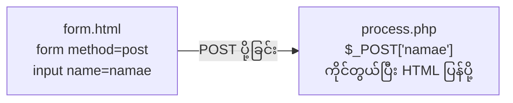
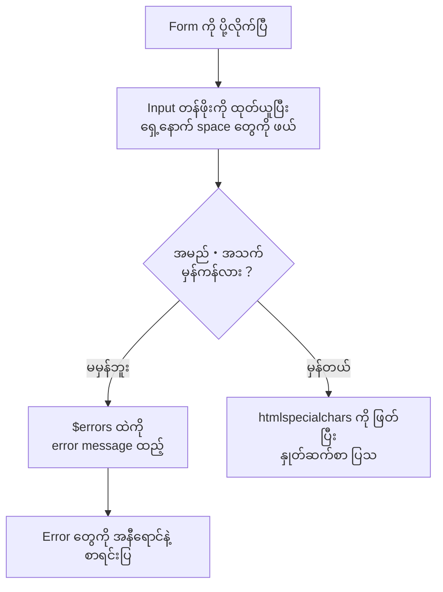

# ပထမနှစ်｜ဒေတာဒီဇိုင်းနှင့် အက်ပ်ဖန်တီးခြင်း — 2026/07/07

> 🇯🇵 မူရင်း (ဂျပန်ဘာသာဖြင့်): [20260707_資料.md](<../../../1年生_データ設計とアプリ開発/前期/20260707/20260707_資料.md>) <!-- original-ja-link -->

---

## ဒီနေ့ရဲ့ ပန်းတိုင်

- PHP ရဲ့ variable・type・array・associative array တွေကို သုံးနိုင်မယ်
- အခြေအနေပေါ်မူတည်ပြီး ခွဲခြားလုပ်ဆောင်တဲ့ code နဲ့ function တွေကို ရေးနိုင်မယ်
- HTML form ရဲ့ ဒေတာကို PHP နဲ့ လက်ခံပြီး လုံခြုံစွာ ကိုင်တွယ်နိုင်မယ်

---

## 1. Variable နှင့် type

```php
<?php
// Variable တွေကို $ နဲ့ မဖြစ်မနေ စရတယ်
$namae    = "田中太郎";   // String（string）
$nenrei   = 20;           // ကိန်းပြည့်（int）
$身長     = 1.75;         // ဒသမကိန်း（float）
$isStudent = true;        // မှန်/မှား တန်ဖိုး（bool）

// gettype() နဲ့ type ကို စစ်ကြည့်တယ်（JS ရဲ့ typeof နဲ့ ညီမျှတယ်）
echo gettype($namae);     // → string
echo gettype($nenrei);    // → integer

// Type ပြောင်းခြင်း
$str = "42";
$num = (int)$str;         // String ကို ကိန်းပြည့်အဖြစ် ပြောင်းတယ်
echo $num + 1;            // → 43
```

---

## 2. String ကိုင်တွယ်ခြင်း

```php
<?php
$namae = "田中太郎";

echo mb_strlen($namae);   // → 4（စာလုံးအရေအတွက်။ mb_ function တွေက ဂျပန်စာကို ကိုင်တွယ်နိုင်တယ်）

// Variable ကို ထည့်ရေးခြင်း（「名前」= အမည်၊「さん」= လူအမည်နောက်မှာ ထည့်တဲ့ အလေးပြုစကား）
echo "名前: {$namae}さん";

// မကြာခဏ သုံးတဲ့ string function များ
echo strtolower("HELLO");              // → hello
echo strtoupper("hello");              // → HELLO
echo trim("  hello  ");                // → hello（ရှေ့နောက်က space တွေကို ဖယ်တယ်）
echo str_replace("猫", "犬", "猫が好き"); // → 犬が好き（「猫」= ကြောင်၊「犬」= ခွေး၊「猫が好き」= ကြောင်ကို ကြိုက်တယ်၊「犬が好き」= ခွေးကို ကြိုက်တယ်）
```

---

## 3. Array

```php
<?php
$scores = [85, 72, 91, 68, 78];

echo $scores[0];          // → 85（0 ကနေ စတယ်）
echo count($scores);      // → 5（JS ရဲ့ .length နဲ့ ညီမျှတယ်）

$scores[] = 95;           // နောက်ဆုံးမှာ ထည့်တယ်（JS ရဲ့ push နဲ့ ညီမျှတယ်）
sort($scores);            // ငယ်စဉ်ကြီးလိုက် စီတယ်
rsort($scores);           // ကြီးစဉ်ငယ်လိုက် စီတယ်

// မကြာခဏ သုံးတဲ့ array function များ
$doubled  = array_map(fn($x) => $x * 2, $scores);       // JS ရဲ့ map
$big      = array_filter($scores, fn($x) => $x >= 80);  // JS ရဲ့ filter
$total    = array_sum($scores);                           // ပေါင်းလဒ်
$average  = array_sum($scores) / count($scores);          // ပျမ်းမျှ
```

---

## 4. Associative array（JS ရဲ့ object နဲ့ ညီမျှတယ်）

```php
<?php
// Associative array = key နဲ့ value အတွဲ
$person = [
    "namae"  => "田中太郎",
    "nenrei" => 20,
    "email"  => "tanaka@example.com",
];

echo $person["namae"];   // → 田中太郎

$person["hobby"] = "プログラミング";  // Key အသစ် ထည့်တယ်（「プログラミング」= ပရိုဂရမ်ရေးခြင်း）
$person["nenrei"] = 21;               // Value ကို ပြောင်းတယ်

// foreach နဲ့ key နဲ့ value ကို ထုတ်ယူတယ်
foreach ($person as $key => $value) {
    echo "{$key}: {$value}\n";
}

// ========== Associative array တွေရဲ့ array（JS ရဲ့ object array）（「点」= အမှတ်） ==========
$students = [
    ["id" => 1, "name" => "田中太郎", "score" => 85],
    ["id" => 2, "name" => "鈴木花子", "score" => 72],
];

foreach ($students as $student) {
    echo "ID:{$student['id']} {$student['name']} {$student['score']}点\n";
}
```

---

## 5. Condition ခွဲခြင်း

```php
<?php
$score = 72;

// if/elseif/else（PHP မှာ elseif လို့ ရေးတယ်）（「S評価」「A評価」「B評価」「D評価」= S၊ A၊ B၊ D အဆင့်）
if ($score >= 90) {
    echo "S評価";
} elseif ($score >= 80) {
    echo "A評価";
} elseif ($score >= 70) {
    echo "B評価";
} else {
    echo "D評価";
}

// Ternary operator（JS နဲ့ အတူတူ）（「合格」= အောင်၊「不合格」= ကျ）
$result = ($score >= 60) ? "合格" : "不合格";

// match expression（PHP 8.0 မှစ၍ အသုံးပြုနိုင်သည်・switch ကို ပိုကောင်းအောင် လုပ်ထားတဲ့ version）
$status = "active";
$label = match($status) {
    "active"   => "有効",
    "inactive" => "無効",
    default    => "不明",
};
echo $label;  // → 有効（「有効」= အသုံးပြုနိုင်၊「無効」= အသုံးမပြုနိုင်၊「不明」= မသိရ）
```

---

## 6. Function

```php
<?php
// Type declaration ပါတဲ့ function（argument နဲ့ return value မှာ type ရေးလို့ရတယ်）
function calcTax(float $price, float $taxRate = 0.1): float {
    return $price * (1 + $taxRate);
}

echo calcTax(1000);       // → 1100（default 10%）
echo calcTax(1000, 0.08); // → 1080（8%）

// တန်ဖိုး အများကြီးကို ပြန်ပေးခြင်း（associative array နဲ့ ပြန်ပေးတယ်）
function calcStats(array $numbers): array {
    return [
        "total"   => array_sum($numbers),
        "average" => array_sum($numbers) / count($numbers),
        "max"     => max($numbers),
        "min"     => min($numbers),
    ];
}

$stats = calcStats([85, 72, 91, 68]);
echo "平均: " . $stats["average"];  // → 平均: 79（「平均」= ပျမ်းမျှ）

// Arrow function（PHP 7.4 မှစ၍ အသုံးပြုနိုင်သည်）
$double = fn($n) => $n * 2;
echo $double(5);  // → 10
```

---

## 7. Form နှင့် ဒေတာ လက်ခံခြင်း（$_POST）

Form မှာ ထည့်လိုက်တဲ့ အကြောင်းအရာတွေက အောက်ပါအတိုင်း PHP ဆီ ရောက်လာပါတယ်။ အောက်က code ထဲက「名前」က အမည်၊「年齢」က အသက်၊「送信する」က ပို့မည်၊「歳」က နှစ်（အသက်）၊「メッセージ」က စာတို ကို ဆိုလိုပါတယ်။



### form.html

```html
<form action="process.php" method="post">
  <input type="text"  name="namae"   placeholder="名前">
  <input type="number" name="age"    placeholder="年齢">
  <textarea name="message"></textarea>
  <button type="submit">送信する</button>
</form>
```

### process.php

```php
<?php
$namae   = $_POST["namae"]   ?? "";
$age     = $_POST["age"]     ?? "";
$message = $_POST["message"] ?? "";

// !! အရေးကြီး !! XSS ကာကွယ်ခြင်း：htmlspecialchars နဲ့ HTML tag တွေကို အလုပ်မလုပ်အောင် လုပ်တယ်
$safeName    = htmlspecialchars($namae,   ENT_QUOTES, 'UTF-8');
$safeMessage = htmlspecialchars($message, ENT_QUOTES, 'UTF-8');

echo "<p>名前: {$safeName}</p>";
echo "<p>年齢: {$age}歳</p>";
echo "<p>メッセージ: {$safeMessage}</p>";
?>
```

---

## 8. XSS ကာကွယ်ခြင်း

```php
<?php
// ❌ အန္တရာယ်ရှိတဲ့ နမူနာ（htmlspecialchars မပါ）（「ハッキング！」= ဟက်ကင်းလုပ်ခြင်း!）
$input = "<script>alert('ハッキング！')</script>";
echo $input;
// → Browser က <script> ကို run သွားလိမ့်မယ်！

// ✅ လုံခြုံတဲ့ နမူနာ
echo htmlspecialchars($input, ENT_QUOTES, 'UTF-8');
// → &lt;script&gt;... ဆိုပြီး ရိုးရိုး string အဖြစ်ပဲ ပေါ်မယ်
?>
```

> **စည်းကမ်း：** အသုံးပြုသူ ထည့်တဲ့ input ကို `htmlspecialchars()` ကို မဖြစ်မနေ ဖြတ်ပြီးမှ ပြသပါ！

---

## 9. Validation（input စစ်ဆေးခြင်း）

အောက်က code က input ကို အောက်ပါ အစီအစဉ်အတိုင်း စစ်ဆေးပါတယ်။ Code ထဲက「名前は必須です」က အမည်ဖြည့်ရန် လိုအပ်သည်၊「名前は50文字以内にしてください」က အမည်ကို စာလုံး ၅၀ အတွင်း ထားပါ၊「年齢は必須です」က အသက်ဖြည့်ရန် လိုအပ်သည်၊「年齢は0〜150の数値を入力してください」က အသက်ကို ၀ မှ ၁၅၀ အတွင်း ကိန်းဂဏန်းဖြင့် ဖြည့်ပါ၊「こんにちは、…さん（…歳）！」က “မင်္ဂလာပါ၊ … (အသက် … နှစ်)!” လို့ ဆိုလိုပါတယ်။



```php
<?php
$errors = [];
$namae  = "";
$age    = "";

if ($_SERVER["REQUEST_METHOD"] === "POST") {
    $namae = trim($_POST["namae"] ?? "");
    $age   = trim($_POST["age"]   ?? "");

    if (empty($namae)) {
        $errors[] = "名前は必須です";
    } elseif (mb_strlen($namae) > 50) {
        $errors[] = "名前は50文字以内にしてください";
    }

    if (empty($age)) {
        $errors[] = "年齢は必須です";
    } elseif (!is_numeric($age) || $age < 0 || $age > 150) {
        $errors[] = "年齢は0〜150の数値を入力してください";
    }

    if (empty($errors)) {
        $safeName = htmlspecialchars($namae, ENT_QUOTES, 'UTF-8');
        echo "<p>こんにちは、{$safeName}さん（{$age}歳）！</p>";
    }
}

if (!empty($errors)) {
    echo "<ul style='color:red;'>";
    foreach ($errors as $error) {
        echo "<li>" . htmlspecialchars($error) . "</li>";
    }
    echo "</ul>";
}
?>
```

---

## အနှစ်ချုပ်

| လုပ်ဆောင်ချက် | JavaScript | PHP |
| --- | --- | --- |
| Variable | `let x = 1` | `$x = 1` |
| Array ရဲ့ အရှည် | `arr.length` | `count($arr)` |
| နောက်ဆုံးမှာ ထည့်ခြင်း | `arr.push(v)` | `$arr[] = v` |
| forEach | `arr.forEach(fn)` | `foreach ($arr as $v)` |
| Object | `{key: value}` | `["key" => value]` |
| else if | `else if` | `elseif` |
| Arrow function | `(x) => x * 2` | `fn($x) => $x * 2` |
| Form ဒေတာ လက်ခံခြင်း | `fetch` / `FormData` | `$_POST["name"]` |
| XSS ကာကွယ်ခြင်း | `textContent` ကို သုံး | `htmlspecialchars()` |

---

## နောက်တစ်ကြိမ်အတွက် ကြိုတင်ပြောချက်

「ဒေတာဘေ့စ် ဘာကြောင့် လိုအပ်သလဲ」ဆိုတာကို ကိုယ်တိုင် လက်တွေ့လုပ်ကြည့်ပြီး သင်ပါမယ်။  
PHP ရဲ့ array တစ်ခုတည်းနဲ့ ဒေတာကို စီမံဖို့ ကြိုးစားရင် ဘယ်လို ကန့်သတ်ချက်တွေ ရှိလဲဆိုတာ ကိုယ်တိုင် ခံစားသိရှိရပါမယ်။

<!-- nav:start -->

---

| ⬅️ ယခင် | 🗺️ ခြုံငုံပုံ | နောက်တစ်ခု ➡️ |
|:--|:--:|--:|
| [06/30 လေ့ကျင့်ခန်း](../20260630/20260630_演習.md) | [သင်ခန်းစာများ၏ ခြုံငုံပုံ](../../README.md) | [07/07 လေ့ကျင့်ခန်း](20260707_演習.md) |

<!-- nav:end -->
