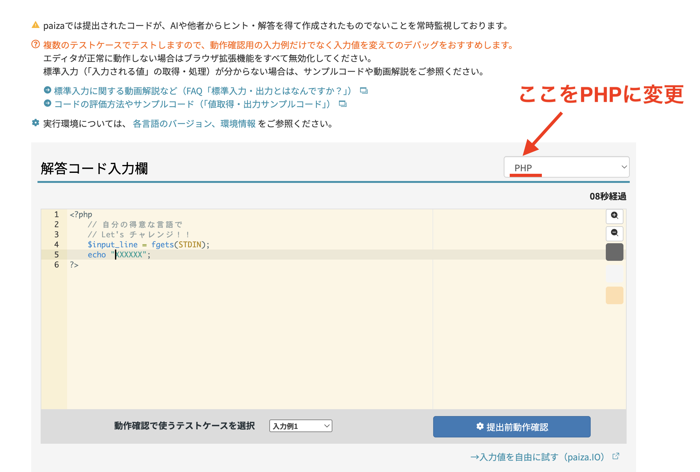

# လေ့ကျင့်ခန်း ပုစ္ဆာများ（2026 ခုနှစ် ဇူလိုင်လ 14 ရက်）

> 🇯🇵 မူရင်း (ဂျပန်ဘာသာဖြင့်): [20260714_資料_1.md](<../../../1年生_データ設計とアプリ開発/前期/20260714/20260714_資料_1.md>) <!-- original-ja-link -->

PHP server ကို စတင်နိုင်ပြီဖြစ်လို့ အရင်ဆုံး အခုထိ သင်ခဲ့တဲ့ လေ့ကျင့်ခန်း ပုစ္ဆာတွေကို လုပ်ကြည့်ပါ။

## ပြင်ဆင်ခြင်း

- [PHP development server စတင်နည်း](../PHP開発サーバーの立て方.md)

## လေ့ကျင့်ခန်း

1. [20260630_လေ့ကျင့်ခန်း](../20260630/20260630_演習.md)
2. [20260707_လေ့ကျင့်ခန်း](../20260707/20260707_演習.md)


ပုစ္ဆာတိုင်းကို `index.php` တစ်ခုတည်းထဲမှာ စုရေးလည်း ရပါတယ်။ ဒါမှမဟုတ် [PHP development server စတင်နည်း](../PHP開発サーバーの立て方.md) ထဲက「အခန်းအလိုက် directory ဖွဲ့စည်းပုံဖြင့် ဝင်ရောက်ခြင်း」အတိုင်း ပုစ္ဆာတစ်ခုချင်းစီအတွက် file ခွဲထားလည်း ရပါတယ်（ဥပမာ: `1-1.php` / `1-2.php`）။

### Directory ဖွဲ့စည်းပုံ နမူနာ

```
study/
  index.php
  0630/
    1.php
    2.php
    3.php
    4.php
  0707/
    1-1.php
    1-2.php
    2-1.php
```

### Server စတင်တဲ့ command

「cd」ဆိုတာ လက်ရှိ directory ကို ပြောင်းခြင်း ဆိုတဲ့ အဓိပ္ပာယ်ပါ။

```bash
cd /Users/<အသုံးပြုသူအမည်>/Desktop/study
php -S localhost:8000
```

### URL ဝင်ရောက်နည်း

Server ကို `study` directory အောက်မှာ တိုက်ရိုက် စတင်တာ（`php -S localhost:8000`）ဖြစ်လို့ URL က `study/` ကနေစတဲ့ relative path နဲ့ ကိုက်ညီပါတယ်။

```
http://localhost:8000/0630/1.php
http://localhost:8000/0630/2.php
http://localhost:8000/0707/1-1.php
http://localhost:8000/0707/1-2.php
```

## AI အသုံးပြုပုံ

**Gemini စတဲ့ AI တွေကို သုံးလို့ရပါတယ်！**ဒါပေမဲ့ အောက်ပါအချက်တွေကို သတိထားပါ။

- Language ကို နားလည်အောင် လုပ်ပါ
- ရှာကြည့်ရင် သိနိုင်တဲ့အရာတွေကို အလွတ်မကျက်ပါနဲ့
- နားမလည်ရင်「code ကို ရှင်းပြတဲ့ comment တွေ ထည့်ပေးပါ」လို့ AI ကို တောင်းဆိုပါ


## လေ့ကျင့်ခန်း ပြီးလို့ အချိန်ပိုရှိသူတွေက Paiza မှာ စာရင်းသွင်းပြီး skill check ကို PHP နဲ့ စမ်းကြည့်ပါ

https://paiza.jp/challenges

တင်သွင်းမယ့် language က default အနေနဲ့ တခြား language ဖြစ်နေလို့ အောက်ပုံအတိုင်း PHP ကို ပြောင်းပါ။



**သတိပြုရန်：Paiza ရဲ့ skill check က AI ဒါမှမဟုတ် တခြားသူဆီက အရိပ်အမြွက်・အဖြေ ယူပြီး ရေးထားတဲ့ code ဟုတ်မဟုတ်ကို အမြဲ စောင့်ကြည့်နေပါတယ်။** အခုထိ လုပ်ခဲ့တဲ့ လေ့ကျင့်ခန်းတွေနဲ့ မတူဘဲ AI မသုံးဘဲ ကိုယ့်အစွမ်းနဲ့ကိုယ် ဖြေရှင်းပါ။

<!-- nav:start -->

---

| ⬅️ ယခင် | 🗺️ ခြုံငုံပုံ | နောက်တစ်ခု ➡️ |
|:--|:--:|--:|
| [07/07 လေ့ကျင့်ခန်း](../20260707/20260707_演習.md) | [သင်ခန်းစာများ၏ ခြုံငုံပုံ](../../README.md) | [07/21 DB ဘာကြောင့် လိုအပ်သလဲ](../20260721/20260721_資料.md) |

<!-- nav:end -->
