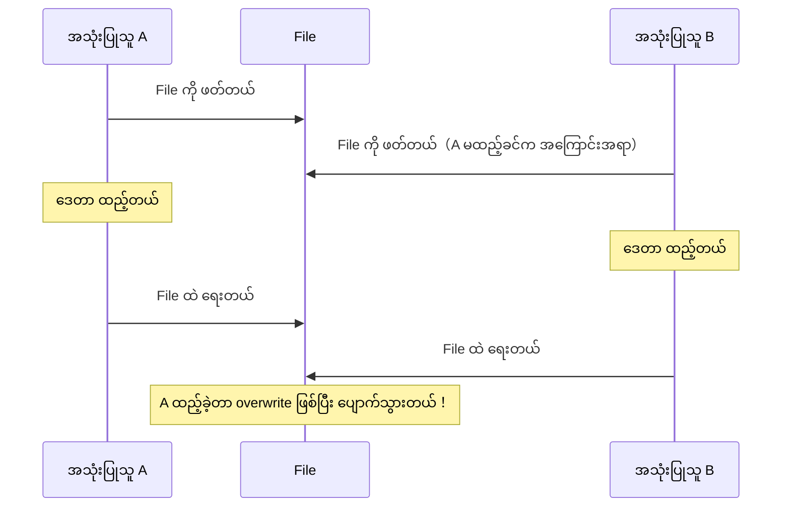
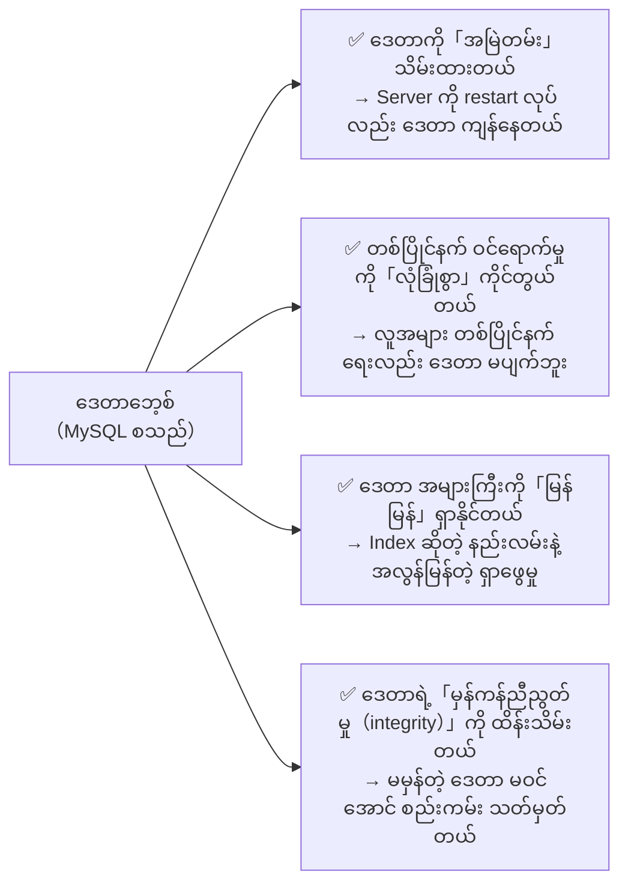
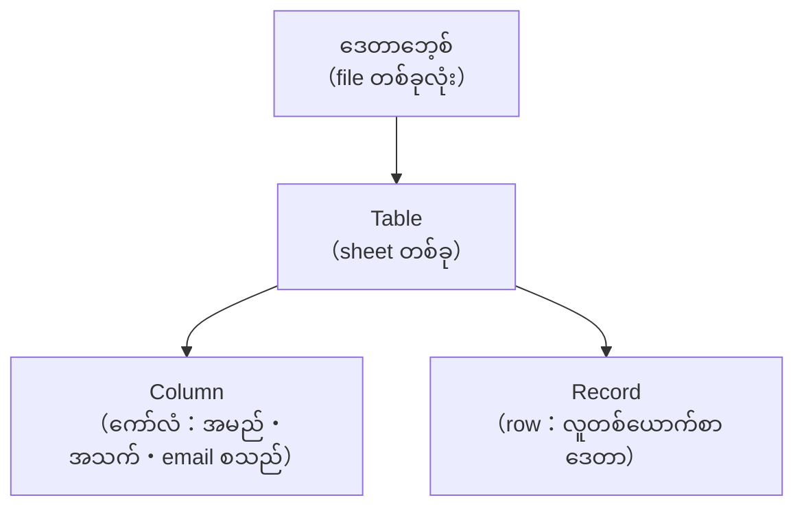
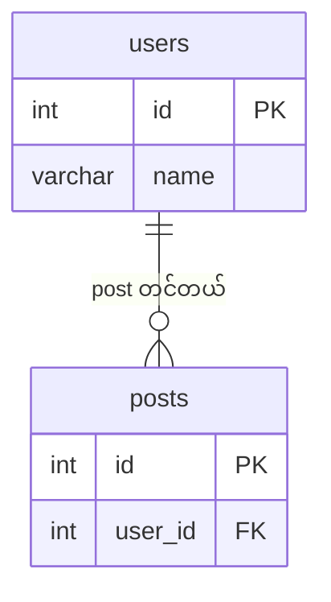

# သင်ချိန် 06｜DB ဘာကြောင့် လိုအပ်သလဲ — PHP ရဲ့ array တစ်ခုတည်းနဲ့ဆိုရင် ကန့်သတ်ချက်ရှိတယ်

> 🇯🇵 မူရင်း (ဂျပန်ဘာသာဖြင့်): [20260721_資料.md](<../../../1年生_データ設計とアプリ開発/前期/20260721/20260721_資料.md>) <!-- original-ja-link -->

## ဒီနေ့ရဲ့ ပန်းတိုင်
- PHP ရဲ့ array တစ်ခုတည်းနဲ့ ဒေတာ စီမံရင် ဖြစ်လာမယ့် ပြဿနာတွေကို ရှင်းပြနိုင်မယ်
- ဒေတာဘေ့စ်က ဘာတွေကို ဖြေရှင်းပေးလဲဆိုတာ နားလည်မယ်
- MySQL ရဲ့ အခြေခံ သဘောတရားတွေ（table・row・column）ကို ရှင်းပြနိုင်မယ်

---

## 1. Array တစ်ခုတည်းနဲ့ ဒေတာကို စီမံကြည့်မယ်

အရင်ဆုံး PHP ရဲ့ array တစ်ခုတည်းနဲ့「အသုံးပြုသူ စီမံခန့်ခွဲမှု စနစ်」ကို ဖန်တီးကြည့်ရအောင်။

```php
<?php
// File နဲ့ အခြေအနေကို သိမ်းဖို့ ကြိုးစားကြည့်ခြင်း
// users.php
$users = [
    ["id" => 1, "name" => "田中太郎", "email" => "tanaka@example.com"],
    ["id" => 2, "name" => "鈴木花子", "email" => "suzuki@example.com"],
];

// အသုံးပြုသူအသစ် ထည့်တဲ့ function
function addUser(array &$users, string $name, string $email): void {
    $newId = count($users) + 1;
    $users[] = ["id" => $newId, "name" => $name, "email" => $email];
}

addUser($users, "山田次郎", "yamada@example.com");

// ပြသခြင်း
foreach ($users as $user) {
    echo "{$user['id']}: {$user['name']}\n";
}
```

### ပြဿနာ 1：Server ကို restart လုပ်ရင် ဒေတာ ပျောက်သွားတယ်

```
PHP program က request ရောက်လာတိုင်း အစကနေ ပြန် run တယ်
 → အကြိမ်တိုင်း $users = [] ကနေ စတယ်
 → အရင်တစ်ခေါက်က ထည့်ခဲ့တဲ့ ဒေတာ ပျောက်သွားတယ်！
```

### ပြဿနာ 2：လူအများ တစ်ပြိုင်နက် ဝင်ရောက်ရင် ဒေတာ ပျက်စီးတယ်

A နဲ့ B က တစ်ချိန်တည်းနီးပါးမှာ ဒေတာရေးလိုက်ရင် အောက်ပါအတိုင်း ဖြစ်လာပါတယ်။



### ပြဿနာ 3：ဒေတာ များလာရင် ရှာဖွေတာ နှေးတယ်

```php
// အသုံးပြုသူ ၁ သန်းထဲကနေ သတ်မှတ်ထားတဲ့ email လိပ်စာကို ရှာတယ်
foreach ($users as $user) {
    if ($user["email"] === "target@example.com") {
        return $user;  // အဆိုးဆုံးဆိုရင် ၁ သန်းကြိမ် loop ပတ်ရမယ်...
    }
}
```

---

## 2. ဒေတာဘေ့စ်က ဖြေရှင်းပေးတဲ့အရာများ



---

## 3. ဒေတာဘေ့စ်ရဲ့ အခြေခံ သဘောတရားများ

ဒေတာဘေ့စ်ကို **spreadsheet နဲ့ ဆင်တူတဲ့ ဖွဲ့စည်းပုံ** လို့ တွေးကြည့်ရင် နားလည်ရ လွယ်ပါတယ်။



```
ဥပမာ：users table

 id │ name     │ email                │ created_at
────┼──────────┼──────────────────────┼─────────────────
  1 │ 田中太郎 │ tanaka@example.com   │ 2024-01-01 10:00
  2 │ 鈴木花子 │ suzuki@example.com   │ 2024-01-02 11:00
  3 │ 山田次郎 │ yamada@example.com   │ 2024-01-03 12:00
```

---

## 4. MySQL ရဲ့ အခြေခံ

**MySQL = ကမ္ဘာပေါ်မှာ အသုံးအများဆုံး open source relational database**

[Relational Database အကြောင်း](./リレーショナルデータベース入門.md)

Laravel မှာလည်း စံအနေနဲ့ သုံးပါတယ်။

```
Relational database（RDB）ဆိုတာ：
- ဒေတာကို table（ဇယား）နဲ့ စီမံတယ်
- Table အချင်းချင်းကို「ဆက်နွယ်မှု（relation）」နဲ့ ချိတ်ဆက်နိုင်တယ်
- SQL（Structured Query Language）ဆိုတဲ့ language နဲ့ ကိုင်တွယ်တယ်

ဥပမာ：
  users table（အသုံးပြုသူ အချက်အလက်）
  posts table（post အချက်အလက်）
  → posts.user_id နဲ့ ဘယ်အသုံးပြုသူရဲ့ post လဲဆိုတာ စီမံနိုင်တယ်
```

users နဲ့ posts ရဲ့ ဆက်နွယ်မှုကို ပုံဆွဲကြည့်ရင် အောက်ပါအတိုင်း ဖြစ်ပါတယ်（အသုံးပြုသူ တစ်ယောက်က post အများကြီး ရှိနိုင်တယ်）။



---

## 5. MySQL ကို ပြင်ဆင်ခြင်း（Windows: XAMPP / Mac: DBngin）

ကိုယ့် OS နဲ့ ကိုက်ညီတဲ့ တစ်ခုခုကို သုံးပါ။

### Windows ဆိုရင်：XAMPP

**XAMPP = Apache / MySQL（MariaDB）/ PHP / phpMyAdmin တို့ကို တစ်ပြိုင်နက် install လုပ်နိုင်တဲ့ အခမဲ့ tool**

#### Install လုပ်ခြင်း

[apachefriends.org](https://www.apachefriends.org/) ကနေ download လုပ်ပြီး install လုပ်ပါ

#### MySQL server စတင်ခြင်း

1. XAMPP Control Panel ကို ဖွင့်ပါ
2. 「MySQL」row မှာရှိတဲ့「Start」ကို click လုပ်ပြီး စတင်ပါ

### Mac ဆိုရင်：DBngin

**DBngin = MySQL / PostgreSQL / Redis တို့ကို click တစ်ချက်နဲ့ စတင်နိုင်တဲ့ အခမဲ့ tool**

#### Install လုပ်ခြင်း

[dbngin.com](https://dbngin.com/) ကနေ download လုပ်ပြီး install လုပ်ပါ

#### MySQL server ဖန်တီးခြင်း・စတင်ခြင်း

1. DBngin ကို ဖွင့်ပါ
2. 「+」ခလုတ် →「MySQL」ကို ရွေးပါ
3. Version ကို ရွေးပြီး「Create」（version ဘာဖြစ်ဖြစ် OK၊ မသေချာရင် နောက်ဆုံး stable version）
4. ဖန်တီးထားတဲ့ server ရဲ့「Start」ကို click လုပ်ပြီး စတင်ပါ

### နှစ်ခုလုံးအတွက် ချိတ်ဆက်မှု အချက်အလက်

ဘယ် tool ပဲ သုံးသုံး default အနေနဲ့ အောက်ပါ setting နဲ့ MySQL စတင်ပါတယ်။

```
Host:     127.0.0.1
Port:     3306
User:     root
Password: （ဗလာထားလည်း OK）
```

※ Port 3306 ကို တခြား MySQL က သုံးနေပြီးသားဆိုရင် tool ဘက်မှာ တခြား port နံပါတ်ကို ပြောင်းပါ（အဲ့ဒီလိုဆိုရင် GUI tool ရဲ့ ချိတ်ဆက်မှု setting ကိုလည်း အဲ့ဒီ port နံပါတ်နဲ့ ကိုက်အောင် ပြင်ပါ）။

---

## 6. GUI tool နဲ့ MySQL ကို ကိုင်တွယ်ခြင်း（Windows: phpMyAdmin / Mac: TablePlus）

### Windows ဆိုရင်：phpMyAdmin

**phpMyAdmin = XAMPP မှာ standard အနေနဲ့ ပါလာတဲ့ MySQL စီမံခန့်ခွဲမှု screen（browser ကနေ ကိုင်တွယ်တယ်）**

XAMPP Control Panel မှာ MySQL ကို Start လုပ်ထားတဲ့ အခြေအနေနဲ့ browser ကနေ အောက်ပါလိပ်စာကို ဝင်ပါ။

```
http://localhost/phpmyadmin/
```

ချိတ်ဆက်မှု အချက်အလက် ထည့်စရာ မလိုပါဘူး（XAMPP စတင်ချိန်မှာ root user နဲ့ အလိုအလျောက် ချိတ်ဆက်ပေးပါတယ်）။

### Mac ဆိုရင်：TablePlus

**TablePlus = MySQL ကို GUI နဲ့ ကိုင်တွယ်နိုင်တဲ့ tool（SQL ကို ကိုယ်တိုင်ရေးပြီး လေ့ကျင့်နိုင်တယ်）**

#### Install လုပ်ခြင်း

[tableplus.com](https://tableplus.com/) ကနေ download လုပ်ပါ

#### ချိတ်ဆက်မှု setting（DBngin နဲ့ စတင်ထားတဲ့ MySQL ကို ချိတ်ဆက်မယ်ဆိုရင်）

```
Name:     local
Host:     127.0.0.1
Port:     3306
User:     root
Password: （ဗလာထားလည်း OK）
Database: （နောက်မှ ဖန်တီးမယ်）
```

---

## 7. ပထမဆုံး ဒေတာဘေ့စ်ကို ဖန်တီးခြင်း

Windows ဆိုရင် phpMyAdmin ရဲ့「SQL」tab၊ Mac ဆိုရင် TablePlus ရဲ့ SQL tab မှာ အောက်ပါအတိုင်း run ပါ：

```sql
-- ဒေတာဘေ့စ်ကို ဖန်တီးတယ်
CREATE DATABASE school_db;

-- ဖန်တီးထားတဲ့ ဒေတာဘေ့စ်ကို သုံးတယ်
USE school_db;

-- Table ကို ဖန်တီးတယ်
CREATE TABLE users (
    id    INT AUTO_INCREMENT PRIMARY KEY,  -- နံပါတ်ကို အလိုအလျောက် တပ်ပေးတယ်
    name  VARCHAR(100) NOT NULL,           -- အများဆုံး စာလုံး 100 ရှိတဲ့ string（မဖြစ်မနေ）
    email VARCHAR(255) NOT NULL UNIQUE,    -- UNIQUE = ထပ်နေတာ ခွင့်မပြုဘူး
    age   INT,                             -- ကိန်းပြည့်（မထည့်လည်းရ）
    created_at TIMESTAMP DEFAULT CURRENT_TIMESTAMP  -- ဖန်တီးတဲ့ ရက်စွဲနဲ့ အချိန်
);

-- ဒေတာ ထည့်ကြည့်မယ်
INSERT INTO users (name, email, age) VALUES ('田中太郎', 'tanaka@example.com', 20);
INSERT INTO users (name, email, age) VALUES ('鈴木花子', 'suzuki@example.com', 22);

-- ဒေတာကို ထုတ်ယူမယ်
SELECT * FROM users;
```

---

## အပိုအခန်း：PHP ကနေ SQL ကို run တဲ့ နမူနာ

PHP မှာ **PDO（PHP Data Objects）** ဆိုတဲ့ DB ချိတ်ဆက်ဖို့ standard လုပ်ဆောင်ချက် ရှိပါတယ်။

```php
<?php
$pdo = new PDO(
    'mysql:host=127.0.0.1;port=3306;dbname=school_db;charset=utf8mb4',
    'root',
    '' // XAMPP/DBngin ရဲ့ default က စကားဝှက် ဗလာ
);

// Run မယ့် SQL statement
$sql = "SELECT * FROM users";

$stmt = $pdo->query($sql);
$users = $stmt->fetchAll(PDO::FETCH_ASSOC);

foreach ($users as $user) {
    echo "{$user['id']}: {$user['name']}\n";
}
```

---

## အနှစ်ချုပ်

| ပြဿနာ | Array တစ်ခုတည်း | ဒေတာဘေ့စ် |
|------|---------|------------|
| ဒေတာကို အမြဲတမ်း သိမ်းခြင်း | ❌ ပျောက်တယ် | ✅ ကျန်တယ် |
| တစ်ပြိုင်နက် ဝင်ရောက်မှု | ❌ ပျက်တယ် | ✅ လုံခြုံတယ် |
| ဒေတာ အများကြီးကို ရှာဖွေခြင်း | ❌ နှေးတယ် | ✅ မြန်တယ် |
| ဒေတာရဲ့ မှန်ကန်ညီညွတ်မှု（integrity） | ❌ စစ်ဆေးမှု မရှိ | ✅ စည်းကမ်းနဲ့ ထိန်းနိုင်တယ် |

---

## နောက်တစ်ကြိမ်（သင်ချိန် 07）အတွက် ကြိုတင်ပြောချက်

SQL အခြေခံ：`SELECT` / `WHERE` / `ORDER BY` ကို သုံးပြီး ဒေတာကို ထုတ်ယူနည်းကို သင်ပါမယ်။  
TablePlus မှာ SQL ကို တကယ်ရေးပြီး run ကြည့်ရင်း လက်တွေ့ လုပ်ကြည့်ပါမယ်။

<!-- nav:start -->

---

📎 တွဲဖတ်ပါ → [Database Server တည်ဆောက်နည်း (XAMPP အပိုင်း)](../データベースサーバーの立て方/データベースサーバーの立て方.md)・[Relational database အခြေခံ](リレーショナルデータベース入門.md)

| ⬅️ ယခင် | 🗺️ ခြုံငုံပုံ | နောက်တစ်ခု ➡️ |
|:--|:--:|--:|
| [07/14 လေ့ကျင့်ခန်း ပုစ္ဆာများ](../20260714/20260714_資料_1.md) | [သင်ခန်းစာများ၏ ခြုံငုံပုံ](../../README.md) | [07/21 SQL အခြေခံ①（SELECT）](20260721_資料_2.md) |

<!-- nav:end -->
