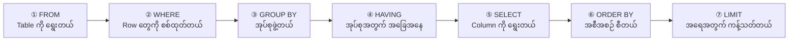

# သင်ချိန် 07｜SQL အခြေခံ① — SELECT / WHERE / ORDER BY

> 🇯🇵 မူရင်း (ဂျပန်ဘာသာဖြင့်): [20260721_資料_2.md](<../../../1年生_データ設計とアプリ開発/前期/20260721/20260721_資料_2.md>) <!-- original-ja-link -->

## ဒီနေ့ရဲ့ ပန်းတိုင်
- SELECT နဲ့ ဒေတာကို ထုတ်ယူနိုင်မယ်
- WHERE နဲ့ အခြေအနေ သတ်မှတ်ပြီး စစ်ထုတ်နိုင်မယ်
- ORDER BY နဲ့ အစီအစဉ် စီနိုင်မယ်
- LIMIT နဲ့ ယူမယ့် အရေအတွက်ကို ကန့်သတ်နိုင်မယ်

---

## ပြင်ဆင်ခြင်း：လေ့ကျင့်ဖို့ ဒေတာ ထည့်မယ်

TablePlus ရဲ့ SQL tab မှာ run ပါ：

```sql
-- ဒေတာဘေ့စ်နဲ့ table ကို ဖန်တီးတယ်
CREATE DATABASE IF NOT EXISTS school_db;
USE school_db;

-- ကျောင်းသား table
CREATE TABLE IF NOT EXISTS students (
    id         INT AUTO_INCREMENT PRIMARY KEY,
    name       VARCHAR(100) NOT NULL,
    age        INT NOT NULL,
    class      VARCHAR(10) NOT NULL,
    score      INT NOT NULL,
    enrolled_at DATE NOT NULL
);

-- စမ်းသပ်ဒေတာကို ထည့်သွင်းတယ်
INSERT INTO students (name, age, class, score, enrolled_at) VALUES
('田中太郎', 18, 'A', 85, '2024-04-01'),
('鈴木花子', 19, 'A', 72, '2024-04-01'),
('山田次郎', 18, 'B', 91, '2024-04-01'),
('佐藤三郎', 20, 'B', 58, '2024-04-01'),
('伊藤美咲', 18, 'A', 78, '2024-04-01'),
('渡辺一郎', 19, 'C', 95, '2024-04-01'),
('加藤幸子', 18, 'C', 45, '2024-04-01'),
('吉田健太', 20, 'B', 88, '2024-04-01'),
('山本麻衣', 19, 'A', 67, '2024-04-01'),
('中村龍一', 18, 'C', 73, '2024-04-01');
```

---

## 1. SELECT — ဒေတာကို ထုတ်ယူခြင်း

```sql
-- Column အားလုံး・row အားလုံးကို ယူတယ်（* = column အားလုံး）
SELECT * FROM students;

-- သတ်မှတ်ထားတဲ့ column တွေကိုပဲ ယူတယ်
SELECT name, score FROM students;

-- Column ကို အမည်တစ်မျိုး（alias）ပေးတယ်（AS）。名前＝အမည်、点数＝ရမှတ်
SELECT name AS 名前, score AS 点数 FROM students;
```

---

## 2. WHERE — အခြေအနေဖြင့် စစ်ထုတ်ခြင်း

```sql
-- score 80 နှင့်အထက် ရတဲ့ ကျောင်းသား
SELECT * FROM students WHERE score >= 80;

-- class က 'A' ဖြစ်တဲ့ ကျောင်းသား
SELECT * FROM students WHERE class = 'A';

-- age က 18 ဖြစ်ပြီး score က 70 နှင့်အထက်
SELECT * FROM students WHERE age = 18 AND score >= 70;

-- class က 'A' ဒါမှမဟုတ် 'B'
SELECT * FROM students WHERE class = 'A' OR class = 'B';

-- class က 'A' ဒါမှမဟုတ် 'B'（IN ကို သုံးရင် တိုတိုရေးလို့ရတယ်）
SELECT * FROM students WHERE class IN ('A', 'B');

-- score 60 နှင့်အထက် 90 အောက်（BETWEEN）
SELECT * FROM students WHERE score BETWEEN 60 AND 89;

-- name ထဲမှာ "太" ပါတယ်（LIKE = တစ်စိတ်တစ်ပိုင်း ကိုက်ညီခြင်း）
SELECT * FROM students WHERE name LIKE '%太%';
-- % = စာလုံး ဘယ်နှလုံးဖြစ်ဖြစ် OK（wildcard）

-- score က NULL မဟုတ်ဘူး（IS NOT NULL）
SELECT * FROM students WHERE score IS NOT NULL;
```

---

## 3. ORDER BY — အစီအစဉ် စီခြင်း

```sql
-- score ကို ငယ်စဉ်ကြီးလိုက်（နိမ့်တာကနေ）
SELECT * FROM students ORDER BY score ASC;   -- ASC = ascending（ငယ်စဉ်ကြီးလိုက်）

-- score ကို ကြီးစဉ်ငယ်လိုက်（မြင့်တာကနေ）
SELECT * FROM students ORDER BY score DESC;  -- DESC = descending（ကြီးစဉ်ငယ်လိုက်）

-- class ကို ငယ်စဉ်ကြီးလိုက်၊ class တူရင် score ကို ကြီးစဉ်ငယ်လိုက်
SELECT * FROM students ORDER BY class ASC, score DESC;
```

---

## 4. LIMIT — ယူမယ့် အရေအတွက်ကို ကန့်သတ်ခြင်း

```sql
-- ထိပ်ဆုံး 5 ခုကိုပဲ ယူတယ်
SELECT * FROM students ORDER BY score DESC LIMIT 5;

-- 6 ခုမြောက်ကနေ 5 ခု ယူတယ်（pagination အတွက် သုံးတယ်）
-- LIMIT အရေအတွက် OFFSET စမယ့်နေရာ
SELECT * FROM students ORDER BY id ASC LIMIT 5 OFFSET 5;
```

---

## 5. Aggregate function（စုစည်းတွက်ချက်တဲ့ function）

```sql
-- Row အရေအတွက်ကို ရေတွက်တယ်
SELECT COUNT(*) FROM students;
-- → 10

-- score ရဲ့ ပေါင်းလဒ်・ပျမ်းမျှ・အများဆုံး・အနည်းဆုံး（人数＝လူဦးရေ、合計点＝စုစုပေါင်းရမှတ်、平均点＝ပျမ်းမျှရမှတ်、最高点＝အမြင့်ဆုံးရမှတ်、最低点＝အနိမ့်ဆုံးရမှတ်）
SELECT
    COUNT(*)    AS 人数,
    SUM(score)  AS 合計点,
    AVG(score)  AS 平均点,
    MAX(score)  AS 最高点,
    MIN(score)  AS 最低点
FROM students;

-- GROUP BY：class အလိုက် ပျမ်းမျှ အမှတ်
SELECT class, AVG(score) AS 平均点, COUNT(*) AS 人数
FROM students
GROUP BY class
ORDER BY 平均点 DESC;
```

---

## 6. SELECT ကို လုပ်ဆောင်သည့် အစီအစဉ်（အရေးကြီး！）

SQL ကို ရေးထားတဲ့ အစီအစဉ်အတိုင်း မဟုတ်ဘဲ အောက်ပါ အစီအစဉ်အတိုင်း လုပ်ဆောင်ပါတယ်။



```sql
SELECT name, score       -- ⑤ ထုတ်ယူမယ့် column ကို ရွေးတယ်
FROM students            -- ① Table ကို ရွေးတယ်
WHERE score >= 70        -- ② အခြေအနေဖြင့် စစ်ထုတ်တယ်
GROUP BY class           -- ③ အုပ်စုဖွဲ့တယ်
HAVING AVG(score) >= 75  -- ④ အုပ်စုအတွက် အခြေအနေ（WHERE ရဲ့ နောက်မှာ）
ORDER BY score DESC      -- ⑥ အစီအစဉ် စီတယ်
LIMIT 5;                 -- ⑦ အရေအတွက် ကန့်သတ်တယ်
```

---

## အနှစ်ချုပ်

| SQL | အဓိပ္ပာယ် |
|-----|------|
| `SELECT * FROM table` | ဒေတာ အားလုံးကို ယူတယ် |
| `WHERE အခြေအနေ` | အခြေအနေနဲ့ စစ်ထုတ်တယ် |
| `AND` / `OR` | အခြေအနေများကို ပေါင်းစပ်တယ် |
| `IN (တန်ဖိုး1, တန်ဖိုး2)` | တန်ဖိုး အများကြီးထဲက တစ်ခုခုနဲ့ ကိုက်ညီတယ် |
| `LIKE '%စာလုံး%'` | တစ်စိတ်တစ်ပိုင်း ကိုက်ညီမှုနဲ့ ရှာဖွေတယ် |
| `ORDER BY column ASC/DESC` | အစီအစဉ် စီတယ် |
| `LIMIT ကိန်းဂဏန်း` | ယူမယ့် အရေအတွက်ကို ကန့်သတ်တယ် |
| `COUNT(*)` / `AVG()` / `SUM()` | Aggregate function |
| `GROUP BY column` | အုပ်စုဖွဲ့တယ် |

---

## နောက်တစ်ကြိမ်（သင်ချိန် 08）အတွက် ကြိုတင်ပြောချက်

INSERT / UPDATE / DELETE ကို သင်ပါမယ်။  
ဒေတာကို ထည့်ခြင်း・ပြင်ဆင်ခြင်း・ဖျက်ခြင်း လုပ်နိုင်လာပါမယ်။

<!-- nav:start -->

---

| ⬅️ ယခင် | 🗺️ ခြုံငုံပုံ | နောက်တစ်ခု ➡️ |
|:--|:--:|--:|
| [07/21 DB ဘာကြောင့် လိုအပ်သလဲ](20260721_資料.md) | [သင်ခန်းစာများ၏ ခြုံငုံပုံ](../../README.md) | [07/21 လေ့ကျင့်ခန်း](20260721_演習.md) |

<!-- nav:end -->
