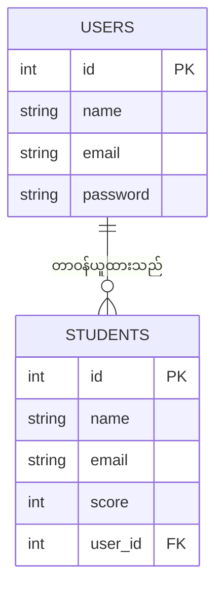

> 🇯🇵 မူရင်း (ဂျပန်ဘာသာဖြင့်): [リレーショナルデータベース入門.md](<../../../1年生_データ設計とアプリ開発/前期/20260721/リレーショナルデータベース入門.md>) <!-- original-ja-link -->

## ဒီဆောင်းပါးမှာ သိရမယ့်အရာများ

- Table・Row・Column
- Primary Key
- Foreign Key နဲ့ Table အချင်းချင်း ချိတ်ဆက်ပုံ
- Table တွေကို ခွဲထားရတဲ့ အကြောင်းရင်း

## Database = စနစ်တကျ စီထားတဲ့ ဇယားတွေရဲ့ စုစည်းမှု

စာရွက်ပေါ်မှာ ဟိုတစ်စ ဒီတစ်စ မှတ်ထားတာမျိုး မဟုတ်ဘဲ၊ ဇယားပုံစံနဲ့ စနစ်တကျ စီပြီး သိမ်းထားတဲ့ စနစ်ကို 「Database」လို့ ခေါ်ပါတယ်။ RDB (Relational Database) ရဲ့ ထူးခြားချက်က ဒီဇယား (Table) တွေ အများကြီးကို အချင်းချင်း ချိတ်ဆက်ပြီး (= Relation လုပ်ပြီး) အသုံးပြုနိုင်တာပါ။

## Table・Row・Column

ဒီ App မှာ တာဝန်မတူတဲ့ Table ၂ ခု ရှိပါတယ်။ တစ်ခုချင်းကို ဥပမာအဖြစ်ယူပြီး အစိတ်အပိုင်းတစ်ခုချင်းရဲ့ အမည်ကို စစ်ကြည့်ရအောင်။

### 🎓 students Table (ကျောင်းသားဒေတာ)

| id | name | email | score |
|----|------|-------|-------|
| 1  | 田中太郎 | tanaka@example.com | 80 |
| 2  | 佐藤花子 | sato@example.com | 95 |

- **Table**: ဒီဇယားတစ်ခုလုံး (ရည်ရွယ်ချက်အလိုက် အများကြီး ဖန်တီးပါတယ်)
- **Column**: `id` `name` `email` `score` လို ဒေါင်လိုက်ရှိတဲ့ ဒေတာအမျိုးအစားများ
- **Row (Record)**: ဒေတာ ၁ ခုစာ (ဒီမှာဆိုရင် ကျောင်းသား ၁ ယောက်စာ အချက်အလက်)

### 🔑 users Table (ဆရာ・စီမံခန့်ခွဲသူတို့ရဲ့ Login အချက်အလက်)

| id | name | email | password |
|----|------|-------|----------|
| 1  | 小山先生 | koyama@example.com | $2y$10$abcdefGhIjKlmn...(ハッシュ化済み) |
| 2  | 田中先生 | tanaka-t@example.com | $2y$10$OpQrStUvWxYz...(ハッシュ化済み) |

- **Table**: `users` (Login အတွက် အကောင့်အချက်အလက်။ students နဲ့ တာဝန်မတူပါ)
- **Column**: `id` `name` `email` `password`
- **Row (Record)**: ဒေတာ ၁ ခုစာ (ဒီမှာဆိုရင် ဆရာ・စီမံခန့်ခွဲသူ ၁ ယောက်စာ Login အချက်အလက်)

> 💡 `password` ကို ရိုက်ထည့်ထားတဲ့ စာသားအတိုင်း (Plain Text) မသိမ်းဘဲ၊ Hash လုပ်ခြင်းဆိုတဲ့ မူရင်းအတိုင်း ပြန်ပြောင်းလို့မရတဲ့ နည်းလမ်းနဲ့ ပြောင်းလဲပြီးမှ သိမ်းပါတယ်။ အပေါ်က 「ハッシュ化済み」ဆိုတာ Hash လုပ်ပြီးသားလို့ ဆိုလိုပါတယ်။ Database ထဲက ဒေတာတွေ ပေါက်ကြားသွားခဲ့ရင်တောင် မူရင်း Password ကို မသိနိုင်စေဖို့ ဖြစ်ပါတယ်။

## Primary Key: ဒေတာကို တစ်ခုတည်းအဖြစ် ခွဲခြားသိနိုင်တဲ့ ID

`name` (နာမည်) တစ်ခုတည်းနဲ့ ရှာရင် နာမည်တူသူ ရှိခဲ့ရင် ဘယ်သူလဲဆိုတာ မခွဲခြားနိုင်ပါဘူး။ ဒါကြောင့် တခြား Row တွေနဲ့ ဘယ်တော့မှ မထပ်တဲ့ နံပါတ် (**Primary Key**) ကို သုံးပါတယ်။ အပေါ်က ဇယားမှာ `id` က အဲဒါပါ။ 「id = 1 ဖြစ်တဲ့ ဒေတာကို ပေးပါ」လို့ ပြောလိုက်ရင် 田中太郎 ရဲ့ ဒေတာ ၁ ခုတည်းကိုပဲ ရွေးထုတ်နိုင်ပါတယ်။ Primary Key = မှတ်ပုံတင်နံပါတ် ဒါမှမဟုတ် အသင်းဝင်နံပါတ်လိုမျိုးလို့ မြင်ကြည့်ရင် နားလည်ရလွယ်ပါတယ်။

## Foreign Key: Table အချင်းချင်း ချိတ်ဆက်မှု

Table အများကြီးကို ID နဲ့ ချိတ်ဆက်ပေးနိုင်တာက RDB ရဲ့ အနှစ်သာရပါ (=「Relational」ဆိုတဲ့ အမည်ရဲ့ မူလအဓိပ္ပာယ်)။

ဒီ App မှာ Login အတွက် `users` Table (ဆရာ・စီမံခန့်ခွဲသူ အကောင့်) နဲ့
ကျောင်းသားဒေတာအတွက် `students` Table ဆိုပြီး ၂ ခု ရှိပါတယ်။ လောလောဆယ်မှာ ဒီ ၂ ခုက
ID နဲ့ မချိတ်ဆက်ထားတဲ့ သီးခြား Table တွေပါ။

တကယ်လို့ 「ဘယ်ဆရာ (user) က ဘယ်ကျောင်းသား (student) ကို မှတ်ပုံတင်・တာဝန်ယူထားလဲ」ဆိုတာကို
မှတ်တမ်းတင်ချင်လာရင် `students` Table မှာ `user_id` ဆိုတဲ့ Column ကို ထပ်ထည့်ပြီး ချိတ်ဆက်ပါတယ်။

`USERS.id` (Primary Key) ကို `STUDENTS.user_id` (Foreign Key) က ရည်ညွှန်းတဲ့ ပုံစံ လုပ်လိုက်ရင်
ဆရာ (user) ၁ ယောက်က ကျောင်းသား (student) အများကြီးကို တာဝန်ယူနိုင်တဲ့ ဆက်နွယ်မှု (One-to-Many) ကို ဖော်ပြနိုင်ပါတယ်။

## ဘာကြောင့် Table တွေကို ခွဲထားရတာလဲ

Table တွေကို မခွဲဘဲ ဇယားတစ်ခုတည်းထဲ စုထည့်လိုက်ရင် တာဝန်ယူတဲ့ ဆရာတစ်ယောက်တည်းရဲ့ နာမည်နဲ့ Email လိပ်စာက သူတာဝန်ယူတဲ့ ကျောင်းသားအရေအတွက်အတိုင်း ထပ်နေပါလိမ့်မယ်။

| student_id | student_name | staff_name | staff_email |
|-----------|-------|-------------|---------------|
| 101 | 田中花子 | 小山先生 | koyama@example.com |
| 103 | 田中次郎 | 小山先生 | koyama@example.com |

ဒီလိုဆိုရင် 小山先生 (ဆရာ Koyama) က Email လိပ်စာ ပြောင်းလိုက်တဲ့အခါ သက်ဆိုင်တဲ့ Row အားလုံးကို ရှာပြီး ပြင်ရမှာဖြစ်လို့ ပြင်ဖို့ ကျန်ခဲ့တာမျိုး ဖြစ်လွယ်ပါတယ်။ users Table နဲ့ students Table ကို ခွဲပြီး ID နဲ့ ချိတ်ဆက်ထားရင် 小山先生 ရဲ့ အချက်အလက်က တစ်နေရာတည်းမှာပဲ ရှိမှာဖြစ်လို့ ပြင်ရင်လည်း တစ်နေရာတည်းမှာ ပြင်ရုံပါပဲ။ ဒီလို 「ထပ်နေတာကို ရှောင်ဖို့ Table တွေကို ခွဲတယ်」ဆိုတဲ့ စဉ်းစားပုံကို **Normalization** လို့ ခေါ်ပါတယ်။

## အနှစ်ချုပ်

- Database ဆိုတာ ဒေတာတွေကို စနစ်တကျ စီပြီး သိမ်းထားတဲ့ စနစ်
- RDB က ဒေတာကို 「Table (ဇယား)」ပုံစံနဲ့ စီမံပြီး Table ကို 「Column (ဒေါင်လိုက် ဒေတာအမျိုးအစား)」နဲ့ 「Row (ဒေတာ ၁ ခုစာ)」တွေနဲ့ ဖွဲ့စည်းထားတယ်
- Primary Key က ဒေတာ ၁ ခုချင်းကို မထပ်ဘဲ ခွဲခြားသိနိုင်ဖို့ အမှတ်အသား (ID)
- Foreign Key က တခြား Table ရဲ့ Primary Key ကို ရည်ညွှန်းပြီး Table အချင်းချင်း ချိတ်ဆက်ပေးတဲ့ စနစ်
- Table တွေကို ခွဲပြီး ချိတ်ဆက်ထားခြင်းအားဖြင့် တူညီတဲ့ အချက်အလက် ထပ်နေတာကို ကာကွယ်နိုင်ပြီး ဒေတာကို စီမံရ လွယ်ကူစေတယ်

နောက်ပိုင်းမှာ 「SQL」「Index」「Transaction」စတာတွေလည်း ပါလာပါလိမ့်မယ်။ ဒါပေမဲ့ အခုတော့ ဒီအခြေခံကို မြင်ယောင်နိုင်ရင် လုံလောက်ပါပြီ။

<!-- nav:start -->

---

| ⬅️ ပြန်သွားရန် | 🗺️ ခြုံငုံပုံ | နောက်တစ်ခု ➡️ |
|:--|:--:|--:|
| [07/21 DB ဘာကြောင့် လိုအပ်သလဲ](20260721_資料.md) | [သင်ခန်းစာများ၏ ခြုံငုံပုံ](../../README.md) | [07/21 SQL အခြေခံ①（SELECT）](20260721_資料_2.md) |

<!-- nav:end -->
