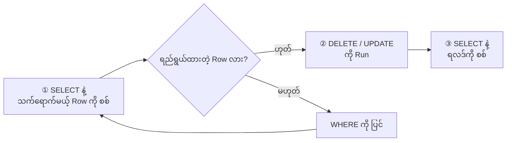
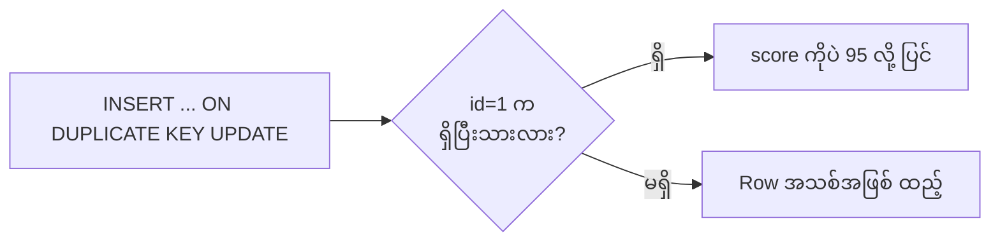

# သင်ချိန် 08｜SQL အခြေခံ② — INSERT / UPDATE / DELETE

> 🇯🇵 မူရင်း (ဂျပန်ဘာသာဖြင့်): [20260723_資料.md](<../../../1年生_データ設計とアプリ開発/前期/20260723/20260723_資料.md>) <!-- original-ja-link -->

## ဒီနေ့ရဲ့ ပန်းတိုင်
- INSERT နဲ့ ဒေတာ ထည့်နိုင်ရမယ်
- UPDATE နဲ့ ဒေတာ ပြင်ဆင်နိုင်ရမယ်
- DELETE နဲ့ ဒေတာ ဖျက်နိုင်ရမယ်
- WHERE ရဲ့ အရေးပါပုံ (ထည့်ဖို့ မေ့ရင် Row အားလုံး ပြောင်းသွားမယ်ဆိုတာ) ကို နားလည်ရမယ်

---

## 1. INSERT — ဒေတာ ထည့်ခြင်း

```sql
-- Column အားလုံးမှာ တန်ဖိုးထည့်မယ်ဆိုရင် (Column အမည်ကို ချန်ထားနိုင်တယ်)
INSERT INTO students VALUES (NULL, '新入生A', 18, 'A', 80, '2024-04-01');
-- ↑ id က AUTO_INCREMENT ဖြစ်လို့ NULL ထားရင် ရပါတယ်（'新入生A'〜'新入生E' ဆိုတာ ကျောင်းသားသစ် A〜E ပါ）

-- သတ်မှတ်ထားတဲ့ Column တွေကိုပဲ ရွေးပြီး ထည့်ခြင်း (အကြံပြုထားတဲ့နည်း)
INSERT INTO students (name, age, class, score, enrolled_at)
VALUES ('新入生B', 19, 'B', 75, '2024-04-01');

-- Row အများကြီးကို တစ်ခါတည်း ထည့်ခြင်း
INSERT INTO students (name, age, class, score, enrolled_at)
VALUES
    ('新入生C', 18, 'C', 88, '2024-04-01'),
    ('新入生D', 20, 'A', 62, '2024-04-01'),
    ('新入生E', 19, 'B', 71, '2024-04-01');
```

---

## 2. UPDATE — ဒေတာ ပြင်ဆင်ခြင်း

```sql
-- !! အလွန်အရေးကြီး !!
-- WHERE ထည့်ဖို့ မေ့ရင် Row အားလုံးကို ပြင်ဆင်မိသွားမယ်!
-- WHERE ကို အမြဲ စစ်ပြီးမှ Run ပါ!

-- id က 1 ဖြစ်တဲ့ ကျောင်းသားရဲ့ score ကို 90 လို့ ပြင်ခြင်း
UPDATE students SET score = 90 WHERE id = 1;

-- Column အများကြီးကို တစ်ပြိုင်နက် ပြင်ခြင်း (ကော်မာခံပြီး)
UPDATE students SET score = 95, class = 'S' WHERE id = 1;

-- WHERE မပါ (အန္တရာယ်ရှိ! Row အားလုံးကို ပြင်ဆင်မိသွားမယ်)
-- UPDATE students SET score = 0;  ← ဒါကို လုပ်ရင် လူတိုင်း 0 မှတ် ဖြစ်သွားမယ်!

-- လက်ရှိတန်ဖိုးကို သုံးပြီး ပြင်ခြင်း (ဥပမာ: လူတိုင်းကို +5 မှတ်)
UPDATE students SET score = score + 5;  -- ရည်ရွယ်ပြီး လုပ်တာဆိုရင် ရပါတယ်
```

---

## 3. DELETE — ဒေတာ ဖျက်ခြင်း

```sql
-- !! အလွန်အရေးကြီး !!
-- WHERE ထည့်ဖို့ မေ့ရင် Row အားလုံး ဖျက်ခံရမယ်!
-- DELETE လုပ်ပြီးရင် ပြန်ယူလို့ မရဘူး!

-- id က 5 ဖြစ်တဲ့ ကျောင်းသားကို ဖျက်ခြင်း
DELETE FROM students WHERE id = 5;

-- score က 50 အောက် ဖြစ်တဲ့ ကျောင်းသားအားလုံးကို ဖျက်ခြင်း
DELETE FROM students WHERE score < 50;

-- WHERE မပါ (ဘယ်တော့မှ မလုပ်ရ)
-- DELETE FROM students;  ← Table ထဲမှာ ဘာမှ မကျန်တော့ဘူး!
```

> **လုပ်ငန်းခွင်မှာ လိုက်နာရမယ့် စည်းကမ်း:**  
> 1. UPDATE/DELETE မလုပ်ခင် SELECT နဲ့ သက်ရောက်မယ့် Row တွေကို စစ်ပါ  
> 2. Run မလုပ်ခင် Backup ယူထားပါ  
> 3. WHERE ကို အမြဲ စစ်ပါ

---

## 4. ဘေးကင်းတဲ့ UPDATE/DELETE လုပ်နည်း

ချက်ချင်း မ Run ဘဲ အောက်ပါ အစီအစဉ်အတိုင်း လုပ်ပါ။



```sql
-- အဆင့် 1: အရင်ဆုံး SELECT နဲ့ သက်ရောက်မယ့် Row တွေကို စစ်
SELECT * FROM students WHERE score < 50;
-- → ဖျက်ခံရမယ့် Row တွေကို မျက်စိနဲ့ စစ်ကြည့်ပါ

-- အဆင့် 2: ပြဿနာမရှိရင် DELETE ကို Run
DELETE FROM students WHERE score < 50;

-- စစ်ဆေးခြင်း
SELECT * FROM students;
```

---

## 5. မကြာခဏ သုံးတဲ့ ပုံစံ: UPSERT

```sql
-- INSERT OR UPDATE (ရှိပြီးသား ဒေတာဆိုရင် ပြင်၊ မရှိရင် အသစ်ထည့်)
-- MySQL မှာ INSERT ... ON DUPLICATE KEY UPDATE ကို သုံးပါတယ်
INSERT INTO students (id, name, score)
VALUES (1, '田中太郎', 95)
ON DUPLICATE KEY UPDATE score = 95;
-- id=1 ရှိပြီးသား → score ကိုပဲ 95 လို့ ပြင်မယ်
-- id=1 မရှိသေး → အသစ် ထည့်မယ်
```

ပုံနဲ့ပြရင် အောက်ပါအတိုင်း ခွဲသွားပါတယ်။



---

## 6. CRUD အနှစ်ချုပ်

| လုပ်ဆောင်ချက် | SQL | အဓိပ္ပာယ် |
|------|-----|------|
| **C**reate (ဖန်တီး) | `INSERT INTO ... VALUES ...` | ဒေတာ ထည့် |
| **R**ead (ဖတ်) | `SELECT ... FROM ...` | ဒေတာ ယူ |
| **U**pdate (ပြင်ဆင်) | `UPDATE ... SET ... WHERE ...` | ဒေတာ ပြင် |
| **D**elete (ဖျက်) | `DELETE FROM ... WHERE ...` | ဒေတာ ဖျက် |

> **CRUD = Create / Read / Update / Delete** က Web App ရဲ့ အခြေခံ လုပ်ဆောင်ချက်တွေပါ။  
> Laravel လေ့ကျင့်ခန်းမှာလည်း အတိအကျ တူညီတဲ့ သဘောတရား ပါလာပါလိမ့်မယ်။

---

## နောက်တစ်ကြိမ်（သင်ချိန် 09）အတွက် ကြိုတင်ပြောချက်

Table တွေရဲ့ ဆက်နွယ်မှုနဲ့ JOIN ကို လေ့လာပါမယ်။  
「User Table နဲ့ Order Table ကို ပေါင်းပြီး ဘယ်သူက ဘာကို မှာယူခဲ့လဲ」ဆိုတာကို SQL Statement တစ်ခုတည်းနဲ့ ထုတ်ယူနိုင်လာပါလိမ့်မယ်။

<!-- nav:start -->

---

| ⬅️ ယခင် | 🗺️ ခြုံငုံပုံ | နောက်တစ်ခု ➡️ |
|:--|:--:|--:|
| [07/21 လေ့ကျင့်ခန်း](../20260721/20260721_演習.md) | [သင်ခန်းစာများ၏ ခြုံငုံပုံ](../../README.md) | [07/23 လေ့ကျင့်ခန်း](20260723_演習.md) |

<!-- nav:end -->
