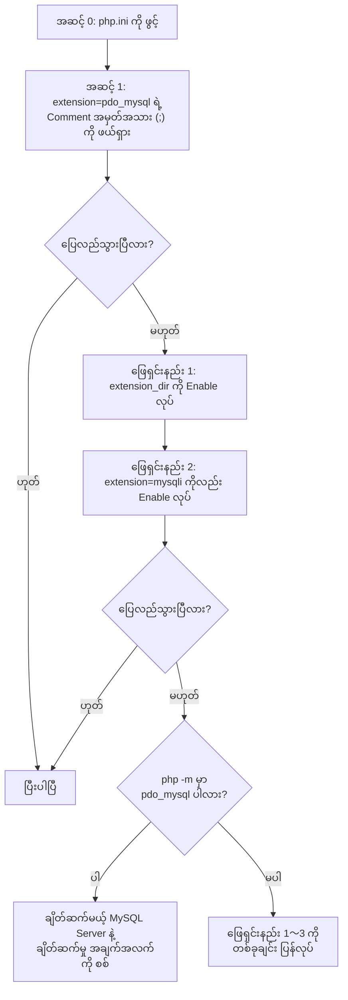

# PDO MySQL Extension ကို Enable မဖြစ်တဲ့အခါ ဖြေရှင်းနည်း

> 🇯🇵 မူရင်း (ဂျပန်ဘာသာဖြင့်): [PDO_MySQL接続エラー対処法.md](<../../../1年生_データ設計とアプリ開発/前期/20260723/PDO_MySQL接続エラー対処法.md>) <!-- original-ja-link -->

## ဖြေရှင်းမယ့် Error

အောက်ပါလို Error ပေါ်နေတဲ့အခါ ဖြေရှင်းနည်းပါ။

```
Fatal error: Uncaught PDOException: could not find driver in C:\Users\nishida\Desktop\apple\5.php:2
Stack trace:
#0 C:\Users\nishida\Desktop\apple\5.php(2): PDO->__construct('mysql:host=127....', 'root', Object(SensitiveParameterValue))
#1 {main}
  thrown in C:\Users\nishida\Desktop\apple\5.php on line 2
```

### ဒီ Error ရဲ့ အဓိပ္ပာယ်

PHP ကနေ MySQL (Database) ကို ချိတ်ဆက်တဲ့အခါ `PDO` ဆိုတဲ့ စနစ်ကို သုံးပါတယ်။ ဒါပေမဲ့ MySQL နဲ့ တကယ် ဆက်သွယ်ဖို့အတွက် 「Driver」ဆိုတဲ့ အစိတ်အပိုင်းတစ်ခု သီးခြား လိုအပ်ပါတယ်။

`could not find driver` ဆိုတာ 「အဲဒီ Driver ကို ရှာမတွေ့ပါ」ဆိုတဲ့ အဓိပ္ပာယ်ရှိတဲ့ Error ပါ။ ဆိုလိုတာက **PHP က `pdo_mysql` ဆိုတဲ့ Extension (Driver) ကို Load မလုပ်နိုင်သေးလို့** ဖြစ်နေတာပါ။

အကြောင်းရင်းက အများအားဖြင့် php.ini (PHP ရဲ့ Setting ဖိုင်) ထဲက Setting မှာ ရှိပါတယ်။ အောက်ပါ အဆင့်တွေကို အပေါ်ကနေ အစဉ်လိုက် စမ်းကြည့်ပါ။ တစ်ခု စမ်းပြီးတိုင်း 「Server ကို Restart လုပ်ခြင်း」([ဖြေရှင်းနည်း 3](#ဖြေရှင်းနည်း-3-server-ကို-သေချာပေါက်-restart-လုပ်ခြင်း)) ကို အမြဲလုပ်ပြီးမှ Browser မှာ စစ်ကြည့်ပါ။ Setting ပြောင်းရုံနဲ့ PHP မှာ အသက်မဝင်ပါဘူး။

လုပ်ဆောင်ရမယ့် အဆင့်တွေကို ခြုံငုံကြည့်ရင် အောက်ပါအတိုင်းပါ။



※ ဘယ်အဆင့်မှာပဲဖြစ်ဖြစ် ပြောင်းပြီး Save လုပ်ပြီးရင် ဖြေရှင်းနည်း 3 (Server ကို Restart လုပ်ခြင်း) ကို အမြဲလုပ်ပြီးမှ စစ်ကြည့်ပါ။

---

## အဆင့် 0: php.ini ကို ဖွင့်ခြင်း

ဒီနောက်ပိုင်း php.ini ဆိုတဲ့ ဖိုင်ကို အကြိမ်ကြိမ် ပြင်ရပါမယ်။ အရင်ဆုံး ဖွင့်နည်းကို စစ်ကြည့်ရအောင်။

1. File Explorer (Folder) ဒါမှမဟုတ် VS Code ကနေ `C:\php\php.ini` ကို ဖွင့်ပါ။
   - ရှာမတွေ့ရင် Terminal မှာ `php --ini` လို့ ရိုက်ထည့်လိုက်ရင် အသုံးပြုနေတဲ့ php.ini ရဲ့ တည်နေရာကို ပြပေးပါလိမ့်မယ်။
2. ဒီနောက်ပိုင်း ဒီ php.ini ထဲက အကြောင်းအရာကို ပြင်သွားပါမယ်။

---

## အဆင့် 1: extension=pdo_mysql ရဲ့ Comment အမှတ်အသား (;) ကို ဖယ်ရှားခြင်း

php.ini ထဲမှာ လုပ်ဆောင်ချက် (Extension) အများကြီးကို On・Off ပြောင်းတဲ့ Setting တွေ စီထားပါတယ်။ စာကြောင်းရဲ့ ရှေ့ဆုံးမှာ `;` (Semicolon) ပါနေရင် 「အဲဒီစာကြောင်းက အသက်မဝင်ပါ (Comment Out)」ဆိုတဲ့ အဓိပ္ပာယ်ပါ။

1. php.ini ကို ဖွင့်ထားတဲ့အခြေအနေမှာ `Ctrl + F` (ရှာဖွေ) ကို နှိပ်ပြီး `extension=pdo_mysql` လို့ ရိုက်ထည့်ပြီး ရှာပါ။
2. အောက်ပါလို ရှေ့ဆုံးမှာ `;` ပါနေတဲ့ စာကြောင်းကို တွေ့ရပါလိမ့်မယ်။

   ```ini
   ;extension=pdo_mysql
   ```

3. စာကြောင်းရဲ့ ရှေ့ဆုံးက `;` ကိုပဲ ဖျက်ပါ။

   ```ini
   extension=pdo_mysql
   ```

4. `Ctrl + S` နဲ့ Save လုပ်ပါ။
5. [ဖြေရှင်းနည်း 3](#ဖြေရှင်းနည်း-3-server-ကို-သေချာပေါက်-restart-လုပ်ခြင်း) ရဲ့ အဆင့်အတိုင်း Server ကို Restart လုပ်ပြီး Browser မှာ အလုပ်လုပ်မလုပ် စစ်ကြည့်ပါ။

ဒါနဲ့ ပြေလည်သွားတာ များပါတယ်။ ဒါပေမဲ့ မပြေလည်ရင် နောက်တစ်ဆင့်ကို ဆက်သွားပါ။

---

## ဒီအထိ မပြေလည်သေးရင်

`;extension=pdo_mysql` ရဲ့ Comment အမှတ်အသား (;) ကို ဖယ်ရှားပြီးတာတောင် မပြေလည်ရင် 「Extension ရဲ့ တကယ့်ဖိုင် (DLL ဖိုင်) ရှိနေတဲ့ Folder ရဲ့ တည်နေရာ」ကို PHP က မသိနိုင်သေးတာ ဖြစ်နိုင်ခြေ များပါတယ်။

အောက်ပါ ဖြေရှင်းနည်းတွေကို အစဉ်လိုက် စစ်ကြည့်ပါ။

## ဖြေရှင်းနည်း 1: extension_dir Setting ကို Enable လုပ်ခြင်း (★ အဖြစ်အများဆုံး အကြောင်းရင်းပါ)

`extension=pdo_mysql` ဆိုတာ 「pdo_mysql ဆိုတဲ့ လုပ်ဆောင်ချက်ကို သုံးမယ်」လို့ ညွှန်ကြားတာ သက်သက်ပါပဲ။ အဲဒီ လုပ်ဆောင်ချက်ကို တကယ် အလုပ်လုပ်စေတဲ့ အစိတ်အပိုင်း (DLL ဖိုင်) က ဘယ်မှာ ရှိလဲဆိုတာကို PHP ကို ပြောပြတဲ့ Setting က `extension_dir` ပါ။ ဒီ Setting မှန်မှန်ကန်ကန် မလုပ်ထားရင် ညွှန်ကြားချက်ပဲ ရှိပြီး အစိတ်အပိုင်းကို ရှာမတွေ့တဲ့ အခြေအနေ ဖြစ်သွားပါတယ်။

1. `C:\php\php.ini` ကို ဖွင့်ပါ။
2. Keyboard မှာ `Ctrl + F` ကို နှိပ်ပြီး `extension_dir` နဲ့ ရှာပါ။
3. အောက်ပါလို စာကြောင်းကို ရှာပါ (ရှေ့ဆုံးမှာ `;` ပါနေပါလိမ့်မယ်)။

   ```ini
   ;extension_dir = "ext"
   ```

4. ရှေ့ဆုံးက `;` (Semicolon) ကို ဖျက်ပြီး Enable လုပ်ပါ။

   ```ini
   extension_dir = "ext"
   ```

5. `Ctrl + S` နဲ့ Save လုပ်ပြီး [ဖြေရှင်းနည်း 3](#ဖြေရှင်းနည်း-3-server-ကို-သေချာပေါက်-restart-လုပ်ခြင်း) အတိုင်း Server ကို Restart လုပ်ပြီး စစ်ကြည့်ပါ။

   ※ ဒါတောင် မပြေလည်ရင် `"ext"` ဆိုတဲ့ Relative Path အစား Full Path (Absolute Path) နဲ့ သတ်မှတ်ကြည့်ပါ။

   ```ini
   extension_dir = "C:\php\ext"
   ```

   ဒါက 「`C:\php` Folder ထဲက `ext` Folder ကို ကြည့်ပါ」လို့ PHP ကို မရှုပ်ထွေးအောင် ရှင်းရှင်းလင်းလင်း ပြောပြတဲ့ ရေးနည်းပါ။ ပြင်ပြီးရင် ထပ်ပြီး Save လုပ်ပြီး Server ကို Restart လုပ်ပါ။

## ဖြေရှင်းနည်း 2: extension=mysqli ကိုလည်း တစ်ပါတည်း Enable လုပ်ကြည့်ခြင်း

`mysqli` ကလည်း MySQL ကို ချိတ်ဆက်ဖို့အတွက် နောက်ထပ် Extension တစ်ခုပါ။ ပတ်ဝန်းကျင် (Environment) ပေါ်မူတည်ပြီး `pdo_mysql` ပုံမှန် အလုပ်လုပ်ဖို့ `mysqli` ကိုလည်း တစ်ပါတည်း Enable လုပ်ထားဖို့ လိုတဲ့အခါ ရှိပါတယ်။ သေချာအောင် တစ်ပါတည်း Enable လုပ်ထားလိုက်ရအောင်။

1. php.ini မှာ `extension=mysqli` ကို ရှာပါ။
2. ရှေ့ဆုံးမှာ `;` ပါရင် ဖျက်ပါ။

   ```ini
   extension=mysqli
   ```

3. `Ctrl + S` နဲ့ Save လုပ်ပြီး Server ကို Restart လုပ်ပြီး စစ်ကြည့်ပါ။

## ဖြေရှင်းနည်း 3: Server ကို "သေချာပေါက်" Restart လုပ်ခြင်း

php.ini ကို ပြင်လိုက်ပေမဲ့ အခု Run နေတဲ့ PHP Server မှာ အလိုအလျောက် အသက်မဝင်ပါဘူး။ အကြောင်းက Setting ဖိုင်ကို 「Server စတင်တဲ့အချိန်」မှာ တစ်ကြိမ်ပဲ ဖတ်တဲ့ စနစ်ဖြစ်လို့ပါ။ ဒါကြောင့် Setting ပြောင်းပြီးရင် Server ကို တစ်ခါ လုံးဝ ရပ်ပြီးမှ ပြန်စတင်ဖို့ အမြဲ လိုအပ်ပါတယ်။

1. VS Code အောက်ခြေက Terminal (အမည်းရောင် Screen) ကို ဖွင့်ပါ။
2. Terminal ကို Click နှိပ်ပြီး `Ctrl + C` ကို အကြိမ်အနည်းငယ် နှိပ်ပြီး Server ကို လုံးဝ ရပ်ပါ။ Terminal မှာ `^C` ပေါ်လာပြီး Command ရိုက်ထည့်နိုင်တဲ့ အခြေအနေ (Prompt) ကို ပြန်ရောက်ရင် ရပ်သွားပါပြီ။
3. Server စတင်တဲ့ Command ကို ထပ်ရိုက်ထည့်ပါ။

   ```bash
   php -S localhost:8000
   ```

4. Browser မှာ သက်ဆိုင်ရာ Page (ဥပမာ: `http://localhost:8000/5.php`) ကို Reload (Refresh) လုပ်ပါ။

---

## ဒါတောင် မပြေလည်ရင် စစ်ဆေးနည်း

「အခု pdo_mysql ကို Load လုပ်ထားပြီးပြီလား」ဆိုတာကို တိုက်ရိုက် စစ်ကြည့်နိုင်တဲ့ နည်းရှိပါတယ်။

1. Terminal မှာ အောက်ပါ Command ကို Run ပါ။

   ```bash
   php -m
   ```

   ဒါက 「လက်ရှိ PHP မှာ Load လုပ်ထားတဲ့ Extension စာရင်း」ကို ပြပေးတဲ့ Command ပါ။

2. ပြထားတဲ့ စာရင်းထဲမှာ `pdo_mysql` ဆိုတဲ့ စာလုံး ပါမပါ ရှာကြည့်ပါ။
   - **ပါရင်** → Extension ကိုယ်တိုင်တော့ Load လုပ်ပြီးပါပြီ။ Error ဆက်ပေါ်နေရင် ချိတ်ဆက်မယ့် MySQL Server စတင်ထားသလား၊ ချိတ်ဆက်မှု အချက်အလက် (Host အမည်・User အမည်・Password စသည်) မှန်ကန်သလား စစ်ကြည့်ပါ။
   - **မပါရင်** → Extension ကို Load မလုပ်နိုင်သေးတဲ့ အခြေအနေပါ။ အထက်က ဖြေရှင်းနည်း 1〜3 ကို တစ်ခုချင်း သေချာ (Save ＆ Server Restart ကို တွဲပြီး) ပြန်လုပ်ကြည့်ပါ။

<!-- nav:start -->

---

| ⬅️ ပြန်သွားရန် | 🗺️ ခြုံငုံပုံ | နောက်တစ်ခု ➡️ |
|:--|:--:|--:|
| [Todo စီမံခန့်ခွဲမှု App ကို စတင်ဖွင့်ပုံ အဆင့်များ](Todo管理アプリ起動する流れ.md) | [သင်ခန်းစာများ၏ ခြုံငုံပုံ](../../README.md) | [07/28 Table ဆက်နွယ်မှု・JOIN](../20260728/20260728_資料.md) |

<!-- nav:end -->
