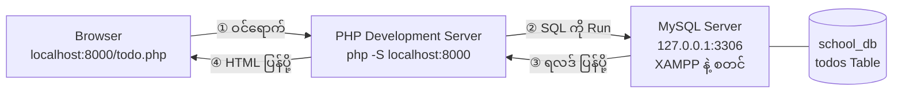
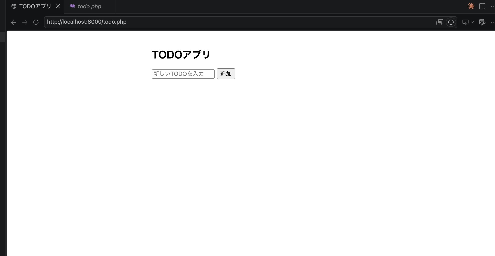
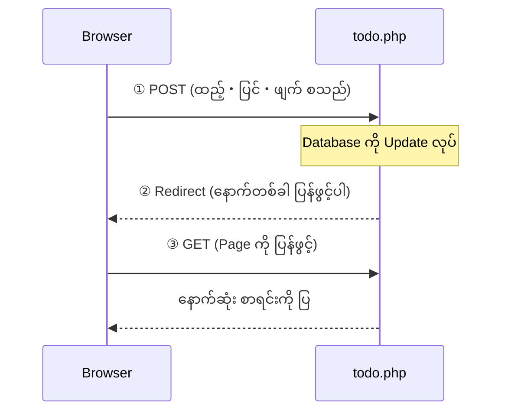

# Todo စီမံခန့်ခွဲမှု App ကို စတင်ဖွင့်ပုံ အဆင့်များ

> 🇯🇵 မူရင်း (ဂျပန်ဘာသာဖြင့်): [Todo管理アプリ起動する流れ.md](<../../../1年生_データ設計とアプリ開発/前期/20260723/Todo管理アプリ起動する流れ.md>) <!-- original-ja-link -->

`todo.php` က PHP＋PDO နဲ့ MySQL ကို ချိတ်ဆက်ပြီး TODO ထည့်ခြင်း・ပြင်ဆင်ခြင်း・ပြီးမပြီး ပြောင်းခြင်း・ဖျက်ခြင်းတွေ လုပ်နိုင်တဲ့ App ပါ။ အလုပ်လုပ်စေဖို့ 「Database Server」နဲ့ 「PHP Development Server」ဆိုတဲ့ **၂ ခုလုံး** ကို စတင်ထားဖို့ လိုပါတယ်။

## ခြုံငုံပုံ (စတင်ဖွင့်ထားတဲ့ အခြေအနေ)



- **PHP Development Server**: `todo.php` (Program) ကို အလုပ်လုပ်စေတဲ့ Server ဖြစ်တယ်။ Browser ကနေ ဝင်ရောက်လာတဲ့ တောင်းဆိုချက်ကို လက်ခံပြီး PHP ကို Run ပေးတယ်။
- **MySQL Server (XAMPP)**: ဒေတာကိုယ်တိုင် (`school_db` ထဲက `todos` Table) ကို သိမ်းဆည်းထားတဲ့ Server ဖြစ်တယ်။ PHP က တောင်းဆိုတဲ့ SQL ကို Run ပြီး ဒေတာကို ပြန်ပို့ပေးတယ်။
- ဒီ ၂ ခုကို **သီးခြား Process** တွေအဖြစ် တစ်ခုချင်းစီ စတင်ပြီး ဖွင့်ထားဖို့ လိုတယ် (တစ်ခုခု ရပ်နေရင်တောင် Error ဖြစ်မယ်)။

## ကြိုတင်လိုအပ်ချက်

- XAMPP ကို Install လုပ်ပြီးသား ဖြစ်ရမယ်
- PHP ကို Install လုပ်ပြီးသား ဖြစ်ရမယ် (`php -v` နဲ့ စစ်ပါ)
- အောက်ပါ Command ထဲက `<User အမည်>` ကို ကိုယ့်ကွန်ပျူတာရဲ့ User အမည်နဲ့ အစားထိုးပါ

---

## 0. todo.php ကို ကိုယ့်ရဲ့ study Directory ထဲမှာ ပြင်ဆင်ထားခြင်း

ဝေပေးထားတဲ့ `todo.php` ကို ကိုယ့်ကွန်ပျူတာရဲ့ `study` Directory အောက် (ဥပမာ: `study/20260723/`) ကို Copy ကူးထားပါ။

- ဖိုင်ကို Drag & Drop နဲ့ တိုက်ရိုက် Copy ကူးတာ ဒါမှမဟုတ်
- အထဲက Code ကို Copy ကူးပြီး ကိုယ့်ပတ်ဝန်းကျင်မှာ အသစ်ဖန်တီးထားတဲ့ `todo.php` ထဲ Paste လုပ်တာ

ဘယ်နည်းနဲ့ပဲဖြစ်ဖြစ် ရပါတယ်။ `php -S` နဲ့ စတင်မယ့် `study` Directory ထဲမှာ `todo.php` ရှိနေတဲ့ အခြေအနေ ဖြစ်အောင် လုပ်ပါ။

---

## 1. XAMPP နဲ့ MySQL ကို စတင်ခြင်း

XAMPP Control Panel ကို ဖွင့်ပြီး `MySQL` ရဲ့ `Actions` မှာ `Stop` လို့ ပြနေသလား (＝ စတင်ထားပြီး) စစ်ပါ။ `Start` လို့ ပြနေရင် Click နှိပ်ပြီး စတင်ပါ။

(အသေးစိတ် အဆင့်တွေအတွက် [Database Server တည်ဆောက်နည်း](../データベースサーバーの立て方/データベースサーバーの立て方.md) ကို ကြည့်ပါ)

`todo.php` က အောက်ပါ ချိတ်ဆက်မှု အချက်အလက်နဲ့ MySQL ကို ချိတ်ဆက်မှာ ဖြစ်လို့ ဒီ Setting နဲ့ ကိုက်ညီဖို့ လိုပါတယ်။

```php
$pdo = new PDO(
    'mysql:host=127.0.0.1;port=3306;dbname=school_db;charset=utf8mb4',
    'root',
    '' // XAMPP/DBngin ရဲ့ Default က Password အလွတ်
);
```

- Host: `127.0.0.1` (ကိုယ့်ကွန်ပျူတာ)
- Port: `3306` (MySQL ရဲ့ Standard Port)
- Database အမည်: `school_db`
- User အမည်: `root`　Password: အလွတ်

`school_db` Database ကိုယ်တိုင်ကိုတော့ phpMyAdmin စတာတွေနဲ့ ကြိုတင် ဖန်တီးထားဖို့ လိုပါတယ် (`todos` Table ကိုတော့ `todo.php` စတင်တဲ့အခါ အလိုအလျောက် ဖန်တီးပေးမှာ ဖြစ်လို့ Table ကို ကိုယ်တိုင် ဖန်တီးစရာ မလိုပါ)။

---

## 2. PHP Development Server ကို စတင်ခြင်း

Terminal ကို ဖွင့်ပြီး `todo.php` ထားတဲ့ `study` Directory ထဲကို တိုက်ရိုက် ရွှေ့ (cd) ပြီးမှ PHP ရဲ့ Development Server ကို စတင်ပါ။

```bash
cd /Users/<User အမည်>/Desktop/study
php -S localhost:8000
```

(အသေးစိတ် အဆင့်တွေအတွက် [PHP Development Server တည်ဆောက်နည်း](../PHP開発サーバーの立て方.md) ကို ကြည့်ပါ)

---

## 3. Browser ကနေ ဝင်ရောက်ခြင်း

Server ကို ဖွင့်ထားရင်းနဲ့ Browser မှာ `todo.php` ထားတဲ့နေရာနဲ့ ကိုက်ညီတဲ့ URL ကို ဝင်ပါ။

```
http://localhost:8000/20260723/todo.php
```

အပေါ်က URL ကို Copy ကူးပြီး Browser ရဲ့ Address Bar မှာ Paste လုပ်ပြီး ဝင်ပါ။

※ `study/20260723/` ထဲမှာ ထားတဲ့အခါရဲ့ ဥပမာပါ။ တကယ့် URL ကို 「`php -S` စတင်ခဲ့တဲ့ Directory (`study/`) ကနေ Relative Path」နဲ့ ကိုက်ညီအောင် ပြင်ပါ။

TODO App ရဲ့ Screen ပေါ်လာရင် စတင်ဖွင့်တာ အောင်မြင်ပါပြီ။

---

## 4. အလုပ်လုပ်ပုံ စစ်ဆေးခြင်း

### ဒီ Screen ပွင့်လာရင် OK!




- Input Box မှာ စာသားထည့်ပြီး 「追加」(ထည့်ရန်) → စာရင်းထဲ ထည့်ပေးသလား
- Checkbox ကို Check လုပ် → စာသားပေါ်မှာ ကန့်လန့်ဖြတ်မျဉ်း ပေါ်လာပြီး ပြီးဆုံးကြောင်း ပြသလား
- 「編集」(ပြင်ရန်) → အကြောင်းအရာကို ပြင်ရေးပြီး 「保存」(သိမ်းရန်) လုပ်နိုင်သလား
- 「削除」(ဖျက်ရန်) → အတည်ပြု Dialog ပြီးနောက် ဖျက်ပေးသလား

ပြောင်းလဲမှုအားလုံး အကျိုးသက်ရောက်ပြီး `index.php` (＝`todo.php`) ကို ပြန်ရောက်လာရင် ပုံမှန်အတိုင်း အလုပ်လုပ်နေပါပြီ (PRG Pattern ကြောင့် လုပ်ဆောင်ပြီးနောက် Page ကို အလိုအလျောက် Reload လုပ်ပေးတဲ့ စနစ်ပါ)။

PRG (Post → Redirect → Get) Pattern ရဲ့ အဆင့်တွေက အောက်ပါအတိုင်းပါ။



---

## Server ကို ရပ်ခြင်း

`php -S` ကို Run ခဲ့တဲ့ Terminal မှာ `Ctrl + C` ကို နှိပ်ရင် PHP Development Server ရပ်သွားပါမယ်။ MySQL ကိုတော့ XAMPP Control Panel ရဲ့ `Stop` ခလုတ်နဲ့ ရပ်နိုင်ပါတယ်။

---

## ကောင်းကောင်း အလုပ်မလုပ်တဲ့အခါ

`could not find driver` လို PDO နဲ့ ပတ်သက်တဲ့ Error ပေါ်ရင် [PDO_MySQL ချိတ်ဆက်မှု Error ဖြေရှင်းနည်း](./PDO_MySQL接続エラー対処法.md) ကို ကြည့်ပါ။

<!-- nav:start -->

---

📎 တွဲဖတ်ရန် → [PDO_MySQL ချိတ်ဆက်မှု Error ဖြေရှင်းနည်း](PDO_MySQL接続エラー対処法.md)

| ⬅️ ယခင် | 🗺️ ခြုံငုံပုံ | နောက်တစ်ခု ➡️ |
|:--|:--:|--:|
| [07/23 လေ့ကျင့်ခန်း](20260723_演習.md) | [သင်ခန်းစာများ၏ ခြုံငုံပုံ](../../README.md) | [07/28 Table ဆက်နွယ်မှု・JOIN](../20260728/20260728_資料.md) |

<!-- nav:end -->
