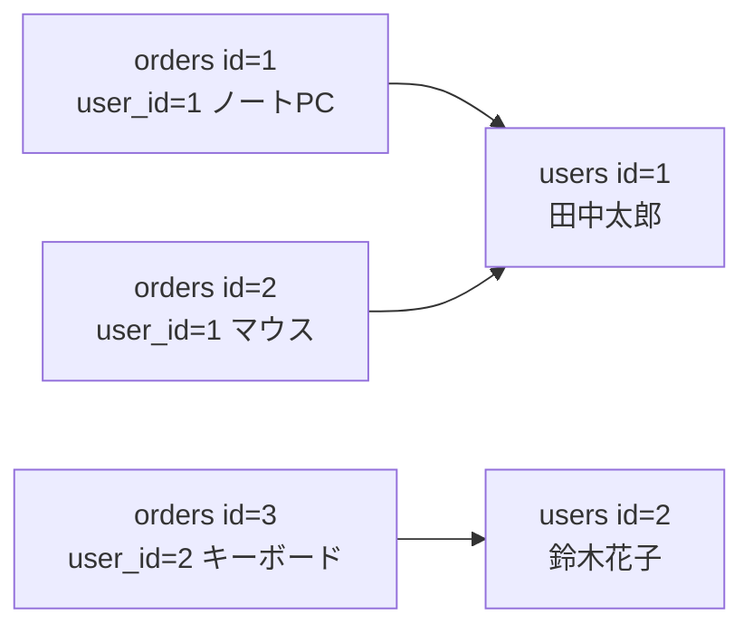
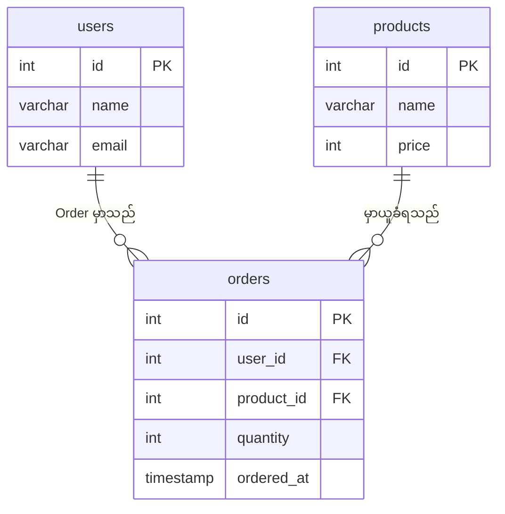
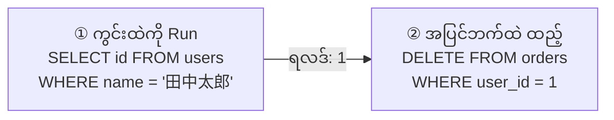

# သင်ချိန် 09｜Table ဆက်နွယ်မှု・JOIN — Table အများကြီးက ဒေတာကို ပေါင်းစပ်ခြင်း

> 🇯🇵 မူရင်း (ဂျပန်ဘာသာဖြင့်): [20260728_資料.md](<../../../1年生_データ設計とアプリ開発/前期/20260728/20260728_資料.md>) <!-- original-ja-link -->

## ဒီနေ့ရဲ့ ပန်းတိုင်
- Table တွေကို ဘာကြောင့် ခွဲရလဲ (Normalization) ဆိုတာ ရှင်းပြနိုင်ရမယ်
- Foreign Key ရဲ့ သဘောတရားကို နားလည်ရမယ်
- INNER JOIN / LEFT JOIN နဲ့ Table တွေကို ပေါင်းနိုင်ရမယ်

---

[Relational Database အကြောင်း](../20260721/リレーショナルデータベース入門.md)

## 1. ဘာကြောင့် Table တွေကို ခွဲရတာလဲ

မကောင်းတဲ့ ဥပမာ: အားလုံးကို Table တစ်ခုတည်းထဲ ထိုးထည့်ထားခြင်း (田中太郎၊ 鈴木花子 က လူအမည်၊ ノートPC က လက်ပ်တော့၊ マウス က မောက်စ်၊ キーボード က ကီးဘုတ်)

```
orders Table (မကောင်းတဲ့ ဥပမာ)
id │ user_name │ user_email         │ product_name │ price
───┼───────────┼────────────────────┼──────────────┼───────
 1 │ 田中太郎  │ tanaka@example.com │ ノートPC     │ 98000
 2 │ 田中太郎  │ tanaka@example.com │ マウス       │  3200
 3 │ 鈴木花子  │ suzuki@example.com │ キーボード   │  8500
```

**ပြဿနာများ:**
- 田中太郎 ရဲ့ အချက်အလက်က Row 2 ကြောင်းမှာ ထပ်နေတယ် (Email ပြောင်းရင် Row အားလုံးကို ပြင်ဖို့ လိုတယ်)
- ဒေတာတွေ အချင်းချင်း မကိုက်ညီတာ ဖြစ်လွယ်တယ်

**ဖြေရှင်းနည်း: Table တွေကို ခွဲပြီး Foreign Key နဲ့ ချိတ်ဆက်ခြင်း (Normalization)**

---

## 2. Foreign Key (တခြား Table ကို ရည်ညွှန်းတဲ့ Key)

**users Table**

| id | name | email |
|----|------|-------|
| 1 | 田中太郎 | tanaka@... |
| 2 | 鈴木花子 | suzuki@... |

**orders Table**

| id | user_id | product | price |
|----|---------|---------|-------|
| 1 | 1 | ノートPC | 98000 |
| 2 | 1 | マウス | 3200 |
| 3 | 2 | キーボード | 8500 |

`orders.user_id` က `users.id` ကို ရည်ညွှန်းနေပါတယ်။ ဒါကို 「Foreign Key」လို့ ခေါ်ပါတယ်။



---

## 3. Table ဖန်တီးခြင်းနဲ့ Foreign Key သတ်မှတ်ခြင်း

```sql
USE school_db;

-- users Table
CREATE TABLE users (
    id    INT AUTO_INCREMENT PRIMARY KEY,
    name  VARCHAR(100) NOT NULL,
    email VARCHAR(255) NOT NULL UNIQUE
);

-- products Table
CREATE TABLE products (
    id    INT AUTO_INCREMENT PRIMARY KEY,
    name  VARCHAR(100) NOT NULL,
    price INT NOT NULL
);

-- orders Table (Foreign Key နဲ့ ချိတ်ဆက်)
CREATE TABLE orders (
    id         INT AUTO_INCREMENT PRIMARY KEY,
    user_id    INT NOT NULL,
    product_id INT NOT NULL,
    quantity   INT NOT NULL DEFAULT 1,
    ordered_at TIMESTAMP DEFAULT CURRENT_TIMESTAMP,
    
    -- Foreign Key Constraint (Referential Integrity ကို ထိန်းသိမ်း)
    FOREIGN KEY (user_id)    REFERENCES users(id),
    FOREIGN KEY (product_id) REFERENCES products(id)
);

-- Test ဒေတာ
INSERT INTO users (name, email) VALUES
    ('田中太郎', 'tanaka@example.com'),
    ('鈴木花子', 'suzuki@example.com'),
    ('山田次郎', 'yamada@example.com');

INSERT INTO products (name, price) VALUES
    ('ノートPC', 98000),
    ('マウス', 3200),
    ('キーボード', 8500);

INSERT INTO orders (user_id, product_id, quantity) VALUES
    (1, 1, 1),  -- 田中 က ノートPC ကို 1 လုံး
    (1, 2, 2),  -- 田中 က マウス ကို 2 ခု
    (2, 3, 1),  -- 鈴木 က キーボード ကို 1 ခု
    (3, 1, 1),  -- 山田 က ノートPC ကို 1 လုံး
    (2, 1, 1);  -- 鈴木 က ノートPC ကို 1 လုံး
```

Table ၃ ခုရဲ့ ဆက်နွယ်မှုကို ပုံနဲ့ပြရင် အောက်ပါအတိုင်း ဖြစ်ပါတယ်။ orders က users နဲ့ products ၂ ခုလုံးကို Foreign Key နဲ့ ရည်ညွှန်းနေပါတယ်။



---

[INNER JOIN နဲ့ LEFT JOIN ရဲ့ ကွာခြားချက်အကြောင်း](./JOIN入門.md)

## 4. INNER JOIN — ၂ ဘက်လုံးမှာ ရှိတဲ့ ဒေတာကိုပဲ ပေါင်းခြင်း

```sql
-- orders ကို users ရဲ့ အချက်အလက်နဲ့ ပေါင်းခြင်း
SELECT
    orders.id,
    users.name    AS ユーザー名,
    users.email,
    orders.quantity
FROM orders
INNER JOIN users ON orders.user_id = users.id;

-- Table 3 ခုကို ပေါင်းခြင်း (orders + users + products)（ユーザー名=အသုံးပြုသူအမည်၊ 商品名=ပစ္စည်းအမည်၊ 単価=တစ်ခုချင်းဈေးနှုန်း၊ 数量=အရေအတွက်၊ 合計金額=စုစုပေါင်းငွေပမာဏ）
SELECT
    orders.id,
    users.name      AS ユーザー名,
    products.name   AS 商品名,
    products.price  AS 単価,
    orders.quantity AS 数量,
    products.price * orders.quantity AS 合計金額
FROM orders
INNER JOIN users    ON orders.user_id    = users.id
INNER JOIN products ON orders.product_id = products.id
ORDER BY orders.id;
```

---

## 5. LEFT JOIN — ဘယ်ဘက် Table ရဲ့ Row အားလုံးကို ထည့်ခြင်း

```sql
-- Order မမှာရသေးတဲ့ User တွေကိုပါ ထည့်ပြချင်တဲ့အခါ（注文数=မှာယူမှုအရေအတွက်）
SELECT
    users.name,
    COUNT(orders.id) AS 注文数
FROM users
LEFT JOIN orders ON users.id = orders.user_id
GROUP BY users.id, users.name;

-- Order 0 ခုရှိတဲ့ User တွေကိုလည်း ပြပေးမယ်
-- INNER JOIN ဆိုရင် Order ရှိတဲ့ User တွေပဲ ထွက်မယ်
```

### 5-1. အသုံးချ: Order မမှာရသေးတဲ့ User တွေ「ကိုပဲ」ရှာခြင်း

LEFT JOIN နဲ့ ပေါင်းတဲ့အခါ ညာဘက် (orders) မှာ ကိုက်ညီတဲ့ Row မရှိရင် အဲဒီ Column တွေက `NULL` ဖြစ်သွားပါတယ်။ ဒီသဘောကို သုံးရင် 「မကိုက်ညီတဲ့ Row တွေကိုပဲ」ရွေးထုတ်နိုင်ပါတယ်။

```sql
SELECT users.name, users.email
FROM users
LEFT JOIN orders ON users.id = orders.user_id
WHERE orders.id IS NULL;
```

**စဉ်းစားပုံ:**
1. `LEFT JOIN` နဲ့ users အားလုံးကို ချန်ထားမယ် (orders မရှိတဲ့သူတွေအတွက် orders ဘက်က Column တွေက `NULL` ဖြစ်မယ်)
2. `WHERE orders.id IS NULL` နဲ့ 「orders နဲ့ မကိုက်ညီခဲ့တဲ့ Row」တွေကိုပဲ ရွေးမယ်
   → ဆိုလိုတာက 「တစ်ခါမှ Order မမှာဖူးတဲ့သူ」တွေပဲ ကျန်မယ်

`INNER JOIN` မှာတော့ ဒီ Pattern ကို သုံးလို့ မရပါဘူး (မကိုက်ညီတဲ့ Row တွေက ရလဒ်ထဲ လုံးဝ မပါလာလို့ပါ)။ 「LEFT JOIN + `IS NULL`」ကို တွဲသုံးတဲ့ အသုံးများတဲ့ Pattern အဖြစ် မှတ်ထားရင် အသုံးဝင်ပါတယ်။

---

## 6. အုပ်စုလိုက်တွက်ချက်မှုနဲ့ ပေါင်းသုံးခြင်း

```sql
-- User အလိုက် ဝယ်ယူငွေ စုစုပေါင်း（注文件数=မှာယူမှုအကြိမ်ရေ）
SELECT
    users.name AS ユーザー名,
    COUNT(orders.id) AS 注文件数,
    SUM(products.price * orders.quantity) AS 合計金額
FROM users
INNER JOIN orders    ON users.id          = orders.user_id
INNER JOIN products  ON orders.product_id = products.id
GROUP BY users.id, users.name
ORDER BY 合計金額 DESC;
```

---

## 7. HAVING — အုပ်စုလိုက်တွက်ချက်「ပြီးမှ」ရွေးထုတ်ခြင်း

`WHERE` က အုပ်စုလိုက်တွက်ချက်မှု မလုပ်**ခင်** Row တွေကို ရွေးထုတ်ပေမဲ့ `HAVING` က `GROUP BY` နဲ့ အုပ်စုလိုက်တွက်ချက်**ပြီးမှ** ရလဒ်ကို ရွေးထုတ်ပါတယ်။

```sql
-- စုစုပေါင်း ငွေပမာဏ 100000 ယန်း နဲ့ အထက် ဖြစ်တဲ့ User တွေကိုပဲ ပြခြင်း
SELECT
    users.name AS ユーザー名,
    SUM(products.price * orders.quantity) AS 合計金額
FROM users
INNER JOIN orders   ON users.id          = orders.user_id
INNER JOIN products ON orders.product_id = products.id
GROUP BY users.id, users.name
HAVING SUM(products.price * orders.quantity) >= 100000;
```

**WHERE နဲ့ HAVING ရဲ့ ကွာခြားချက်:**

| | ဘယ်အချိန်မှာ ရွေးထုတ်လဲ | သုံးနိုင်တဲ့အရာ |
|---|---|---|
| `WHERE` | `GROUP BY` နဲ့ အုပ်စုလိုက်တွက်ချက်မှု မလုပ်**ခင်** | Row တစ်ခုချင်းရဲ့ မူရင်း Column (`orders.quantity` စသည်) |
| `HAVING` | `GROUP BY` နဲ့ အုပ်စုလိုက်တွက်ချက်**ပြီးနောက်** | `SUM()`၊ `COUNT()` စတဲ့ အုပ်စုလိုက်တွက်ချက်မှုရလဒ်များ |

`SELECT ... FROM ... WHERE ... GROUP BY ... HAVING ... ORDER BY` အစဉ်အတိုင်း ရေးပေမဲ့ တကယ် လုပ်ဆောင်တဲ့ အစဉ်က `WHERE`→`GROUP BY`→`HAVING`→`ORDER BY` ပါ။ 「`HAVING SUM(...) >= 100000` ကို သုံးလို့ရပြီး `WHERE SUM(...) >= 100000` ကို သုံးလို့မရဘူး (အုပ်စုလိုက်တွက်ချက်မှု မလုပ်ရသေးလို့ `SUM` ရလဒ် မရှိသေးဘူး)」လို့ မှတ်ထားပါ။

---

## 8. Subquery — SELECT ထဲမှာ SELECT ကို ရေးခြင်း

`INSERT` ဒါမှမဟုတ် `DELETE` လုပ်တဲ့အခါ သက်ဆိုင်တဲ့ `id` ကို မသိတာမျိုး ရှိတတ်ပါတယ်။ အဲဒီအခါမှာ `SELECT` ရဲ့ ရလဒ်ကို Condition အဖြစ် တိုက်ရိုက်သုံးတဲ့ **Subquery** က အသုံးဝင်ပါတယ်။

```sql
-- ဥပမာ: 「田中太郎」ရဲ့ id ကို Condition အဖြစ် သုံးချင်ပေမဲ့ id က ဘယ်နံပါတ်လဲ မသိဘူး

-- ① မကောင်းတဲ့ ဥပမာ မဟုတ်ပေမဲ့ 2 ဆင့် ခွဲလုပ်ရတယ်
SELECT id FROM users WHERE name = '田中太郎';  -- ရလဒ်: 1
DELETE FROM orders WHERE user_id = 1;          -- စစ်ထားတဲ့ 1 ကို ကိုယ်တိုင် ရိုက်ထည့်တယ်

-- ② Subquery ကို သုံးရင် Statement 1 ခုတည်းနဲ့ ရေးနိုင်တယ်
DELETE FROM orders
WHERE user_id = (SELECT id FROM users WHERE name = '田中太郎');
```

`( )` ထဲက `SELECT` ကို အရင် Run ပြီး တန်ဖိုးတစ်ခု (ဒီမှာဆိုရင် `id`) ဖြစ်လာပြီးမှ အပြင်ဘက်က `WHERE user_id = ဒီနေရာ` ထဲကို ထည့်ပေးတယ်လို့ မြင်ယောင်ကြည့်ပါ။ 「ကွင်းထဲကို အရင်ဖတ်」လို့ စဉ်းစားရင် နားလည်ရလွယ်ပါတယ်။



```sql
-- INSERT မှာလည်း အလားတူ သုံးနိုင်တဲ့ ဥပမာ（USBハブ=USB hub）
INSERT INTO orders (user_id, product_id, quantity)
VALUES (
    (SELECT id FROM users WHERE name = '田中太郎'),
    (SELECT id FROM products WHERE name = 'USBハブ'),
    3
);
```

---

## အနှစ်ချုပ်

| သဘောတရား | ရှင်းလင်းချက် |
|------|------|
| Foreign Key | တခြား Table ရဲ့ Primary Key ကို ရည်ညွှန်းတဲ့ Column |
| INNER JOIN | Table ၂ ခုလုံးမှာ ရှိတဲ့ ဒေတာကိုပဲ ပေါင်း |
| LEFT JOIN | ဘယ်ဘက် Table ရဲ့ Row အားလုံး＋ညာဘက် Table က ကိုက်ညီတဲ့ Row တွေကို ပေါင်း |
| `ON TableA.col = TableB.col` | ပေါင်းမယ့် Condition |
| LEFT JOIN + `WHERE ... IS NULL` | ညာဘက် Table နဲ့ မကိုက်ညီတဲ့ Row တွေကိုပဲ ရှာတဲ့ အသုံးများတဲ့ Pattern |
| `WHERE` | အုပ်စုလိုက်တွက်ချက်မှု မလုပ်ခင် Row တွေကို ရွေးထုတ် |
| `HAVING` | `GROUP BY` နဲ့ အုပ်စုလိုက်တွက်ချက်ပြီးနောက် ရလဒ်ကို ရွေးထုတ် |
| Subquery `(SELECT ...)` | `SELECT` ရဲ့ ရလဒ်ကို တခြား SQL ရဲ့ Condition ဒါမှမဟုတ် တန်ဖိုးအဖြစ် ထည့်သုံး |

---

## နောက်တစ်ကြိမ်（သင်ချိန် 10）အတွက် ကြိုတင်ပြောချက်

SQL လေ့ကျင့်ခန်းအဖြစ် Order စီမံခန့်ခွဲမှု Database ကို ကိုယ်တိုင် ကိုင်တွယ်ပါမယ်။  
SELECT / INSERT / UPDATE / DELETE / JOIN တွေကို ပေါင်းသုံးတဲ့ လက်တွေ့ မေးခွန်းတွေကို ဖြေရှင်းပါမယ်။

<!-- nav:start -->

---

📎 တွဲဖတ်ရန် → [JOIN မိတ်ဆက်](JOIN入門.md)

| ⬅️ ယခင် | 🗺️ ခြုံငုံပုံ | နောက်တစ်ခု ➡️ |
|:--|:--:|--:|
| [Todo စီမံခန့်ခွဲမှု App ကို စတင်ဖွင့်ပုံ အဆင့်များ](../20260723/Todo管理アプリ起動する流れ.md) | [သင်ခန်းစာများ၏ ခြုံငုံပုံ](../../README.md) | [07/28 SQL လေ့ကျင့်ခန်း](20260728_演習.md) |

<!-- nav:end -->
