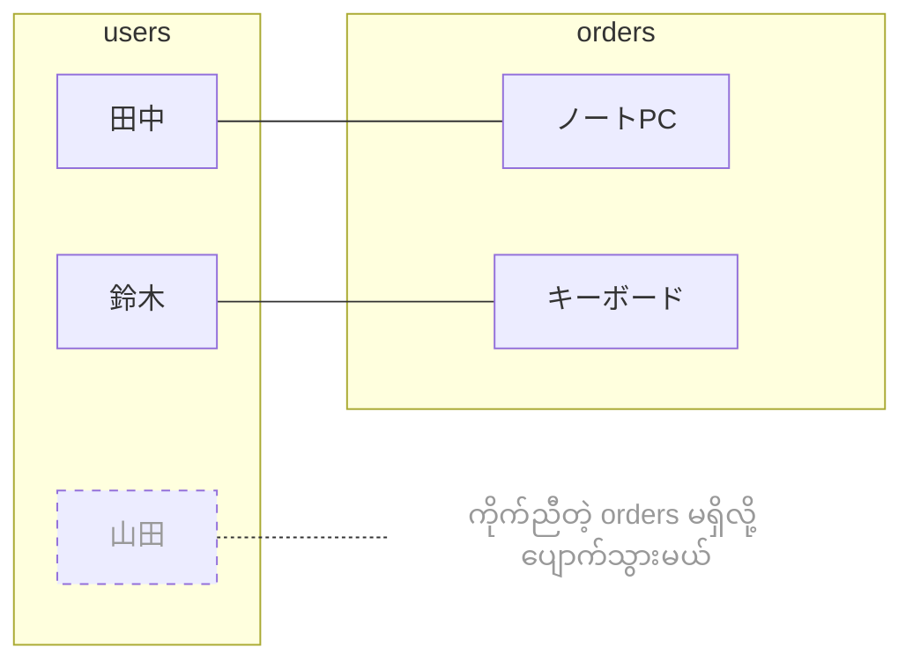
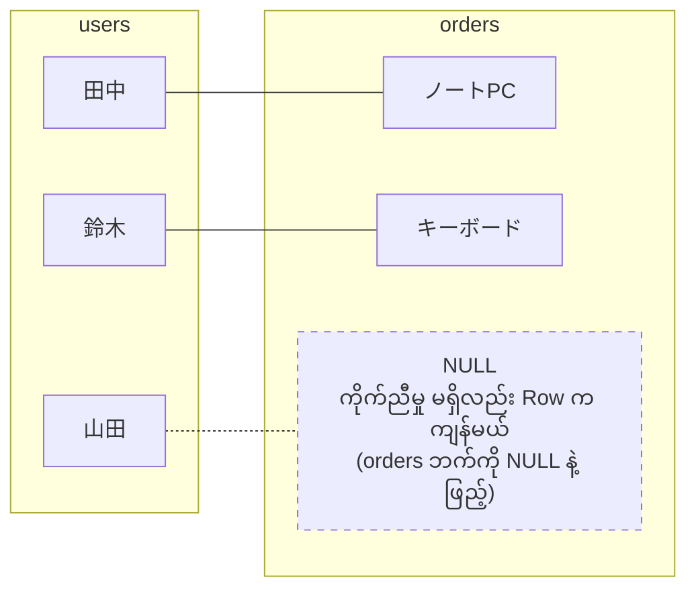

> 🇯🇵 မူရင်း (ဂျပန်ဘာသာဖြင့်): [JOIN入門.md](<../../../1年生_データ設計とアプリ開発/前期/20260728/JOIN入門.md>) <!-- original-ja-link -->

## ဒီဆောင်းပါးမှာ သိရမယ့်အရာများ

- INNER JOIN က 「Table ၂ ခုလုံးမှာ ရှိတဲ့ ဒေတာကိုပဲ」ပေါင်းတယ်ဆိုတာ
- LEFT JOIN က 「ဘယ်ဘက် Table ရဲ့ Row အားလုံး＋ညာဘက် Table က ကိုက်ညီတဲ့ Row တွေ」ကို ပေါင်းတယ်ဆိုတာ
- တူညီတဲ့ Table ၂ ခုနဲ့ တူညီတဲ့ ပေါင်းစပ်မှု Condition ကို သုံးပေမဲ့ JOIN အမျိုးအစားပေါ် မူတည်ပြီး ရလဒ်ရဲ့ Row အရေအတွက် ပြောင်းလဲတယ်ဆိုတာ

## အသုံးပြုမယ့် Table ၂ ခု

`users` (User) နဲ့ `orders` (Order) ကို သုံးပြီး ရှင်းပြပါမယ်။ အဓိကအချက်က **山田次郎 က Order တစ်ခါမှ မမှာဖူးသေးဘူး** ဆိုတာပါ။

### 🧑 users Table

| id | name |
|----|------|
| 1  | 田中太郎 |
| 2  | 鈴木花子 |
| 3  | 山田次郎 |

### 🛒 orders Table

| id | user_id | product |
|----|---------|---------|
| 1  | 1       | ノートPC |
| 2  | 2       | キーボード |

`orders.user_id` က `users.id` ကို ရည်ညွှန်းနေပါတယ် (Foreign Key)။ 山田次郎 (id=3) ကို ရည်ညွှန်းတဲ့ Row က `orders` မှာ တစ်ခုမှ မရှိပါဘူး။ `ノートPC` ဆိုတာ လက်ပ်တော့ကွန်ပျူတာ၊ `キーボード` ဆိုတာ ကီးဘုတ် ဖြစ်ပါတယ်။

## INNER JOIN: ၂ ဘက်လုံးမှာ ရှိတဲ့ ဒေတာကိုပဲ ပေါင်းခြင်း

```sql
SELECT users.name, orders.product
FROM users
INNER JOIN orders ON users.id = orders.user_id;
```

**ရလဒ်:**

| name | product |
|------|---------|
| 田中太郎 | ノートPC |
| 鈴木花子 | キーボード |

INNER JOIN ကို မြင်ယောင်ကြည့်ခြင်း (ချိတ်ဆက်မိတဲ့ အတွဲတွေပဲ ရလဒ်ထဲ ပါမယ်)



山田次郎 က `orders` မှာ ကိုက်ညီတဲ့ Row တစ်ခုမှ မရှိလို့ **ရလဒ်ကနေ ပျောက်သွားပါတယ်**။ 「Table ၂ ခုလုံးမှာ ရှိတဲ့ ဒေတာကိုပဲ ပေါင်းတယ်」ဆိုတာ ဒီအဓိပ္ပာယ်ပါ။

## LEFT JOIN: ဘယ်ဘက် Table ရဲ့ Row အားလုံး＋ညာဘက် Table က ကိုက်ညီတဲ့ Row တွေကို ပေါင်းခြင်း

```sql
SELECT users.name, orders.product
FROM users
LEFT JOIN orders ON users.id = orders.user_id;
```

**ရလဒ်:**

| name | product |
|------|---------|
| 田中太郎 | ノートPC |
| 鈴木花子 | キーボード |
| 山田次郎 | NULL    |

LEFT JOIN ကို မြင်ယောင်ကြည့်ခြင်း (ဘယ်ဘက် Table က Row အားလုံးကို ဆက်လက်ဖော်ပြမယ်)



`FROM users LEFT JOIN orders` မှာ **FROM ဘက် (ဘယ်ဘက်) မှာ ရေးထားတဲ့ users က အခြေခံ** ဖြစ်ပါတယ်။ 山田次郎 မှာ Order မရှိရင်တောင် Row အဖြစ် ကျန်နေပြီး `orders` ဘက်က Column တွေကို `NULL` (သက်ဆိုင်ရာတန်ဖိုး မရှိ) နဲ့ ဖြည့်ပေးပါတယ်။

## ခွဲခြားသိနိုင်တဲ့ နည်းလမ်း

- **`FROM A LEFT JOIN B`** → **A က ဘယ်ဘက်**၊ A ရဲ့ Row အားလုံး အမြဲ ကျန်မယ်
- မကိုက်ညီတဲ့ Row ထွက်လာရင် ညာဘက် (B) ရဲ့ Column တွေက အလိုအလျောက် `NULL` ဖြစ်မယ်
- `INNER JOIN` မှာ ဒီ「အားလုံးကို ဆက်လက်ဖော်ပြတဲ့」လုပ်ဆောင်ချက် မရှိဘဲ ကိုက်ညီတဲ့ Row တွေပဲ ကျန်မယ်

## ဘယ်ဟာကို သုံးရမလဲ

| လုပ်ချင်တဲ့အရာ | သုံးရမယ့် JOIN |
|---|---|
| Order ရှိတဲ့သူတွေရဲ့ ဒေတာကိုပဲ ကြည့်ချင်တယ် | `INNER JOIN` |
| Order မရှိတဲ့သူတွေအပါအဝင် အားလုံးကို စာရင်းပြုစုချင်တယ် (ဥပမာ: Order မမှာဖူးသေးသူတွေကို အကြောင်းကြား Email ပို့ဖို့ ရှာခြင်း) | `LEFT JOIN` |
| User အလိုက် Order အရေအတွက်ကို ရေတွက်ချင်တယ် (0 ခုရှိတဲ့သူကိုလည်း 0 ခုအဖြစ် ပြချင်တယ်) | `LEFT JOIN` + `COUNT` |

တတိယ ဥပမာက `20260728_資料.md` ရဲ့ 「5. LEFT JOIN」မှာ ဖော်ပြခဲ့တဲ့ Order မရှိတဲ့ User တွေကိုပါ ပြပေးတဲ့ SQL ပါ။ `INNER JOIN` နဲ့ အဲဒီအတိုင်း လုပ်ရင် 山田次郎 လို Order မမှာဖူးသေးတဲ့ User တွေက ရလဒ်ထဲ လုံးဝ မပါလာပါဘူး။

## အနှစ်ချုပ်

- `INNER JOIN` က 「Table ၂ ခုလုံးမှာ ရှိတဲ့ ဒေတာကိုပဲ」ပေါင်းတယ် → မကိုက်ညီတဲ့ Row တွေ ပျောက်သွားမယ်
- `LEFT JOIN` က 「`FROM` ရဲ့ ဘယ်ဘက် Table ရဲ့ Row အားလုံး＋ညာဘက် Table က ကိုက်ညီတဲ့ Row တွေ」ကို ပေါင်းတယ် → မကိုက်ညီရင်တောင် ဘယ်ဘက် Table ရဲ့ Row က ကျန်ပြီး ညာဘက်က `NULL` ဖြစ်မယ်
- 「လူတိုင်း/Row အားလုံးကို မလွတ်တမ်း ကြည့်ချင်ရင်」LEFT JOIN၊ 「၂ ဘက်လုံးမှာ ရှိတဲ့ ဒေတာပဲ လိုရင်」INNER JOIN လို့ မှတ်ထားရင် ကောင်းပါတယ်

<!-- nav:start -->

---

| ⬅️ ပြန်သွားရန် | 🗺️ ခြုံငုံပုံ | နောက်တစ်ခု ➡️ |
|:--|:--:|--:|
| [07/28 Table ဆက်နွယ်မှု・JOIN](20260728_資料.md) | [သင်ခန်းစာများ၏ ခြုံငုံပုံ](../../README.md) | [07/28 SQL လေ့ကျင့်ခန်း](20260728_演習.md) |

<!-- nav:end -->
