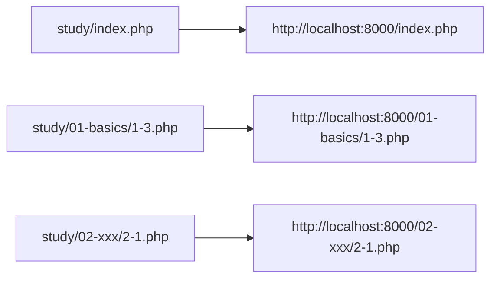

# PHP Development Server တည်ဆောက်နည်း

> 🇯🇵 မူရင်း (ဂျပန်ဘာသာဖြင့်): [PHP開発サーバーの立て方.md](<../../1年生_データ設計とアプリ開発/前期/PHP開発サーバーの立て方.md>) <!-- original-ja-link -->

PHP ဖိုင်ကို Browser မှာ တိုက်ရိုက်ဖွင့်ရင် အလုပ်လုပ်မှာ မဟုတ်ပါဘူး (Source Code ကို ဒီအတိုင်း ပြသမယ် ဒါမှမဟုတ် Download ဖြစ်သွားမယ်)။
PHP က Server ဘက်မှာ အဓိပ္ပာယ်ဖော်ပြီး အလုပ်လုပ်တဲ့ ဘာသာစကား ဖြစ်လို့ `php -S` လို Server ကနေတစ်ဆင့် အမြဲ ဝင်ရောက်ရပါမယ်။

## ကြိုတင်လိုအပ်ချက်

- PHP ကို Install လုပ်ပြီးသား ဖြစ်ရမယ် (`php -v` နဲ့ စစ်ပါ)
- ဒီမှာ `php` ထဲမှာ ပါပြီးသား Development Server ကို သုံးပါမယ် (Production မှာ သုံးဖို့ မသင့်တော်ပါ)
- အောက်ပါ Command ထဲက `<User အမည်>` ကို ကိုယ့်ကွန်ပျူတာရဲ့ User အမည်နဲ့ အစားထိုးပါ (ဥပမာ: `taro`, `hanako` စသည်။ Mac ဆိုရင် `whoami` Command နဲ့ စစ်ကြည့်နိုင်ပါတယ်)

## နည်းလမ်း 1: study Directory အောက်မှာ တိုက်ရိုက် စတင်ခြင်း

```bash
cd /Users/<User အမည်>/Desktop/study
php -S localhost:8000
```

`cd` (change directory) က Terminal ရဲ့ 「လက်ရှိ ရောက်နေတဲ့နေရာ (Current Directory)」ကို ရွှေ့ပေးတဲ့ Command ပါ။
`cd /Users/<User အမည်>/Desktop/study` နဲ့ `study` Directory ထဲကို ဝင်ပြီးမှ `php -S` ကို Run လိုက်ရင်
`study` က စတင်တဲ့နေရာ＝ Web ရဲ့ Root ဖြစ်သွားပါတယ်။

`php -S` ကို Run ခဲ့တဲ့ Directory က 「Web ရဲ့ Root (`/`)」ဖြစ်ပါတယ်။
`study/` အောက်မှာ တိုက်ရိုက် `contact.php` ရှိလို့ URL က ဒီအတိုင်းပါ:

```
http://localhost:8000/contact.php
http://localhost:8000/1-3.php
http://localhost:8000/index.php
```

## အခန်းအလိုက် Directory ဖွဲ့စည်းပုံနဲ့ ဝင်ရောက်ခြင်း

လေ့ကျင့်ခန်းတွေ များလာရင် အခန်းအလိုက် Sub Directory ခွဲပြီး စနစ်တကျ စီထားပါ (ဥပမာ: `01-basics/`)။

```
study/
  index.php
  contact.php
  01-basics/
    1-1.php
    1-2.php
    1-3.php
  02-xxx/
    2-1.php
```

Server ကိုတော့ ဆက်ပြီး **study Directory အောက်မှာ တိုက်ရိုက်** စတင်ပါ (စတင်တဲ့နေရာကို မပြောင်းပါနဲ့)။

```bash
cd /Users/<User အမည်>/Desktop/study
php -S localhost:8000
```

စတင်တဲ့ Directory က Web ရဲ့ Root ဖြစ်တာကြောင့် Sub Directory ထဲ ထည့်ထားတဲ့ ဖိုင်တွေအတွက်
**URL ထဲမှာ အဲဒီ Directory အမည်ကို ထည့်ရေး** ဖို့ လိုပါတယ်:

```
http://localhost:8000/index.php
http://localhost:8000/01-basics/1-3.php
http://localhost:8000/02-xxx/2-1.php
```

ဆိုလိုတာက 「ဖိုင်ထားတဲ့ Path」＝「URL ရဲ့ Path」(`study/` ကို အခြေခံထားတဲ့ Relative Path) နဲ့ တိုက်ရိုက် ကိုက်ညီပါတယ်။



## Server ကို ရပ်ခြင်း

Server စတင်ခဲ့တဲ့ Terminal မှာ `Ctrl + C`။

## Port နံပါတ်အကြောင်း

`8000` နေရာမှာ အသုံးမပြုရသေးတဲ့ နံပါတ်ဆိုရင် ကြိုက်တဲ့ နံပါတ်ကို သတ်မှတ်နိုင်ပါတယ် (ဥပမာ: `php -S localhost:8080`)။

<!-- nav:start -->

---

| ⬅️ ပြန်သွားရန် | 🗺️ ခြုံငုံပုံ | နောက်တစ်ခု ➡️ |
|:--|:--:|--:|
| [06/30 PHP မိတ်ဆက်](20260630/20260630_資料.md) | [သင်ခန်းစာများ၏ ခြုံငုံပုံ](../README.md) | [06/30 လေ့ကျင့်ခန်း](20260630/20260630_演習.md) |

<!-- nav:end -->
