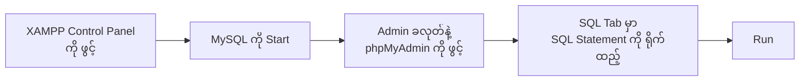
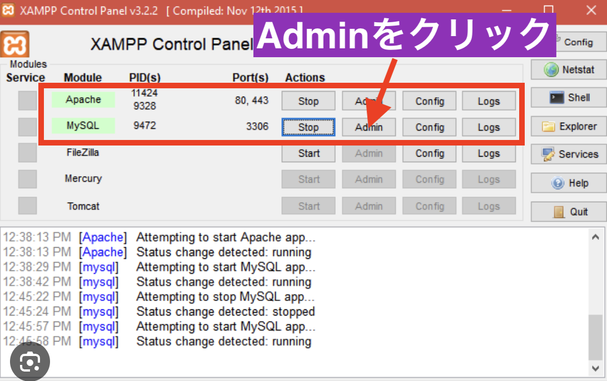
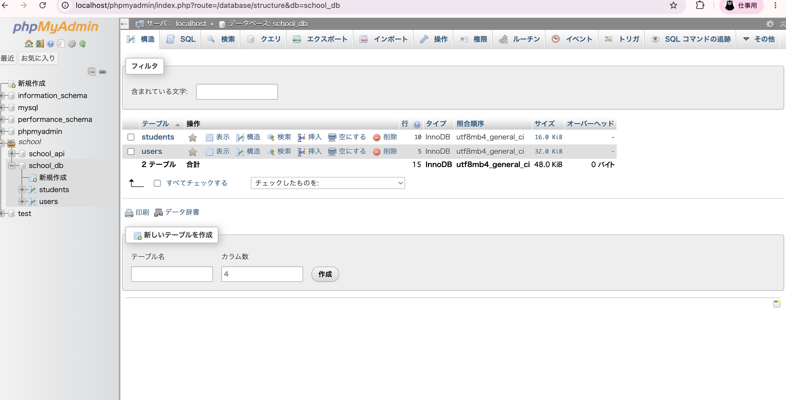
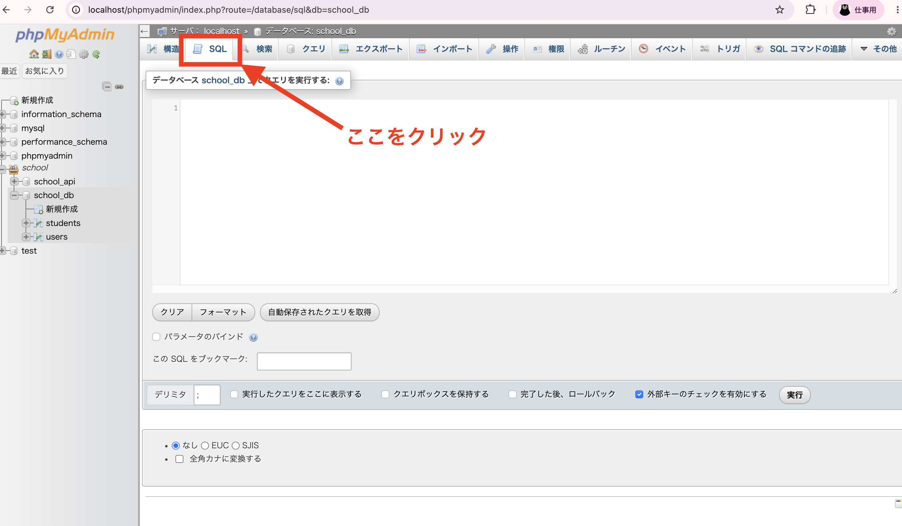

# Database Server တည်ဆောက်နည်း (XAMPP အပိုင်း)

> 🇯🇵 မူရင်း (ဂျပန်ဘာသာဖြင့်): [データベースサーバーの立て方.md](<../../../1年生_データ設計とアプリ開発/前期/データベースサーバーの立て方/データベースサーバーの立て方.md>) <!-- original-ja-link -->

## ဒီဆောင်းပါးမှာ သိရမယ့်အရာများ

- XAMPP မှာ ဘာတွေကို စတင်နေတာလဲ
- phpMyAdmin (Database စီမံခန့်ခွဲမှု Screen) ကို ဖွင့်နည်း
- phpMyAdmin မှာ SQL Statement ကို Run နည်း

လုပ်ဆောင်ရမယ့် အဆင့်တွေက အောက်ပါအတိုင်းပါ။

## 1. XAMPP ဆိုတာ

XAMPP (ဇမ့်ပ်) ဆိုတာ Web App ကို Run ဖို့ လိုအပ်တဲ့ အောက်ပါ ၂ ခုကို ကွန်ပျူတာမှာ လွယ်လွယ်ကူကူ Install လုပ်နိုင်တဲ့ Software ပါ။

- **Apache**: Web Page တွေကို ပြပေးဖို့အတွက် Web Server
- **MySQL**: ဒေတာတွေကို သိမ်းထားဖို့အတွက် Database Server

App ဖန်တီးတဲ့အခါ 「ဒေတာသိမ်းမယ့်နေရာ (Database)」လိုအပ်တာကြောင့် အရင်ဆုံး ဒီ MySQL ကို စတင်ထားဖို့ လိုပါတယ်။

## 2. XAMPP ကို စတင်ပြီး အလုပ်လုပ်မလုပ် စစ်ဆေးခြင်း

XAMPP App (XAMPP Control Panel) ကို ဖွင့်ပါ။

`Apache` နဲ့ `MySQL` Row ရဲ့ `Actions` မှာ `Stop` လို့ ပြနေရင် စတင်ပြီးသား အခြေအနေပါ။ တကယ်လို့ `Start` လို့ ပြနေရင် မစတင်ရသေးလို့ အဲဒီခလုတ်ကို Click နှိပ်ပြီး စတင်ပါ။

## 3. phpMyAdmin (စီမံခန့်ခွဲမှု Screen) ကို ဖွင့်ခြင်း

MySQL Row မှာရှိတဲ့ `Admin` ခလုတ်ကို Click နှိပ်ပါ။

ဒါဆိုရင် Browser မှာ **phpMyAdmin** ဆိုတဲ့ Screen ပွင့်လာပါမယ်။ phpMyAdmin ဆိုတာ MySQL ထဲမှာ သိမ်းထားတဲ့ ဒေတာတွေကို Screen ပေါ်မှာ ကြည့်ရှု၊ ပြင်ဆင်နိုင်တဲ့ စီမံခန့်ခွဲမှု Tool ပါ။ ဒီမှာ ဖန်တီးပြီးသား Database (ဥပမာ: `school_db`) ထဲမှာရှိတဲ့ Table တွေ (`students`၊ `users` စသည်) ရဲ့ စာရင်းကို ကြည့်နိုင်ပါတယ်။

## 4. SQL Statement ကို Run ခြင်း

Table ဖန်တီးတာ၊ ဒေတာထည့်တာ ဒါမှမဟုတ် ပြင်ဆင်တာကို SQL Statement နဲ့ တိုက်ရိုက် လုပ်ချင်ရင် Screen အပေါ်ပိုင်းက `SQL` Tab ကို Click နှိပ်ပါ။

Tab ကို ဖွင့်လိုက်ရင် SQL Statement ရိုက်ထည့်နိုင်တဲ့ Input Box ပေါ်လာမှာ ဖြစ်လို့ အဲဒီမှာ SQL Statement ကို ရိုက်ထည့်ပြီး 「実行」(Run) ခလုတ်ကို နှိပ်လိုက်ရင် အဲဒီ SQL Statement ရဲ့ ရလဒ်က Database မှာ ထင်ဟပ်သွားပါမယ်။

## အနှစ်ချုပ်

- XAMPP ဆိုတာ Apache (Web Server) နဲ့ MySQL (Database) ကို တစ်ပါတည်း Run ပေးတဲ့ Tool
- MySQL ရဲ့ `Admin` ကနေ phpMyAdmin ဆိုတဲ့ Database စီမံခန့်ခွဲမှု Screen ကို ဖွင့်နိုင်တယ်
- phpMyAdmin ရဲ့ `SQL` Tab ကနေ SQL Statement ကို တိုက်ရိုက် Run နိုင်တယ်

<!-- nav:start -->

---

| ⬅️ ပြန်သွားရန် | 🗺️ ခြုံငုံပုံ | နောက်တစ်ခု ➡️ |
|:--|:--:|--:|
| [07/21 DB ဘာကြောင့် လိုအပ်သလဲ](../20260721/20260721_資料.md) | [သင်ခန်းစာများ၏ ခြုံငုံပုံ](../../README.md) | [07/21 SQL အခြေခံ①（SELECT）](../20260721/20260721_資料_2.md) |

<!-- nav:end -->
