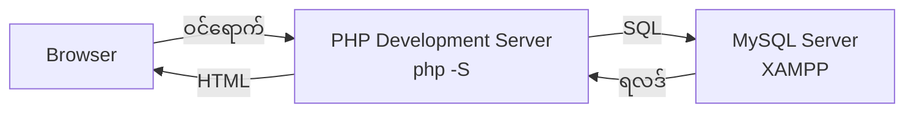
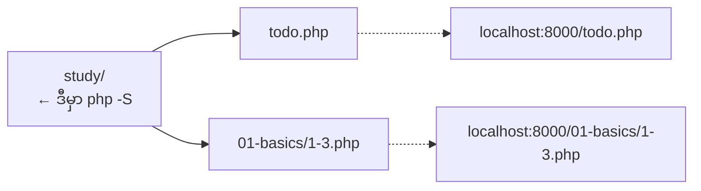
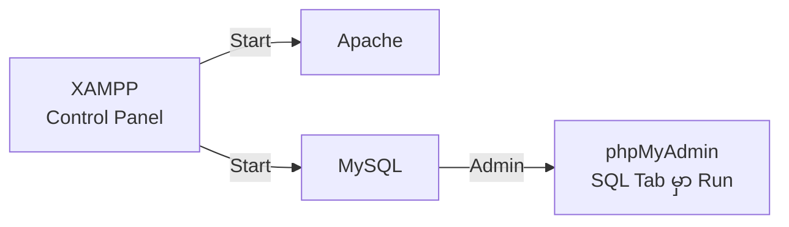
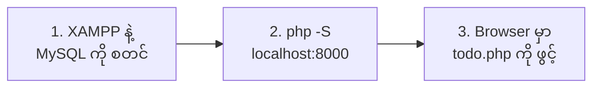

# ပထမ Semester ကို ပြန်လည်သုံးသပ်ခြင်း (ပြန်လည်လေ့လာခြင်း)

> 🇯🇵 မူရင်း (ဂျပန်ဘာသာဖြင့်): [20261001_復習.md](<../../../1年生_データ設計とアプリ開発/後期/20261001/20261001_復習.md>) <!-- original-ja-link -->

ဒုတိယ Semester မစခင် ပထမ Semester မှာ လုပ်ခဲ့တဲ့ 「App ကို Run ဖို့ ပြင်ဆင်မှု」ကို ပြန်လည်သတိရကြည့်ရအောင်။
Web App ကို Run ဖို့ **Server ၂ ခု** လိုအပ်ခဲ့ပါတယ်။



- **PHP Development Server**: PHP Program ကို Run ပေးတဲ့ Server
- **MySQL Server**: ဒေတာကို သိမ်းဆည်းပေးတဲ့ Server

**Server နှစ်ခုထဲက တစ်ခုခု ရပ်နေရင်တောင် App က အလုပ်မလုပ်ပါဘူး။**

---

## 1. PHP Development Server

PHP က Server ဘက်မှာ Run တဲ့ ဘာသာစကား ဖြစ်လို့ `.php` ဖိုင်ကို Browser မှာ တိုက်ရိုက်ဖွင့်ရင် Run မှာ မဟုတ်ပါဘူး။
ဒါကြောင့် PHP ထဲမှာ ပါပြီးသား Development Server ကို စတင်ခဲ့ပါတယ်။

Windows မှာဆိုရင် **PowerShell** (Start Menu မှာ 「PowerShell」လို့ ရှာပါ) နဲ့ Run ပါ။

```powershell
cd C:\Users\<User အမည်>\Desktop\study
php -S localhost:8000
```

> **`php` ကို ရှာမတွေ့ဘူးလို့ ပြရင်**
> XAMPP ထဲမှာ ပါတဲ့ PHP ကို တည်နေရာ သတ်မှတ်ပြီး စတင်ပါ။
>
> ```powershell
> C:\xampp\php\php.exe -S localhost:8000
> ```

`php -S` ကို Run ခဲ့တဲ့ Folder က URL ရဲ့ `/` (Root) ဖြစ်ပါတယ်။
Folder ထဲမှာရှိတဲ့ ဖိုင်တွေကို ဝင်ရောက်တဲ့အခါ URL မှာလည်း အဲဒီ Folder အမည်ကို ထည့်ပေးရပါတယ်။



ရပ်ချင်တဲ့အခါ စတင်ခဲ့တဲ့ PowerShell မှာ `Ctrl + C` ကို နှိပ်ပါ။

အသေးစိတ် → [PHP Development Server တည်ဆောက်နည်း](../../前期/PHP開発サーバーの立て方.md)

---

## 2. XAMPP (MySQL)

ဒေတာ သိမ်းမယ့်နေရာအဖြစ် XAMPP နဲ့ MySQL ကို စတင်ခဲ့ပါတယ်။
XAMPP Control Panel ရဲ့ `Start` ခလုတ်ကို နှိပ်ပြီး `Stop` လို့ ပြောင်းသွားရင် MySQL အလုပ်လုပ်နေပါပြီ။



MySQL Row ရဲ့ `Admin` ခလုတ်ကို နှိပ်ရင် Database စီမံခန့်ခွဲမှု Screen (phpMyAdmin) ပွင့်လာပါမယ်။
`SQL` Tab ကနေ SQL Statement ကို တိုက်ရိုက် Run နိုင်ခဲ့ပါတယ်။

အသေးစိတ် → [Database Server တည်ဆောက်နည်း (XAMPP အပိုင်း)](../../前期/データベースサーバーの立て方/データベースサーバーの立て方.md)

---

## 3. App ကို Run တဲ့ အစဉ်

PHP ကနေ PDO နဲ့ MySQL ကို ချိတ်ဆက်ပြီး Todo စီမံခန့်ခွဲမှု App (`todo.php`) ကို Run ခဲ့ပါတယ်။
အောက်ပါ အစဉ်အတိုင်း စတင်ပါ။



အသေးစိတ် → [Todo စီမံခန့်ခွဲမှု App ကို စတင်ဖွင့်ပုံ အဆင့်များ](../../前期/20260723/Todo管理アプリ起動する流れ.md)

<!-- nav:start -->

---

| ⬅️ ယခင် | 🗺️ ခြုံငုံပုံ | နောက်တစ်ခု ➡️ |
|:--|:--:|--:|
| [07/28 SQL လေ့ကျင့်ခန်း](../../前期/20260728/20260728_演習.md) | [သင်ခန်းစာများ၏ ခြုံငုံပုံ](../../README.md) | [10/01 Source Control မိတ်ဆက်](20261001_資料_1.md) |

<!-- nav:end -->
