# Source Control မိတ်ဆက် — SourceTree နှင့် GitHub ဖြင့် code ကို စီမံခန့်ခွဲခြင်း

> 🇯🇵 မူရင်း (ဂျပန်ဘာသာဖြင့်): [20261001_資料_1.md](<../../../1年生_データ設計とアプリ開発/後期/20261001/20261001_資料_1.md>) <!-- original-ja-link -->

## ယနေ့ ပန်းတိုင်
- Source control ဘာကြောင့် လိုအပ်သလဲ ဆိုတာ နားလည်ရန်
- SourceTree ဖြင့် commit・push・pull လုပ်နိုင်ရန်

[ပထမ Semester ကို ပြန်လည်သုံးသပ်ခြင်း](./20261001_復習.md)

---

## 1. Source control ဘာကြောင့် လိုအပ်သလဲ？

ဒီလို အတွေ့အကြုံမျိုး ရှိဖူးပါသလား။

```
study/
  todo.php
  todo_コピー.php
  todo_動いてたやつ.php
  todo_最新2.php   ← ဘယ်ဟာက တကယ့် နောက်ဆုံးဗားရှင်းလဲ？
```

File ကို copy ကူးပြီး သိမ်းထားတဲ့ နည်းနဲ့ဆိုရင် ဘယ်ဟာက နောက်ဆုံးဗားရှင်းလဲ၊ ဘယ်နေရာကို ပြင်ခဲ့သလဲ ဆိုတာ မသိတော့ပါဘူး။
ကွန်ပျူတာ ပျက်သွားရင်လည်း အားလုံး ပျောက်သွားပါလိမ့်မယ်။

Git ကို သုံးရင် ဂိမ်းလိုပဲ **save point** တွေ ချန်ထားနိုင်ပါတယ်။
Code ကို ပျက်အောင် လုပ်မိသွားရင်တောင် အလုပ်လုပ်ခဲ့တဲ့ အခြေအနေကို အချိန်မရွေး ပြန်သွားနိုင်ပါတယ်။

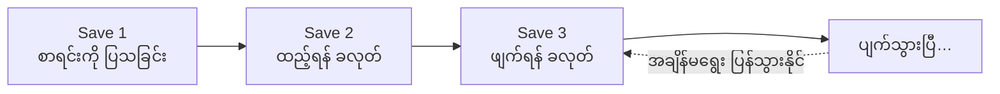

---

## 2. Git・GitHub・SourceTree

နာမည်တွေ ဆင်တူပေမယ့် တစ်ခုချင်းစီရဲ့ အလုပ်က မတူပါဘူး။

| နာမည် | ဘာလဲ？ | ဥပမာပေးရရင် |
|------|-----------|-----------|
| **Git** | History ကို မှတ်တမ်းတင်တဲ့ စနစ် | Save လုပ်တဲ့ function |
| **GitHub** | History ကို အင်တာနက်ပေါ်မှာ ထားပေးတဲ့ service | Cloud ပေါ်က save သိမ်းတဲ့နေရာ |
| **SourceTree** | Git ကို screen ပေါ်ကနေ ကိုင်တွယ်တဲ့ app | Save screen |

Git ကို ပုံမှန်အားဖြင့် PowerShell စတာတွေမှာ command ရိုက်ပြီး သုံးရပေမယ့်၊ ယနေ့မှာတော့ SourceTree ကို သုံးပြီး **mouse နဲ့** လုပ်ဆောင်ပါမယ်။

---

## 3. ဝေါဟာရတွေကို ပုံနဲ့ မှတ်ပါ

Git မှာ file တွေဟာ「အလုပ်လုပ်တဲ့ folder → ကိုယ့် PC → GitHub」ကြားမှာ အသွားအပြန် ရွေ့လျားပါတယ်။
မြှားရဲ့ နာမည်ဟာ လုပ်ဆောင်ချက်ရဲ့ နာမည် ဖြစ်ပါတယ်။

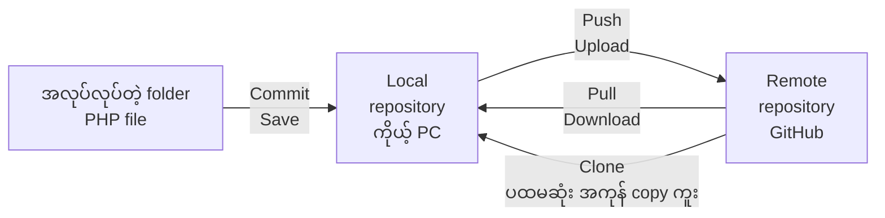

- **Repository**：History ကို စီမံတဲ့「သေတ္တာ」။ ကိုယ့် PC ထဲမှာ ရှိတာကို **local**၊ GitHub ပေါ်မှာ ရှိတာကို **remote** လို့ ခေါ်ပါတယ်
- **Commit**：ပြောင်းလဲမှုကို save point အဖြစ် မှတ်တမ်းတင်ခြင်း
- **Push**：ကိုယ့် PC က save ကို GitHub ပေါ် upload တင်ခြင်း
- **Pull**：GitHub ရဲ့ နောက်ဆုံး အခြေအနေကို ကိုယ့် PC ထဲ download ဆွဲခြင်း
- **Clone**：GitHub repository ကို ပထမဆုံးအကြိမ် အကုန် copy ကူးယူခြင်း

---

## 4. SourceTree ကို install လုပ်ခြင်း

တရားဝင် website ကနေ installer ကို download ဆွဲပြီး run ပါ။

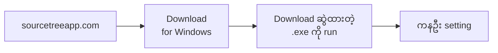

Install လုပ်နေစဉ်မှာ မေးခွန်းအချို့ မေးပါလိမ့်မယ်။

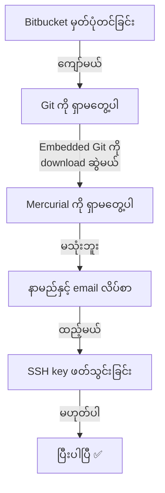

| မေးမယ့်အရာ | ရွေးရမယ့်အရာ |
|------------|---------|
| Bitbucket (Atlassian) မှာ မှတ်ပုံတင်ခြင်း | ကျော်မယ် (`スキップ`)（ယနေ့ မသုံးပါ） |
| Git ကို ရှာမတွေ့ပါ | **Embedded Git ကို download ဆွဲမယ်** (`埋め込み版のGitをダウンロード`)（SourceTree သီးသန့် Git ထည့်သွင်းပေးပါမယ်） |
| Mercurial ကို ရှာမတွေ့ပါ | Mercurial မသုံးချင်ပါ (`Mercurialを使いたくない`)（ယနေ့ မသုံးပါ） |
| နာမည်နှင့် email လိပ်စာ | ထည့်ပါ။ ဒီနာမည်ကို **commit ရေးသူ** အဖြစ် မှတ်တမ်းတင်ပါလိမ့်မယ် |
| SSH key ဖတ်သွင်းမလား | မဟုတ်ပါ (`いいえ`)（ယနေ့ token သုံးမှာမို့ မလိုပါ） |

> Screen ပေါ်က စာသားတွေဟာ ဗားရှင်းပေါ် မူတည်ပြီး နည်းနည်း ကွာနိုင်ပါတယ်။ မသေချာရင် ဆရာ/ဆရာမကို မေးပါ။

> **နာမည်ကို ကိုယ်မှန်း သိသာတဲ့ နာမည် ပေးပါ**
> ယနေ့ အားလုံး repository တစ်ခုတည်းကို သုံးမှာမို့ `yamada-taro` လိုမျိုး **ဘယ်သူ့ commit လဲ သိနိုင်တဲ့ နာမည်** ကို ပေးပါ။

---

## 5. ယနေ့ရဲ့ စနစ်

ယနေ့မှာ ဆရာ/ဆရာမ GitHub ပေါ်မှာ ပြင်ဆင်ထားတဲ့ **လေ့ကျင့်ရန် repository** ကို အတန်းသားအားလုံး အတူတူ သုံးပါမယ်။
ကိုယ့်ရဲ့ GitHub account ကို မသုံးသေးဘဲ ဆရာ/ဆရာမ ပေးမယ့် အချက်အလက် ၃ ခုနဲ့ ချိတ်ဆက်ပါမယ်။

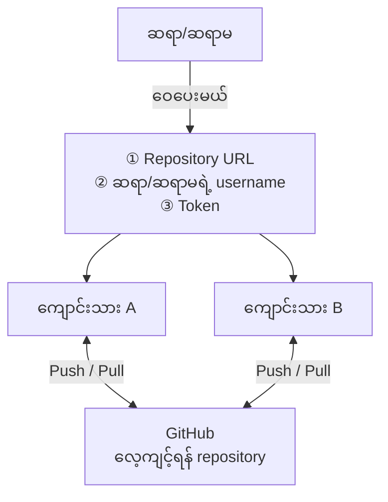

**Token** ဆိုတာ GitHub ကို「ဒီလူ လုပ်ဆောင်ခွင့် ရှိတယ်」လို့ အသိပေးဖို့ password အစား သုံးတဲ့ လျှို့ဝှက်စကားဝှက် ဖြစ်ပါတယ်（`github_pat_` နဲ့ စတဲ့ စာလုံးရှည်ကြီး）။
ယနေ့ token ကို လေ့ကျင့်ရန် repository ကိုပဲ ကိုင်တွယ်နိုင်အောင် ကန့်သတ်ထားပါတယ်။

> ⚠️ **Token ကို သူများကို မပြပါနဲ့・SNS သို့မဟုတ် chat မှာ မကူးထည့်ပါနဲ့**

---

## 6. Clone လုပ်ခြင်း

ဆရာ/ဆရာမရဲ့ repository ကို ကိုယ့် PC ထဲ copy ကူးပါမယ်။

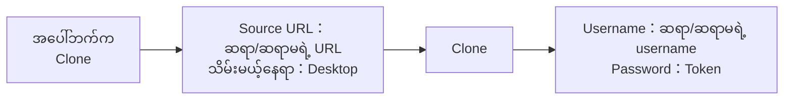

SourceTree ရဲ့ အပေါ်ဘက်မှာရှိတဲ့ `Clone` ကို နှိပ်ပြီး အောက်ပါအတိုင်း ထည့်ပါ။

| အကွက် | ထည့်ရမယ့် အကြောင်းအရာ |
|------|------------|
| မူရင်း path / URL (`元のパス / URL`) | ဆရာ/ဆရာမဆီက ရထားတဲ့ repository URL |
| သိမ်းမယ့်နေရာရဲ့ path (`保存先のパス`) | `C:\Users\<အသုံးပြုသူအမည်>\Desktop\<repository အမည်>` |

လုပ်နေစဉ် username နဲ့ password မေးလာရင် **password အကွက်ထဲမှာ token ကို paste လုပ်ပါ**။

✅ Desktop ပေါ်မှာ `<repository အမည်>` folder ပေါ်လာပြီး အထဲမှာ `README.md` ရှိရင် အောင်မြင်ပါပြီ။

ထည့်ခဲ့တဲ့ token ကို Windows ရဲ့「資格情報マネージャー」(Credential Manager) မှာ သိမ်းထားမှာမို့ နောက်တစ်ခါကစပြီး မမေးတော့ပါဘူး။

> **Desktop ပေါ်မှာ folder ကို ရှာမတွေ့ရင်**
> OneDrive သုံးတဲ့ PC တွေမှာ desktop ရဲ့ နေရာဟာ `C:\Users\<အသုံးပြုသူအမည်>\OneDrive\デスクトップ` ဖြစ်နေတတ်ပါတယ်။
> သိမ်းမယ့်နေရာရဲ့ `...` ခလုတ်ကနေ Explorer မှာ desktop ကို ရွေးရင် သေချာပါတယ်။

---

## 7. Commit လုပ်ခြင်း

ပထမ semester မှာ ရေးခဲ့တဲ့ PHP file ကို clone လုပ်ထားတဲ့ folder ထဲ ထည့်ပြီး commit လုပ်ပါမယ်။
အားလုံး repository တစ်ခုတည်းကို သုံးမှာမို့ **ကိုယ့်နာမည်နဲ့ folder** တစ်ခု ဆောက်ပြီး အဲဒီထဲမှာ ထည့်ပါ။
ဒီလို လုပ်ရင် တခြားသူတွေရဲ့ file တွေနဲ့ မတိုက်မိတော့ပါဘူး။

```
<repository အမည်>/
  README.md
  yamada-taro/     ← ကိုယ့် folder
    todo.php
  suzuki-hanako/   ← တခြားသူ
    todo.php
```

Explorer မှာ file ကို copy ကူးပြီးရင် SourceTree ရဲ့ ဘယ်ဘက်က File status (`ファイルステータス`) ကို ဖွင့်ပါ။
「Stage မလုပ်ရသေးတဲ့ file」(ステージしていないファイル) မှာ ပေါ်နေတဲ့ file ကို「Stage」(ステージ) ထဲ တင်ပြီး message ရေးကာ commit လုပ်ပါ။

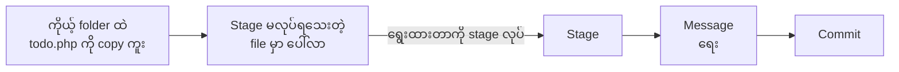

**Stage** ဆိုတာ「ဒီတစ်ကြိမ် save မှာ ထည့်မယ့် file」တွေကို ရွေးတဲ့ နေရာ ဖြစ်ပါတယ်။

Commit message မှာ နောက်မှ ကြည့်ရင် နားလည်အောင် **ဘာလုပ်ခဲ့သလဲ** ကို ရေးပါ။

| ❌ မကောင်းတဲ့ message | ⭕ ကောင်းတဲ့ message |
|----------|----------|
| 修正（ပြင်ဆင်） | Todoの削除ボタンが効かない不具合を修正（Todo ဖျက်ရန် ခလုတ် အလုပ်မလုပ်တဲ့ bug ကို ပြင်ဆင်） |
| 更新（Update） | Todo一覧に期限の列を追加（Todo စာရင်းမှာ သတ်မှတ်ရက် column ထည့်） |

---

## 8. Push လုပ်ခြင်း

Commit လုပ်ရုံနဲ့တော့ ကိုယ့် PC ထဲမှာပဲ မှတ်တမ်းတင်ထားသေးတာ ဖြစ်ပါတယ်။
Push လုပ်ပြီး GitHub ပေါ် upload တင်ပါမယ်။

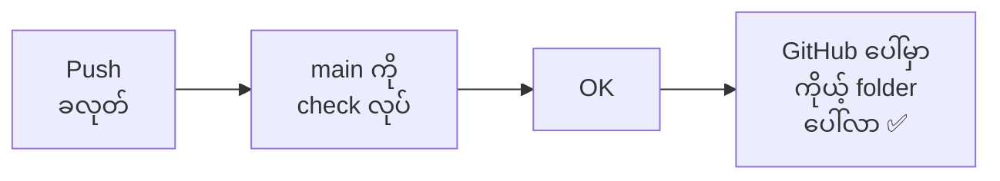

ဆရာ/ဆရာမ screen ပေါ် ပြပေးတဲ့ GitHub page မှာ ကိုယ့် folder ပေါ်လာရင် အောင်မြင်ပါပြီ။

### Error（rejected）တက်လာရင်

တခြားသူက အရင် push လုပ်ထားရင် GitHub ဘက်က ပိုအသစ်တဲ့ အခြေအနေ ဖြစ်နေပါတယ်။
ဒီအတိုင်း push လုပ်ရင် GitHub က ငြင်းပယ်ပါလိမ့်မယ်（rejected）။
**အရင်ဆုံး pull လုပ်ပြီး နောက်ဆုံးအခြေအနေကို ယူပြီးမှ** ထပ်ပြီး push လုပ်ပါ။

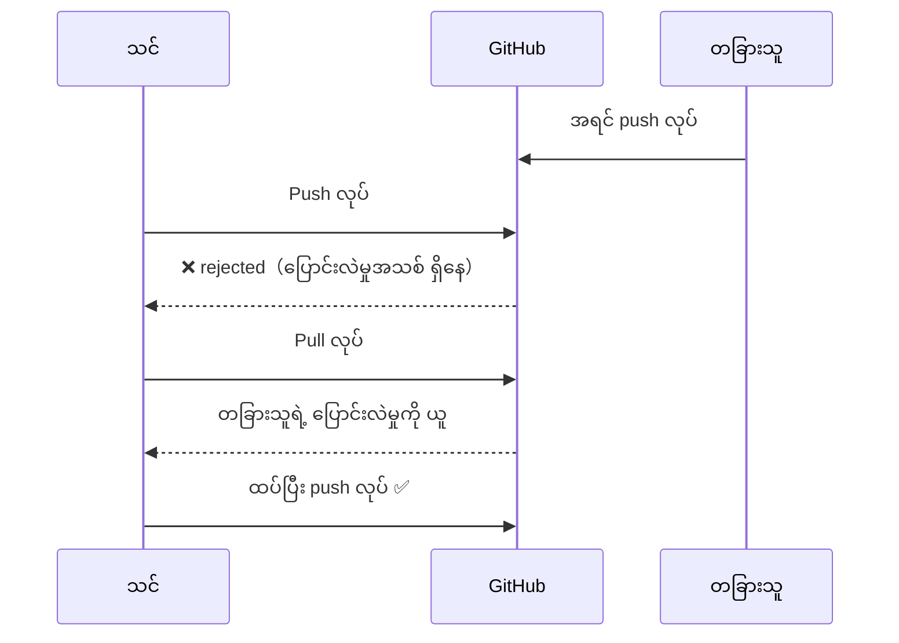

---

## 9. Pull လုပ်ခြင်း

တခြားသူတွေ push လုပ်ထားတဲ့ ပြောင်းလဲမှုတွေကို ကိုယ့် PC ထဲ ယူပါမယ်။

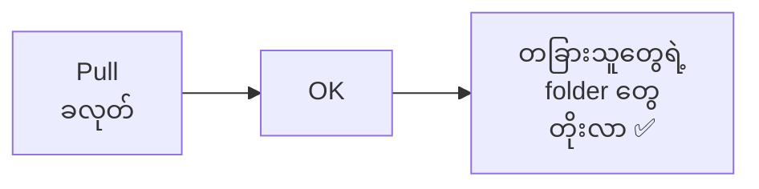

Explorer မှာ desktop ပေါ်က `<repository အမည်>` folder ကို ဖွင့်ကြည့်ပြီး တခြားသူတွေရဲ့ folder တွေ တိုးလာရင် အောင်မြင်ပါပြီ။
ဒီလိုမျိုး GitHub ကနေတစ်ဆင့် **အားလုံးရဲ့ ပြောင်းလဲမှုတွေကို မျှဝေနိုင်တာ** ဟာ GitHub ရဲ့ အသုံးဝင်တဲ့ အချက် ဖြစ်ပါတယ်။

---

## 10. အလုပ်လုပ်ပုံ အဆင့်ဆင့်

Git ကို သုံးတဲ့ development မှာ အောက်ပါ အဆင့်တွေကို ထပ်ခါထပ်ခါ လုပ်ပါတယ်။

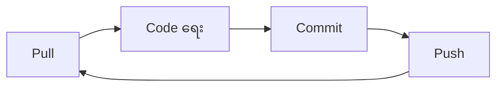

- **အလုပ် မစခင် pull လုပ်ပါ**：တခြားသူတွေရဲ့ ပြောင်းလဲမှုကို အရင် ယူထားပါ
- **မကြာခဏ commit လုပ်ပါ**：「ဒီအထိ အလုပ်လုပ်ပြီ」လို့ ထင်ရင် save လုပ်ပါ
- **အလုပ် ပြီးတဲ့အခါ push လုပ်ပါ**：GitHub မှာ သိမ်းပြီး မျှဝေပါ

> ယနေ့ repository နဲ့ token ဟာ **လေ့ကျင့်ရန်သီးသန့်** ဖြစ်ပါတယ်（အတန်းပြီးရင် သုံးလို့မရတော့ပါ）။
> ကိုယ်ပိုင် repository ဆောက်မယ် → [GitHub account နဲ့ repository ပြုလုပ်နည်း](../20261008/20261008_資料_1.md)

<!-- nav:start -->

---

| ⬅️ ယခင် | 🗺️ ခြုံငုံပုံ | နောက်တစ်ခု ➡️ |
|:--|:--:|--:|
| [10/01 ပထမ Semester ကို ပြန်လည်သုံးသပ်ခြင်း](20261001_復習.md) | [သင်ခန်းစာများ၏ ခြုံငုံပုံ](../../README.md) | [10/08 GitHub account နဲ့ repository](../20261008/20261008_資料_1.md) |

<!-- nav:end -->
