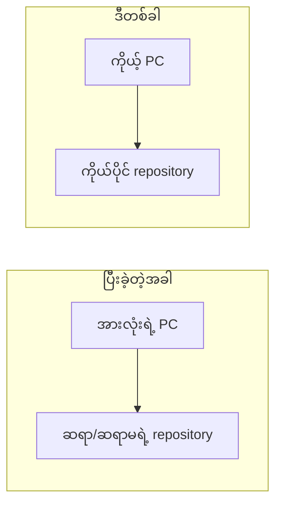
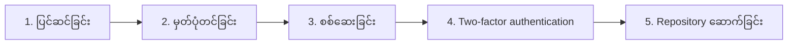
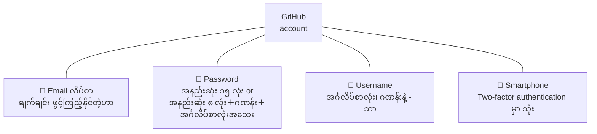
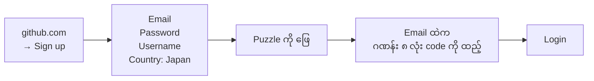
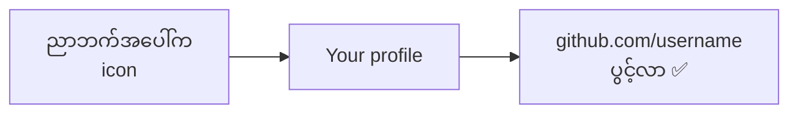
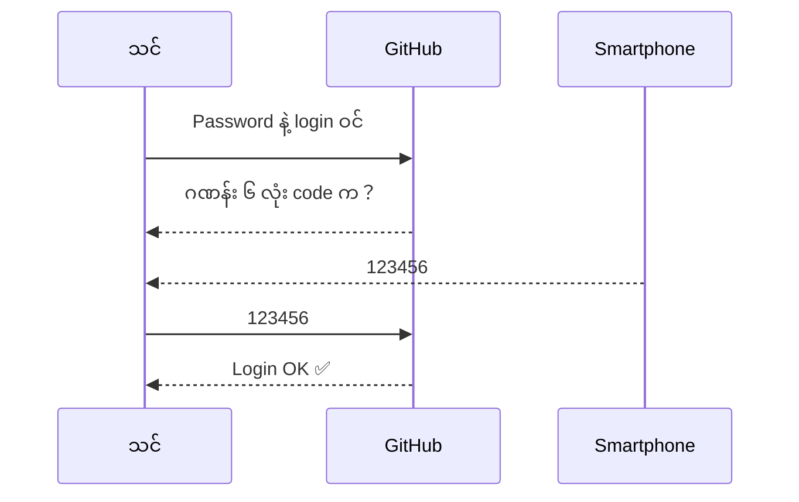
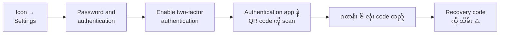
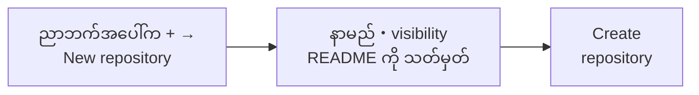
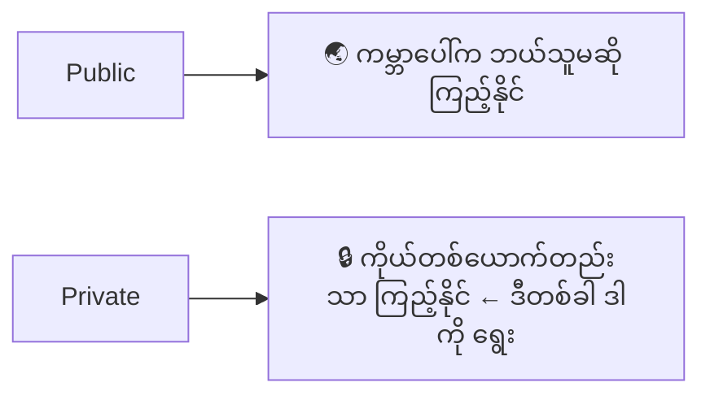

> 🇯🇵 မူရင်း (ဂျပန်ဘာသာဖြင့်): [20261008_資料_1.md](<../../../1年生_データ設計とアプリ開発/後期/20261008/20261008_資料_1.md>) <!-- original-ja-link -->

# GitHub account နဲ့ repository ပြုလုပ်နည်း

## ယနေ့ ပန်းတိုင်
- GitHub account ကို ဖွင့်နိုင်ရန်
- ကိုယ်ပိုင် repository ကို ဆောက်နိုင်ရန်

[Source Control မိတ်ဆက်သို့ ပြန်သွားရန်](../20261001/20261001_資料_1.md)

---

## ပြီးခဲ့တဲ့ အတန်း ပြန်လည်သုံးသပ်ချက်

ပြီးခဲ့တဲ့ အတန်းမှာ **ဆရာ/ဆရာမရဲ့ GitHub account မှာရှိတဲ့ repository** ထဲကို အားလုံး push လုပ်ခဲ့ကြပါတယ်။

ဒီတစ်ခါမှာတော့ **ကိုယ်ပိုင် GitHub account ကို ဖွင့်ပြီး ကိုယ်ပိုင် repository** ကို ပြင်ဆင်ပါမယ်။
ဒါဆိုရင် ကိုယ့် code ကို ကိုယ့်နေရာမှာ စီမံခန့်ခွဲနိုင်လာပါပြီ။

---

## လုပ်ငန်းစဉ် တစ်ခုလုံး

ယနေ့မှာ အောက်ပါ အဆင့် ၅ ဆင့်နဲ့ ကိုယ်ပိုင် code သိမ်းတဲ့နေရာကို GitHub ပေါ်မှာ ပြင်ဆင်ပါမယ်။

---

## 1. ပြင်ဆင်ရမယ့်အရာများ

မှတ်ပုံမတင်ခင် အောက်ပါ ၄ ခုကို ပြင်ဆင်ထားပါ။

- **Email လိပ်စာ**：အတည်ပြု code ပို့လာမှာမို့ အတန်းချိန်အတွင်း ချက်ချင်း ဖွင့်ကြည့်နိုင်တဲ့ email ကို သုံးပါ
- **Smartphone**：နောက်မှ setting လုပ်မယ့် two-factor authentication မှာ သုံးပါမယ်

### Username ရွေးချယ်နည်း

Username ဟာ `https://github.com/<username>` လိုမျိုး **URL ဖြစ်လာပြီး တခြားသူတွေကို ပြမယ့် နာမည်** ဖြစ်ပါတယ်။
အနာဂတ်မှာ portfolio အဖြစ် ပြရနိုင်တာမို့ ပြက်လုံးထုတ်တဲ့ နာမည်မျိုးကို ရှောင်ပါ။
နာမည်အရင်း မထုတ်ချင်ရင် နာမည်အရင်း မဟုတ်လည်း ရပါတယ်။

| ❌ ရှောင်သင့်တာ | ⭕ ကောင်းတာ |
|-------------|----------|
| `unko-man`、`aaaa1234` | `taro-yamada`、`tyamada-dev` |

---

## 2. မှတ်ပုံတင်ခြင်း

https://github.com ကို ဖွင့်ပြီး ညာဘက်အပေါ်က `Sign up` ကနေ မှတ်ပုံတင်ပါ။

- Username ကို တခြားသူ သုံးပြီးသားဆိုရင် စာနီနဲ့ ပြပါလိမ့်မယ်။ အဲဒီအခါ တခြားနာမည် ပြောင်းပါ
- **Puzzle** ဆိုတာ「လူသား ဟုတ်မဟုတ် စစ်ဆေးခြင်း」ဖြစ်ပါတယ်။ Screen ပေါ်က ညွှန်ကြားချက်အတိုင်း ဖြေပါ
- မှတ်ပုံတင်ထားတဲ့ email ကို ပို့လာတဲ့ **ဂဏန်း ၈ လုံး code** ကို ထည့်လိုက်ရင် မှတ်ပုံတင်ခြင်း ပြီးပါပြီ

လုပ်နေစဉ် မေးခွန်းတွေ ဒါမှမဟုတ် plan ရွေးချယ်မှု ပေါ်လာရင် အောက်ပါအတိုင်း ဆက်လုပ်ပါ။

| Screen | ရွေးရမယ့်အရာ |
|------|---------|
| သုံးမယ့် ရည်ရွယ်ချက် မေးခွန်း | `Skip personalization`（ကျော်မယ်） |
| Plan | **Free（အခမဲ့）** |

> **Email မရောက်လာရင်**
> Spam folder ကို စစ်ကြည့်ပါ → မိနစ်အနည်းငယ် စောင့်ပြီး `Resend the code` နဲ့ ပြန်ပို့ခိုင်းပါ → ဒါတောင် မရရင် လိပ်စာ ရိုက်မှားထားသလား စစ်ပါ

---

## 3. စစ်ဆေးခြင်း

Account ဖွင့်ပြီးပြီလား ဆိုတာ ကိုယ့် profile screen ကို ဖွင့်ပြီး စစ်ဆေးပါ။

**ကိုယ့် username ကို မှတ်ထားပါ။** နောက်မှ သုံးပါမယ်။

---

## 4. Two-factor authentication

**Two-factor authentication（2FA）** ဆိုတာ password အပြင် **smartphone ပေါ်မှာ ပြတဲ့ ဂဏန်း ၆ လုံး code** နဲ့ပါ login ကို အတည်ပြုတဲ့ စနစ် ဖြစ်ပါတယ်။
Password ကို တခြားသူ သိသွားရင်တောင် smartphone မရှိရင် login ဝင်လို့ မရပါဘူး။

GitHub မှာ two-factor authentication setting လုပ်ဖို့ လိုအပ်ပြီး login ဝင်ပြီး ခဏကြာရင် setting လုပ်ဖို့ လမ်းညွှန်ချက် ပေါ်လာပါလိမ့်မယ်။

### Setting လုပ်နည်း အဆင့်ဆင့်

Smartphone မှာ authentication app（Google Authenticator စသည်）ကို ထည့်ပြီးမှ စပါ။

> ⚠️ **Recovery code ကို မဖြစ်မနေ သိမ်းထားပါ！**
> Smartphone ပျောက်သွားတဲ့အခါ login ဝင်ဖို့ နောက်ဆုံးနည်းလမ်း ဖြစ်ပါတယ်။
> ပျောက်သွားရင် account ထဲ ဝင်လို့ မရတော့တာမျိုး ဖြစ်နိုင်ပါတယ်။

---

## 5. Repository ဆောက်ခြင်း

Account ဖွင့်ပြီးရင် ကိုယ့် code ကို သိမ်းမယ့် **repository**（history ကို စီမံတဲ့ သေတ္တာ）ကို ဆောက်ပါမယ်။

အောက်ပါအတိုင်း သတ်မှတ်ပါ။

| အကွက် | Setting |
|------|------------|
| Repository name | `php-study` |
| Visibility（ကြည့်ခွင့်အတိုင်းအတာ） | **`Private`** |
| Add README | **On** |

**Visibility** ဆိုတာ ဒီ repository ကို ဘယ်သူတွေ ကြည့်နိုင်လဲ ဆိုတဲ့ setting ဖြစ်ပါတယ်။
လေ့ကျင့်ရန် code တွေကို `Private` ထားပါ။

**README** ဆိုတာ repository ရဲ့ ရှင်းလင်းချက်ကို ရေးတဲ့ file ဖြစ်ပါတယ်။
အစကတည်းက file တစ်ခု ရှိနေရင် နောက်မှ clone လုပ်တဲ့အခါ အထဲမှာ အကြောင်းအရာ ပါမပါ စစ်ဆေးနိုင်ပါတယ်။

### စစ်ဆေးခြင်း ✅

အောက်ပါ ၃ ချက် ပြည့်စုံရင် ပြီးပါပြီ။

- URL ဟာ `github.com/<username>/php-study` ဖြစ်နေတယ်
- `README.md` ကို ပြနေတယ်
- Repository နာမည်ဘေးမှာ `Private` လို့ ပြနေတယ်

---

နောက်တစ်ဆင့်မှာ ဆောက်ထားတဲ့ `php-study` ထဲကို လေ့ကျင့်ရေး environment ကို push လုပ်ပါမယ် → [လေ့ကျင့်ရေး environment ကို ကိုယ်ပိုင် repository ထဲ push လုပ်ခြင်း](./20261008_資料_2.md)

<!-- nav:start -->

---

| ⬅️ ယခင် | 🗺️ ခြုံငုံပုံ | နောက်တစ်ခု ➡️ |
|:--|:--:|--:|
| [10/01 Source Control မိတ်ဆက်](../20261001/20261001_資料_1.md) | [သင်ခန်းစာများ၏ ခြုံငုံပုံ](../../README.md) | [10/08 လေ့ကျင့်ရေး environment ကို push လုပ်ခြင်း](20261008_資料_2.md) |

<!-- nav:end -->
