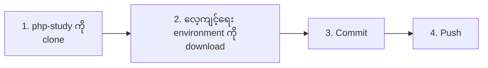
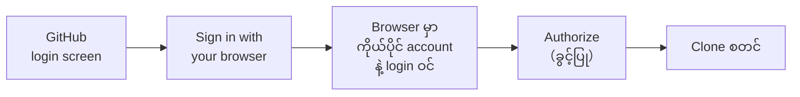
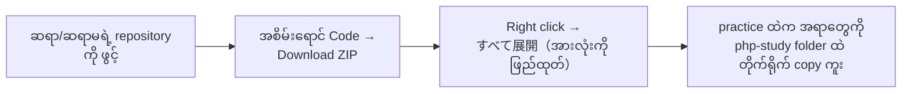
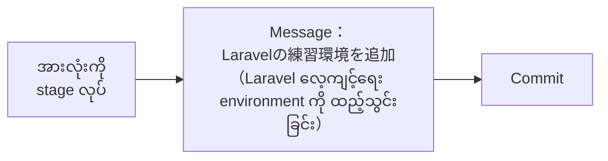

# လေ့ကျင့်ရေး environment ကို ကိုယ်ပိုင် repository ထဲ push လုပ်ခြင်း

> 🇯🇵 မူရင်း (ဂျပန်ဘာသာဖြင့်): [20261008_資料_2.md](<../../../1年生_データ設計とアプリ開発/後期/20261008/20261008_資料_2.md>) <!-- original-ja-link -->

## ယနေ့ ပန်းတိုင်
- ကိုယ်ပိုင် GitHub account နဲ့ login ဝင်ပြီး clone・push လုပ်နိုင်ရန်
- လေ့ကျင့်ရေး environment ကို ကိုယ်ပိုင် repository ထဲ push လုပ်နိုင်ရန်

[GitHub account နဲ့ repository ပြုလုပ်နည်းသို့ ပြန်သွားရန်](./20261008_資料_1.md)

---

## လုပ်ငန်းစဉ် တစ်ခုလုံး

[သင်ခန်းစာ 1](./20261008_資料_1.md) မှာ ဆောက်ခဲ့တဲ့ `php-study` ထဲကို ဆရာ/ဆရာမ ပြင်ဆင်ထားတဲ့ **လေ့ကျင့်ရေး environment** ကို ထည့်ပြီး push လုပ်ပါမယ်။



---

## 1. php-study ကို clone လုပ်ခြင်း

ပြီးခဲ့တဲ့အခါလိုပဲ SourceTree ရဲ့ `Clone` ကနေ ကိုယ့် PC ထဲ copy ကူးပါမယ်။
ပြီးခဲ့တဲ့အခါက token ပါတဲ့ URL နဲ့ clone လုပ်ခဲ့ပေမယ့် ဒီတစ်ခါမှာတော့ **ကိုယ်ပိုင် GitHub account နဲ့ login ဝင်ပြီး** ချိတ်ဆက်ပါမယ်။

| အကွက် | ထည့်ရမယ့် အကြောင်းအရာ |
|------|------------|
| မူရင်း path / URL | `https://github.com/<ကိုယ့် username>/php-study.git` |
| သိမ်းမယ့်နေရာရဲ့ path | `C:\Users\<အသုံးပြုသူအမည်>\Desktop\php-study` |

`クローン` (Clone) ကို နှိပ်လိုက်ရင် GitHub login screen ပေါ်လာပါလိမ့်မယ်။
`Sign in with your browser`（browser နဲ့ sign in ဝင်ခြင်း）ကို ရွေးပြီး **ကိုယ်ပိုင် account** နဲ့ login ဝင်ပါ။



- Browser မှာ login ဝင်ဖို့ တောင်းလာရင် သင်ထောက်ကူစာရွက် 1 မှာ ဖွင့်ခဲ့တဲ့ account နဲ့ login ဝင်ပါ（two-factor authentication ရဲ့ ဂဏန်း ၆ လုံး code ကိုလည်း ထည့်ပါ）
- `Authorize`（ခွင့်ပြု）ကို နှိပ်လိုက်ရင် SourceTree ကို ပြန်ရောက်ပြီး clone စတင်ပါလိမ့်မယ်
- Login အချက်အလက်ကို Windows မှာ သိမ်းထားမှာမို့ နောက်တစ်ခါကစပြီး မမေးတော့ပါဘူး

✅ Desktop ပေါ်မှာ `php-study` folder ပေါ်လာပြီး အထဲမှာ `README.md` ရှိရင် အောင်မြင်ပါပြီ။

---

## 2. လေ့ကျင့်ရေး environment ကို download ဆွဲခြင်း

ဆရာ/ဆရာမရဲ့ repository ကို ZIP နဲ့ download ဆွဲပြီး အထဲက `practice` folder ရဲ့ **အထဲက အရာတွေ** ကို ထုတ်ယူပါမယ်။



**ဆရာ/ဆရာမရဲ့ repository：** https://github.com/hakobunet/iica-koyama

ဖြည်ထုတ်ထားတဲ့ folder ထဲက အောက်ပါနေရာမှာ `practice` ရှိပါတယ်။

```
iica-koyama-main/
  docs/
    1年生_データ設計とアプリ開発/
      practice/   ← ဒီအထဲက အရာတွေကို copy ကူး
```

`practice` folder ကို ဖွင့်ပြီး **အထဲက အရာအားလုံး** ကို `php-study` folder ထဲ **တိုက်ရိုက်** copy ကူးပါ（`practice` folder ကိုယ်တိုင်ကို မဆောက်ပါနဲ့）။

```
php-study/
  README.md          ← practice ရဲ့ README.md နဲ့ အစားထိုးလို့ ရပါတယ်
  .gitattributes
  mysql/
    compose.yaml
  laravel/
    .gitignore
    compose.yaml
    Dockerfile
    entrypoint.sh
```

> **`README.md` နာမည်တူ ထပ်နေရင်**
> 「ファイルを置き換える」(file ကို အစားထိုးမယ်) ကို ရွေးလို့ ရပါတယ်။ လေ့ကျင့်ရေး environment ကို run ပုံ ရေးထားတဲ့ README ဖြစ်သွားပါလိမ့်မယ်။

> **အထဲက file တွေကို တစ်ခုချင်း မရွေးပါနဲ့**
> `.gitattributes` နဲ့ `.gitignore` လိုမျိုး နာမည်ဟာ `.` နဲ့ စတဲ့ file တွေက အရေးကြီးတဲ့ setting file တွေ ဖြစ်ပါတယ်။
> မမြင်ရတတ်တာမို့ `practice` folder ကို ဖွင့်ပြီးရင် `Ctrl + A`（အားလုံးကို ရွေး）နဲ့ တစ်ခါတည်း copy ကူးပါ။

---

## 3. Commit လုပ်ခြင်း

SourceTree ရဲ့ `ファイルステータス` (File status) ကို ဖွင့်လိုက်ရင် `mysql` နဲ့ `laravel` ထဲက file တွေဟာ「ステージしていないファイル」（stage မလုပ်ရသေးတဲ့ file တွေ）မှာ ပေါ်လာပါလိမ့်မယ်။



---

## 4. Push လုပ်ခြင်း

`プッシュ` (Push) ခလုတ် → `main` ကို check လုပ် → `OK` နဲ့ GitHub ပေါ် upload တင်ပါ။

### စစ်ဆေးခြင်း ✅

Browser မှာ `github.com/<username>/php-study` ကို ဖွင့်ပြီး အောက်ပါအတိုင်း ဖြစ်နေရင် ပြီးပါပြီ။

- `mysql` နဲ့ `laravel` folder တွေဟာ အပေါ်ဆုံးအဆင့်（`php-study` folder ထဲမှာ တိုက်ရိုက်）မှာ ပေါ်နေတယ်

> **Clone ဒါမှမဟုတ် push လုပ်တဲ့အခါ `403` ဒါမှမဟုတ် `Repository not found` ပေါ်လာရင်**
> URL ထဲက `<ကိုယ့် username>` မှန်မမှန်၊ browser မှာ **ကိုယ်ပိုင် account** နဲ့ login ဝင်ခဲ့သလား စစ်ဆေးပါ။

လေ့ကျင့်ရေး environment ကို run ပုံကို `php-study` folder ထဲက `README.md` မှာ ရေးထားပါတယ်။
Folder ရဲ့ နေရာဟာ `C:\Users\<အသုံးပြုသူအမည်>\Desktop\php-study` ဖြစ်မှာမို့ README ထဲက `Desktop\practice` ကို `Desktop\php-study` လို့ ပြောင်းဖတ်ပါ။

<!-- nav:start -->

---

| ⬅️ ယခင် | 🗺️ ခြုံငုံပုံ | နောက်တစ်ခု ➡️ |
|:--|:--:|--:|
| [10/08 GitHub account နဲ့ repository](20261008_資料_1.md) | [သင်ခန်းစာများ၏ ခြုံငုံပုံ](../../README.md) | [10/08 Docker မိတ်ဆက်](20261008_資料_3.md) |

<!-- nav:end -->
