# Docker မိတ်ဆက် — Docker Desktop ကို install လုပ်ခြင်း

> 🇯🇵 မူရင်း (ဂျပန်ဘာသာဖြင့်): [20261008_資料_3.md](<../../../1年生_データ設計とアプリ開発/後期/20261008/20261008_資料_3.md>) <!-- original-ja-link -->

## ယနေ့ ပန်းတိုင်
- Docker က ဘာလုပ်ပေးတာလဲ ဆိုတာ နားလည်ရန်
- Docker Desktop ကို install လုပ်ပြီး `hello-world` ကို run နိုင်ရန်
- လေ့ကျင့်ရေး environment ကို စတင်ပြီး browser မှာ Laravel ရဲ့ top page ကို ပြနိုင်ရန်

---

## နိဒါန်း：Container ဆိုတာ ဘာလဲ？

**Container** ဆိုတာ PC ထဲမှာ ဆောက်ထားတဲ့ **သီးသန့် အခန်းငယ်လေး** တစ်ခုလိုမျိုး ဖြစ်ပါတယ်။
အခန်းထဲမှာ app ကို run ဖို့ လိုအပ်တဲ့ အရာ（PHP、MySQL စသည်）တွေပဲ ပါပါတယ်။

ပထမ semester က XAMPP ကို PC ထဲ တိုက်ရိုက် install လုပ်ခဲ့ပါတယ်။
Container ကို သုံးရင် PC ကိုယ်တိုင်ထဲ မထည့်ဘဲ အခန်းထဲမှာပဲ run နိုင်ပါတယ်။

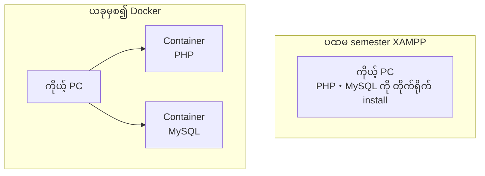

Container မှာ အောက်ပါလို ထူးခြားချက်တွေ ရှိပါတယ်။

| ထူးခြားချက် | ဘာကို ဆိုလိုတာလဲ？ |
|------|--------------|
| **အခန်းတစ်ခုချင်း သီးခြားစီ ဖြစ်တယ်** | Container တွေဟာ တစ်ခုနဲ့တစ်ခု မထိခိုက်ပါဘူး။ PHP ဗားရှင်းအဟောင်းနဲ့ အသစ်ကို တစ်ပြိုင်တည်း run နိုင်တယ် |
| **PC ကို မရှုပ်ထွေးစေဘူး** | PC ကိုယ်တိုင်ထဲမှာ ဘာမှ install မလုပ်ပါဘူး |
| **ချက်ချင်း ဆောက်နိုင်ပြီး ချက်ချင်း ဖျက်နိုင်တယ်** | စက္ကန့်အနည်းငယ်နဲ့ စတင်နိုင်တယ်။ မလိုတော့ရင် ဖျက်ပြီး ပြန်ဆောက်ရုံပဲ |
| **ဘယ်သူ့ PC မှာမဆို အထဲက အရာ တူတယ်** | တူညီတဲ့ ပုံစံငယ်တစ်ခုကနေ ဖန်တီးရင် အားလုံးရဲ့ PC မှာ တူညီတဲ့ environment ရရှိတယ် |

ဒီ container ကို ဆောက်တာ၊ run တာ လုပ်ပေးတဲ့ software ဟာ **Docker** ဖြစ်ပါတယ်။

---

## 1. Docker ကို ဘာကြောင့် သုံးတာလဲ？

ပထမ semester မှာ app ကို run ဖို့ XAMPP ကို ထည့်ပြီး PHP နဲ့ MySQL ကို ပြင်ဆင်ခဲ့ပါတယ်။
ဒါပေမယ့် ဒီလို ပြဿနာတွေ ဖြစ်တတ်ပါတယ်။

```
A：「ကိုယ့် PC မှာတော့ အလုပ်လုပ်တာပဲ…」
B：「PHP ဗားရှင်း မတူတာ ဖြစ်မယ်」
C：「XAMPP setting ကို ပြင်လိုက်တော့ အလုပ်မလုပ်တော့ဘူး」
```

**Docker** ကို သုံးရင် app ကို run ဖို့ environment（PHP・MySQL စသည်）ကို **container**（သီးသန့် အခန်း）ထဲ ထည့်ပြီး ဘယ် PC မှာမဆို တူညီစွာ run နိုင်ပါတယ်။

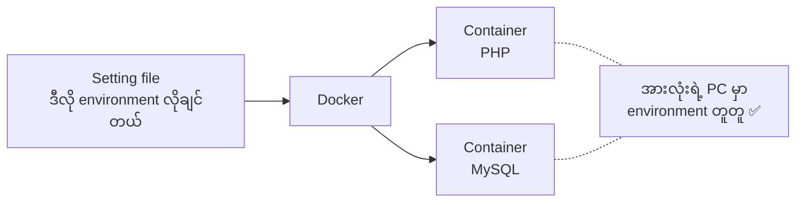

- Environment ကို ပျက်အောင် လုပ်မိရင်တောင် container ကို ပြန်ဆောက်လိုက်ရင် ချက်ချင်း မူလအတိုင်း ပြန်ဖြစ်တယ်
- Setting file ကို မျှဝေလိုက်ရင် team အားလုံး environment တူတူ ပြင်ဆင်နိုင်တယ်

---

## 2. Docker・Image・Container

အစမှာ တွေ့ရမယ့် ဝေါဟာရတွေကို ဟင်းချက်တာနဲ့ ဥပမာပေးပြီး မှတ်ကြရအောင်။

| နာမည် | ဘာလဲ？ | ဥပမာပေးရရင် |
|------|-----------|-----------|
| **Image** | Environment ရဲ့ ပုံစံငယ် | ဟင်းချက်နည်း（recipe） |
| **Container** | Image ကနေ ဆောက်ထားတဲ့ တကယ် run နေတဲ့ environment | Recipe ကနေ ချက်ထားတဲ့ ဟင်း |
| **Docker Desktop** | Windows မှာ Docker ကို သုံးဖို့ app | မီးဖိုချောင် |
| **Docker Hub** | Image တွေကို အများသုံး တင်ထားတဲ့ site | ဟင်းချက်နည်း စာအုပ် |

Image（recipe）တစ်ခုကနေ container（ဟင်း）တွေကို အရေအတွက် အကန့်အသတ်မရှိ ဖန်တီးနိုင်ပါတယ်။

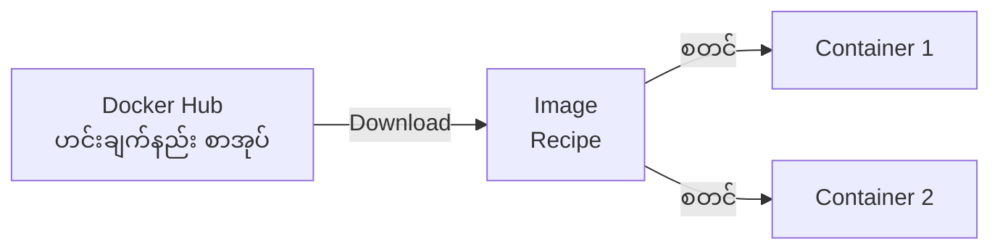

> **Container ကို ဖျက်လည်း ရလား？**
> Container ကို image（recipe）ကနေ အချိန်မရွေး ပြန်ဆောက်နိုင်တာမို့ ပျက်သွားရင် ဖျက်ပြီး ပြန်ဆောက်ရင် OK ပါတယ်။
> ဒါပေမယ့် **container ထဲမှာ ဖန်တီးထားတဲ့ data တွေဟာ container ကို ဖျက်ရင် အတူတူ ပျက်သွားပါတယ်။** Data ကို သိမ်းထားတဲ့ နည်းလမ်းကို နောက်အတန်းတွေမှာ လေ့လာပါမယ်။

---

## 3. Install လုပ်ပုံ အဆင့်ဆင့်

ယနေ့ အောက်ပါ အစီအစဉ်အတိုင်း လုပ်ပါမယ်။

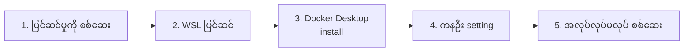

---

## 4. ပြင်ဆင်မှုကို စစ်ဆေးခြင်း

Docker Desktop ကို မထည့်ခင် PC က အောက်ပါ အခြေအနေတွေနဲ့ ကိုက်ညီမညီ စစ်ဆေးပါ။

| စစ်ဆေးရမယ့်အရာ | လိုအပ်ချက် |
|------------|------|
| Windows ဗားရှင်း | Windows 10（22H2）သို့မဟုတ် Windows 11 |
| Virtualization | **ဖွင့်ထား（有効）** ရမယ် |
| Account | **Administrator ခွင့်** ရှိတဲ့ user |

### Virtualization ဖွင့်ထားသလား စစ်ဆေးခြင်း

Docker ဟာ PC ထဲမှာ နောက်ထပ် PC အသေးလေး တစ်လုံးကို run တဲ့ **virtualization** ဆိုတဲ့ function ကို သုံးပါတယ်။

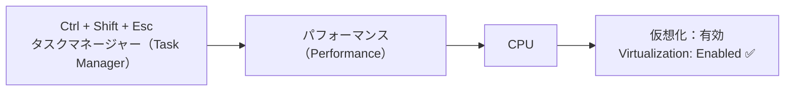

ညာဘက်အောက်က စာရင်းမှာ **「仮想化：有効」**（Virtualization: Enabled）လို့ ပြနေရင် OK ပါတယ်။

> **「無効」（Disabled）ဖြစ်နေရင်**
> BIOS（PC စဖွင့်ချိန်မှာ ပေါ်တဲ့ setting screen）မှာ ဖွင့်ပေးဖို့ လိုပါတယ်။ PC ထုတ်လုပ်တဲ့ ကုမ္ပဏီပေါ် မူတည်ပြီး လုပ်ပုံ မတူတာမို့ ဆရာ/ဆရာမကို ခေါ်ပါ။

---

## 5. WSL ပြင်ဆင်ခြင်း

**WSL**（Windows Subsystem for Linux）ဆိုတာ Windows ထဲမှာ Linux ကို run တဲ့ စနစ် ဖြစ်ပါတယ်။
Docker Desktop ဟာ ဒီ WSL ပေါ်မှာ အလုပ်လုပ်ပါတယ်။

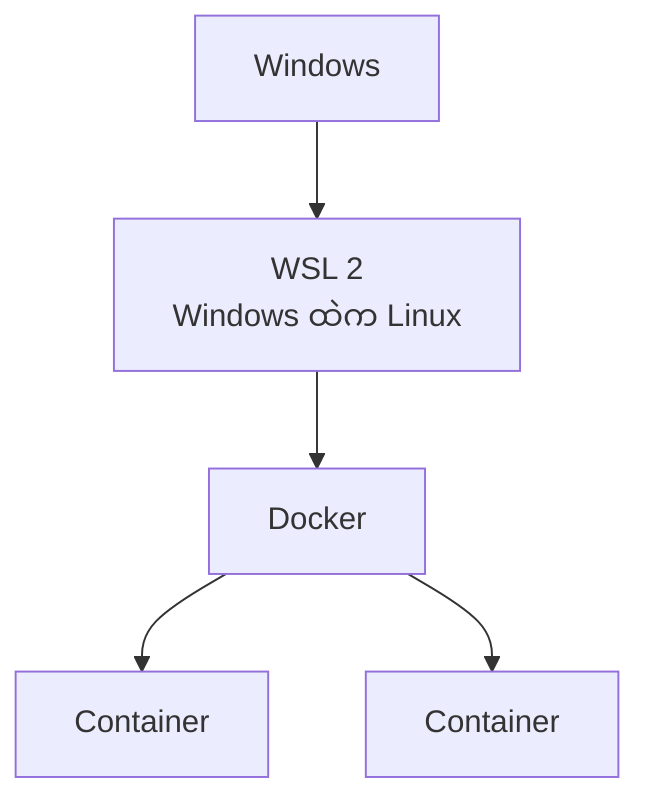

Start menu မှာ「PowerShell」လို့ ရှာပြီး **Right click →「管理者として実行」(Run as administrator)** နဲ့ ဖွင့်ပါ။

```powershell
wsl --install
```

ထည့်ပြီးသား ဖြစ်နေရင် နောက်ဆုံးဗားရှင်းကို update လုပ်ထားပါ။

```powershell
wsl --update
```

ပြီးရင် **PC ကို restart** လုပ်ပါ။

✅ Restart ပြီးနောက် PowerShell မှာ အောက်ပါ command ကို run ပြီး `既定のバージョン: 2`（Default Version: 2）လို့ ပြရင် OK ပါတယ်။

```powershell
wsl --status
```

> **`wsl --install` လုပ်တဲ့အခါ Ubuntu ရဲ့ username ကို မေးလာရင်**
> Ubuntu（Linux အမျိုးအစားတစ်ခု）ရဲ့ ကနဦး setting ဖြစ်ပါတယ်။ အင်္ဂလိပ်စာလုံးအသေးတွေနဲ့ username တစ်ခု သတ်မှတ်ပြီး password ကိုလည်း သတ်မှတ်ကာ ထည့်ပါ။
> Password ကို ရိုက်ထည့်တဲ့အခါ screen ပေါ်မှာ ဘာမှ မပြပေမယ့် တကယ်တော့ ထည့်ပြီးသား ဖြစ်ပါတယ်။

---

## 6. Docker Desktop ကို install လုပ်ခြင်း

တရားဝင် website ကနေ installer ကို download ဆွဲပြီး run ပါ။

**Download page：** https://www.docker.com/products/docker-desktop/

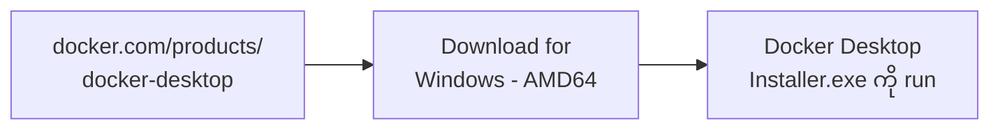

> **ARM64 နဲ့ AMD64 ရဲ့ ကွာခြားချက်**
> PC ရဲ့ CPU အမျိုးအစား ဖြစ်ပါတယ်။ Windows PC အများစုဟာ **AMD64**（x86_64）ဖြစ်ပါတယ်။
> Snapdragon လိုမျိုး smartphone အမျိုးအစား CPU သုံးတဲ့ PC တွေမှာသာ ARM64 ကို ရွေးပါ။

Installer လုပ်နေစဉ်မှာ setting တွေ မေးပါလိမ့်မယ်။

| မေးမယ့်အရာ | ရွေးရမယ့်အရာ |
|------------|---------|
| Use WSL 2 instead of Hyper-V | **On**（WSL ပေါ်မှာ run မယ်） |
| Add shortcut to desktop | On（Desktop ပေါ်မှာ icon ပေါ်လာမယ်） |

`OK` ကို နှိပ်ရင် install စတင်ပါမယ်။
`Close and restart`（သို့မဟုတ် `Close`）ပေါ်လာရင် **PC ကို restart** လုပ်ပါ။

---

## 7. ကနဦး setting

Restart ပြီးနောက် desktop ပေါ်က **Docker Desktop** icon ကို double click နှိပ်ပြီး ဖွင့်ပါ။

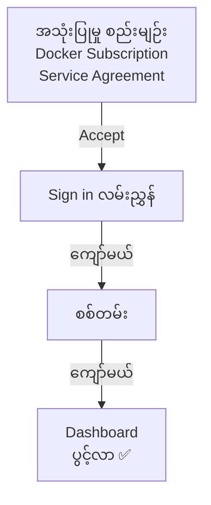

| Screen | ရွေးရမယ့်အရာ |
|------|---------|
| အသုံးပြုမှု စည်းမျဉ်း（Subscription Service Agreement） | `Accept` |
| Sign in（Sign in / Sign up） | `Skip`（ယနေ့ account မပါဘဲ သုံးမယ်） |
| စစ်တမ်း（Welcome Survey） | `Skip` |

> လေ့လာရေး ရည်ရွယ်ချက်・ကိုယ်ပိုင် အသုံးပြုမှုအတွက် အခမဲ့ ဖြစ်ပါတယ်။

> Screen ပေါ်က စာသားတွေဟာ ဗားရှင်းပေါ် မူတည်ပြီး နည်းနည်း ကွာနိုင်ပါတယ်။ မသေချာရင် ဆရာ/ဆရာမကို မေးပါ။

### စတင်ထားသလား စစ်ဆေးခြင်း

Screen ရဲ့ ဘယ်ဘက်အောက်မှာ **Engine running**（အစိမ်းရောင်）လို့ ပြနေရင် Docker အလုပ်လုပ်နေပါပြီ။
Screen ရဲ့ ညာဘက်အောက် taskbar（`^` ထဲမှာ）ရှိတဲ့ **ဝေလငါး icon** 🐳 နဲ့လည်း စစ်ဆေးနိုင်ပါတယ်။

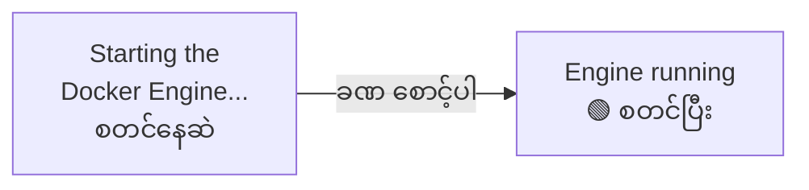

**Docker Desktop ကို မဖွင့်ထားရင် Docker ကို သုံးလို့ မရပါဘူး။**
PC ကို restart လုပ်ပြီးရင် အရင်ဆုံး Docker Desktop ကို ဖွင့်ပါ။

---

## 8. အလုပ်လုပ်မလုပ် စစ်ဆေးခြင်း

PowerShell（administrator မဟုတ်လည်း OK）ကို ဖွင့်ပြီး Docker ဗားရှင်းကို စစ်ဆေးပါ။

```powershell
docker --version
```

```
Docker version 28.x.x, build xxxxxxx
```

ဒီလို ပြရင် OK ပါတယ်（ဂဏန်းတွေက လူတိုင်း မတူနိုင်ပါ）။

နောက်တစ်ဆင့်မှာ လေ့ကျင့်ရန် **hello-world** image ကို run ကြည့်ပါမယ်။

```powershell
docker run hello-world
```

ဒီ command တစ်ခုတည်းနဲ့ Docker ဟာ အောက်ပါအရာတွေကို လုပ်ပေးနေပါတယ်။

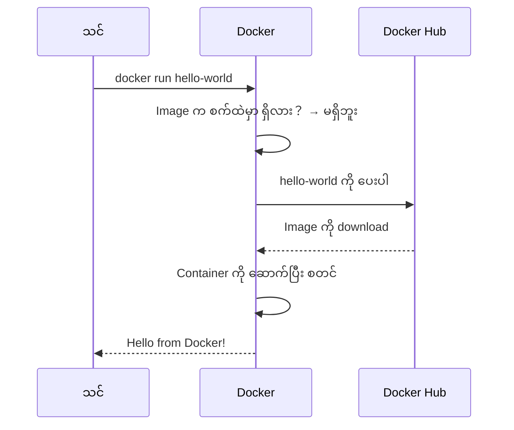

✅ အောက်ပါ message ပြရင် install အောင်မြင်ပါပြီ။

```
Hello from Docker!
This message shows that your installation appears to be working correctly.
```

`docker run hello-world` ကို နောက်တစ်ကြိမ် run ရင် ဒီတစ်ခါ download မဆွဲဘဲ ချက်ချင်း run ပါလိမ့်မယ်။
Image（recipe）က စက်ထဲမှာ ရှိပြီးသား ဖြစ်လို့ပါ။

Docker Desktop ရဲ့ ဘယ်ဘက်က `Containers` ကို ဖွင့်ရင် ခုနက run ခဲ့တဲ့ container ကို ပြနေပါလိမ့်မယ်။

---

## 9. လေ့ကျင့်ရေး environment ကို စတင်ခြင်း

[သင်ခန်းစာ 2](./20261008_資料_2.md) မှာ push လုပ်ခဲ့တဲ့ လေ့ကျင့်ရေး environment ကို Docker နဲ့ run ကြည့်ပါမယ်။
**မဖြစ်မနေ mysql → laravel အစီအစဉ်အတိုင်း** စတင်ပါ။

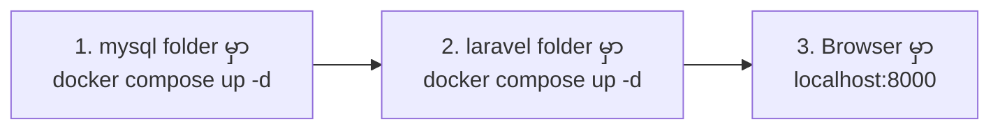

စတင်လိုက်ရင် container ၂ ခုဟာ အောက်ပါအတိုင်း ချိတ်ဆက်ပြီး အလုပ်လုပ်ပါတယ်။
laravel container က mysql container ကို သုံးတာမို့ mysql ကို အရင် စတင်ထားပါ။

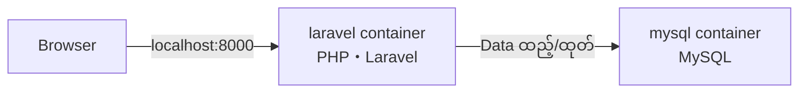

```powershell
cd C:\Users\<အသုံးပြုသူအမည်>\Desktop\php-study\mysql
docker compose up -d
```

```powershell
cd C:\Users\<အသုံးပြုသူအမည်>\Desktop\php-study\laravel
docker compose up -d
```

**ပထမဆုံးအကြိမ်မှာသာ** Laravel install လုပ်ဖို့ မိနစ်အနည်းငယ် ကြာပါတယ်။
`docker compose logs -f` နဲ့ တိုးတက်မှုကို ကြည့်နိုင်ပါတယ်（`Ctrl + C` နဲ့ ကြည့်တာကို ရပ်ပါ）။
`Server running on [http://0.0.0.0:8000]` လို့ ပြရင် အဆင်သင့် ဖြစ်ပါပြီ။

✅ Browser မှာ http://localhost:8000 ကို ဖွင့်ပြီး အောက်ပါ screen ပေါ်လာရင် OK ပါတယ်။


---

## 10. အဆင်မပြေတဲ့အခါ

| ဖြစ်ပုံ | ဖြေရှင်းနည်း |
|------|------|
| `docker` ကို ရှာမတွေ့ဘူးလို့ ပြော | Docker Desktop ဖွင့်ထားသလား စစ်ပါ → PowerShell ကို ပြန်ဖွင့်ပါ |
| `Engine stopped` အတိုင်း အလုပ်မလုပ် | Docker Desktop ကို ပိတ်ပြီး ပြန်ဖွင့်ပါ → မရရင် PC ကို restart လုပ်ပါ |
| WSL ဟောင်းနေတယ်လို့ ပြော（WSL update failed စသည်） | Administrator PowerShell မှာ `wsl --update` → PC ကို restart လုပ်ပါ |
| Virtualization ပိတ်ထားတယ်လို့ ပြော（Virtualization support not detected） | [4. ပြင်ဆင်မှုကို စစ်ဆေးခြင်း](#4-ပြင်ဆင်မှုကို-စစ်ဆေးခြင်း) ကို ကြည့်ပါ → ဆရာ/ဆရာမကို ခေါ်ပါ |
| `error during connect` ပေါ်လာ | Docker Engine စတင်နေဆဲ ဖြစ်ပါတယ်။ ဘယ်ဘက်အောက်မှာ `Engine running` ဖြစ်လာတဲ့အထိ စောင့်ပါ |

---

## 11. အနှစ်ချုပ်

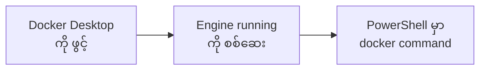

- **Image** က ပုံစံငယ်ဖြစ်ပြီး **container** က အဲဒီပုံစံငယ်ကနေ ဖန်တီးထားတဲ့ တကယ် အလုပ်လုပ်နိုင်တဲ့ environment ဖြစ်တယ်
- Docker ကို မသုံးခင် **Docker Desktop ကို ဖွင့်ထား** ပါ
- `docker run <image အမည်>` နဲ့ image download ဆွဲတာကနေ container စတင်တာအထိ တစ်ခါတည်း လုပ်နိုင်ပါတယ်

နောက်အတန်းမှာ Docker ကို သုံးပြီး PHP နဲ့ MySQL environment ကို ဆောက်ပါမယ်။

<!-- nav:start -->

---

| ⬅️ ယခင် | 🗺️ ခြုံငုံပုံ | နောက်တစ်ခု ➡️ |
|:--|:--:|--:|
| [10/08 လေ့ကျင့်ရေး environment ကို push လုပ်ခြင်း](20261008_資料_2.md) | [သင်ခန်းစာများ၏ ခြုံငုံပုံ](../../README.md) | [10/15 MVC အလုပ်လုပ်ပုံ](../20261015/20261015_資料_1.md) |

<!-- nav:end -->
