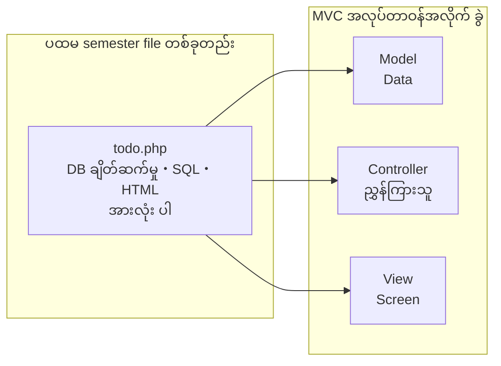
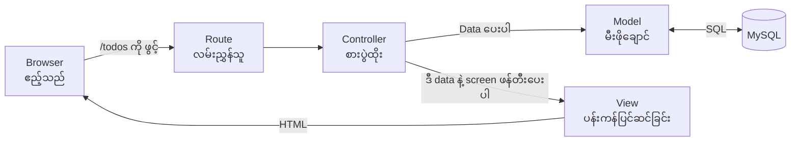
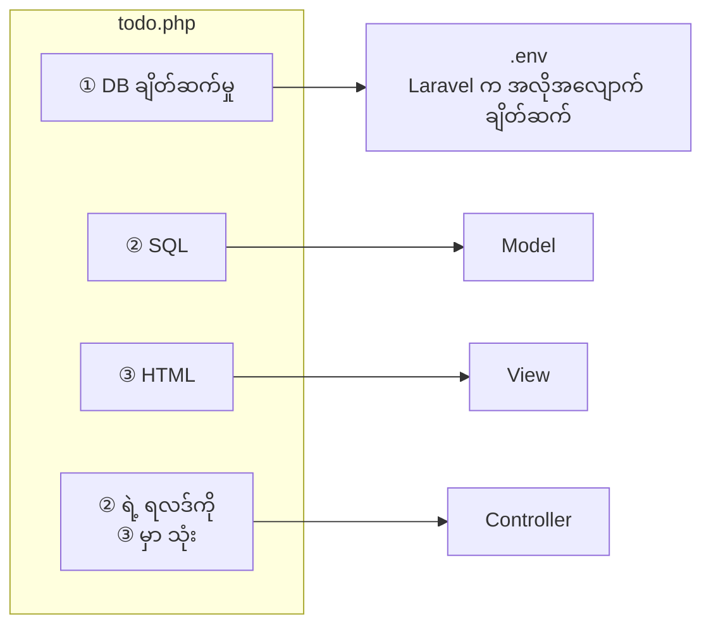
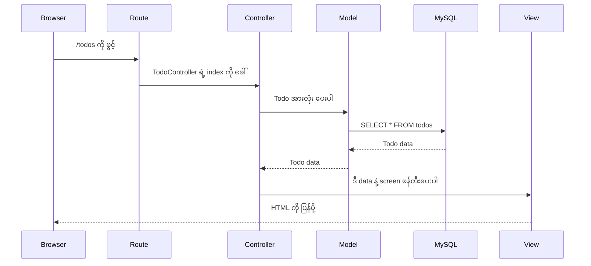
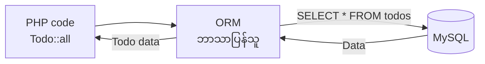
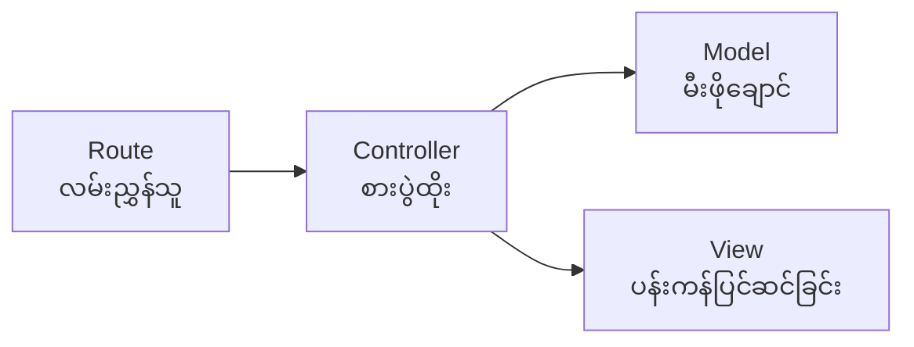

# Laravel မိတ်ဆက် — MVC အလုပ်လုပ်ပုံ

> 🇯🇵 မူရင်း (ဂျပန်ဘာသာဖြင့်): [20261015_資料_1.md](<../../../1年生_データ設計とアプリ開発/後期/20261015/20261015_資料_1.md>) <!-- original-ja-link -->

## ယနေ့ ပန်းတိုင်
- MVC（Model・View・Controller）တစ်ခုချင်းစီရဲ့ အလုပ်ကို နားလည်ရန်
- Laravel မှာ request တစ်ခုဟာ「Route → Controller → Model → View」အတိုင်း စီးဆင်းသွားတာကို နားလည်ရန်
- ORM ကို သုံးရင် SQL မရေးဘဲနဲ့ data ထည့်/ထုတ် လုပ်နိုင်တာကို နားလည်ရန်

---

## 1. ပထမ semester က todo.php ကို ပြန်ကြည့်ရအောင်

ပထမ semester မှာ ရေးခဲ့တဲ့ `todo.php` ဟာ **file တစ်ခုတည်းထဲမှာ အားလုံး** ရေးထားတာ ဖြစ်ပါတယ်။
စာရင်းပြတဲ့ အပိုင်းကိုပဲ ထုတ်ကြည့်ရင် ဒီလို ဖြစ်ပါတယ်။

```php
<?php
// ① Database ကို ချိတ်ဆက်
$pdo = new PDO('mysql:host=127.0.0.1;dbname=school_db;charset=utf8mb4', 'root', '');

// ② SQL နဲ့ Todo တွေကို ယူ
$stmt = $pdo->query("SELECT * FROM todos ORDER BY created_at DESC");
$todos = $stmt->fetchAll(PDO::FETCH_ASSOC);
?>
<!-- ③ HTML နဲ့ screen ကို ဖန်တီး -->
<ul>
<?php foreach ($todos as $todo): ?>
    <li><?= htmlspecialchars($todo['title']) ?></li>
<?php endforeach; ?>
</ul>
```

App သေးသေးလေးဆိုရင် ဒါနဲ့ အလုပ်လုပ်ပါတယ်။
ဒါပေမယ့် app ကြီးလာတဲ့အခါ ဒီလို ပြဿနာတွေ ဖြစ်လာပါတယ်။

```
A：「Screen ရဲ့ ပုံစံကိုပဲ ပြင်ချင်တာ၊ SQL တွေ ရောနေလို့ ဖတ်ရခက်တယ်…」
B：「SELECT တစ်ခုတည်းကို file အမျိုးမျိုးထဲ copy ကူးမိသွားပြီ」
C：「ဘယ်နေရာကို ပြင်ရမလဲ မသိဘူး」
```

အဲဒါကြောင့် **အလုပ်တာဝန်အလိုက် file တွေကို ခွဲထားတဲ့** စဉ်းစားပုံဟာ **MVC** ဖြစ်ပါတယ်။



---

## 2. MVC ဆိုတာ

MVC ဆိုတာ app ကို အလုပ်တာဝန် ၃ ခုအဖြစ် ခွဲတဲ့ စဉ်းစားပုံ ဖြစ်ပါတယ်။ စားသောက်ဆိုင်နဲ့ ဥပမာပေးပြီး မှတ်ကြရအောင်။

| နာမည် | အလုပ်တာဝန် | စားသောက်ဆိုင်နဲ့ ဥပမာပေးရရင် |
|------|------|------------------|
| **M**odel（Model） | Database ထဲက data ကို ထည့်/ထုတ် လုပ်တယ် | မီးဖိုချောင်（ပါဝင်ပစ္စည်းတွေကို ထုတ်ပေးတယ်） |
| **V**iew（View） | Screen（HTML）ကို ဖန်တီးတယ် | ပန်းကန်ပြင်ဆင်ခြင်း（ပန်းကန်ပေါ် တင်ပြီး ပြတယ်） |
| **C**ontroller（Controller） | Order ကို လက်ခံပြီး model နဲ့ view ကို ညွှန်ကြားတယ် | စားပွဲထိုး（မီးဖိုချောင်နဲ့ ပန်းကန်ပြင်ဆင်သူကို ချိတ်ဆက်ပေးတယ်） |

Laravel မှာ ဒီအပေါ်မှာ **Route**（ဘယ် URL ကို ဘယ် controller က တာဝန်ယူမလဲ）ဆိုတာ ထပ်ပါလာပါတယ်။
Route ဟာ ဆိုင်ရဲ့ **ဝင်ပေါက်က လမ်းညွှန်သူ** ဖြစ်ပါတယ်။



အဓိကအချက်က **controller ဟာ အလယ်မှာရှိပြီး အားလုံးကို ညွှန်ကြားတာ** ဖြစ်ပါတယ်။
View ဟာ ကိုယ်တိုင် model ဆီ data သွားမယူပါဘူး။ Data ကို controller ဆီကနေ လက်ခံရယူပါတယ်။

### ပထမ semester က todo.php ဟာ ဘယ်ကို ရောက်သွားမလဲ？

ခုနက `todo.php` ရဲ့ ①〜③ ဟာ MVC မှာ အောက်ပါအတိုင်း ခွဲသွားပါတယ်။



| todo.php ရဲ့ အပိုင်း | ရောက်သွားမယ့်နေရာ | ထားရှိမယ့်နေရာ |
|---------------|-------|---------|
| ① Database ကို ချိတ်ဆက် | Laravel က အလိုအလျောက် လုပ်ပေးတယ် | `.env`（setting file） |
| ② SQL နဲ့ Todo တွေကို ယူ | **Model** | `app/Models/Todo.php` |
| ③ HTML နဲ့ screen ကို ဖန်တီး | **View** | `resources/views/todos/index.blade.php` |
| ② ရဲ့ ရလဒ်ကို ③ ဆီ ပေးပို့ | **Controller** | `app/Http/Controllers/TodoController.php` |
| ဘယ် URL မှာ ဒီလုပ်ဆောင်ချက်ကို run မလဲ | **Route** | `routes/web.php` |

---

## 3. Request ရဲ့ စီးဆင်းပုံ

Browser မှာ `http://localhost:8000/todos` ကို ဖွင့်လိုက်တဲ့အခါ Laravel ထဲမှာ အောက်ပါ အစီအစဉ်အတိုင်း လုပ်ဆောင်သွားပါတယ်။



စားသောက်ဆိုင်နဲ့ ဥပမာပေးရရင် ဒီလို စီးဆင်းပါတယ်။

1. ဧည့်သည် ဆိုင်ထဲ ဝင်လာတယ်（browser မှာ `/todos` ကို ဖွင့်）
2. လမ်းညွှန်သူက တာဝန်ကျ စားပွဲထိုးဆီ ပို့ပေးတယ်（Route → Controller）
3. စားပွဲထိုးက မီးဖိုချောင်ကို ပါဝင်ပစ္စည်း တောင်းတယ်（Controller → Model）
4. မီးဖိုချောင်က ဂိုဒေါင်ထဲက ပါဝင်ပစ္စည်းတွေကို ထုတ်လာတယ်（Model → MySQL）
5. စားပွဲထိုးက ပါဝင်ပစ္စည်းတွေကို ပန်းကန်ပြင်ဆင်သူဆီ ပေးတယ်（Controller → View）
6. ဟင်းကို ဧည့်သည်ဆီ ချပေးတယ်（HTML က browser ဆီ ပြန်ရောက်）

---

## 4. ORM အလုပ်လုပ်ပုံ

### ORM ဆိုတာ

ပထမ semester မှာ `SELECT * FROM todos` လိုမျိုး **SQL statement ကို ကိုယ်တိုင် ရေးခဲ့** ပါတယ်။
Laravel မှာတော့ model ကို သုံးပြီး `Todo::all()` လို့ ရေးရုံနဲ့ data ကို ယူနိုင်ပါတယ်။

ဒါဟာ **ORM**（Object-Relational Mapping）ဆိုတဲ့ စနစ်ကြောင့် ဖြစ်ပါတယ်။
ORM ဟာ **PHP code ကို SQL အဖြစ် အလိုအလျောက် ဘာသာပြန်** ပြီး MySQL ဆီ ပို့ပေးပါတယ်။
Laravel ရဲ့ ORM ကို **Eloquent**（အီလိုကွမ့်）လို့ ခေါ်ပါတယ်။



စားသောက်ဆိုင်နဲ့ ဥပမာပေးရရင် မီးဖိုချောင်（model）ထဲမှာ **ဘာသာပြန်သူ（ORM）** ရှိပြီး စားပွဲထိုးရဲ့「Todo အားလုံး ပေးပါ」ဆိုတဲ့ order ကို ဂိုဒေါင်（MySQL）နားလည်တဲ့ ဘာသာစကား（SQL）အဖြစ် ပြောင်းပေးတယ်လို့ မြင်ကြည့်ပါ။

### ပထမ semester က SQL နဲ့ နှိုင်းယှဉ်ကြည့်ခြင်း

| လုပ်ချင်တာ | ပထမ semester（SQL ရေး） | Laravel（Eloquent） |
|------------|-----------------|-------------------|
| အားလုံး ယူမယ် | `SELECT * FROM todos` | `Todo::all()` |
| id 1 ဖြစ်တာကို ယူမယ် | `SELECT * FROM todos WHERE id = 1` | `Todo::find(1)` |
| မပြီးသေးတာတွေကိုပဲ ယူမယ် | `SELECT * FROM todos WHERE is_done = 0` | `Todo::where('is_done', 0)->get()` |

ယနေ့မှာတော့「SQL မရေးဘဲနဲ့ ဒီလို ရေးလို့ရတာပဲ」လို့ နားလည်ရင် OK ပါတယ်။

### SQL လေ့လာခဲ့တာ အလကား ဖြစ်သွားပြီလား？

**မဖြစ်ပါဘူး။** ORM ဟာ နောက်ကွယ်မှာ SQL ကို ဖန်တီးပြီး MySQL ဆီ ပို့နေတာပါ။
ကောင်းကောင်း အလုပ်မလုပ်တဲ့အခါ ဒါမှမဟုတ် ရှုပ်ထွေးတဲ့ data ကို ယူချင်တဲ့အခါ ပထမ semester မှာ သင်ယူခဲ့တဲ့ SQL အသိပညာက အသုံးဝင်ပါတယ်။

---

## 5. အနှစ်ချုပ်



| အလုပ်တာဝန် | တစ်ခွန်းတည်းနဲ့ |
|------|-----------|
| **Route** | ဘယ် URL ကို ဘယ် controller က တာဝန်ယူမလဲ ဆုံးဖြတ်တယ် |
| **Controller** | Model ဆီက data ကို ယူပြီး view ဆီ ပေးတယ် |
| **Model** | Database ထဲက data ကို ထည့်/ထုတ် လုပ်တယ်（ORM က SQL အဖြစ် ဘာသာပြန်ပေးတယ်） |
| **View** | Screen（HTML）ကို ဖန်တီးတယ် |

အလုပ်တာဝန်အလိုက် file တွေ ခွဲထားတာမို့「Screen ကို ပြင်ချင်ရင် view」「Data ယူပုံကို ပြင်ချင်ရင် model」ဆိုပြီး **ပြင်ရမယ့်နေရာကို ချက်ချင်း သိ** လာပါလိမ့်မယ်။

နောက်တစ်ဆင့်မှာ တကယ် MVC အဖြစ် ခွဲပြီး Todo စာရင်း page ကို ဖန်တီးပါမယ် → [Todo စာရင်းကို ဖန်တီးကြည့်ရအောင်](./20261015_資料_2.md)

<!-- nav:start -->

---

| ⬅️ ယခင် | 🗺️ ခြုံငုံပုံ | နောက်တစ်ခု ➡️ |
|:--|:--:|--:|
| [10/08 Docker မိတ်ဆက်](../20261008/20261008_資料_3.md) | [သင်ခန်းစာများ၏ ခြုံငုံပုံ](../../README.md) | [10/15 Todo စာရင်း](20261015_資料_2.md) |

<!-- nav:end -->
