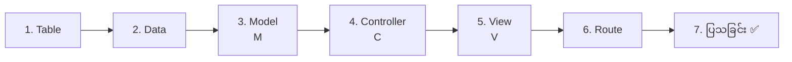
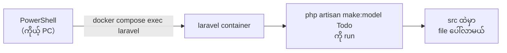
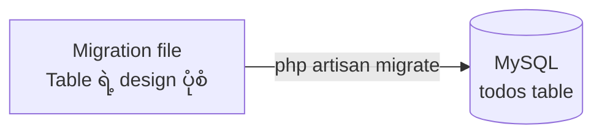
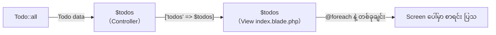
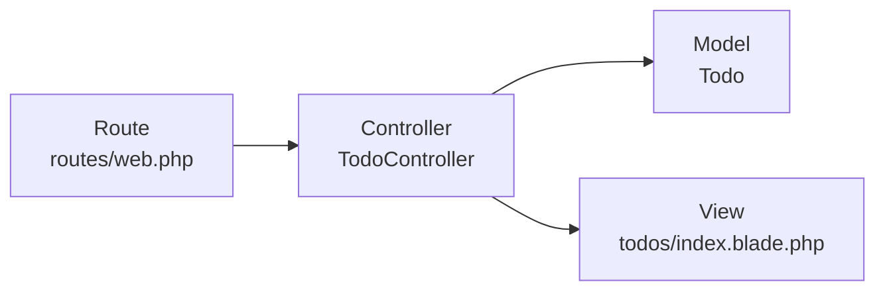

# Laravel မိတ်ဆက် — Todo စာရင်းကို ဖန်တီးကြည့်ရအောင်

> 🇯🇵 မူရင်း (ဂျပန်ဘာသာဖြင့်): [20261015_資料_2.md](<../../../1年生_データ設計とアプリ開発/後期/20261015/20261015_資料_2.md>) <!-- original-ja-link -->

[MVC အလုပ်လုပ်ပုံ](./20261015_資料_1.md) မှာ သင်ယူခဲ့တာတွေကို သုံးပြီး Todo စာရင်း page ကို ဖန်တီးပါမယ်။

## ယနေ့ ပန်းတိုင်
- Todo စာရင်း page ကို MVC အဖြစ် ခွဲပြီး ဖန်တီးနိုင်ရန်
- Migration・Model・Controller・View・Route တစ်ခုချင်းစီကို ဘယ်မှာ ရေးရမလဲ ဆိုတာ သိရန်

> လေ့ကျင့်ရေး environment（`php-study`）ရဲ့ mysql နဲ့ laravel ကို စတင်ပြီးမှ စပါမယ်။
> စတင်နည်းကို `php-study` folder ထဲက `README.md` မှာ ကြည့်ပါ။

ပထမ semester မှာ သုံးခဲ့တဲ့ `todos` table ကိုပဲ သုံးပြီး Todo စာရင်း page ကို ဖန်တီးပါမယ်။
File တွေကို `php-study\laravel\src` ထဲမှာ ဖန်တီးပါလိမ့်မယ်။

---

## 1. ဖန်တီးမယ့် အစီအစဉ်

**အလုပ်လုပ်တဲ့ အစီအစဉ်**（Route → Controller → Model → View）နဲ့ ပြောင်းပြန် **data ဘက်ကနေ** စပြီး ဖန်တီးသွားပါမယ်။
ပါဝင်ပစ္စည်း（table နဲ့ data）မရှိရင် ဟင်း（screen）ကို ချက်လို့ မရလို့ပါ။



---

## 2. Command ဖတ်နည်း

ယနေ့ အောက်ပါလို command တွေကို အကြိမ်ကြိမ် သုံးပါမယ်။
Command တွေကို PowerShell မှာ **laravel folder** ထဲ ရွှေ့ပြီးမှ run ပါ။

```powershell
cd C:\Users\<အသုံးပြုသူအမည်>\Desktop\php-study\laravel
```

```powershell
docker compose exec laravel php artisan make:model Todo
```

ရှည်ပုံရပေမယ့် အပိုင်း ၂ ပိုင်း ခွဲထားပါတယ်။

| အပိုင်း | အဓိပ္ပာယ် |
|------|------|
| `docker compose exec laravel` | 「laravel container ထဲမှာ နောက်က command ကို run ပေးပါ」 |
| `php artisan make:model Todo` | 「Todo ဆိုတဲ့ နာမည်နဲ့ model ကို ဖန်တီးပေးပါ」 |

ကိုယ့် PC ရဲ့ PowerShell ကနေ container ထဲကို command ပို့ပြီး run ခိုင်းတယ်လို့ မြင်ကြည့်ပါ။
Container ထဲမှာ ဖန်တီးထားတဲ့ file တွေဟာ ကိုယ့် PC ရဲ့ `src` folder ထဲမှာ ပေါ်လာပါတယ်။



**artisan**（အာတီဇန်）ဆိုတာ Laravel မှာ ပါလာတဲ့ **အကူအညီပေး command** ဖြစ်ပါတယ်။
`make:〇〇` နဲ့ file ရဲ့ အခြေခံပုံစံ（template）ကို အလိုအလျောက် ဖန်တီးပေးပါတယ်။

---

## 3. ဖန်တီးကြည့်ရအောင်

ယနေ့ ဖန်တီးမယ့်・ပြင်ရေးမယ့် file တွေက အောက်ပါ ၅ ခု ဖြစ်ပါတယ်（`src` ထဲမှာ）။

```
src/
├─ routes/
│   └─ web.php ······························ 6. Route（ထပ်ရေး）
├─ app/
│   ├─ Http/Controllers/
│   │   └─ TodoController.php ··············· 4. Controller
│   └─ Models/
│       └─ Todo.php ························· 3. Model
├─ resources/views/
│   └─ todos/
│       └─ index.blade.php ·················· 5. View
└─ database/migrations/
    └─ 2026_10_15_xxxxxx_create_todos_table.php ··· 1. Table
```

### 1. Table ဖန်တီးခြင်း（Migration）

> အခု ဒီမှာ：**🟢 1. Table** → 2. Data → 3. Model → 4. Controller → 5. View → 6. Route → 7. ပြသခြင်း

**Migration** ဆိုတာ table ရဲ့ design ပုံစံကို PHP နဲ့ ရေးထားတဲ့ file ဖြစ်ပါတယ်။
ပထမ semester မှာ SQL ရဲ့ `CREATE TABLE` နဲ့ table ဖန်တီးခဲ့ပေမယ့် Laravel မှာတော့ ဒီ file ကနေ ဖန်တီးပါတယ်။

အောက်ပါ command နဲ့ migration file ကို ဖန်တီးပါ။

```powershell
docker compose exec laravel php artisan make:migration create_todos_table
```

နာမည်ကို `create_〇〇_table` လို့ ပေးရင် Laravel က table အမည် `todos` ကို ဖတ်ယူပြီး template ကို ဖန်တီးပေးပါတယ်။

`database/migrations/` ထဲမှာ `2026_10_15_123456_create_todos_table.php` လိုမျိုး **ရက်စွဲပါတဲ့ file** ပေါ်လာပါလိမ့်မယ်။
ဖွင့်ပြီး `up()` ထဲကို အောက်ပါအတိုင်း ရေးပါ။

```php
public function up(): void
{
    Schema::create('todos', function (Blueprint $table) {
        $table->id();
        $table->string('title');
        $table->boolean('is_done')->default(false);
        $table->timestamps();
    });
}
```

ပထမ semester က `CREATE TABLE` နဲ့ နှိုင်းယှဉ်ကြည့်ရအောင်။ လုပ်ဆောင်ချက်တူတာကို PHP နဲ့ ရေးထားတာပါ။

| ပထမ semester က SQL | Migration |
|----------|----------------|
| `id INT AUTO_INCREMENT PRIMARY KEY` | `$table->id();`（တိတိကျကျပြောရရင် INT ထက် ပိုကြီးတဲ့ ဂဏန်းအထိ ထည့်နိုင်တဲ့ `BIGINT UNSIGNED` ဖြစ်ပါတယ်） |
| `title VARCHAR(255) NOT NULL` | `$table->string('title');` |
| `is_done TINYINT(1) NOT NULL DEFAULT 0` | `$table->boolean('is_done')->default(false);` |
| `created_at TIMESTAMP ...` | `$table->timestamps();`（`created_at` နဲ့ `updated_at` ၂ ခု ဖန်တီးပေးတယ်။ တန်ဖိုးကို Laravel က အလိုအလျောက် ထည့်ပေးတယ်） |

Save လုပ်ပြီးရင် migration ကို run ပြီး table ကို ဖန်တီးပါ။

အဲဒီမတိုင်ခင် **`todos` table မရှိသေးတာကို** စစ်ဆေးထားရအောင်။
File ကို ရေးရုံနဲ့ table ကို မဖန်တီးရသေးပါဘူး။

👀 **မ run ခင် ကြည့်ထားပါ**：phpMyAdmin（http://localhost:8080）မှာ ဘယ်ဘက်က စာရင်းကနေ `laravel` database ကို ဖွင့်ပါ။
Table စာရင်းထဲမှာ `todos` က **မရှိသေးဘူး** ဆိုတာ စစ်ဆေးပါ။



```powershell
docker compose exec laravel php artisan migrate
```

✅ **စစ်ဆေးခြင်း**：phpMyAdmin（http://localhost:8080）ရဲ့ `laravel` database ထဲမှာ `todos` table ဖန်တီးပြီးသား ဖြစ်နေရင် OK ပါတယ်။

---

### 2. Data ထည့်ခြင်း

> အခု ဒီမှာ：1. Table → **🟢 2. Data** → 3. Model → 4. Controller → 5. View → 6. Route → 7. ပြသခြင်း

phpMyAdmin မှာ `todos` table ကို ဖွင့်ပြီး Insert (`挿入`) ကနေ Todo ၂〜၃ ခု ထည့်ထားပါ။
`id`・`created_at`・`updated_at` ကို အလွတ်အတိုင်း ထားလို့ ရပါတယ်။

| title | is_done |
|-------|---------|
| 牛乳を買う | 0 |
| レポートを出す | 1 |

✅ **စစ်ဆေးခြင်း**：Browse (`表示`) tab မှာ ထည့်ခဲ့တဲ့ data ကို မြင်ရရင် OK ပါတယ်။ `牛乳を買う` က 「နို့ဝယ်ရန်」၊ `レポートを出す` က 「အစီရင်ခံစာ တင်ရန်」 လို့ အဓိပ္ပာယ်ရပါတယ်။

---

### 3. Model ဖန်တီးခြင်း（M）

> အခု ဒီမှာ：1. Table → 2. Data → **🟢 3. Model** → 4. Controller → 5. View → 6. Route → 7. ပြသခြင်း

Table ရှိပြီဆိုတော့ အဲဒီ table ရဲ့ data ကို ထည့်/ထုတ် လုပ်မယ့် **model**（မီးဖိုချောင်）ကို ဖန်တီးပါမယ်။

```powershell
docker compose exec laravel php artisan make:model Todo
```

`app/Models/Todo.php` ပေါ်လာပါလိမ့်မယ်။ ဖွင့်ကြည့်ရင် ဘာမှ သိပ်မရေးထားပါဘူး။

```php
class Todo extends Model
{
    //
}
```

**ဒါနဲ့ ပြီးပါပြီ။ ဘာမှ ထပ်ရေးစရာ မလိုပါဘူး။**
Laravel က model အမည် `Todo` ကနေ **table အမည် `todos`** ကို အလိုအလျောက် ဆုံးဖြတ်ပေးတာမို့ ဒါလောက်နဲ့ data ထည့်/ထုတ် လုပ်နိုင်ပါတယ်။

| Model အမည်（အနည်းကိန်း・စာလုံးကြီးနဲ့ စ） | Table အမည်（အများကိန်း・စာလုံးသေး） |
|------------------|------------------|
| `Todo` | `todos` |
| `User` | `users` |

Model ကို သုံးရင် **SQL statement ကို ကိုယ်တိုင် မရေးဘဲနဲ့** data ထည့်/ထုတ် လုပ်နိုင်ပါတယ်။
ဒါဟာ **ORM** ဆိုတဲ့ စနစ်ကြောင့် ဖြစ်ပါတယ် → [ORM အလုပ်လုပ်ပုံ](./20261015_資料_1.md#4-orm-အလုပ်လုပ်ပုံ)

> **`-m` ထည့်ရင် တစ်ခါတည်း ဖန်တီးနိုင်တယ်**
> `php artisan make:model Todo -m` လို့ ရေးရင် model နဲ့ migration ကို တစ်ကြိမ်တည်းနဲ့ ဖန်တီးနိုင်ပါတယ်။
> ယနေ့မှာတော့ အလုပ်တာဝန်တွေကို ခွဲခြားနားလည်ဖို့ သီးခြားစီ ဖန်တီးခဲ့ပါတယ်။

---

### 4. Controller ဖန်တီးခြင်း（C）

> အခု ဒီမှာ：1. Table → 2. Data → 3. Model → **🟢 4. Controller** → 5. View → 6. Route → 7. ပြသခြင်း

Model（မီးဖိုချောင်）နဲ့ view（ပန်းကန်ပြင်ဆင်ခြင်း）ကို ချိတ်ဆက်ပေးမယ့် **controller**（စားပွဲထိုး）ကို ဖန်တီးပါမယ်။

```powershell
docker compose exec laravel php artisan make:controller TodoController
```

`app/Http/Controllers/TodoController.php` ပေါ်လာမှာမို့ အထဲက အကြောင်းအရာကို အောက်ပါအတိုင်း ပြင်ရေးပါ။

```php
<?php

namespace App\Http\Controllers;

use App\Models\Todo;  // ← Todo model ကို သုံးဖို့ လိုင်း ၁ ကြောင်း

class TodoController extends Controller
{
    public function index()
    {
        // ① Model ကို「Todo အားလုံး ပေးပါ」လို့ တောင်းဆိုတယ်
        $todos = Todo::all();

        // ② View ကို「ဒီ data နဲ့ screen ဖန်တီးပေးပါ」လို့ တောင်းဆိုတယ်
        return view('todos.index', ['todos' => $todos]);
    }
}
```

| Code | အဓိပ္ပာယ် |
|--------|------|
| `Todo::all()` | `SELECT * FROM todos` နဲ့ အတူတူပါပဲ။ SQL ရေးစရာ မလိုဘူး |
| `view('todos.index', ...)` | `resources/views/todos/index.blade.php` ကို သုံးပြီး screen ဖန်တီးတယ်（`.` က folder ခွဲတဲ့ သင်္ကေတ） |
| `['todos' => $todos]` | View ထဲမှာ `$todos` ဆိုတဲ့ နာမည်နဲ့ သုံးနိုင်အောင် လုပ်ပေးတယ် |

Data ကို အောက်ပါအတိုင်း controller ကနေ view ဆီ ပေးပို့ပါတယ်။



ပထမ semester က `todo.php` နဲ့ နှိုင်းယှဉ်ကြည့်ရင် ② ရဲ့ လိုင်း ၂ ကြောင်းဟာ `Todo::all()` လိုင်း ၁ ကြောင်းတည်း ဖြစ်သွားပါတယ်။

```php
// ပထမ semester
$stmt = $pdo->query("SELECT * FROM todos");
$todos = $stmt->fetchAll(PDO::FETCH_ASSOC);

// Laravel
$todos = Todo::all();
```

---

### 5. View ဖန်တီးခြင်း（V）

> အခု ဒီမှာ：1. Table → 2. Data → 3. Model → 4. Controller → **🟢 5. View** → 6. Route → 7. ပြသခြင်း

Screen ကို ဖန်တီးမယ့် **view**（ပန်းကန်ပြင်ဆင်ခြင်း）ကို ဖန်တီးပါမယ်။ View ကို command နဲ့ မဟုတ်ဘဲ file ကို ကိုယ်တိုင် ဖန်တီးပါ။

1. `resources/views` ထဲမှာ `todos` folder ကို ဖန်တီးပါ
2. `todos` folder ထဲမှာ `index.blade.php` ဆိုတဲ့ file ကို ဖန်တီးပါ

```
resources/views/
  └─ todos/
       └─ index.blade.php   ← ဒီမှာ ရေးပါ
```

```html
<!DOCTYPE html>
<html lang="ja">
<head>
    <meta charset="UTF-8">
    <title>TODOアプリ</title>
</head>
<body>
    <h1>TODOアプリ</h1>

    <ul>
        @foreach ($todos as $todo)
            <li>
                <input type="checkbox" @checked($todo->is_done)>
                {{ $todo->title }}
            </li>
        @endforeach
    </ul>
</body>
</html>
```

**Blade**（ဘလိတ်）ဆိုတာ Laravel ရဲ့ HTML ရေးနည်း ဖြစ်ပါတယ်။ ပထမ semester က PHP ထက် တိုတိုရေးနိုင်ပါတယ်။

| Blade | ပထမ semester က PHP နဲ့ ရေးရင် |
|-------|-----------------|
| `{{ $todo->title }}` | `<?= htmlspecialchars($todo['title']) ?>` |
| `@foreach (...)` 〜 `@endforeach` | `<?php foreach (...): ?>` 〜 `<?php endforeach; ?>` |
| `@checked($todo->is_done)` | `<?= $todo['is_done'] ? 'checked' : '' ?>` |

- `{{ }}` က `htmlspecialchars` ကို အလိုအလျောက် လုပ်ပေးတာမို့ လုံခြုံပါတယ်
- ပထမ semester မှာ `$todo['title']` လို့ ရေးခဲ့ပေမယ့် model ရဲ့ data ကို **`$todo->title`**（မြှား）နဲ့ ထုတ်ယူပါတယ်
- `@checked(...)` က `( )` ထဲက တန်ဖိုး ပြီးဆုံး（`1`）ဖြစ်တဲ့အခါမှသာ checkbox မှာ `checked` ထည့်ပေးပါတယ်
- Checkbox ကို နှိပ်လို့ ရပေမယ့် ယနေ့မှာတော့ **database ထဲ မသိမ်းသေးပါဘူး**（page ကို reload လုပ်ရင် မူလအတိုင်း ပြန်ဖြစ်သွားပါတယ်）။ နှိပ်ရင် သိမ်းအောင် လုပ်တာကို 10/29 မှာ လုပ်ပါမယ်

---

### 6. Route ရေးခြင်း

> အခု ဒီမှာ：1. Table → 2. Data → 3. Model → 4. Controller → 5. View → **🟢 6. Route** → 7. ပြသခြင်း

နောက်ဆုံးအနေနဲ့「`/todos` ကို ဖွင့်ရင် ဘယ် controller ကို run မလဲ」ဆိုတာကို **route**（လမ်းညွှန်သူ）ကို ပြောပြပါမယ်။

`routes/web.php` ကို ဖွင့်ပြီး ★ ပါတဲ့ လိုင်း ၂ ကြောင်းကို ထပ်ရေးပါ။

```php
<?php

use Illuminate\Support\Facades\Route;
use App\Http\Controllers\TodoController;  // ★ ထပ်ထည့်（အပေါ်ပိုင်းမှာ ရေးပါ）

Route::get('/', function () {
    return view('welcome');
});

Route::get('/todos', [TodoController::class, 'index']);  // ★ ထပ်ထည့်（အောက်ဆုံးမှာ ရေးပါ）
```

`Route::get('/todos', [TodoController::class, 'index']);` ရဲ့ အဓိပ္ပာယ်က အောက်ပါအတိုင်း ဖြစ်ပါတယ်။

```
Route::get( '/todos' ,  [TodoController::class, 'index'] );
             ~~~~~~~     ~~~~~~~~~~~~~~~~~~~~~  ~~~~~~~
             ဒီ URL ကို    TodoController ရဲ့     index က တာဝန်ယူပါ
             ဖွင့်ရင်
```

---

### 7. ပြသခြင်း ✅

> အခု ဒီမှာ：1. Table → 2. Data → 3. Model → 4. Controller → 5. View → 6. Route → **🟢 7. ပြသခြင်း**

Browser မှာ http://localhost:8000/todos ကို ဖွင့်ပါ။
phpMyAdmin မှာ ထည့်ခဲ့တဲ့ Todo တွေ စာရင်းအဖြစ် ပြရင် အောင်မြင်ပါပြီ။

```
TODOアプリ

☐ 牛乳を買う
☑ レポートを出す
```

`TODOアプリ` က 「Todo အက်ပ်」 လို့ အဓိပ္ပာယ်ရပါတယ်။ ပြီးစီးပြီးသား Todo（`is_done` က `1`）မှာ အမှန်ခြစ် ပါနေပါတယ်။

✅ **စစ်ဆေးခြင်း**：phpMyAdmin မှာ Todo ၁ ခု ထပ်ထည့်ပြီး browser ကို reload လုပ်ကြည့်ပါ။ ထပ်ထည့်ခဲ့တဲ့ Todo ပေါ်လာရင် database ကနေ မှန်မှန်ကန်ကန် ယူနိုင်နေပါပြီ။

---

## 4. အဆင်မပြေတဲ့အခါ

Error screen ရဲ့ အပေါ်ဆုံးမှာ ပြထားတဲ့ အင်္ဂလိပ်စာကို ဖတ်ရင် ဘယ်နေရာ မှားနေလဲ သိနိုင်ပါတယ်။

| ဖြစ်ပုံ | အကြောင်းရင်း ရှိတဲ့နေရာ | ဖြေရှင်းနည်း |
|------|----------|------|
| `404 Not Found` | Route | `routes/web.php` မှာ route ရေးခဲ့သလား၊ URL က `/todos` ဖြစ်နေသလား စစ်ပါ |
| `Target class [TodoController] does not exist` | Route | `web.php` ရဲ့ အပေါ်မှာ `use App\Http\Controllers\TodoController;` ရှိသလား စစ်ပါ |
| `Class "App\Http\Controllers\Todo" not found` | Controller | `TodoController.php` ရဲ့ အပေါ်မှာ `use App\Models\Todo;` ရှိသလား စစ်ပါ |
| `View [todos.index] not found` | View | File ရဲ့ နေရာက `resources/views/todos/index.blade.php` ဖြစ်နေသလား စစ်ပါ（`.blade.php` အထိ လိုပါတယ်） |
| `Table 'laravel.todos' doesn't exist` | Table | `php artisan migrate` ကို run ခဲ့သလား စစ်ပါ |
| စာရင်းမှာ ဘာမှ မပေါ် | Data | phpMyAdmin မှာ `todos` table ထဲ data ထည့်ထားသလား စစ်ပါ |

---

## 5. အနှစ်ချုပ်



| အလုပ်တာဝန် | ယနေ့ ရေးခဲ့တာ | တစ်ခွန်းတည်းနဲ့ |
|------|--------------|-----------|
| **Route** | `Route::get('/todos', ...)` | ဘယ် URL ကို ဘယ် controller က တာဝန်ယူမလဲ ဆုံးဖြတ်တယ် |
| **Controller** | `TodoController` ရဲ့ `index()` | Model ဆီက data ကို ယူပြီး view ဆီ ပေးတယ် |
| **Model** | `Todo`（`Todo::all()`） | Database ထဲက data ကို ထည့်/ထုတ် လုပ်တယ် |
| **View** | `todos/index.blade.php` | Screen ကို ဖန်တီးတယ်（Blade နဲ့ ရေးတယ်） |

အလုပ်တာဝန်အလိုက် file တွေ ခွဲထားတာမို့ **ပြင်ရမယ့်နေရာကို ချက်ချင်း သိ** လာပါလိမ့်မယ်။

<!-- nav:start -->

---

| ⬅️ ယခင် | 🗺️ ခြုံငုံပုံ | နောက်တစ်ခု ➡️ |
|:--|:--:|--:|
| [10/15 MVC အလုပ်လုပ်ပုံ](20261015_資料_1.md) | [သင်ခန်းစာများ၏ ခြုံငုံပုံ](../../README.md) | [10/22 Todo ထည့်ခြင်း（CREATE）](../20261022/20261022_資料_1.md) |

<!-- nav:end -->
