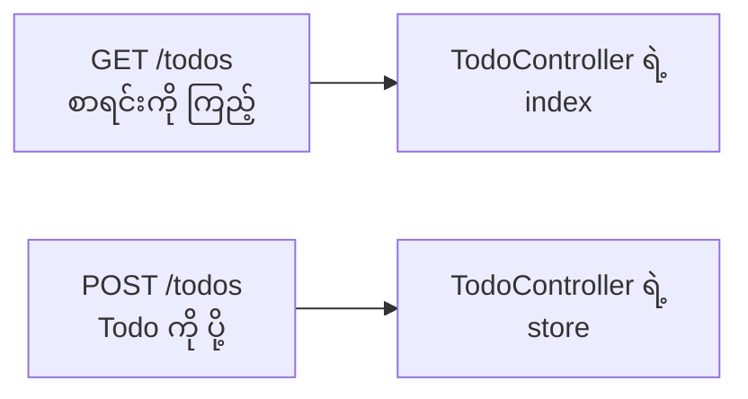
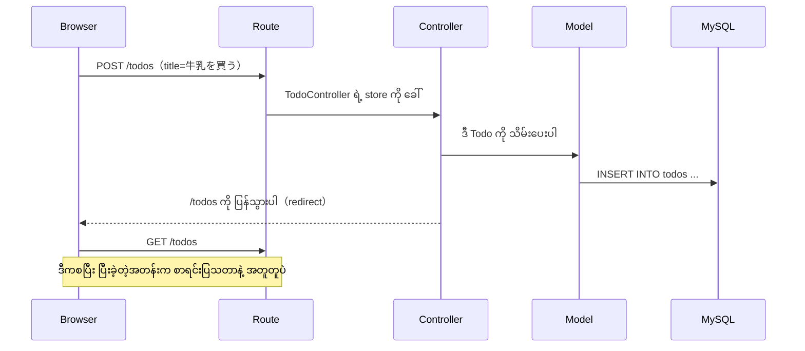
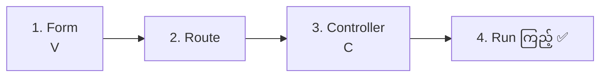
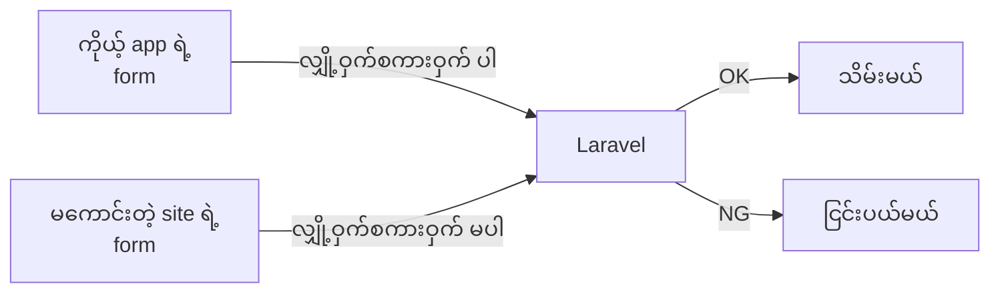
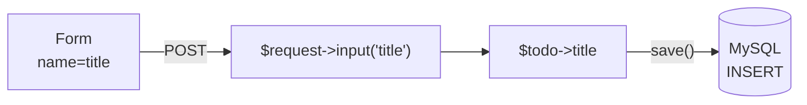
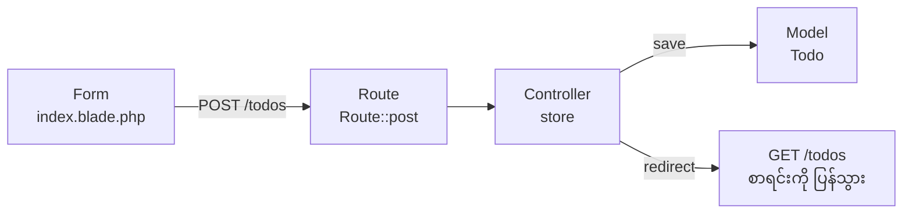

# Laravel မိတ်ဆက် — Todo ထည့်ကြရအောင်（CREATE）

> 🇯🇵 မူရင်း (ဂျပန်ဘာသာဖြင့်): [20261022_資料_1.md](<../../../1年生_データ設計とアプリ開発/後期/20261022/20261022_資料_1.md>) <!-- original-ja-link -->

[ပြီးခဲ့တဲ့အတန်း](../20261015/20261015_資料_2.md) မှာ ဖန်တီးခဲ့တဲ့ Todo စာရင်းထဲကို **form ကနေ Todo ထည့်တဲ့ function** ကို ထပ်ထည့်ပါမယ်။

## ယနေ့ ပန်းတိုင်
- GET နဲ့ POST ရဲ့ ကွာခြားချက်ကို နားလည်ရန်
- Form ကနေ ပို့လိုက်တဲ့ data ကို controller မှာ လက်ခံပြီး database ထဲ သိမ်းနိုင်ရန်
- သိမ်းပြီးနောက် စာရင်း page ကို ပြန်ပို့（redirect လုပ်）နိုင်ရန်

> လေ့ကျင့်ရေး environment（`php-study`）ရဲ့ mysql နဲ့ laravel ကို စတင်ပြီးမှ စပါမယ်။
> ပြီးခဲ့တဲ့အတန်းမှာ ဖန်တီးခဲ့တဲ့ `/todos` စာရင်း page ကို ပြနိုင်တဲ့ အခြေအနေကနေ စပါမယ်။

---

## 1. GET နဲ့ POST

Browser ကနေ server ဆီ တောင်းဆိုမှု（request）မှာ အမျိုးအစားတွေ ရှိပါတယ်။ ယနေ့ သုံးမှာက အောက်ပါ ၂ ခု ဖြစ်ပါတယ်။

| အမျိုးအစား | သုံးတဲ့အခါ | ဥပမာပေးရရင် |
|------|---------|-----------|
| **GET** | Page ကို **ကြည့်** တဲ့အခါ（URL ဖွင့်တာ・link နှိပ်တာ） | Menu ကို ပြခိုင်းတာ |
| **POST** | Data ကို **ပို့** တဲ့အခါ（form ရဲ့ submit ခလုတ်） | Order စာရွက်ကို ပေးတာ |

ပြီးခဲ့တဲ့အတန်းမှာ ဖန်တီးခဲ့တာက「Todo ကို ကြည့်တဲ့」page ဖြစ်လို့ **GET** ဖြစ်ပါတယ်။
ယနေ့ ဖန်တီးမှာက「Todo ကို ပို့ပြီး သိမ်းတဲ့」function ဖြစ်လို့ **POST** ကို သုံးပါမယ်။

Laravel မှာ **URL တူတူပဲ ဖြစ်ပေမယ့် GET နဲ့ POST အတွက် မတူတဲ့ လုပ်ဆောင်ချက်** ကို တာဝန်ပေးနိုင်ပါတယ်။



> **ပထမ semester က todo.php မှာဆိုရင်？**
> ပထမ semester မှာ file တစ်ခုတည်းထဲမှာ `<input type="hidden" name="action" value="create">` ကို သုံးပြီး「ဘယ်လုပ်ဆောင်ချက်လဲ」ဆိုတာ ခွဲခြားခဲ့ပါတယ်။
> Laravel မှာတော့ **URL နဲ့ GET/POST ရဲ့ ပေါင်းစပ်မှု** နဲ့ ဘယ် method ကို run မလဲ ဆုံးဖြတ်ပါတယ်။

---

## 2. ယနေ့ရဲ့ စီးဆင်းပုံ

Form ရဲ့ submit ခလုတ်ကို နှိပ်လိုက်ရင် အောက်ပါ အစီအစဉ်အတိုင်း လုပ်ဆောင်သွားပါတယ်။



အဓိကအချက်က နောက်ဆုံးက **redirect** ဖြစ်ပါတယ်။
သိမ်းပြီးတဲ့အခါ controller က screen မဖန်တီးဘဲ「စာရင်း page（`/todos`）ကို ပြန်ဖွင့်ပါ」လို့ browser ကို ပြန်ပြောပါတယ်။
Browser က စာရင်းကို ပြန်ဖွင့်တာမို့ ထည့်ခဲ့တဲ့ Todo က စာရင်းထဲမှာ ပေါ်လာပါတယ်။

> **ပထမ semester က todo.php မှာလည်း လုပ်ခဲ့တယ်**
> ပထမ semester မှာ `header('Location: index.php');` နဲ့ အတူတူ လုပ်ခဲ့ပါတယ်（PRG pattern）။
> Reload လုပ်ရင်တောင် Todo တစ်ခုတည်း နှစ်ခါ မှတ်ပုံမတင်မိအောင် ဖြစ်ပါတယ်။

---

## 3. ဖန်တီးကြည့်ရအောင်

ဒီတစ်ခါ table ရော model ရော ရှိပြီးသားမို့ **အလုပ်လုပ်တဲ့ အစီအစဉ်**（View → Route → Controller）အတိုင်း ဖန်တီးသွားပါမယ်။



ပြင်ရမယ့် file တွေက အောက်ပါ ၃ ခု ဖြစ်ပါတယ်（`src` ထဲမှာ）။ Model `Todo.php` ကိုတော့ ယနေ့ ပြင်မရေးပါဘူး။

```
src/
├─ resources/views/todos/
│   └─ index.blade.php ················ 1. Form ကို ထပ်ရေး
├─ routes/
│   └─ web.php ························ 2. POST route ကို ထပ်ရေး
└─ app/Http/Controllers/
    └─ TodoController.php ············· 3. store method ကို ထပ်ရေး
```

---

### 1. Form ဖန်တီးခြင်း（V）

> အခု ဒီမှာ：**🟢 1. Form** → 2. Route → 3. Controller → 4. Run ကြည့်

`resources/views/todos/index.blade.php` ကို ဖွင့်ပြီး `<h1>` ရဲ့ အောက်တည့်တည့်မှာ ★ ပါတဲ့ form ကို ထပ်ရေးပါ။ `TODOアプリ` က「Todo အက်ပ်」၊ `新しいTODOを入力` က「Todo အသစ်ကို ရိုက်ထည့်ပါ」၊ `追加` က「ထည့်မယ်」လို့ အဓိပ္ပာယ်ရပါတယ်။

```html
<!DOCTYPE html>
<html lang="ja">
<head>
    <meta charset="UTF-8">
    <title>TODOアプリ</title>
</head>
<body>
    <h1>TODOアプリ</h1>

    {{-- ★ ဒီကစပြီး ထပ်ထည့် --}}
    <form method="POST" action="/todos">
        @csrf
        <input type="text" name="title" placeholder="新しいTODOを入力" required>
        <button type="submit">追加</button>
    </form>
    {{-- ★ ဒီအထိ --}}

    <ul>
        @foreach ($todos as $todo)
            <li>
                <input type="checkbox" @checked($todo->is_done)>
                {{ $todo->title }}
            </li>
        @endforeach
    </ul>
</body>
</html>
```

| Code | အဓိပ္ပာယ် |
|--------|------|
| `method="POST"` | POST နဲ့ ပို့တယ် |
| `action="/todos"` | `/todos` ကို ပို့တယ် |
| `name="title"` | `title` ဆိုတဲ့ နာမည်နဲ့ ပို့တယ်။ Controller မှာ ဒီနာမည်ကို သုံးပြီး လက်ခံတယ် |
| `required` | အလွတ်အတိုင်းဆိုရင် ပို့လို့ မရအောင် လုပ်တယ် |
| `@csrf` | အောက်မှာ ရှင်းပြမယ့်「လျှို့ဝှက်စကားဝှက်」ကို ထည့်တယ် |
| `{{-- --}}` | Blade ရဲ့ comment။ Screen ပေါ်မှာ မပေါ်ဘူး |

#### `@csrf` ဆိုတာ ဘာလဲ？

`@csrf` ဆိုတာ form ထဲကို **လျှို့ဝှက်စကားဝှက်（CSRF token）** ကို တိတ်တဆိတ် ထည့်ပေးတဲ့ ရေးနည်း ဖြစ်ပါတယ်။
Browser မှာ「Page source ကို ကြည့်ခြင်း」(View page source) လုပ်ကြည့်ရင် အောက်ပါလို လိုင်း ၁ ကြောင်း ဖြစ်သွားတာကို တွေ့ရပါမယ်။

```html
<input type="hidden" name="_token" value="ကျပန်း စာလုံးတန်း">
```

Laravel က POST ရောက်လာတဲ့အခါ လျှို့ဝှက်စကားဝှက်ကို စစ်ဆေးပါတယ်။
ဒါနဲ့ **မကောင်းတဲ့ site က သင့် app ဆီကို form ကို ခွင့်မပြုဘဲ ပို့တဲ့ တိုက်ခိုက်မှု（CSRF）** ကို ကာကွယ်နိုင်ပါတယ်။



**POST form မှာ `@csrf` ကို မဖြစ်မနေ ရေးရမယ်** လို့ မှတ်ထားပါ။

> **`@csrf` မေ့သွားရင်တောင် အလုပ်လုပ်နေတတ်တယ်**
> Laravel 13 ဟာ လျှို့ဝှက်စကားဝှက်အပြင်「site တစ်ခုတည်းကနေ ပို့တာလား」ဆိုတာကိုလည်း browser နဲ့ စစ်ဆေးပါတယ်။
> ဒါကြောင့် လေ့ကျင့်ရေး environment（`localhost`）မှာ `@csrf` မေ့သွားရင်တောင် အလုပ်လုပ်နေတတ်ပါတယ်။
> ဒါပေမယ့် အများသုံး server ရဲ့ environment ပေါ် မူတည်ပြီး လျှို့ဝှက်စကားဝှက်နဲ့ပဲ ဆုံးဖြတ်တာမို့ **အလုပ်လုပ်နေရင်တောင် မဖြစ်မနေ ရေးပါ**။

---

### 2. Route ရေးခြင်း

> အခု ဒီမှာ：1. Form → **🟢 2. Route** → 3. Controller → 4. Run ကြည့်

`routes/web.php` ကို ဖွင့်ပြီး ★ ပါတဲ့ လိုင်း ၁ ကြောင်းကို ထပ်ရေးပါ။

```php
<?php

use Illuminate\Support\Facades\Route;
use App\Http\Controllers\TodoController;

Route::get('/', function () {
    return view('welcome');
});

Route::get('/todos', [TodoController::class, 'index']);
Route::post('/todos', [TodoController::class, 'store']);  // ★ ထပ်ထည့်
```

```
Route::post( '/todos' ,  [TodoController::class, 'store'] );
~~~~~~~~~~~   ~~~~~~~     ~~~~~~~~~~~~~~~~~~~~~  ~~~~~~~
POST နဲ့       ဒီ URL ကို    TodoController ရဲ့     store က တာဝန်ယူပါ
              ပို့လာရင်
```

`get` နဲ့ `post` ကြောင့် `/todos` တူတူပဲ ဖြစ်ပေမယ့် တာဝန်ယူတဲ့ method ပြောင်းသွားပါတယ်။

| Route | တာဝန်ယူသူ | လုပ်တာ |
|--------|------|---------|
| `Route::get('/todos', ...)` | `index` | စာရင်းကို ပြတယ်（ပြီးခဲ့တဲ့အတန်း） |
| `Route::post('/todos', ...)` | `store` | Todo ကို သိမ်းတယ်（ယနေ့） |

`store`（စတိုး）ဆိုတာ「သိမ်းဆည်းတယ်」ဆိုတဲ့ အဓိပ္ပာယ် ဖြစ်ပါတယ်။ Laravel မှာ သိမ်းတဲ့ method ကို `store` လို့ နာမည်ပေးလေ့ ရှိပါတယ်။

---

### 3. Controller ရေးခြင်း（C）

> အခု ဒီမှာ：1. Form → 2. Route → **🟢 3. Controller** → 4. Run ကြည့်

`app/Http/Controllers/TodoController.php` ကို ဖွင့်ပြီး ★ ပါတဲ့ အပိုင်းကို ထပ်ရေးပါ။

```php
<?php

namespace App\Http\Controllers;

use App\Models\Todo;
use Illuminate\Http\Request;  // ★ ထပ်ထည့်（form data ကို လက်ခံဖို့）

class TodoController extends Controller
{
    public function index()
    {
        $todos = Todo::all();

        return view('todos.index', ['todos' => $todos]);
    }

    // ★ ဒီကစပြီး ထပ်ထည့်
    public function store(Request $request)
    {
        // ① Todo အသစ် ၁ ခုကို ပြင်ဆင်တယ်
        $todo = new Todo();

        // ② Form မှာ ရိုက်ထည့်ခဲ့တဲ့ title ကို ထည့်တယ်
        $todo->title = $request->input('title');

        // ③ Database ထဲ သိမ်းတယ်
        $todo->save();

        // ④ စာရင်း page ကို ပြန်သွားတယ်
        return redirect('/todos');
    }
    // ★ ဒီအထိ
}
```

| Code | အဓိပ္ပာယ် |
|--------|------|
| `Request $request` | Form ကနေ ပို့လိုက်တဲ့ data ပါတဲ့ သေတ္တာ။ Laravel က အလိုအလျောက် ပေးပို့ပေးတယ် |
| `$request->input('title')` | Form ရဲ့ `name="title"` ရဲ့ တန်ဖိုးကို ထုတ်ယူတယ်။ ပထမ semester က `$_POST['title']` နဲ့ အတူတူပဲ |
| `new Todo()` | Todo အသစ် ၁ ခုကို ပြင်ဆင်တယ်（မသိမ်းရသေးဘူး） |
| `$todo->save()` | Database ထဲ သိမ်းတယ်။ `INSERT INTO todos ...` နဲ့ အတူတူပဲ |
| `redirect('/todos')` | 「`/todos` ကို ပြန်ဖွင့်ပါ」လို့ browser ကို ပြန်ပြောတယ် |

ပထမ semester က `todo.php` နဲ့ နှိုင်းယှဉ်ကြည့်ရအောင်။

```php
// ပထမ semester
$title = trim($_POST['title'] ?? '');
$stmt = $pdo->prepare("INSERT INTO todos (title) VALUES (:title)");
$stmt->execute(['title' => $title]);
header('Location: index.php');
exit;

// Laravel
$todo = new Todo();
$todo->title = $request->input('title');
$todo->save();
return redirect('/todos');
```

SQL မရေးဘဲနဲ့ model ရဲ့ `save()` က `INSERT` statement ကို ဖန်တီးပေးပါတယ်（ORM）။
Prepared statement ကိုလည်း Laravel က အတွင်းမှာ လုပ်ပေးတာမို့ လုံခြုံပါတယ်။
ဒါ့အပြင် ပထမ semester က `trim()`（ရှေ့နောက်က space တွေကို ဖယ်ရှား）ကိုလည်း Laravel က အလိုအလျောက် လုပ်ပေးပါတယ်။



---

### 4. Run ကြည့်ခြင်း ✅

> အခု ဒီမှာ：1. Form → 2. Route → 3. Controller → **🟢 4. Run ကြည့်**

1. Browser မှာ http://localhost:8000/todos ကို ဖွင့်ပါ
2. ရိုက်ထည့်တဲ့ အကွက်မှာ「宿題をする」(အိမ်စာလုပ်မယ်) လို့ ထည့်ပြီး `追加`（ထည့်မယ်）ကို နှိပ်ပါ
3. စာရင်းရဲ့ အောက်ဆုံးမှာ「宿題をする」（အိမ်စာလုပ်မယ်）ပေါ်လာရင် အောင်မြင်ပါပြီ။ အောက်ပါဥပမာမှာ `牛乳を買う` က「နို့ဝယ်မယ်」၊ `レポートを出す` က「အစီရင်ခံစာ တင်မယ်」လို့ အဓိပ္ပာယ်ရပါတယ်။

```
TODOアプリ

[ 新しいTODOを入力 ] [追加]

☐ 牛乳を買う
☑ レポートを出す
☐ 宿題をする        ← ထပ်ထည့်ပြီးပြီ！
```

✅ **စစ်ဆေးခြင်း 1**：phpMyAdmin（http://localhost:8080）မှာ `todos` table ကို ဖွင့်ကြည့်ရအောင်။
ထည့်ခဲ့တဲ့ Todo ရဲ့ `created_at` နဲ့ `updated_at` မှာ ရက်စွဲနဲ့ အချိန် ပါနေရပါမယ်။ `save()` လုပ်တဲ့အခါ Laravel က အလိုအလျောက် ထည့်ပေးခဲ့တာပါ။
အချိန်က ၉ နာရီ စောနေတာက Laravel ဟာ UTC（ကမ္ဘာ့စံတော်ချိန်）နဲ့ မှတ်တမ်းတင်လို့ ဖြစ်ပါတယ်။
（ပြီးခဲ့တဲ့အတန်းမှာ phpMyAdmin ထဲ လက်နဲ့ ရိုက်ထည့်ခဲ့တဲ့ Todo တွေကတော့ အလွတ်（NULL）အတိုင်း ရှိနေပါတယ်）

✅ **စစ်ဆေးခြင်း 2**：ထည့်ပြီးနောက် browser မှာ reload（F5）လုပ်ကြည့်ပါ။
Redirect လုပ်ထားတာမို့ Todo တစ်ခုတည်း နှစ်ခါ ထပ်ထည့်မိတာ မဖြစ်ပါဘူး။

---

## 4. အဆင်မပြေတဲ့အခါ

> **🔥 အလုပ်မလုပ်ရင် log ထုတ်ကြည့်ပါ！**
> Error ရဲ့ အကြောင်းရင်း မသိတဲ့အခါ log ထုတ်ပြီး「ဘယ်အထိ အလုပ်လုပ်ခဲ့လဲ」ဆိုတာ စစ်ဆေးပါ → [【အရေးကြီး】Log ထုတ်နည်း](./【重要】ログの出し方.md)

| ဖြစ်ပုံ | အကြောင်းရင်း ရှိတဲ့နေရာ | ဖြေရှင်းနည်း |
|------|----------|------|
| `The POST method is not supported for route todos.` | Route | `routes/web.php` မှာ `Route::post('/todos', ...)` ကို ရေးခဲ့သလား စစ်ပါ |
| `Call to undefined method App\Http\Controllers\TodoController::store()` | Controller | `TodoController.php` မှာ `store` method ကို ရေးခဲ့သလား၊ နာမည် စာလုံးပေါင်း မှန်သလား စစ်ပါ |
| `Class "App\Http\Controllers\Request" does not exist` | Controller | `TodoController.php` ရဲ့ အပေါ်မှာ `use Illuminate\Http\Request;` ရှိသလား စစ်ပါ |
| `Column 'title' cannot be null` | Form | `<input>` ရဲ့ `name="title"` စာလုံးပေါင်းကို စစ်ပါ（controller ရဲ့ `input('title')` နဲ့ နာမည်တူအောင် လုပ်ပါ） |
| `419 Page Expired` | Form | Form ထဲမှာ `@csrf` ရှိသလား စစ်ပါ（လေ့ကျင့်ရေး environment မှာ `@csrf` မပါလည်း ဒီ error မပေါ်တာမျိုး ရှိနိုင်ပါတယ်） |
| ထည့်ပေမယ့် စာရင်းမှာ မပေါ် | Controller | `$todo->save();` ကို ရေးခဲ့သလား စစ်ပါ။ phpMyAdmin မှာ data ဝင်နေသလားလည်း စစ်ပါ |

---

## 5. အနှစ်ချုပ်



| ယနေ့ ရေးခဲ့တာ | တစ်ခွန်းတည်းနဲ့ |
|--------------|-----------|
| `<form method="POST">` နဲ့ `@csrf` | Todo ကို ပို့တဲ့ form။ POST form မှာ `@csrf` မဖြစ်မနေ ပါရမယ် |
| `Route::post('/todos', ...)` | POST နဲ့ ပို့လာရင် `store` က တာဝန်ယူတယ် |
| `$request->input('title')` | Form ကနေ ပို့လိုက်တဲ့ တန်ဖိုးကို လက်ခံတယ် |
| `new Todo()` → `save()` | Todo အသစ် ဖန်တီးပြီး သိမ်းတယ်（INSERT） |
| `redirect('/todos')` | သိမ်းပြီးရင် စာရင်းကို ပြန်သွားတယ် |

---

## 6. ထပ်လုပ်ကြည့်ရအောင်（အချိန်ပိုနေသူများအတွက်）

အသစ်ထည့်ခဲ့တဲ့ Todo က **အပေါ်ဆုံး** မှာ ပေါ်အောင် လုပ်ကြည့်ရအောင်။
`index` method ထဲက `Todo::all()` ကို အောက်ပါအတိုင်း ပြင်ရေးပါ။

```php
$todos = Todo::orderBy('id', 'desc')->get();
```

`ORDER BY id DESC`（id ကြီးတဲ့အစဉ် ＝ အသစ်ဆုံးအစဉ်）နဲ့ အဓိပ္ပာယ် အတူတူပဲ ဖြစ်ပါတယ်။

> **`Todo::create()` ဆိုတဲ့ ရေးနည်းလည်း ရှိတယ်**
> အင်တာနက်မှာ ရှာကြည့်ရင် `new Todo()` → `save()` အစား အောက်ပါ ရေးနည်းကိုလည်း မကြာခဏ တွေ့ရပါတယ်။
> ```php
> Todo::create(['title' => $request->input('title')]);
> ```
> လိုင်း ၁ ကြောင်းတည်းနဲ့ ရေးနိုင်လို့ အဆင်ပြေပေမယ့် ဒါကို သုံးဖို့ model မှာ「ဘယ် column တွေကို ထည့်ခွင့်ရှိလဲ」ဆိုတဲ့ setting（`Fillable`）ကို ရေးဖို့ လိုပါတယ်။
> မရေးရင် `Add [title] to fillable property ...` ဆိုတဲ့ error ဖြစ်ပါလိမ့်မယ်။
> ယနေ့မှာတော့ စနစ်ကို နားလည်ရလွယ်တဲ့ `new Todo()` → `save()` ကို သုံးခဲ့ပါတယ်။

<!-- nav:start -->

---

📎 တွဲဖက်ဖတ်ရန် → [【အရေးကြီး】Log ထုတ်နည်း](【重要】ログの出し方.md)

| ⬅️ ယခင် | 🗺️ ခြုံငုံပုံ | နောက်တစ်ခု ➡️ |
|:--|:--:|--:|
| [10/15 Todo စာရင်း](../20261015/20261015_資料_2.md) | [သင်ခန်းစာများ၏ ခြုံငုံပုံ](../../README.md) | [10/22 Todo အသေးစိတ်（SHOW）](20261022_資料_2.md) |

<!-- nav:end -->
