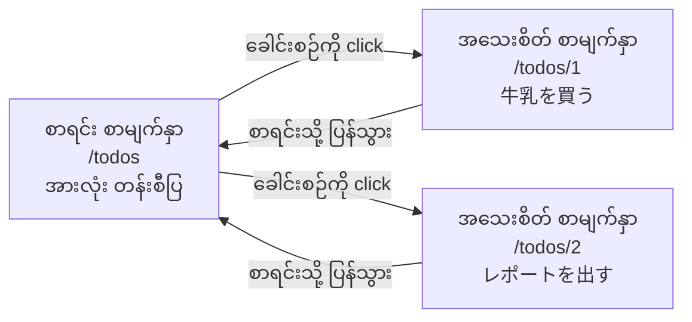
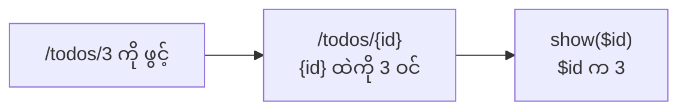
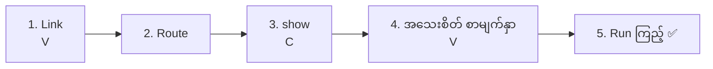
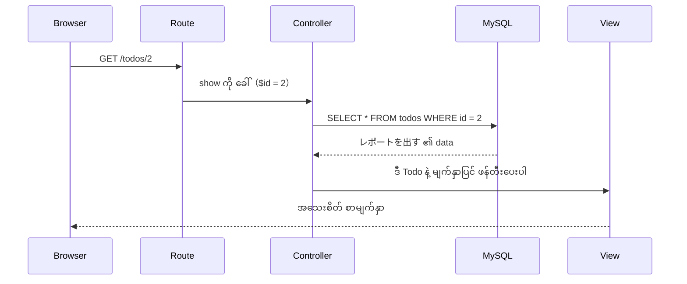
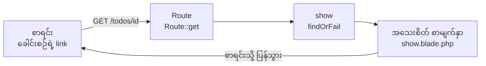

# Laravel မိတ်ဆက် — Todo ၏ အသေးစိတ် စာမျက်နှာကို လုပ်ကြည့်ရအောင်（SHOW）

> 🇯🇵 မူရင်း (ဂျပန်ဘာသာဖြင့်): [20261022_資料_2.md](<../../../1年生_データ設計とアプリ開発/後期/20261022/20261022_資料_2.md>) <!-- original-ja-link -->

[သင်ခန်းစာ 1](./20261022_資料_1.md) မှာ Todo ကို ထည့်နိုင်လာပြီ။ နောက်တစ်ဆင့်အနေနဲ့ **Todo တစ်ခုကို အသေးစိတ် ကြည့်လို့ရတဲ့ စာမျက်နှာ（အသေးစိတ် စာမျက်နှာ）** ကို လုပ်ပါမယ်။

## ဒီနေ့ရဲ့ ပန်းတိုင်
- URL ထဲမှာ `id` ကို ထည့်ပြီး ဘယ် Todo ကို ကြည့်မလဲ ဆုံးဖြတ်နိုင်မယ်（route parameter）
- `id` ကို သုံးပြီး Todo တစ်ခုတည်းကိုပဲ ယူလာနိုင်မယ်
- Todo တစ်ခုရဲ့ အချက်အလက်ကို အသေးစိတ် စာမျက်နှာမှာ ပြနိုင်မယ်

> သင်ခန်းစာ 1 ရဲ့ 「Todo ထည့်ခြင်း」 ပြီးနေတဲ့ အခြေအနေကနေ စပါမယ်။

---

## 1. စာရင်း စာမျက်နှာနှင့် အသေးစိတ် စာမျက်နှာ

စာရင်း စာမျက်နှာက 「Todo အားလုံးကို တန်းစီပြီး ပြတဲ့」 စာမျက်နှာ ဖြစ်ပါတယ်။
အသေးစိတ် စာမျက်နှာက 「**Todo တစ်ခုတည်း** ကို အသေးစိတ် ပြတဲ့」 စာမျက်နှာ ဖြစ်ပါတယ်။ အောက်ပါပုံထဲက 「牛乳を買う」 က 「နို့ဝယ်ရန်」၊ 「レポートを出す」 က 「report တင်ရန်」 လို့ အဓိပ္ပာယ်ရပါတယ်။



| | URL | တာဝန်ယူသူ | ပြမယ့်အရာ |
|---|---|---|---|
| စာရင်း စာမျက်နှာ | `/todos` | `index` | Todo အားလုံး |
| အသေးစိတ် စာမျက်နှာ | `/todos/1`、`/todos/2` … | `show` | **URL ထဲက နံပါတ်နဲ့ တူတဲ့ `id` ရှိတဲ့** Todo တစ်ခု |

URL ရဲ့ နောက်ဆုံးက နံပါတ်က **ကြည့်ချင်တဲ့ Todo ရဲ့ `id`** ဖြစ်ပါတယ်။
`/todos/1` ဆိုရင် `id` 1 ဖြစ်တဲ့ Todo၊ `/todos/2` ဆိုရင် `id` 2 ဖြစ်တဲ့ Todo ရဲ့ အသေးစိတ် စာမျက်နှာ ဖြစ်ပါတယ်။

> **Online ဆိုင်တွေမှာလည်း အတူတူပါပဲ**
> Online ဈေးဝယ် site တွေမှာလည်း ပစ္စည်းစာရင်းထဲက တစ်ခုကို click လိုက်ရင် အဲဒီပစ္စည်းအတွက်ပဲ အသေးစိတ် စာမျက်နှာ ပွင့်လာပါတယ်။
> URL ကို ကြည့်ရင် `/items/12345` လိုမျိုး **နံပါတ် ပါနေတာ** များပါတယ်။

---

## 2. အသစ် တွေ့ရမယ့် အကြောင်းအရာများ

### Route parameter `{id}`

`/todos/1`・`/todos/2`・`/todos/3`… ဆိုပြီး Todo အရေအတွက်နဲ့ ညီအောင် route တွေ ရေးနေရရင် ပင်ပန်းပါတယ်။
ဒါကြောင့် route မှာ `{id}` လို့ ရေးလိုက်ရင် **URL ရဲ့ အဲဒီနေရာမှာ ဘာပဲလာလာ OK** ဖြစ်သွားပြီး အဲဒီတန်ဖိုးကို controller မှာ လက်ခံယူနိုင်ပါတယ်။

```php
Route::get('/todos/{id}', [TodoController::class, 'show']);
```



### `findOrFail()` ဖြင့် တစ်ခုတည်း ယူလာခြင်း

စာရင်းမှာတော့ `Todo::all()` နဲ့ **အားလုံး** ကို ယူလာခဲ့ပါတယ်။
အသေးစိတ် စာမျက်နှာမှာတော့ `id` ကို သုံးပြီး **တစ်ခုတည်း** ကိုပဲ ယူလာပါမယ်။

| ရေးပုံ | ယူလာမယ့်အရာ | SQL နဲ့ ပြောရရင် |
|--------|--------------|------------|
| `Todo::all()` | အားလုံး | `SELECT * FROM todos` |
| `Todo::findOrFail($id)` | `id` ကိုက်ညီတဲ့ တစ်ခု | `SELECT * FROM todos WHERE id = ?` |

---

## 3. လုပ်ကြည့်ရအောင်



ပြင်ရမယ့် file တွေက အောက်ပါ 4 ခု ဖြစ်ပါတယ်（`src` ထဲမှာ）။

```
src/
├─ resources/views/todos/
│   ├─ index.blade.php ················ 1. ခေါင်းစဉ်ကို link လုပ်မယ်
│   └─ show.blade.php ················· 4. အသေးစိတ် စာမျက်နှာ（အသစ် ဖန်တီးမယ်）
├─ routes/
│   └─ web.php ························ 2. route ကို ထပ်ရေးမယ်
└─ app/Http/Controllers/
    └─ TodoController.php ············· 3. show method ကို ထပ်ရေးမယ်
```

---

### 1. စာရင်းထဲက ခေါင်းစဉ်ကို link လုပ်ခြင်း（V）

> အခု ဒီနေရာ：**🟢 1. Link** → 2. Route → 3. show → 4. အသေးစိတ် စာမျက်နှာ → 5. Run ကြည့်

`resources/views/todos/index.blade.php` ကို ဖွင့်ပြီး `{{ $todo->title }}` ကို ★ ပြထားတဲ့အတိုင်း link tag နဲ့ ပတ်ပါ။

```html
    <ul>
        @foreach ($todos as $todo)
            <li>
                <input type="checkbox" @checked($todo->is_done)>
                <a href="/todos/{{ $todo->id }}">{{ $todo->title }}</a>  {{-- ★ link လုပ်မယ် --}}
            </li>
        @endforeach
    </ul>
```

`{{ $todo->id }}` ထဲမှာ အဲဒီ Todo ရဲ့ `id` ဝင်ပါတယ်။
Browser မှာ စာရင်းကို ဖွင့်ပြီး ခေါင်းစဉ်ပေါ်ကို mouse တင်ကြည့်ရင် ဘယ်ဘက်အောက်ထောင့်မှာ `…/todos/1`・`…/todos/2` လိုမျိုး တစ်တန်းချင်းစီ မတူတဲ့ URL ပေါ်လာပါမယ်။

（ဒီအချိန်မှာ ခေါင်းစဉ်ကို နှိပ်ရင် `404 Not Found` ဖြစ်ပါမယ်။ route မရှိသေးလို့ပါ）

---

### 2. Route ရေးခြင်း

> အခု ဒီနေရာ：1. Link → **🟢 2. Route** → 3. show → 4. အသေးစိတ် စာမျက်နှာ → 5. Run ကြည့်

`routes/web.php` မှာ ★ ပါတဲ့ စာကြောင်း 1 ကြောင်းကို ထပ်ရေးပါ။

```php
Route::get('/todos', [TodoController::class, 'index']);
Route::post('/todos', [TodoController::class, 'store']);
Route::get('/todos/{id}', [TodoController::class, 'show']);  // ★ ထပ်ထည့်
```

```
Route::get( '/todos/{id}' ,  [TodoController::class, 'show'] );
~~~~~~~~~~   ~~~~~~~~~~~     ~~~~~~~~~~~~~~~~~~~~~  ~~~~~~
GET ဖြင့်     ဒီ URL ကို       TodoController ရဲ့      show က တာဝန်ယူပေးပါ
             ဖွင့်ရင်
             （{id} က ဘာဖြစ်ဖြစ် OK）
```

ဒီအထိနဲ့ route 3 ခု ဖြစ်သွားပါပြီ။

| Route | တာဝန်ယူသူ | လုပ်မယ့်အရာ |
|--------|------|---------|
| `GET /todos` | `index` | စာရင်းကို ပြမယ် |
| `POST /todos` | `store` | အသစ် ထည့်မယ် |
| `GET /todos/{id}` | `show` | Todo တစ်ခုကို အသေးစိတ် ပြမယ် |

`show`（ရှိုး）ဆိုတာ 「ပြတယ်」 ဆိုတဲ့ အဓိပ္ပာယ်ပါ။ Laravel မှာ data တစ်ခုကို ပြတဲ့ method ကို `show` လို့ နာမည်ပေးလေ့ရှိပါတယ်။

---

### 3. show method ရေးခြင်း（C）

> အခု ဒီနေရာ：1. Link → 2. Route → **🟢 3. show** → 4. အသေးစိတ် စာမျက်နှာ → 5. Run ကြည့်

`app/Http/Controllers/TodoController.php` မှာ ★ ပါတဲ့ `show` method ကို ထပ်ရေးပါ။

```php
    // （index နှင့် store ကို ဤနေရာတွင် ဖော်ပြမထားပါ）

    // ★ ဒီကနေ စထည့်
    public function show($id)
    {
        // ① id ဖြင့် ကြည့်ချင်တဲ့ Todo တစ်ခုကို ယူလာမယ်
        $todo = Todo::findOrFail($id);

        // ② အသေးစိတ် စာမျက်နှာကို ပြမယ်
        return view('todos.show', ['todo' => $todo]);
    }
    // ★ ဒီအထိ
```

| Code | အဓိပ္ပာယ် |
|--------|------|
| `show($id)` | URL ရဲ့ `{id}` အပိုင်းက `$id` ထဲကို ဝင်တယ် |
| `Todo::findOrFail($id)` | `id` ကိုက်ညီတဲ့ Todo တစ်ခုကို ယူလာတယ် |
| `view('todos.show', ...)` | `resources/views/todos/show.blade.php` ကို သုံးပြီး မျက်နှာပြင်ကို ဖန်တီးတယ် |
| `['todo' => $todo]` | view ထဲမှာ `$todo` ဆိုတဲ့ နာမည်နဲ့ သုံးလို့ရအောင် လုပ်တယ် |

`index` နဲ့ ယှဉ်ကြည့်ရအောင်။ ပုံစံက အတော်လေး တူပါတယ်။

| | `index`（စာရင်း） | `show`（အသေးစိတ်） |
|---|---|---|
| ယူလာတာ | `Todo::all()`（အားလုံး） | `Todo::findOrFail($id)`（တစ်ခု） |
| Variable | `$todos`（အများကိန်း） | `$todo`（အနည်းကိန်း） |
| View | `todos.index` | `todos.show` |

> **`findOrFail` ရဲ့ 「OrFail」 ဆိုတာ ဘာလဲ？**
> 「ရှာမတွေ့ရင် မအောင်မြင်（Fail）အဖြစ် သတ်မှတ်မယ်」 ဆိုတဲ့ အဓိပ္ပာယ်ပါ။
> `/todos/999` လိုမျိုး မရှိတဲ့ Todo ကို ဖွင့်ဖို့ ကြိုးစားရင် `404 Not Found` စာမျက်နှာကို အလိုအလျောက် ပြပေးပါတယ်။
> ဆင်တူတဲ့ `Todo::find($id)` ကတော့ ရှာမတွေ့ရင် `null`（ဘာမှမရှိ）ဖြစ်သွားပြီး နောက်ပိုင်း view မှာ error ဖြစ်ပါတယ်။

---

### 4. အသေးစိတ် စာမျက်နှာ ဖန်တီးခြင်း（V）

> အခု ဒီနေရာ：1. Link → 2. Route → 3. show → **🟢 4. အသေးစိတ် စာမျက်နှာ** → 5. Run ကြည့်

`resources/views/todos` ထဲမှာ `show.blade.php` ဆိုတဲ့ file အသစ်ကို ဖန်တီးပါ။

```
resources/views/todos/
  ├─ index.blade.php
  └─ show.blade.php   ← အသစ် ဖန်တီးမယ်
```

```html
<!DOCTYPE html>
<html lang="ja">
<head>
    <meta charset="UTF-8">
    <title>TODOの詳細</title>
</head>
<body>
    <h1>{{ $todo->title }}</h1>

    <p>番号：{{ $todo->id }}</p>

    <p>
        状態：
        @if ($todo->is_done)
            完了 ✅
        @else
            未完了
        @endif
    </p>

    <a href="/todos">一覧にもどる</a>
</body>
</html>
```

| Code | အဓိပ္ပာယ် |
|--------|------|
| `{{ $todo->title }}` | Todo ရဲ့ ခေါင်းစဉ် |
| `{{ $todo->id }}` | Todo ရဲ့ နံပါတ်（`id`） |
| `@if` 〜 `@else` 〜 `@endif` | ပြီးဆုံးရင် 「完了 ✅」(ပြီးဆုံး)၊ မဟုတ်ရင် 「未完了」(မပြီးသေး) လို့ ပြတယ် |

စာရင်းရဲ့ view မှာတော့ `@foreach` နဲ့ တစ်ခုချင်း ထုတ်ယူခဲ့ပေမယ့် အသေးစိတ် စာမျက်နှာရဲ့ `$todo` က **အစကတည်းက တစ်ခုတည်း** ဖြစ်လို့ `@foreach` မလိုပါဘူး။

---

### 5. Run ကြည့်ခြင်း ✅

> အခု ဒီနေရာ：1. Link → 2. Route → 3. show → 4. အသေးစိတ် စာမျက်နှာ → **🟢 5. Run ကြည့်**

1. http://localhost:8000/todos ကို ဖွင့်ပါ
2. 「レポートを出す」(report တင်ရန်) ကို click လုပ်ပါ
3. အောက်ပါလို အသေးစိတ် စာမျက်နှာ ပေါ်လာရင် အောင်မြင်ပါပြီ（「番号」 = နံပါတ်၊ 「状態」 = အခြေအနေ၊ 「完了」 = ပြီးပြီ၊ 「一覧にもどる」 = စာရင်းသို့ ပြန်သွားရန်）

```
レポートを出す

番号：2

状態：完了 ✅

一覧にもどる
```



✅ **စစ်ဆေးချက် 1**：တခြား Todo တွေကိုလည်း click ပြီး တစ်ခုချင်းစီရဲ့ ခေါင်းစဉ်နဲ့ အခြေအနေ ပေါ်လား စစ်ကြည့်ပါ။

✅ **စစ်ဆေးချက် 2**：Browser ရဲ့ URL ကို http://localhost:8000/todos/999 လို့ တိုက်ရိုက် ပြောင်းရေးပြီး ဖွင့်ကြည့်ပါ။
`id` 999 ဖြစ်တဲ့ Todo မရှိလို့ `404 Not Found` စာမျက်နှာ ပေါ်လာပါမယ်။ `findOrFail` အလုပ်လုပ်နေတယ်ဆိုတဲ့ လက္ခဏာပါ။

---

## 4. အဆင်မပြေတဲ့အခါ

> **🔥 အလုပ်မလုပ်ရင် log ထုတ်ကြည့်ပါ！**
> Error ရဲ့ အကြောင်းရင်းကို မသိရင် `show` ထဲမှာ `Log::info()` ကို သုံးပြီး `$id` ရဲ့ တန်ဖိုးကို စစ်ကြည့်ပါ → [【အရေးကြီး】Log ထုတ်နည်း](./【重要】ログの出し方.md)

| ပြဿနာ | အကြောင်းရင်းရှိတဲ့ နေရာ | ဖြေရှင်းနည်း |
|------|----------|------|
| ခေါင်းစဉ်ကို နှိပ်ရင် `404 Not Found` | Route | `routes/web.php` မှာ `Route::get('/todos/{id}', ...)` ရေးထားလား စစ်ပါ |
| `Call to undefined method App\Http\Controllers\TodoController::show()` | Controller | `TodoController.php` မှာ `show` method ရေးထားလား၊ နာမည်ရဲ့ စာလုံးပေါင်း မှန်လား စစ်ပါ |
| `View [todos.show] not found.` | View | `resources/views/todos/show.blade.php` ကို ဖန်တီးထားလား၊ file နာမည် မှန်လား စစ်ပါ |
| `Undefined variable $todo` | Controller | `view('todos.show', ['todo' => $todo])` ထဲက `'todo'` ရဲ့ စာလုံးပေါင်းကို စစ်ပါ（`'todos'` ဖြစ်မနေဘူးလား） |
| ဘယ် Todo ကို နှိပ်နှိပ် တူညီတဲ့ Todo ပဲ ပေါ်တယ် | View | စာရင်းထဲက link က `href="/todos/{{ $todo->id }}"` ဖြစ်နေလား စစ်ပါ |

---

## 5. အနှစ်ချုပ်



| ဒီနေ့ ရေးခဲ့တာ | တစ်ကြောင်းတည်းနဲ့ ပြောရရင် |
|--------------|-----------|
| `href="/todos/{{ $todo->id }}"` | Todo တစ်ခုချင်းစီအတွက် `id` ပါတဲ့ link ကို ဖန်တီးတယ် |
| `Route::get('/todos/{id}', ...)` | URL ထဲက `id` ကို controller မှာ `$id` အဖြစ် လက်ခံယူတယ် |
| `Todo::findOrFail($id)` | `id` ဖြင့် Todo တစ်ခုကို ယူလာတယ်။ မရှိရင် 404 |
| `show.blade.php` | Todo တစ်ခုကို အသေးစိတ် ပြတဲ့ စာမျက်နှာ |

ဒီမှာ မှတ်ခဲ့တဲ့ **`{id}` နဲ့ `findOrFail()`** ကို နောက်ပိုင်း လုပ်မယ့် 「ပြင်ဆင်ခြင်း」 နဲ့ 「ဖျက်ခြင်း」 မှာလည်း သုံးပါမယ်။

---

## 6. ထပ်လုပ်ကြည့်ရအောင်（အချိန်ပိုနေသူများအတွက်）

အသေးစိတ် စာမျက်နှာမှာ **ဖန်တီးခဲ့တဲ့ ရက်စွဲနဲ့ အချိန်**（`created_at`）ကိုလည်း ပြကြည့်ပါ။

<details>
<summary>အရိပ်အမြွက်</summary>

`show.blade.php` မှာ အောက်ပါ စာကြောင်း 1 ကြောင်းကို ထပ်ရေးပါ။（「作った日時」 = ဖန်တီးခဲ့တဲ့ ရက်စွဲနဲ့ အချိန်）

```html
<p>作った日時：{{ $todo->created_at }}</p>
```

- သင်ခန်းစာ 1 ရဲ့ form ကနေ ထည့်ခဲ့တဲ့ Todo တွေမှာ ရက်စွဲနဲ့ အချိန် ပေါ်ပါမယ်（UTC ဖြစ်လို့ ဂျပန်စံတော်ချိန်ထက် 9 နာရီ စောပါတယ်）
- အရင်တစ်ခါ phpMyAdmin မှာ ကိုယ်တိုင် ရိုက်ထည့်ခဲ့တဲ့ Todo တွေမှာတော့ `created_at` က ဗလာ（NULL）ဖြစ်လို့ ဘာမှ မပေါ်ပါဘူး

</details>

<!-- nav:start -->

---

| ⬅️ ယခင် | 🗺️ ခြုံငုံပုံ | နောက်တစ်ခု ➡️ |
|:--|:--:|--:|
| [10/22 Todo ထည့်ခြင်း（CREATE）](20261022_資料_1.md) | [သင်ခန်းစာများ၏ ခြုံငုံပုံ](../../README.md) | [10/29 Todo ပြင်ဆင်ခြင်း（UPDATE）](../20261029/20261029_資料_1.md) |

<!-- nav:end -->
