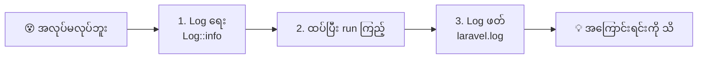
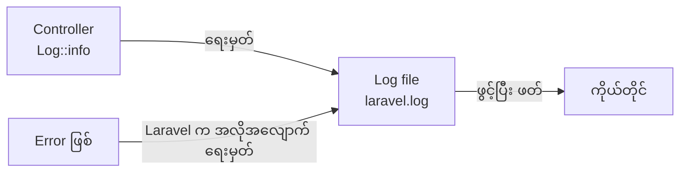
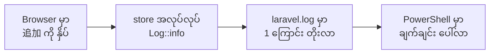
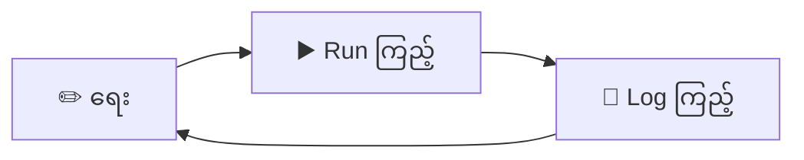

# 【အရေးကြီး】အလုပ်မလုပ်ရင် log ထုတ်ကြည့်ပါ！

> 🇯🇵 မူရင်း (ဂျပန်ဘာသာဖြင့်): [【重要】ログの出し方.md](<../../../1年生_データ設計とアプリ開発/後期/20261022/【重要】ログの出し方.md>) <!-- original-ja-link -->

[Todo ထည့်ကြည့်ရအောင်（CREATE）သို့ ပြန်သွားရန်](./20261022_資料_1.md)

> ## 🔥 အလုပ်မလုပ်ရင် log ထုတ်ကြည့်ပါ！
> Program က ကောင်းကောင်း အလုပ်မလုပ်တဲ့အခါ **ခန့်မှန်းပြီး code ကို လျှောက်ပြင်ရုံနဲ့ များသောအားဖြင့် မပြေလည်ပါဘူး။**
> အရင်ဆုံး **log ထုတ်ပြီး အထဲမှာ ဘာဖြစ်နေလဲ ကြည့်ပါ**။ ဒါက အကြောင်းရင်းကို ရှာဖို့ အမြန်ဆုံး နည်းလမ်း ဖြစ်ပါတယ်။
> ဒီစာမျက်နှာကို နောက်ပိုင်း သင်ခန်းစာတွေနဲ့ ကိုယ်ပိုင် project တွေမှာလည်း အမြဲ သုံးပါမယ်။ အခက်အခဲ ကြုံရင် ဘယ်နှစ်ခါဖြစ်ဖြစ် ပြန်လာကြည့်ပါ။
>
> ## 👀 Log ကြည့်တဲ့ အကျင့်ကို မွေးမြူကြရအောင်！
> အလုပ်မလုပ်တဲ့အချိန်မှာတင် မဟုတ်ဘဲ **ပုံမှန်အချိန်တွေမှာလည်း log ကို ကြည့်** ပါ။
> 「အလုပ်လုပ်တယ်လို့ ထင်နေတဲ့」 အမှားတွေကိုလည်း စောစော သတိထားမိလာပါမယ်။



## ဒီစာမျက်နှာရဲ့ ပန်းတိုင်
- Log က ဘာအတွက် ရှိတာလဲ နားလည်မယ်
- `Log::info()` နဲ့ log ကို ကိုယ်တိုင် ရေးထုတ်နိုင်မယ်
- Log file ကို ဖွင့်ပြီး အထဲက အကြောင်းအရာကို ဖတ်နိုင်မယ်
- ပုံမှန်အချိန်တွေမှာလည်း log ကြည့်တဲ့ အကျင့်ကို မွေးမြူမယ်

---

## 1. Log ဆိုတာ

Form ရဲ့ `追加`（ထည့်ရန်）ကို နှိပ်ပေမယ့် ကောင်းကောင်း မသိမ်းဆည်းနိုင်တဲ့ အခါမျိုး ရှိပါတယ်။
ဒါပေမဲ့ controller ထဲမှာ ဘာဖြစ်နေလဲဆိုတာ မျက်နှာပြင်ကနေ မမြင်ရပါဘူး။

- Form ရဲ့ တန်ဖိုးက controller ဆီကို တကယ် ရောက်နေရဲ့လား？
- `store` method က အလုပ် လုပ်နေရဲ့လား？

အဲဒီအခါ သုံးရတာက **log** ဖြစ်ပါတယ်။
Log ဆိုတာ app က 「ဘယ်အချိန်・ဘာလုပ်ခဲ့လဲ」 ဆိုတာကို ရေးမှတ်ထားတဲ့ **နေ့စဉ်မှတ်တမ်း** လိုမျိုး ဖြစ်ပါတယ်။



Log file ရှိတဲ့ နေရာက `src` ထဲက ဒီနေရာ ဖြစ်ပါတယ်။

```
src/
└─ storage/
    └─ logs/
        └─ laravel.log   ← ဒီမှာ ရေးမှတ်သွားမယ်
```

> **Error တွေလည်း အလိုအလျောက် ရေးမှတ်သွားတယ်**
> ကိုယ်က ဘာမှ မလုပ်ရင်တောင် program error ဖြစ်တဲ့အခါ Laravel က `laravel.log` ထဲကို ရေးမှတ်ပေးပါတယ်။
> Error မျက်နှာပြင်ကို ပိတ်လိုက်မိရင်တောင် နောက်မှ log မှာ ပြန်စစ်လို့ ရပါတယ်။
>
> ဒါပေမဲ့ `404 Not Found`（စာမျက်နှာ ရှာမတွေ့）・`405`（`The POST method is not supported ...`：POST method ကို ပံ့ပိုးမထားပါ）・`419 Page Expired`（စာမျက်နှာ သက်တမ်းကုန်သွားပါပြီ） လိုမျိုး
> **「URL ဒါမှမဟုတ် ပို့ပုံ မှားနေတဲ့」 error တွေကိုတော့ log ထဲမှာ မရေးမှတ်ပါဘူး**။ ဒီလိုဆိုရင် route နဲ့ form ကို စစ်ကြည့်ပါ။

---

## 2. Log ရေးထုတ်ကြည့်ရအောင်

အရင်တစ်ခါက `store` method ထဲကို log ရေးထုတ်တဲ့ စာကြောင်းတွေ ထပ်ထည့်ကြည့်ပါမယ်။
`app/Http/Controllers/TodoController.php` ကို ဖွင့်ပြီး ★ အပိုင်းတွေကို ထပ်ရေးပါ။

```php
<?php

namespace App\Http\Controllers;

use App\Models\Todo;
use Illuminate\Http\Request;
use Illuminate\Support\Facades\Log;  // ★ ထပ်ထည့်（log သုံးဖို့အတွက်）

class TodoController extends Controller
{
    // （index ကို ချန်ထားသည်）

    public function store(Request $request)
    {
        // ★ Form ကနေ ရောက်လာတဲ့ တန်ဖိုးကို log ထဲ ရေးမယ်
        Log::info('Todoを追加します', ['title' => $request->input('title')]);

        $todo = new Todo();
        $todo->title = $request->input('title');
        $todo->save();

        // ★ သိမ်းဆည်းပြီးကြောင်းကို log ထဲ ရေးမယ်（Todoを保存しました：Todo ကို သိမ်းဆည်းပြီးပါပြီ）
        Log::info('Todoを保存しました', ['id' => $todo->id]);

        return redirect('/todos');
    }
}
```

| Code | အဓိပ္ပာယ် |
|--------|------|
| `use Illuminate\Support\Facades\Log;` | Log ကို သုံးဖို့အတွက် စာကြောင်း 1 ကြောင်း |
| `Log::info('message')` | Log ထဲကို 「အသိပေးချက်」 အဖြစ် ရေးတယ် |
| `['title' => ...]` | Message နဲ့အတူ တန်ဖိုးကိုပါ ရေးထုတ်တယ်（မပါလည်း OK） |
| `$todo->id` | `save()` လုပ်ပြီးနောက် အလိုအလျောက် ရလာတဲ့ `id` ကို သိနိုင်တယ် |

---

## 3. Log ကြည့်ကြည့်ရအောင်

Browser မှာ http://localhost:8000/todos ကို ဖွင့်ပြီး 「宿題をする」（အိမ်စာလုပ်ရန်）လို့ ရိုက်ထည့်ပြီး `追加` ကို နှိပ်ပါ။
ပြီးရင် log ကို ကြည့်ကြည့်ရအောင်။ ကြည့်နည်း 2 မျိုး ရှိပါတယ်။

### ကြည့်နည်း 1：Editor နဲ့ ဖွင့်ခြင်း

`src/storage/logs/laravel.log` ကို VS Code စတဲ့ editor နဲ့ ဖွင့်ပါ။
အောက်ဆုံးအထိ scroll ဆွဲကြည့်ရင် အောက်ပါလို စာကြောင်းတွေ တိုးလာပါမယ်။

```
[2026-10-22 01:15:30] local.INFO: Todoを追加します {"title":"宿題をする"}
[2026-10-22 01:15:30] local.INFO: Todoを保存しました {"id":3}
```

| အပိုင်း | အဓိပ္ပာယ် |
|------|------|
| `[2026-10-22 01:15:30]` | ရေးမှတ်ခဲ့တဲ့ ရက်စွဲနဲ့ အချိန် |
| `local` | Run နေတဲ့ ပတ်ဝန်းကျင်（လေ့ကျင့်ရေး ပတ်ဝန်းကျင်က `local`） |
| `INFO` | Log ရဲ့ အမျိုးအစား（အသိပေးချက်） |
| `Todoを追加します` | ကိုယ်တိုင် ရေးခဲ့တဲ့ message（Todo ထည့်ပါမယ်） |
| `{"title":"宿題をする"}` | အတူတူ ရေးထုတ်ခဲ့တဲ့ တန်ဖိုး |

> **အချိန်က 9 နာရီ ကွာနေသလား？**
> Laravel က အချိန်ကို **UTC（ကမ္ဘာ့စံတော်ချိန်）** နဲ့ မှတ်တမ်းတင်ပါတယ်။ ဂျပန်စံတော်ချိန်က UTC ကို 9 နာရီ ပေါင်းထားတဲ့ အချိန် ဖြစ်ပါတယ်။
> အပေါ်က ဥပမာရဲ့ `01:15:30` က ဂျပန်စံတော်ချိန်မှာ `10:15:30` ဖြစ်ပါတယ်။

### ကြည့်နည်း 2：PowerShell မှာ real-time ကြည့်ခြင်း

laravel folder ထဲမှာ အောက်ပါ command ကို run ပါ။

```powershell
docker compose exec laravel tail -f storage/logs/laravel.log
```

Log ရေးမှတ်တိုင်း ချက်ချင်း ပေါ်လာပါမယ်။
Browser မှာ `追加` ကို နှိပ်ရင် စာကြောင်းအသစ် တိုးလာတာကို တွေ့ရပါမယ်။
ကြည့်တာ ရပ်ချင်ရင် `Ctrl + C` ကို နှိပ်ပါ။

> `tail: cannot open ... No such file or directory` လို့ ပေါ်လာရင် log file မရှိသေးလို့ ဖြစ်ပါတယ်။
> Log file က ပထမဆုံး စာကြောင်း 1 ကြောင်း ရေးမှတ်တဲ့အခါမှ ဖန်တီးပါတယ်။ Browser မှာ `追加` ကို တစ်ခါ နှိပ်ပြီးမှ ထပ်ပြီး run ကြည့်ပါ။



> **`php artisan pail` ကို သုံးလို့မရပါ**
> Internet မှာ ရှာကြည့်ရင် log ကြည့်တဲ့ command အဖြစ် `php artisan pail` ကို တွေ့ရပါလိမ့်မယ်။
> လေ့ကျင့်ရေး ပတ်ဝန်းကျင်မှာ pail အလုပ်လုပ်ဖို့ လိုအပ်တဲ့ PHP ရဲ့ function（pcntl）မပါလို့ သုံးလို့ မရပါဘူး။
> အဲဒီအစား `tail -f` ကို သုံးပါ။

---

## 4. Log အမျိုးအစားများ

Log မှာ အရေးကြီးမှုအလိုက် အမျိုးအစားတွေ ရှိပါတယ်။ အသုံးများတာက အောက်ပါ 4 မျိုး ဖြစ်ပါတယ်။

| ရေးပုံ | အမျိုးအစား | သုံးမယ့် အခြေအနေ |
|--------|------|---------|
| `Log::debug('...')` | Debug | Develop လုပ်နေစဉ် တန်ဖိုးကို စစ်ကြည့်ချင်တဲ့အခါ |
| `Log::info('...')` | အသိပေးချက် | 「Todo သိမ်းဆည်းပြီးပြီ」 စတဲ့ ပုံမှန် ဖြစ်ရပ်များ |
| `Log::warning('...')` | သတိပေးချက် | Error မဟုတ်ပေမယ့် သတိထားချင်တဲ့ အရာ |
| `Log::error('...')` | Error | မအောင်မြင်တဲ့အခါ |

Log file ထဲမှာ `local.DEBUG`・`local.INFO`・`local.WARNING`・`local.ERROR` လိုမျိုး အမျိုးအစားကို ရေးထားပါတယ်။
Error ရှာတဲ့အခါ file ထဲမှာ `ERROR` ကို search လုပ်ရင် ရှာရလွယ်ပါတယ်။

---

## 5. အလုပ်မလုပ်တဲ့အခါ log နဲ့ အကြောင်းရင်းကို ရှာပါ

### Log မထုတ်ရင်…

```
「ဒီနေရာ မှားနေတာ ဖြစ်မယ်…」→ ပြင်တယ် → အလုပ်မလုပ်သေးဘူး
「ဒါဆို ဟိုနေရာလား…」       → ပြင်တယ် → အလုပ်မလုပ်သေးဘူး
「အစက ဘယ်လိုဖြစ်နေခဲ့လဲ…」  → မူလအတိုင်း ပြန်မပြင်နိုင်တော့ဘူး 😱
```

ခန့်မှန်းပြီး လျှောက်ပြင်ရင် အချိန်ကုန်တဲ့အပြင် **အလုပ်လုပ်နေခဲ့တဲ့ အပိုင်းတွေကိုပါ ပျက်စီးသွားစေ** တတ်ပါတယ်။

| | ခန့်မှန်းပြီး ပြင်ခြင်း | Log ထုတ်ခြင်း |
|---|---|---|
| လုပ်တာ | စိတ်ထဲပေါ်လာတဲ့ နေရာကို ပြင်တယ် | မပြင်ခင် log နဲ့ အထဲကို အရင်ကြည့်တယ် |
| သိရတာ | ဘာမှ မသိရဘူး | ဘယ်အထိ အလုပ်လုပ်ခဲ့လဲ・တန်ဖိုးက ဘာလဲ |
| ရလဒ် | ပြင်လို့ ရမရက ကံပေါ်မူတည်တယ် | အကြောင်းရင်းရှိနိုင်တဲ့ နေရာတွေကို တဖြည်းဖြည်း ကျဉ်းမြောင်းအောင် ရှာနိုင်တယ် |

### Log နဲ့ အကြောင်းရင်းရှိနိုင်တဲ့ နေရာကို ရှာဖွေခြင်း

Log ကို 「ဘယ်အထိ အလုပ်လုပ်ခဲ့လဲ」 ဆိုတာ စစ်ဆေးဖို့ သုံးနိုင်ပါတယ်။

ဥပမာ form ရဲ့ `name` ကို `name="titel"`（စာလုံးပေါင်း မှား）လို့ ရေးမိသွားတယ် ဆိုပါစို့။
`追加` ကို နှိပ်လိုက်တော့ error ဖြစ်သွားပါတယ်။ Log ကို ကြည့်ရင် ဒီလို ရေးထားပါတယ်။

```
[2026-10-22 01:20:05] local.INFO: Todoを追加します {"title":null}
[2026-10-22 01:20:05] local.ERROR: SQLSTATE[23000]: Integrity constraint violation: 1048 Column 'title' cannot be null ...
```


ပထမ စာကြောင်းကနေ **`store` အထိ အလုပ်လုပ်နေပေမယ့် `title` ရဲ့ တန်ဖိုး မရောက်လာဘူး** ဆိုတာ သိရပါတယ်။
ဒါကြောင့် တန်ဖိုးကို ပို့နေတဲ့ ဘက်（form ရဲ့ `name`）ကို သံသယရှိတယ်လို့ စဉ်းစားနိုင်ပါတယ်။

ဒီလိုမျိုး **သံသယရှိတဲ့ နေရာရဲ့ အရှေ့နဲ့ အနောက်မှာ log ရေးပြီး ဘယ်အထိ မှန်မှန်ကန်ကန် အလုပ်လုပ်နေလဲ စစ်ဆေးတာ** က အကြောင်းရင်းကို ရှာတဲ့ နည်းလမ်းကောင်း ဖြစ်ပါတယ်။

> **ဆရာ ဒါမှမဟုတ် သူငယ်ချင်းကို မေးတဲ့အခါမှာလည်း log ကို ပြပါ**
> 「အလုပ်မလုပ်ဘူး」 လို့ပဲ ပြောရင် မေးခံရတဲ့သူလည်း အကြောင်းရင်းကို မသိနိုင်ပါဘူး။
> 「`store` ရဲ့ အစမှာ ထုတ်ခဲ့တဲ့ log မှာ `title` က `null` ဖြစ်နေတယ်」 လိုမျိုး **log နဲ့အတူ မေးမြန်း** ရင် မြန်မြန် ဖြေရှင်းနိုင်ပါတယ်။

---

## 6. Log နဲ့ `dd()` ရဲ့ ကွာခြားချက်

တန်ဖိုးကို စစ်ဆေးတဲ့ နည်းလမ်းထဲမှာ `dd()` လည်း ရှိပါတယ်။

```php
dd($request->input('title'));
```

`dd()` ကို ရေးလိုက်ရင် **အဲဒီနေရာမှာ processing ရပ်သွားပြီး** တန်ဖိုးကို browser မှာ ပြပါတယ်။

| | `Log::info()` | `dd()` |
|---|---|---|
| ဘယ်မှာ ပေါ်လဲ？ | Log file | Browser မျက်နှာပြင် |
| Processing က？ | မရပ်ဘဲ နောက်ဆုံးအထိ အလုပ်လုပ်တယ် | အဲဒီနေရာမှာ ရပ်သွားတယ် |
| သင့်တော်တဲ့ အခြေအနေ | Flow တစ်ခုလုံးကို လိုက်ကြည့်ချင်တဲ့အခါ・နောက်မှ ပြန်ကြည့်ချင်တဲ့အခါ | တန်ဖိုးတစ်ခုကို အဲဒီနေရာမှာ မြန်မြန် ကြည့်ချင်တဲ့အခါ |
| နောက်မှ ဖျက်ရမလား？ | ချန်ထားလည်း ရတယ် | **မဖြစ်မနေ ဖျက်ပါ**（မဖျက်ရင် အဲဒီနေရာမှာ အမြဲ ရပ်နေမယ်） |

---

## 7. Log ကြည့်တဲ့ အကျင့်ကို မွေးမြူကြရအောင်！

Log ဆိုတာ အလုပ်မလုပ်တဲ့အချိန်မှာပဲ ကြည့်ရတဲ့အရာ မဟုတ်ပါဘူး။ **ပုံမှန်အချိန်တွေမှာ ကြည့်တဲ့ အကျင့်** ရှိရင် အမှားတွေကို စောစော သတိထားမိပါတယ်။

### Develop လုပ်နေစဉ် log ကို ဖွင့်ထားပါ

Program ရေးနေတဲ့ အချိန်မှာ PowerShell ထဲမှာ `tail -f` ကို run ထားပါ။
မျက်နှာပြင် 3 ခုကို ဘေးချင်းကပ်ထားပြီး **ရေး → run ကြည့် → log ကြည့်** ကို ထပ်ခါထပ်ခါ လုပ်တာကို အကြံပြုပါတယ်။

```
┌──────────────┬──────────────┐
│              │              │
│  Editor      │  Browser     │
│  （ရေး）     │  （run ကြည့်）│
│              │              │
├──────────────┴──────────────┤
│  PowerShell（log ကြည့်）     │
│  tail -f storage/logs/...   │
└─────────────────────────────┘
```



### 「အလုပ်လုပ်တယ်」 ဆိုတဲ့အခါမှာလည်း log ကို ကြည့်ပါ

မျက်နှာပြင်မှာ အလုပ်လုပ်နေသလို မြင်ရပေမယ့် **အထဲမှာ မတူတဲ့ တန်ဖိုး ဝင်နေတာ** မျိုး ရှိတတ်ပါတယ်။
ဥပမာ ရိုက်ထည့်ခဲ့တဲ့ ခေါင်းစဉ်က အတိအကျ ရောက်လာရဲ့လား၊ `追加` ကို တစ်ခါ နှိပ်တာနဲ့ 2 ခု သိမ်းမိနေသလား စသဖြင့် ဖြစ်ပါတယ်။
Log မှာ 「ထင်ထားတဲ့အတိုင်း တန်ဖိုး ဟုတ်ရဲ့လား」 ဆိုတာအထိ စစ်ဆေးပြီးမှ 「အလုပ်လုပ်တယ်」 လို့ ပြောနိုင်ပါတယ်။

### Error မျက်နှာပြင် ပေါ်လာရင် log ကို အရင်ကြည့်ပါ

Error မျက်နှာပြင် ပေါ်လာရင် မပျာယာခတ်ဘဲ `laravel.log` ရဲ့ **အောက်ဆုံး** ကို ကြည့်ပါ။
`ERROR` လို့ ရေးထားတဲ့ စာကြောင်းမှာ ဘာဖြစ်ခဲ့လဲ ရေးထားပါတယ်။
（`404`・`405`・`419` တွေကို log ထဲမှာ မရေးမှတ်လို့ မျက်နှာပြင်က message ကို ဖတ်ပြီး route နဲ့ form ကို စစ်ပါ）

### Log ကြည့်တဲ့ အကျင့် စစ်ဆေးစာရင်း

- [ ] Develop စလုပ်တဲ့အခါ `tail -f` နဲ့ log ကို ဖွင့်ခဲ့တယ်
- [ ] Button နှိပ်တာ၊ စာမျက်နှာ ဖွင့်တာ လုပ်ပြီးရင် log ကို ကြည့်ခဲ့တယ်
- [ ] 「အလုပ်လုပ်တယ်」 ဆိုတဲ့အခါမှာလည်း ထင်ထားတဲ့အတိုင်း တန်ဖိုး ဟုတ်မဟုတ် log နဲ့ စစ်ခဲ့တယ်
- [ ] Error ပေါ်လာရင် `laravel.log` ရဲ့ အောက်ဆုံးကို အရင်ကြည့်ခဲ့တယ်
- [ ] မေးမြန်းတဲ့အခါ log ကိုပါ တွဲပြခဲ့တယ်

---

## 8. အနှစ်ချုပ်

> ## 🔥 အလုပ်မလုပ်ရင် log ထုတ်ကြည့်ပါ！
> ## 👀 Log ကြည့်တဲ့ အကျင့်ကို မွေးမြူကြရအောင်！

- Log ဆိုတာ app က 「ဘယ်အချိန်・ဘာလုပ်ခဲ့လဲ」 ကို ရေးမှတ်ထားတဲ့ နေ့စဉ်မှတ်တမ်း
- `use Illuminate\Support\Facades\Log;` ကို ရေးပြီး `Log::info('message', [တန်ဖိုး])`နဲ့ ရေးထုတ်တယ်
- Log ကို `src/storage/logs/laravel.log` ထဲမှာ ရေးမှတ်တယ်။ Error တွေကိုလည်း အလိုအလျောက် ရေးမှတ်တယ်
- `docker compose exec laravel tail -f storage/logs/laravel.log` နဲ့ real-time ကြည့်နိုင်တယ်
- အချိန်က UTC（ဂျပန်စံတော်ချိန်ထက် 9 နာရီ စော）
- အဆင်မပြေတဲ့အခါ သံသယရှိတဲ့ နေရာရဲ့ အရှေ့နဲ့ အနောက်မှာ log ရေးပြီး 「ဘယ်အထိ အလုပ်လုပ်ခဲ့လဲ」 ကို စစ်ဆေးတယ်
- Develop လုပ်နေစဉ် `tail -f` ကို ဖွင့်ထားပြီး **ရေး → run ကြည့် → log ကြည့်** ကို ထပ်ခါထပ်ခါ လုပ်တယ်

<!-- nav:start -->

---

| ⬅️ ပြန်သွားရန် | 🗺️ ခြုံငုံပုံ | နောက်တစ်ခု ➡️ |
|:--|:--:|--:|
| [10/22 Todo ထည့်ခြင်း（CREATE）](20261022_資料_1.md) | [သင်ခန်းစာများ၏ ခြုံငုံပုံ](../../README.md) | [10/22 Todo အသေးစိတ်（SHOW）](20261022_資料_2.md) |

<!-- nav:end -->
