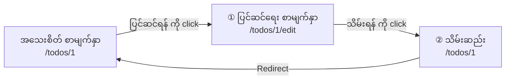
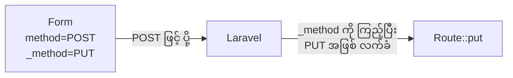
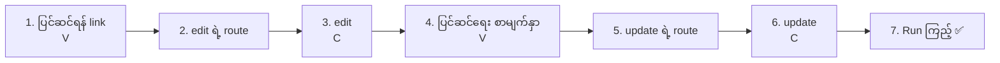
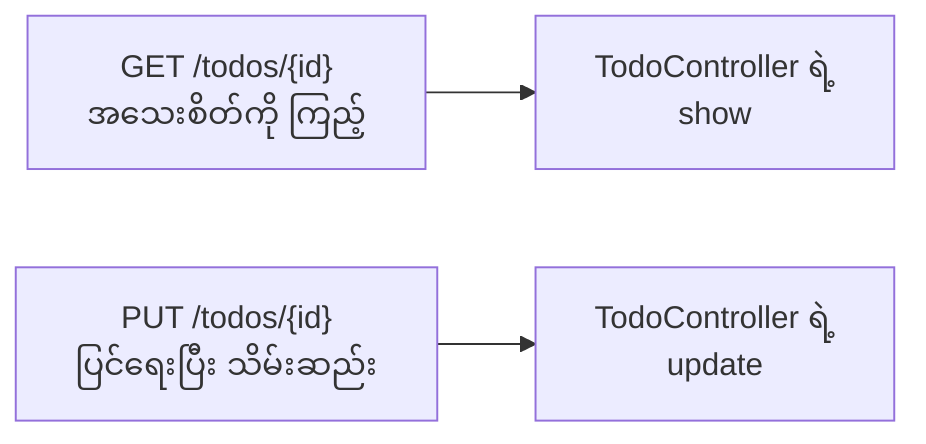
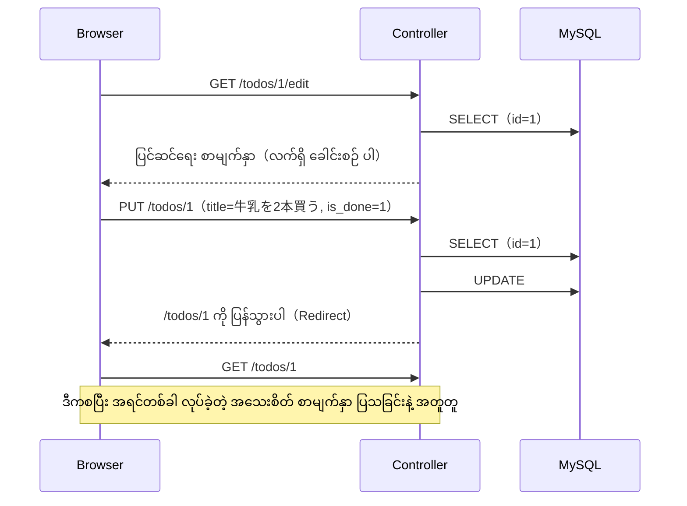
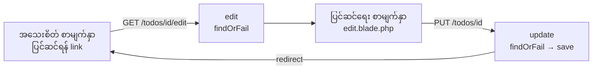

# Laravel မိတ်ဆက် — Todo ကို ပြင်ဆင်ကြည့်ရအောင်（UPDATE）

> 🇯🇵 မူရင်း (ဂျပန်ဘာသာဖြင့်): [20261029_資料_1.md](<../../../1年生_データ設計とアプリ開発/後期/20261029/20261029_資料_1.md>) <!-- original-ja-link -->

[ပြီးခဲ့တဲ့အတန်း](../20261022/20261022_資料_2.md) လုပ်ခဲ့တဲ့ အသေးစိတ် စာမျက်နှာမှာ 「編集」（ပြင်ဆင်ရန်） button ထည့်ပြီး **စာရင်းသွင်းထားတဲ့ Todo ရဲ့ ခေါင်းစဉ်နဲ့ အခြေအနေ（ပြီးဆုံး・မပြီးသေး）ကို ပြောင်းရေးနိုင်တဲ့（ပြင်ဆင်နိုင်တဲ့）function** ကို လုပ်ပါမယ်။

## ဒီနေ့ရဲ့ ပန်းတိုင်
- ပြင်ဆင်ရေး စာမျက်နှာကို ဖန်တီးပြီး လက်ရှိ ခေါင်းစဉ်နဲ့ အခြေအနေကို ပြနိုင်မယ်
- PUT နဲ့ `@method('PUT')` ကို သုံးပြီး ပြင်ထားတဲ့ အကြောင်းအရာကို ပို့နိုင်မယ်
- ပြင်ထားတဲ့ ခေါင်းစဉ်နဲ့ အခြေအနေကို database ထဲမှာ သိမ်းဆည်း（UPDATE）နိုင်မယ်
- Checkbox ရဲ့ တန်ဖိုးကို ဘယ်လို လက်ခံယူရလဲ နားလည်မယ်

> လေ့ကျင့်ရေး ပတ်ဝန်းကျင်（`php-study`）ရဲ့ mysql နဲ့ laravel ကို စတင် run ပြီးမှ စပါမယ်။
> အရင်တစ်ခါက 「အသေးစိတ် စာမျက်နှာ（`/todos/1` စသည်）」 ကို ပြနိုင်တဲ့ အခြေအနေကနေ စပါမယ်။

---

## 1. ပြင်ဆင်ခြင်းကို 「စာမျက်နှာ 2 ခု」 နဲ့ လုပ်ထားတယ်

ထည့်ခြင်းကတော့ 「form ပို့ခြင်း」 တစ်ကြိမ်တည်းနဲ့ ပြီးခဲ့ပါတယ်။
ပြင်ဆင်ခြင်းကတော့ **① ပြင်ဆင်ရေး စာမျက်နှာကို ဖွင့်** → **② ပြင်ရေးပြီး ပို့** ဆိုပြီး 2 ကြိမ် ခွဲထားပါတယ်။



| | URL | အမျိုးအစား | တာဝန်ယူသူ | လုပ်မယ့်အရာ |
|---|---|---|---|---|
| ① | `/todos/1/edit` | GET | `edit` | ပြင်ဆင်ရေး စာမျက်နှာကို ပြမယ်（လက်ရှိ ခေါင်းစဉ်ကို input ကွက်ထဲ ထည့်ထားမယ်） |
| ② | `/todos/1` | PUT | `update` | ပြင်ထားတဲ့ ခေါင်းစဉ်ကို သိမ်းဆည်းမယ် |

နှစ်ခုလုံးမှာ URL ထဲက `1` က **ပြင်ချင်တဲ့ Todo ရဲ့ `id`** ဖြစ်ပါတယ်။
အရင်တစ်ခါက အသေးစိတ် စာမျက်နှာလိုပဲ **route parameter `{id}`** နဲ့ **`findOrFail()`** ကို သုံးပါမယ်။

> **ပထမ စာသင်နှစ်ဝက်ရဲ့ todo.php မှာတော့？**
> ပထမ စာသင်နှစ်ဝက်မှာ `index.php?edit=3` လိုမျိုး `?edit=` နဲ့ ပြင်မယ့် Todo ကို ဆုံးဖြတ်ခဲ့ပါတယ်။
> Laravel မှာတော့ `/todos/3/edit` လိုမျိုး **URL ထဲမှာ `id` ကို ထည့်ပါတယ်**။

---

## 2. အသစ် တွေ့ရမယ့် အကြောင်းအရာ：PUT နဲ့ `@method('PUT')`

「ရှိပြီးသား data ကို ပြင်ရေးတဲ့」 အခါ **PUT** ဆိုတဲ့ အမျိုးအစားကို သုံးတာက Laravel ရဲ့ စည်းမျဉ်း ဖြစ်ပါတယ်။

| အမျိုးအစား | သုံးမယ့် အခြေအနေ | အခုထိ လုပ်ခဲ့တာ |
|------|---------|-------------------|
| GET | ကြည့်တယ် | စာရင်း（`/todos`）・အသေးစိတ်（`/todos/1`） |
| POST | အသစ် ထည့်တယ် | ထည့်ခြင်း（`/todos`） |
| **PUT** | ပြင်ရေးတယ် | **ဒီနေ့ရဲ့ ပြင်ဆင်ခြင်း** |

ဒါပေမဲ့ HTML form က **GET နဲ့ POST ကိုပဲ ပို့နိုင်ပါတယ်**။
ဒါကြောင့် form ကို POST နဲ့ ပို့ပြီး `@method('PUT')` နဲ့ 「တကယ်တော့ PUT ပါ」 လို့ Laravel ကို ပြောပြပါတယ်။

```html
<form method="POST" action="/todos/1">
    @csrf
    @method('PUT')
    ...
</form>
```

`@method('PUT')` က `<input type="hidden" name="_method" value="PUT">` ဆိုတဲ့ စာကြောင်း 1 ကြောင်း အဖြစ် ပြောင်းသွားပါတယ်။
Laravel က ဒီ `_method` ကို ကြည့်ပြီး 「PUT ရောက်လာတယ်」 လို့ ယူဆပါတယ်။



---

## 3. လုပ်ကြည့်ရအောင်



ပြင်ရမယ့် file တွေက အောက်ပါ 4 ခု ဖြစ်ပါတယ်（`src` ထဲမှာ）။

```
src/
├─ resources/views/todos/
│   ├─ show.blade.php ················· 1. ပြင်ဆင်ရန် link ကို ထပ်ရေးမယ်
│   └─ edit.blade.php ················· 4. ပြင်ဆင်ရေး စာမျက်နှာ（အသစ် ဖန်တီးမယ်）
├─ routes/
│   └─ web.php ························ 2・5. route ကို ထပ်ရေးမယ်
└─ app/Http/Controllers/
    └─ TodoController.php ············· 3・6. edit နဲ့ update ကို ထပ်ရေးမယ်
```

---

### 1. အသေးစိတ် စာမျက်နှာမှာ 「編集」（ပြင်ဆင်ရန်） link ထည့်ခြင်း（V）

> အခု ဒီနေရာ：**🟢 1. ပြင်ဆင်ရန် link** → 2. edit ရဲ့ route → 3. edit → 4. ပြင်ဆင်ရေး စာမျက်နှာ → 5. update ရဲ့ route → 6. update → 7. Run ကြည့်

အရင်တစ်ခါ လုပ်ခဲ့တဲ့ `resources/views/todos/show.blade.php` ကို ဖွင့်ပြီး ★ ပါတဲ့ စာကြောင်း 1 ကြောင်းကို ထပ်ရေးပါ။

```html
<body>
    <h1>{{ $todo->title }}</h1>

    <p>番号：{{ $todo->id }}</p>

    <p>
        状態：
        @if ($todo->is_done)
            完了 ✅
        @else
            未完了
        @endif
    </p>

    <a href="/todos/{{ $todo->id }}/edit">編集</a>  {{-- ★ ထပ်ထည့် --}}
    <a href="/todos">一覧にもどる</a>
</body>
```

`/todos/{{ $todo->id }}/edit` က `id` 1 ဖြစ်တဲ့ Todo ဆိုရင် `/todos/1/edit` ဖြစ်သွားပါတယ်။

（ဒီအချိန်မှာ 「編集」(ပြင်ဆင်ရန်) ကို နှိပ်ရင် `404 Not Found` ဖြစ်ပါမယ်။ route မရှိသေးလို့ပါ）

---

### 2. ပြင်ဆင်ရေး စာမျက်နှာရဲ့ route ရေးခြင်း

> အခု ဒီနေရာ：1. ပြင်ဆင်ရန် link → **🟢 2. edit ရဲ့ route** → 3. edit → 4. ပြင်ဆင်ရေး စာမျက်နှာ → 5. update ရဲ့ route → 6. update → 7. Run ကြည့်

`routes/web.php` မှာ ★ ပါတဲ့ စာကြောင်း 1 ကြောင်းကို ထပ်ရေးပါ။

```php
Route::get('/todos', [TodoController::class, 'index']);
Route::post('/todos', [TodoController::class, 'store']);
Route::get('/todos/{id}', [TodoController::class, 'show']);
Route::get('/todos/{id}/edit', [TodoController::class, 'edit']);  // ★ ထပ်ထည့်
```

```
Route::get( '/todos/{id}/edit' ,  [TodoController::class, 'edit'] );
~~~~~~~~~~   ~~~~~~~~~~~~~~~~     ~~~~~~~~~~~~~~~~~~~~~  ~~~~~~
GET ဖြင့်     ဒီ URL ကို ဖွင့်ရင်    TodoController ရဲ့      edit က တာဝန်ယူပေးပါ
```

`edit`（အက်ဒစ်）ဆိုတာ 「ပြင်ဆင်တယ်」 ဆိုတဲ့ အဓိပ္ပာယ်ပါ။ Laravel မှာ ပြင်ဆင်ရေး စာမျက်နှာကို ပြတဲ့ method ကို `edit` လို့ နာမည်ပေးလေ့ရှိပါတယ်။

---

### 3. edit method ရေးခြင်း（C）

> အခု ဒီနေရာ：1. ပြင်ဆင်ရန် link → 2. edit ရဲ့ route → **🟢 3. edit** → 4. ပြင်ဆင်ရေး စာမျက်နှာ → 5. update ရဲ့ route → 6. update → 7. Run ကြည့်

`app/Http/Controllers/TodoController.php` မှာ ★ ပါတဲ့ `edit` method ကို ထပ်ရေးပါ။

```php
    // （index・store・show ကို ချန်ထားသည်）

    // ★ ဒီကနေ စထည့်
    public function edit($id)
    {
        // ① id ဖြင့် ပြင်ချင်တဲ့ Todo တစ်ခုကို ယူလာမယ်
        $todo = Todo::findOrFail($id);

        // ② ပြင်ဆင်ရေး စာမျက်နှာကို ပြမယ်
        return view('todos.edit', ['todo' => $todo]);
    }
    // ★ ဒီအထိ
```

အရင်တစ်ခါက `show` နဲ့ ယှဉ်ကြည့်ရအောင်။ **မတူတာက သုံးတဲ့ view တစ်ခုတည်းပဲ** ဖြစ်ပါတယ်။

| | `show`（အသေးစိတ်） | `edit`（ပြင်ဆင်ခြင်း） |
|---|---|---|
| ယူလာတာ | `Todo::findOrFail($id)` | `Todo::findOrFail($id)` |
| View | `todos.show` | **`todos.edit`** |

---

### 4. ပြင်ဆင်ရေး စာမျက်နှာ ဖန်တီးခြင်း（V）

> အခု ဒီနေရာ：1. ပြင်ဆင်ရန် link → 2. edit ရဲ့ route → 3. edit → **🟢 4. ပြင်ဆင်ရေး စာမျက်နှာ** → 5. update ရဲ့ route → 6. update → 7. Run ကြည့်

`resources/views/todos` ထဲမှာ `edit.blade.php` ဆိုတဲ့ file အသစ်ကို ဖန်တီးပါ။

```
resources/views/todos/
  ├─ index.blade.php
  ├─ show.blade.php
  └─ edit.blade.php   ← အသစ် ဖန်တီးမယ်
```

```html
<!DOCTYPE html>
<html lang="ja">
<head>
    <meta charset="UTF-8">
    <title>TODOの編集</title>
</head>
<body>
    <h1>TODOの編集</h1>

    <form method="POST" action="/todos/{{ $todo->id }}">
        @csrf
        @method('PUT')
        <input type="text" name="title" value="{{ $todo->title }}" required>
        <label>
            <input type="checkbox" name="is_done" value="1" @checked($todo->is_done)>
            完了
        </label>
        <button type="submit">保存</button>
    </form>

    <a href="/todos/{{ $todo->id }}">もどる</a>
</body>
</html>
```

| Code | အဓိပ္ပာယ် |
|--------|------|
| `action="/todos/{{ $todo->id }}"` | `/todos/1` လိုမျိုး ပြင်နေတဲ့ Todo ရဲ့ `id` ပါတဲ့ URL ကို ပို့တယ် |
| `@csrf` | စကားဝှက်（အရင်တစ်ခါက ထည့်ခြင်း form နဲ့ အတူတူ） |
| `@method('PUT')` | 「တကယ်တော့ PUT ပါ」 လို့ Laravel ကို ပြောပြတယ် |
| `value="{{ $todo->title }}"` | Input ကွက်ထဲမှာ **လက်ရှိ ခေါင်းစဉ်ကို အစကတည်းက ထည့်ထားတယ်** |
| `name="is_done" value="1"` | Check **လုပ်ထားတဲ့အခါမှသာ** `is_done=1` ကို ပို့တယ် |
| `@checked($todo->is_done)` | ပြီးဆုံးပြီးသား Todo ဆိုရင် အစကတည်းက check လုပ်ထားတယ်（10/15 ရဲ့ စာရင်းနဲ့ အတူတူ） |
| `<label>` 〜 `</label>` | 「完了」(ပြီးဆုံး) ဆိုတဲ့ စာသားကို click လုပ်ရင်လည်း check ပြောင်းသွားအောင် လုပ်တယ် |

#### Checkbox ရဲ့ အရေးကြီးတဲ့ အလုပ်လုပ်ပုံ

Checkbox က **check လုပ်ထားတဲ့အခါမှသာ** တန်ဖိုးကို ပို့ပါတယ်။
Check ဖြုတ်ထားတဲ့အခါ `is_done` ကိုယ်တိုင်ကို **မပို့ပါဘူး**။

| Checkbox | ပို့မယ့်အရာ |
|----------------|------------|
| ☑ Check လုပ်ထား | `title=…` နဲ့ `is_done=1` |
| ☐ Check မလုပ်ထား | `title=…` ပဲ（`is_done` ကို ဘာမှ မပို့ဘူး） |

ဒါကြောင့် controller မှာ 「`is_done` **ပို့လာသလား မပို့လာဘူးလား**」 ဆိုတာနဲ့ ပြီးဆုံး・မပြီးသေး ကို ဆုံးဖြတ်ပါတယ်（6 မှာ ရေးပါမယ်）။

ထည့်ခြင်း form နဲ့ ကွာခြားချက်က အောက်ပါ 4 ခု ဖြစ်ပါတယ်။

| | ထည့်ခြင်း form | ပြင်ဆင်ခြင်း form |
|---|---|---|
| ပို့မယ့်နေရာ | `/todos` | `/todos/{{ $todo->id }}` |
| `@method('PUT')` | မပါ | **ပါ** |
| Input ကွက် | ဗလာ | **လက်ရှိ ခေါင်းစဉ် ပါနေ**（`value`） |
| အခြေအနေ | မပါ（ထည့်လိုက်တဲ့ Todo က မပြီးသေး） | **ပြီးဆုံးကြောင်း checkbox**（လက်ရှိ အခြေအနေ ပါနေ） |

✅ **စစ်ဆေးချက်**：အသေးစိတ် စာမျက်နှာမှာ 「編集」 ကို နှိပ်ပြီး input ကွက်ထဲမှာ လက်ရှိ ခေါင်းစဉ်၊ checkbox မှာ လက်ရှိ အခြေအနေ ပါနေတဲ့ ပြင်ဆင်ရေး စာမျက်နှာ ပေါ်လာရင် OK ပါ။
（「保存」(သိမ်းရန်) ကို မနှိပ်ပါနဲ့ဦး။ နှိပ်ရင် error ဖြစ်ပါမယ်）

---

### 5. သိမ်းဆည်းခြင်းရဲ့ route ရေးခြင်း

> အခု ဒီနေရာ：1. ပြင်ဆင်ရန် link → 2. edit ရဲ့ route → 3. edit → 4. ပြင်ဆင်ရေး စာမျက်နှာ → **🟢 5. update ရဲ့ route** → 6. update → 7. Run ကြည့်

`routes/web.php` မှာ ★ ပါတဲ့ စာကြောင်း 1 ကြောင်းကို ထပ်ရေးပါ။

```php
Route::get('/todos', [TodoController::class, 'index']);
Route::post('/todos', [TodoController::class, 'store']);
Route::get('/todos/{id}', [TodoController::class, 'show']);
Route::get('/todos/{id}/edit', [TodoController::class, 'edit']);
Route::put('/todos/{id}', [TodoController::class, 'update']);  // ★ ထပ်ထည့်
```

ဒီအထိနဲ့ route 5 ခု ဖြစ်သွားပါပြီ။

| Route | တာဝန်ယူသူ | လုပ်မယ့်အရာ |
|--------|------|---------|
| `GET /todos` | `index` | စာရင်းကို ပြမယ် |
| `POST /todos` | `store` | အသစ် ထည့်မယ် |
| `GET /todos/{id}` | `show` | Todo တစ်ခုကို အသေးစိတ် ပြမယ် |
| `GET /todos/{id}/edit` | `edit` | ပြင်ဆင်ရေး စာမျက်နှာကို ပြမယ် |
| `PUT /todos/{id}` | `update` | ပြင်ရေးပြီး သိမ်းဆည်းမယ် |

`/todos/{id}` ကို **GET ဆိုရင် `show`၊ PUT ဆိုရင် `update`** က တာဝန်ယူပါတယ်။
`/todos` တုန်းက 「GET ဆိုရင် `index`၊ POST ဆိုရင် `store`」 နဲ့ အလုပ်လုပ်ပုံ အတူတူပါပဲ။



---

### 6. update method ရေးခြင်း（C）

> အခု ဒီနေရာ：1. ပြင်ဆင်ရန် link → 2. edit ရဲ့ route → 3. edit → 4. ပြင်ဆင်ရေး စာမျက်နှာ → 5. update ရဲ့ route → **🟢 6. update** → 7. Run ကြည့်

`TodoController.php` မှာ ★ ပါတဲ့ `update` method ကို ထပ်ရေးပါ။

```php
    // ★ ဒီကနေ စထည့်
    public function update(Request $request, $id)
    {
        // ① id ဖြင့် ပြင်ရေးချင်တဲ့ Todo တစ်ခုကို ယူလာမယ်
        $todo = Todo::findOrFail($id);

        // ② ရိုက်ထည့်ထားတဲ့ ခေါင်းစဉ်နဲ့ အခြေအနေဖြင့် ပြင်ရေးမယ်
        $todo->title = $request->input('title');
        $todo->is_done = $request->has('is_done');

        // ③ Database ထဲမှာ သိမ်းဆည်းမယ်
        $todo->save();

        // ④ အသေးစိတ် စာမျက်နှာကို ပြန်သွားမယ်
        return redirect('/todos/' . $todo->id);
    }
    // ★ ဒီအထိ
```

| Code | အဓိပ္ပာယ် |
|--------|------|
| `update(Request $request, $id)` | Form ရဲ့ တန်ဖိုး（`$request`）နဲ့ URL ရဲ့ `{id}`（`$id`）နှစ်ခုလုံးကို လက်ခံယူတယ် |
| `$request->has('is_done')` | `is_done` ပို့လာရင် `true`（ပြီးဆုံး）၊ မပို့လာရင် `false`（မပြီးသေး）။ ပထမ စာသင်နှစ်ဝက်ရဲ့ `isset($_POST['is_done'])` နဲ့ အတူတူ |
| `'/todos/' . $todo->id` | စာသားတွေကို ဆက်ပြီး `/todos/1` လိုမျိုး URL ဖြစ်အောင် လုပ်တယ်（`.` က ပထမ စာသင်နှစ်ဝက်မှာ သင်ခဲ့တဲ့ string ဆက်ခြင်း） |

အရင်တစ်ခါ လုပ်ခဲ့တဲ့ ထည့်ခြင်းရဲ့ `store` နဲ့ ပုံစံ အတော်လေး တူပါတယ်။ မတူတာက **① နဲ့ ④** ဖြစ်ပါတယ်။

| | `store`（ထည့်ခြင်း） | `update`（ပြင်ဆင်ခြင်း） |
|---|---|---|
| ① | `new Todo()`（အသစ် ဖန်တီး） | `Todo::findOrFail($id)`（ရှိပြီးသားကို ယူလာ） |
| ② | `$todo->title = ...` | `$todo->title = ...` နဲ့ `$todo->is_done = ...` |
| ③ | `save()` → `INSERT` | `save()` → **`UPDATE`** |
| ④ | စာရင်း（`/todos`）ကို ပြန်သွား | အသေးစိတ် စာမျက်နှာ（`/todos/1` စသည်）ကို ပြန်သွား |

`save()` တစ်ခုတည်း ဖြစ်ပေမယ့် **အသစ် ဖန်တီးထားတဲ့ Todo ဆိုရင် `INSERT`၊ ယူလာတဲ့ Todo ဆိုရင် `UPDATE`** ကို Laravel က အလိုအလျောက် ခွဲခြားသုံးပေးပါတယ်။

ပထမ စာသင်နှစ်ဝက်ရဲ့ `todo.php` နဲ့ ယှဉ်ကြည့်ရအောင်။

```php
// ပထမ စာသင်နှစ်ဝက်
$id = (int)($_POST['id'] ?? 0);
$title = trim($_POST['title'] ?? '');
$stmt = $pdo->prepare("UPDATE todos SET title = :title WHERE id = :id");
$stmt->execute(['title' => $title, 'id' => $id]);
header('Location: index.php');
exit;

// Laravel
$todo = Todo::findOrFail($id);
$todo->title = $request->input('title');
$todo->is_done = $request->has('is_done');
$todo->save();
return redirect('/todos/' . $todo->id);
```

ပထမ စာသင်နှစ်ဝက်ရဲ့ ပြင်ဆင်ခြင်းမှာ ခေါင်းစဉ်ကိုပဲ ပြင်ခဲ့ပေမယ့် Laravel version မှာတော့ **အခြေအနေကိုပါ တစ်ပါတည်း** ပြင်ရေးပါတယ်။

---

### 7. Run ကြည့်ခြင်း ✅

> အခု ဒီနေရာ：1. ပြင်ဆင်ရန် link → 2. edit ရဲ့ route → 3. edit → 4. ပြင်ဆင်ရေး စာမျက်နှာ → 5. update ရဲ့ route → 6. update → **🟢 7. Run ကြည့်**

1. http://localhost:8000/todos ကို ဖွင့်ပါ
2. 「牛乳を買う」(နွားနို့ဝယ်ရန်) ကို click လုပ်ပြီး အသေးစိတ် စာမျက်နှာကို ဖွင့်ပါ
3. 「編集」 ကို နှိပ်ပါ
4. Input ကွက်ကို 「牛乳を2本買う」(နွားနို့ 2 ဘူး ဝယ်ရန်) လို့ ပြောင်းရေးပြီး 「完了」 ကို check လုပ်ကာ `保存` ကို နှိပ်ပါ
5. အသေးစိတ် စာမျက်နှာကို ပြန်ရောက်ပြီး ခေါင်းစဉ်က 「牛乳を2本買う」၊ အခြေအနေက 「完了 ✅」 လို့ ပြောင်းသွားရင် အောင်မြင်ပါပြီ
6. ပြင်ဆင်ရေး စာမျက်နှာကို ထပ်ဖွင့်ပြီး check ကို ဖြုတ်ကာ `保存` လုပ်ရင် 「未完了」(မပြီးသေး) ကို ပြန်ဖြစ်သွားတာကိုလည်း စစ်ကြည့်ပါ



✅ **စစ်ဆေးချက် 1**：စာရင်း စာမျက်နှာကို ပြန်သွားပြီး စာရင်းထဲက ခေါင်းစဉ်နဲ့ checkbox ပါ ပြောင်းသွားလား စစ်ကြည့်ပါ။

✅ **စစ်ဆေးချက် 2**：phpMyAdmin မှာ `todos` table ကို ဖွင့်ကြည့်ပါ။
ပြင်ရေးခဲ့တဲ့ Todo ရဲ့ `updated_at` က သိမ်းဆည်းခဲ့တဲ့ အချိန်ကို ပြောင်းသွားပါမယ်（UTC ဖြစ်လို့ ဂျပန်စံတော်ချိန်ထက် 9 နာရီ စောပါတယ်）။
`save()` လုပ်တဲ့အခါ Laravel က 「update လုပ်ခဲ့တဲ့ အချိန်」 ကို အလိုအလျောက် ထည့်ပေးခဲ့ပါတယ်။ `created_at` ကတော့ မပြောင်းပါဘူး။

> **ခေါင်းစဉ်ရော အခြေအနေရော မပြောင်းဘဲ 「保存」 လုပ်ရင်？**
> ဘာမှ မပြောင်းထားရင် Laravel က `UPDATE` မလုပ်ပါဘူး။ ဒါကြောင့် `updated_at` လည်း မပြောင်းပါဘူး။

---

## 4. အဆင်မပြေတဲ့အခါ

> **🔥 အလုပ်မလုပ်ရင် log ထုတ်ကြည့်ပါ！**
> Error ရဲ့ အကြောင်းရင်းကို မသိရင် `update` ထဲမှာ `Log::info()` ကို သုံးပြီး `$id`・`title`・`is_done` ရဲ့ တန်ဖိုးတွေကို စစ်ကြည့်ပါ → [【အရေးကြီး】Log ထုတ်နည်း](../20261022/【重要】ログの出し方.md)

| ပြဿနာ | အကြောင်းရင်းရှိတဲ့ နေရာ | ဖြေရှင်းနည်း |
|------|----------|------|
| 「編集」 ကို နှိပ်ရင် `404 Not Found` | Route | `routes/web.php` မှာ `Route::get('/todos/{id}/edit', ...)` ရေးထားလား စစ်ပါ |
| `Call to undefined method App\Http\Controllers\TodoController::edit()` | Controller | `TodoController.php` မှာ `edit` method ရေးထားလား၊ နာမည်ရဲ့ စာလုံးပေါင်း မှန်လား စစ်ပါ（`update` လည်း အတူတူ） |
| `View [todos.edit] not found.` | View | `resources/views/todos/edit.blade.php` ကို ဖန်တီးထားလား၊ file နာမည် မှန်လား စစ်ပါ |
| ပြင်ဆင်ရေး စာမျက်နှာရဲ့ input ကွက် ဗလာ ဖြစ်နေတယ် | View | `<input>` မှာ `value="{{ $todo->title }}"` ပါလား စစ်ပါ |
| 「保存」 ကို နှိပ်ရင် `The POST method is not supported for route todos/1.` | View | ပြင်ဆင်ရေး စာမျက်နှာရဲ့ form မှာ `@method('PUT')` ပါလား စစ်ပါ |
| 「保存」 ကို နှိပ်ရင် `The PUT method is not supported for route todos/1.` | Route | `routes/web.php` မှာ `Route::put('/todos/{id}', ...)` ရေးထားလား စစ်ပါ |
| သိမ်းဆည်းပေမယ့် ခေါင်းစဉ် မပြောင်းဘူး | Controller | `update` ထဲမှာ `$todo->save();` ပါလား စစ်ပါ |
| Check လုပ်ပြီး သိမ်းဆည်းပေမယ့် မပြီးသေးအတိုင်း ဖြစ်နေတယ် | View・Controller | `name="is_done"` နဲ့ `$request->has('is_done')` ရဲ့ စာလုံးပေါင်း တူလား စစ်ပါ |
| Check ဖြုတ်ပြီး သိမ်းဆည်းပေမယ့် ပြီးဆုံးအတိုင်း ဖြစ်နေတယ် | Controller | `update` ထဲမှာ `$todo->is_done = $request->has('is_done');` ပါလား စစ်ပါ |
| တခြား Todo က ပြောင်းသွားတယ် | View | ပြင်ဆင်ရေး စာမျက်နှာရဲ့ `action="/todos/{{ $todo->id }}"` ကို စစ်ပါ |

> `404`・`The ... method is not supported` error တွေကို log ထဲမှာ မရေးမှတ်ပါဘူး။ မျက်နှာပြင်က message ကို ဖတ်ပြီး route နဲ့ form ကို စစ်ပါ။

---

## 5. အနှစ်ချုပ်



| ဒီနေ့ ရေးခဲ့တာ | တစ်ကြောင်းတည်းနဲ့ ပြောရရင် |
|--------------|-----------|
| `Route::get('/todos/{id}/edit', ...)` နဲ့ `edit` | ပြင်ဆင်ရေး စာမျက်နှာကို ပြတယ်။ `show` နဲ့ အတော်လေး တူတယ် |
| `value="{{ $todo->title }}"` | Input ကွက်ထဲမှာ လက်ရှိ ခေါင်းစဉ်ကို ထည့်ထားတယ် |
| `<input type="checkbox" name="is_done" ...>` | အခြေအနေကို ပြင်တဲ့ checkbox။ Check လုပ်ထားမှသာ ပို့တယ် |
| `$request->has('is_done')` | `is_done` ပို့လာသလား မလာဘူးလား ဆိုတာနဲ့ ပြီးဆုံး・မပြီးသေး ကို ဆုံးဖြတ်တယ် |
| `@method('PUT')` | Form ကို POST နဲ့ ပို့ပြီး 「တကယ်တော့ PUT」 လို့ ပြောပြတယ် |
| `Route::put('/todos/{id}', ...)` နဲ့ `update` | ပြင်ရေးပြီး သိမ်းဆည်းတယ် |
| ယူလာတဲ့ Todo ကို `save()` | `UPDATE` ဖြစ်တယ်（အသစ် ဖန်တီးထားတဲ့ Todo ဆိုရင် `INSERT`） |

---

## 6. ထပ်လုပ်ကြည့်ရအောင်（အချိန်ပိုနေသူများအတွက်）

ပြင်ဆင်ရေး စာမျက်နှာရဲ့ ခေါင်းစဉ်ကြီးကို 「TODOの編集」(TODO ပြင်ဆင်ခြင်း) အစား 「『牛乳を買う』の編集」(「နွားနို့ဝယ်ရန်」ကို ပြင်ဆင်ခြင်း) လိုမျိုး **ပြင်နေတဲ့ Todo ရဲ့ ခေါင်းစဉ် ပါအောင်** လုပ်ကြည့်ပါ။

<details>
<summary>အရိပ်အမြွက်</summary>

`edit.blade.php` ရဲ့ `<h1>` ထဲမှာ `{{ $todo->title }}` ကို သုံးပါ။

```html
<h1>『{{ $todo->title }}』の編集</h1>
```

</details>

---

နောက်တစ်ခါမှာ စာရင်းထဲက checkbox နဲ့ ပြီးဆုံး・မပြီးသေး ကို ပြောင်းနိုင်တဲ့ function ကို လုပ်ပါမယ် → [ပြီးဆုံး・မပြီးသေး ကို ပြောင်းကြည့်ရအောင်（PATCH）](./20261029_資料_2.md)

<!-- nav:start -->

---

| ⬅️ ယခင် | 🗺️ ခြုံငုံပုံ | နောက်တစ်ခု ➡️ |
|:--|:--:|--:|
| [10/22 Todo အသေးစိတ်（SHOW）](../20261022/20261022_資料_2.md) | [သင်ခန်းစာများ၏ ခြုံငုံပုံ](../../README.md) | [10/29 ပြီးဆုံး/မပြီးဆုံး ပြောင်းခြင်း（PATCH）](20261029_資料_2.md) |

<!-- nav:end -->
