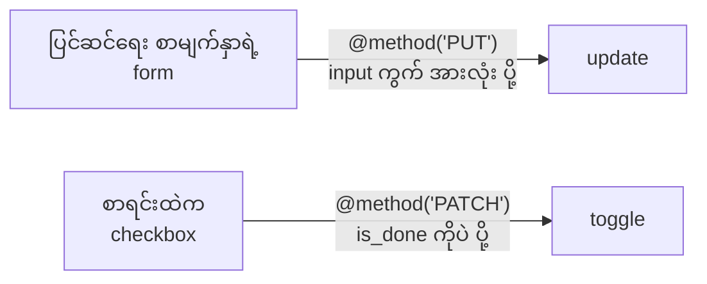
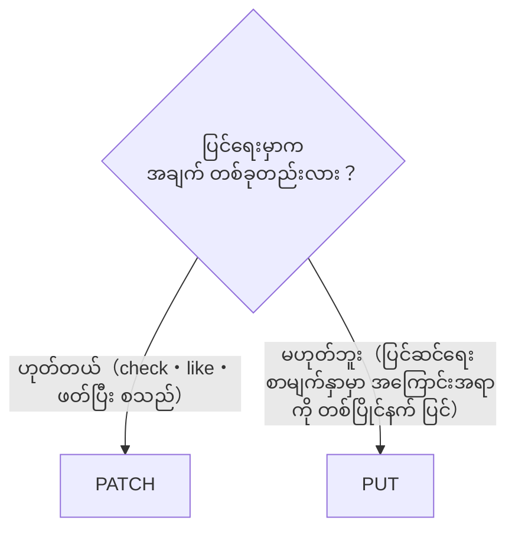
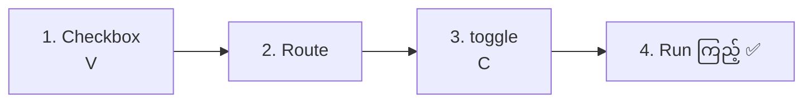
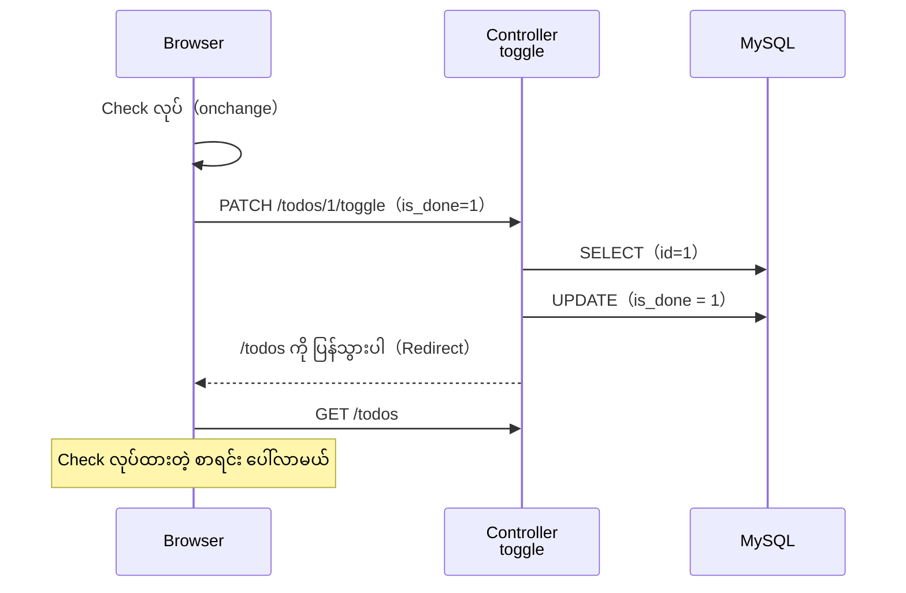
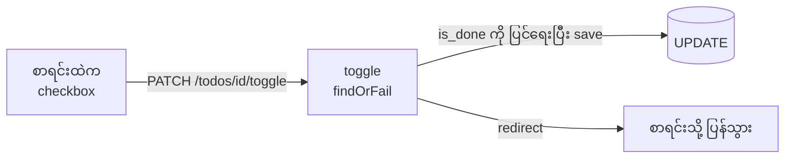

# Laravel မိတ်ဆက် — ပြီးဆုံး・မပြီးသေး ကို ပြောင်းကြည့်ရအောင်（PATCH）

> 🇯🇵 မူရင်း (ဂျပန်ဘာသာဖြင့်): [20261029_資料_2.md](<../../../1年生_データ設計とアプリ開発/後期/20261029/20261029_資料_2.md>) <!-- original-ja-link -->

[သင်ခန်းစာ 1](./20261029_資料_1.md) မှာ Todo ရဲ့ ခေါင်းစဉ်ကို ပြင်ဆင်နိုင်လာပြီ။ နောက်တစ်ဆင့်အနေနဲ့ စာရင်းထဲက checkbox နဲ့ **ပြီးဆုံး・မပြီးသေး ကို ပြောင်းနိုင်တဲ့ function** ကို လုပ်ပါမယ်။

## ဒီနေ့ရဲ့ ပန်းတိုင်
- PUT နဲ့ PATCH ရဲ့ ကွာခြားချက်ကို နားလည်မယ်
- PATCH နဲ့ `@method('PATCH')` ကို သုံးပြီး တစ်စိတ်တစ်ပိုင်းကိုပဲ ပြင်ရေးတဲ့ request ကို ပို့နိုင်မယ်
- Checkbox နဲ့ ပြီးဆုံး・မပြီးသေး ကို ပြောင်းနိုင်မယ်

> သင်ခန်းစာ 1 ရဲ့ 「Todo ကို ပြင်ဆင်ခြင်း」 ပြီးနေတဲ့ အခြေအနေကနေ စပါမယ်။

---

## 1. ပြီးဆုံး・မပြီးသေး ပြောင်းခြင်း ဆိုတာ

သင်ခန်းစာ 1 မှာ ပြင်ဆင်ရေး စာမျက်နှာကနေ အခြေအနေ（`is_done`）ကို ပြောင်းနိုင်လာပါပြီ။
ဒါပေမဲ့ စာရင်းထဲက checkbox ကိုတော့ နှိပ်ပေမယ့် **database ထဲမှာ မသိမ်းဆည်းပါဘူး**（စာမျက်နှာကို reload လုပ်ရင် မူလအတိုင်း ပြန်ဖြစ်သွားပါတယ်）။
ဒီမှာတော့ စာရင်းထဲက checkbox ကို **နှိပ်လိုက်တာနဲ့ 「ပြီးဆုံး ⇄ မပြီးသေး」 ချက်ချင်း ပြောင်းသွား** အောင် လုပ်ပါမယ်။
ပြင်ဆင်ရေး စာမျက်နှာကို တစ်ခါချင်း မဖွင့်ရဘဲ စာရင်းကနေ တန်းပြီး ပြောင်းနိုင်လာပါမယ်။

```
TODOアプリ

☐ 牛乳を買う         ← check လုပ်ရင် 「ပြီးဆုံး」 ဖြစ်သွားမယ်（牛乳を買う＝နွားနို့ဝယ်ရန်）
☑ レポートを出す     ← check ဖြုတ်ရင် 「မပြီးသေး」 ဆိုတဲ့ အခြေအနေကို ပြန်ရောက်သွားမယ်（レポートを出す＝အစီရင်ခံစာတင်ရန်）
```

အထဲမှာ လုပ်တာက သင်ခန်းစာ 1 မှာ လုပ်ခဲ့တဲ့ `update` နဲ့ အတူတူ **UPDATE** ဖြစ်ပါတယ်။ ပြင်ရေးတာက `title` မဟုတ်ဘဲ `is_done` ဖြစ်သွားတာပဲ ကွာပါတယ်။

| URL | အမျိုးအစား | တာဝန်ယူသူ | လုပ်မယ့်အရာ |
|-----|------|------|---------|
| `/todos/1/toggle` | **PATCH** | `toggle` | `is_done` ကို ပြင်ရေးမယ် |

`toggle`（တော်ဂယ်）ဆိုတာ 「on・off ပြောင်းတယ်」 ဆိုတဲ့ အဓိပ္ပာယ်ပါ။

---

## 2. အသစ် တွေ့ရမယ့် အကြောင်းအရာ：PATCH

ပြင်ရေးတဲ့အခါ သုံးတဲ့ အမျိုးအစားမှာ **PUT** အပြင် **PATCH**（ပက်ချ်）လည်း ရှိပါတယ်။
နှစ်ခုလုံး 「ပြင်ရေးတယ်」 ဆိုတာ တူပေမယ့် **ဘယ်လောက် ပြင်ရေးလဲ** ဆိုတာ ကွာပါတယ်။

| အမျိုးအစား | အဓိပ္ပာယ် | ဥပမာ ပြောရရင် |
|------|------|-----------|
| PUT | Data ကို **အကုန်လုံး** ပြင်ရေးတယ် | စာရွက်စာတမ်းကို အသစ် ပြန်ရေးပြီး **တစ်ခုလုံး အစားထိုးတယ်** |
| **PATCH** | Data ရဲ့ **တစ်စိတ်တစ်ပိုင်းကိုပဲ** ပြင်ရေးတယ် | စာရွက်စာတမ်းရဲ့ **တစ်နေရာတည်း** မှာ correction tape ကပ်တယ် |

`patch` ဆိုတာ အင်္ဂလိပ်လို 「ဖာထေးခြင်း（အဝတ်ရဲ့ အပေါက်ကို အထည်စ တစ်ခု ကပ်ပြီး ပြင်တာ）」 ဆိုတဲ့ အဓိပ္ပာယ်ပါ။

### လိပ်စာကတ်နဲ့ ယှဉ်ကြည့်ရအောင်

ဥပမာ ဒီလို 「လိပ်စာကတ်」 တစ်ခု ရှိတယ် ဆိုပါစို့（東京都〇〇区＝တိုကျိုမြို့ရှိ 〇〇 ရပ်ကွက်）။

```
အမည်：山田 花子
လိပ်စာ：東京都〇〇区…
ဖုန်း：090-xxxx-xxxx
```

အိမ်ပြောင်းလိုက်လို့ **လိပ်စာ တစ်ခုတည်းပဲ** ပြောင်းသွားပါတယ်（大阪府＝အိုဆာကာဒေသ）။

```
【PUT】ကတ်အသစ် တစ်ခု ရေးပြီး တစ်ခုလုံး အစားထိုးတယ်

  ┌──────────────────────┐
  │ အမည်：山田 花子       │ ← မပြောင်းပေမယ့် ရေးတယ်
  │ လိပ်စာ：大阪府…（အသစ်）│ ← ပြောင်းသွားတဲ့ နေရာ
  │ ဖုန်း：090-xxxx-xxxx  │ ← မပြောင်းပေမယ့် ရေးတယ်
  └──────────────────────┘

【PATCH】လက်ရှိ ကတ်ရဲ့ လိပ်စာ နေရာမှာပဲ correction tape ကပ်တယ်

  ┌──────────────────────┐
  │ လိပ်စာ：大阪府…（အသစ်）│ ← ပြောင်းသွားတဲ့ နေရာပဲ
  └──────────────────────┘
```

| | PUT | PATCH |
|---|---|---|
| ပို့မယ့်အရာ | **အမည်・လိပ်စာ・ဖုန်း အားလုံး**（မပြောင်းတဲ့ အမည်နဲ့ ဖုန်းကိုလည်း ရေးတယ်） | **လိပ်စာ တစ်ခုတည်း** |
| မရေးခဲ့တဲ့ အချက်တွေက？ | 「ဗလာ လုပ်မယ်」 ဆိုတဲ့ အဓိပ္ပာယ် ဖြစ်တယ် | 「ဒီအတိုင်း ထားမယ်」 ဆိုတဲ့ အဓိပ္ပာယ် ဖြစ်တယ် |

PUT က 「ဒါက ကတ်အသစ်ပါ」 ဆိုပြီး **အားလုံး** ကို ပေးတာဖြစ်လို့ ရေးဖို့ မေ့သွားတဲ့ အချက်တွေက ဗလာ ဖြစ်သွားပါတယ်။
PATCH က 「ဒီနေရာကိုပဲ ပြင်ပေးပါ」 ဆိုပြီး ပေးတာဖြစ်လို့ မရေးခဲ့တဲ့ အချက်တွေက ဒီအတိုင်း ကျန်ပါတယ်။

### Todo App မှာဆိုရင်

Todo App နဲ့ ယှဉ်ကြည့်ရင် ဒီလို ဖြစ်ပါတယ်။

| | ပြင်ဆင်ခြင်း（`update`） | ပြီးဆုံး・မပြီးသေး ပြောင်းခြင်း（`toggle`） |
|---|---|---|
| ဘယ်လို လုပ်ဆောင်ချက်လဲ？ | ပြင်ဆင်ရေး စာမျက်နှာမှာ **Todo ရဲ့ အကြောင်းအရာကို ပြန်ရေးပြီး** သိမ်းဆည်းတယ် | စာရင်းမှာ **check ကိုပဲ** ပြောင်းတယ် |
| ပို့မယ့်အရာ | ပြင်ဆင်ရေး စာမျက်နှာရဲ့ input ကွက် **အားလုံး**（`title` နဲ့ `is_done`） | **`is_done` တစ်ခုတည်း** |
| အမျိုးအစား | **PUT** | **PATCH** |
| ရေးပုံ | `@method('PUT')` ／ `Route::put(...)` | `@method('PATCH')` ／ `Route::patch(...)` |



> **ပြင်ဆင်ရေး စာမျက်နှာမှာလည်း အခြေအနေ ပြောင်းလို့ရတာပဲ၊ ဘာကြောင့် toggle ကို လုပ်ရတာလဲ？**
> ပြင်ဆင်ရေး စာမျက်နှာက 「ခေါင်းစဉ်နဲ့ အခြေအနေကို **တစ်ပြိုင်နက်** ပြန်ရေးတဲ့ မျက်နှာပြင်」 ဖြစ်ပါတယ်（PUT）။
> စာရင်းထဲက checkbox ကတော့ 「အခြေအနေ **တစ်ခုတည်း** ကို အဲဒီနေရာမှာ မြန်မြန် ပြောင်းဖို့」 ဖြစ်ပါတယ်（PATCH）။
> နှစ်ခုလုံး `is_done` ကို ပြောင်းပေမယ့် **ပို့မယ့်အရာ（အားလုံးလား၊ တစ်စိတ်တစ်ပိုင်းလား）ကွာလို့** processing ကိုလည်း အမျိုးအစားကိုလည်း သီးခြားစီ ခွဲထားပါတယ်။
> 「မျက်နှာပြင်ရဲ့ အချက်တွေကို အားလုံး ပြန်ပို့တာ」 က PUT၊ 「အချက် တစ်ခုတည်းကိုပဲ တိတိကျကျ ပြောင်းတာ」 က PATCH ဖြစ်ပါတယ်။

### မဆုံးဖြတ်နိုင်တဲ့အခါ



နေ့စဉ် သုံးနေတဲ့ app တွေမှာဆိုရင် ဥပမာ ဒီလို ခွဲခြားသုံးပါတယ်။

| လုပ်ဆောင်ချက် | အမျိုးအစား | အကြောင်းရင်း |
|------|------|------|
| Profile ပြင်ဆင်ရေး စာမျက်နှာမှာ 「သိမ်းရန်」 | PUT | အမည်・ကိုယ်ရေးအကျဉ်း စတာတွေကို တစ်ပြိုင်နက် ပြန်ပို့တယ် |
| Post ကို 「like」 လုပ်တယ် | PATCH | 「like」 တစ်နေရာတည်းကိုပဲ ပြောင်းတယ် |
| Message ကို 「ဖတ်ပြီး」 လုပ်တယ် | PATCH | 「ဖတ်ပြီးပြီလား」 တစ်နေရာတည်းကိုပဲ ပြောင်းတယ် |
| Todo ကို check လုပ်တယ် | PATCH | `is_done` တစ်နေရာတည်းကိုပဲ ပြောင်းတယ် |

### PUT နဲ့ PATCH၊ ဘယ်ဟာ သုံးသုံး အလုပ်လုပ်သလား？

Laravel မှာ ဘယ်ဟာကို သုံးသုံး `save()` နဲ့ အတူတူ သိမ်းဆည်းနိုင်ပါတယ်။ **Program ရဲ့ အလုပ်လုပ်ပုံ မပြောင်းပါဘူး**။
（လိပ်စာကတ် ဥပမာက 「PUT နဲ့ PATCH ရဲ့ **အဓိပ္ပာယ်**」 ဖြစ်ပါတယ်။ Laravel မှာ PUT နဲ့ မပို့ခဲ့တဲ့ အချက်တွေ အလိုအလျောက် ဗလာ ဖြစ်သွားတာ မရှိပါဘူး）
ဒါတောင် ခွဲခြားသုံးရတာက route ကို ကြည့်လိုက်ရုံနဲ့ **「ဘာလုပ်တဲ့ processing လဲ」 ဆိုတာ သိနိုင်အောင်** ဖြစ်ပါတယ်။

```php
Route::put('/todos/{id}', ...);           // 「Todo ကို တစ်ခုလုံး ပြန်ရေးမှာပဲ」
Route::patch('/todos/{id}/toggle', ...);  // 「Todo ရဲ့ တစ်စိတ်တစ်ပိုင်းကို ပြောင်းမှာပဲ」
```

> တကယ့် development မှာတော့ ပြင်ဆင်ရေး စာမျက်နှာအတွက်ပါ PATCH ကို သုံးတဲ့ team တွေလည်း ရှိပါတယ်။ အရေးကြီးတာက **team အတွင်းမှာ စည်းမျဉ်းကို တစ်ပြေးညီ ထားဖို့** ဖြစ်ပါတယ်။
> ဒီသင်တန်းမှာတော့ 「ပြင်ဆင်ရေး စာမျက်နှာဆိုရင် PUT၊ အချက် တစ်ခုတည်းကိုပဲ ပြောင်းရင် PATCH」 လို့ တစ်ပြေးညီ သတ်မှတ်ပါမယ်။

HTML form က PATCH ကိုလည်း မပို့နိုင်လို့ PUT လိုပဲ `@method('PATCH')` ကို သုံးပါတယ်။

> **ပထမ စာသင်နှစ်ဝက်ရဲ့ todo.php မှာလည်း လုပ်ခဲ့တယ်**
> ပထမ စာသင်နှစ်ဝက်မှာ `action=toggle` ကို ပို့ပြီး `isset($_POST['is_done']) ? 1 : 0` နဲ့ ပြီးဆုံး・မပြီးသေး ကို ဆုံးဖြတ်ခဲ့ပါတယ်။
> Laravel မှာလည်း အဲဒီ စဉ်းစားပုံအတိုင်း လုပ်ပါမယ်။

---

## 3. လုပ်ကြည့်ရအောင်



ပြင်ရမယ့် file တွေက အောက်ပါ 3 ခု ဖြစ်ပါတယ်（`src` ထဲမှာ）။

```
src/
├─ resources/views/todos/
│   └─ index.blade.php ················ 1. checkbox ကို form နဲ့ ဝိုင်းမယ်
├─ routes/
│   └─ web.php ························ 2. route ကို ထပ်ရေးမယ်
└─ app/Http/Controllers/
    └─ TodoController.php ············· 3. toggle method ကို ထပ်ရေးမယ်
```

---

### 1. စာရင်းထဲက checkbox နဲ့ သိမ်းဆည်းနိုင်အောင် လုပ်ခြင်း（V）

> အခု ဒီနေရာ：**🟢 1. Checkbox** → 2. Route → 3. toggle → 4. Run ကြည့်

`resources/views/todos/index.blade.php` ရဲ့ `<li>` ထဲကို အောက်ပါအတိုင်း ပြင်ရေးပါ။
လက်ရှိ checkbox ကို **form နဲ့ ဝိုင်းပြီး** `name`・`value`・`onchange` ကို ထပ်ထည့်ပါ။

```html
    <ul>
        @foreach ($todos as $todo)
            <li>
                {{-- ★ ဒီကနေ စပြင် --}}
                <form method="POST" action="/todos/{{ $todo->id }}/toggle" style="display: inline;">
                    @csrf
                    @method('PATCH')
                    <input type="checkbox" name="is_done" value="1" onchange="this.form.submit()" @checked($todo->is_done)>
                </form>
                {{-- ★ ဒီအထိ --}}
                <a href="/todos/{{ $todo->id }}">{{ $todo->title }}</a>
            </li>
        @endforeach
    </ul>
```

| | 10/15〜（နှိပ်ပေမယ့် မသိမ်းဆည်း） | ဒီနေ့ကစပြီး（နှိပ်ရင် သိမ်းဆည်း） |
|---|---|---|
| Form | မပါ | `<form ...>` နဲ့ ဝိုင်း |
| `name="is_done" value="1"` | မပါ | ပါ |
| `onchange` | မပါ | ပါ |
| `@checked(...)` | ပါ | ပါ（ဒီအတိုင်း） |

| Code | အဓိပ္ပာယ် |
|--------|------|
| `action="/todos/{{ $todo->id }}/toggle"` | `/todos/1/toggle` လိုမျိုး အဲဒီ Todo ရဲ့ `id` ပါတဲ့ URL သို့ ပို့တယ် |
| `@method('PATCH')` | 「တကယ်တော့ PATCH ပါ」 လို့ Laravel ကို ပြောပြတယ်（တစ်စိတ်တစ်ပိုင်းကိုပဲ ပြင်ရေးမှာ ဖြစ်လို့） |
| `name="is_done" value="1"` | Check **လုပ်ထားတဲ့အခါမှသာ** `is_done=1` ကို ပို့တယ် |
| `onchange="this.form.submit()"` | Check အခြေအနေကို ပြောင်းလိုက်တာနဲ့ form ကို ချက်ချင်း ပို့တယ်（submit button မလိုဘူး） |
| `@checked($todo->is_done)` | ပြီးဆုံးပြီးသား Todo ဆိုရင် အစကတည်းက check လုပ်ထားတယ်（10/15 နဲ့ အတူတူ） |
| `style="display: inline;"` | Form ရဲ့ နောက်မှာ စာကြောင်း မဆင်းဘဲ ခေါင်းစဉ်နဲ့ ဘေးချင်းကပ် ထားတယ် |

> **Checkbox ရဲ့ အရေးကြီးတဲ့ အလုပ်လုပ်ပုံ（သင်ခန်းစာ 1 ကို ပြန်လည်သုံးသပ်ခြင်း）**
> Checkbox က **check လုပ်ထားတဲ့အခါမှသာ** `is_done=1` ကို ပို့ပါတယ်။ Check ဖြုတ်ထားတဲ့အခါ `is_done` ကိုယ်တိုင်ကို မပို့ပါဘူး။
> ဒါကြောင့် controller မှာ သင်ခန်းစာ 1 ရဲ့ `update` လိုပဲ 「`is_done` **ပို့လာသလား မပို့လာဘူးလား**」 ဆိုတာနဲ့ ပြီးဆုံး・မပြီးသေး ကို ဆုံးဖြတ်ပါတယ်။

---

### 2. Route ရေးခြင်း

> အခု ဒီနေရာ：1. Checkbox → **🟢 2. Route** → 3. toggle → 4. Run ကြည့်

`routes/web.php` မှာ ★ ပါတဲ့ စာကြောင်း 1 ကြောင်းကို ထပ်ရေးပါ။

```php
Route::get('/todos', [TodoController::class, 'index']);
Route::post('/todos', [TodoController::class, 'store']);
Route::get('/todos/{id}', [TodoController::class, 'show']);
Route::get('/todos/{id}/edit', [TodoController::class, 'edit']);
Route::put('/todos/{id}', [TodoController::class, 'update']);
Route::patch('/todos/{id}/toggle', [TodoController::class, 'toggle']);  // ★ ထပ်ထည့်
```

`/todos/{id}`（ခေါင်းစဉ် ပြင်ဆင်ခြင်း）နဲ့ `/todos/{id}/toggle`（ပြီးဆုံး・မပြီးသေး ပြောင်းခြင်း）က URL မတူလို့ တာဝန်ယူသူလည်း သီးခြားစီ ဖြစ်ပါတယ်။

---

### 3. toggle method ရေးခြင်း（C）

> အခု ဒီနေရာ：1. Checkbox → 2. Route → **🟢 3. toggle** → 4. Run ကြည့်

`TodoController.php` မှာ ★ ပါတဲ့ `toggle` method ကို ထပ်ရေးပါ။

```php
    // ★ ဒီကနေ စထည့်
    public function toggle(Request $request, $id)
    {
        // ① id ဖြင့် ပြောင်းချင်တဲ့ Todo တစ်ခုကို ယူလာမယ်
        $todo = Todo::findOrFail($id);

        // ② is_done ပို့လာရင် ပြီးဆုံး（true）၊ မပို့လာရင် မပြီးသေး（false）
        $todo->is_done = $request->has('is_done');

        // ③ Database ထဲမှာ သိမ်းဆည်းမယ်
        $todo->save();

        // ④ စာရင်း စာမျက်နှာကို ပြန်သွားမယ်
        return redirect('/todos');
    }
    // ★ ဒီအထိ
```

| Code | အဓိပ္ပာယ် |
|--------|------|
| `$request->has('is_done')` | `is_done` ပို့လာရင် `true`၊ မပို့လာရင် `false`။ ပထမ စာသင်နှစ်ဝက်ရဲ့ `isset($_POST['is_done'])` နဲ့ အတူတူ |

`update` နဲ့ ယှဉ်ကြည့်ရအောင်။

| | `update`（ပြင်ဆင်ရေး စာမျက်နှာ） | `toggle`（စာရင်းထဲက checkbox） |
|---|---|---|
| ① | `Todo::findOrFail($id)` | `Todo::findOrFail($id)` |
| ② | `title` နဲ့ `is_done` ကို ပြင်ရေးတယ် | **`is_done` တစ်ခုတည်း** ကို ပြင်ရေးတယ် |
| ③ | `save()` → `UPDATE` | `save()` → `UPDATE` |
| ④ | အသေးစိတ် စာမျက်နှာကို ပြန်သွား | စာရင်း စာမျက်နှာကို ပြန်သွား |

ပထမ စာသင်နှစ်ဝက်ရဲ့ `todo.php` နဲ့ ယှဉ်ကြည့်ရအောင်။

```php
// ပထမ စာသင်နှစ်ဝက်
$id = (int)($_POST['id'] ?? 0);
$isDone = isset($_POST['is_done']) ? 1 : 0;
$stmt = $pdo->prepare("UPDATE todos SET is_done = :is_done WHERE id = :id");
$stmt->execute(['is_done' => $isDone, 'id' => $id]);
header('Location: index.php');
exit;

// Laravel
$todo = Todo::findOrFail($id);
$todo->is_done = $request->has('is_done');
$todo->save();
return redirect('/todos');
```

---

### 4. Run ကြည့်ခြင်း ✅

> အခု ဒီနေရာ：1. Checkbox → 2. Route → 3. toggle → **🟢 4. Run ကြည့်**

1. http://localhost:8000/todos ကို ဖွင့်ပါ
2. 「牛乳を買う」(နွားနို့ဝယ်ရန်) ရဲ့ checkbox ကို check လုပ်ပါ
3. စာမျက်နှာ reload ဖြစ်သွားပြီး check လုပ်ထားတဲ့အတိုင်း ရှိနေရင် အောင်မြင်ပါပြီ
4. Check ကို ထပ်ဖြုတ်ပြီး ဖြုတ်ထားတဲ့အတိုင်း ရှိနေလားလည်း စစ်ကြည့်ပါ



✅ **စစ်ဆေးချက် 1**：Check လုပ်ခဲ့တဲ့ Todo ရဲ့ အသေးစိတ် စာမျက်နှာကို ဖွင့်ပြီး 「完了 ✅」(ပြီးဆုံး) ဖြစ်နေလား စစ်ကြည့်ပါ။

✅ **စစ်ဆေးချက် 2**：phpMyAdmin မှာ `todos` table ကို ဖွင့်ပြီး `is_done` က `1`（ပြီးဆုံး）・`0`（မပြီးသေး）ကို ပြောင်းသွားလား စစ်ကြည့်ပါ။

---

## 4. အဆင်မပြေတဲ့အခါ

> **🔥 အလုပ်မလုပ်ရင် log ထုတ်ကြည့်ပါ！**
> Error ရဲ့ အကြောင်းရင်းကို မသိရင် `toggle` ထဲမှာ `Log::info()` ကို သုံးပြီး `is_done` ပို့လာလား စစ်ကြည့်ပါ → [【အရေးကြီး】Log ထုတ်နည်း](../20261022/【重要】ログの出し方.md)

| ပြဿနာ | အကြောင်းရင်းရှိတဲ့ နေရာ | ဖြေရှင်းနည်း |
|------|----------|------|
| Check လုပ်ပေမယ့် ဘာမှ မဖြစ်ဘူး | View | `<input>` မှာ `onchange="this.form.submit()"` ပါလား စစ်ပါ |
| Check လုပ်ရင် `404 Not Found` | Route | `routes/web.php` မှာ `Route::patch('/todos/{id}/toggle', ...)` ရေးထားလား စစ်ပါ |
| Check လုပ်ရင် `The POST method is not supported for route todos/1/toggle.` | View | Checkbox ရဲ့ form မှာ `@method('PATCH')` ပါလား စစ်ပါ |
| Check လုပ်ရင် `The PATCH method is not supported for route todos/1/toggle.` | Route | `routes/web.php` က `Route::put(...)` ဖြစ်မနေဘူးလား စစ်ပါ（`Route::patch(...)` လို့ ပြင်ပါ） |
| Check လုပ်ပေမယ့် ပြန်ဖြုတ်ပြီးသား ဖြစ်နေတယ် | View・Controller | `name="is_done"` နဲ့ `$request->has('is_done')` ရဲ့ စာလုံးပေါင်း တူလား စစ်ပါ |
| ပြီးဆုံးပြီးသား Todo ဖြစ်ပေမယ့် check မလုပ်ထားဘူး | View | `<input>` မှာ `@checked($todo->is_done)` ပါလား စစ်ပါ |

---

## 5. အနှစ်ချုပ်



| ဒီနေ့ ရေးခဲ့တာ | တစ်ကြောင်းတည်းနဲ့ ပြောရရင် |
|--------------|-----------|
| PATCH နဲ့ `@method('PATCH')` | တစ်စိတ်တစ်ပိုင်းကိုပဲ ပြင်ရေးတဲ့အခါ သုံးတယ်（အားလုံးဆိုရင် PUT） |
| `onchange="this.form.submit()"` | Check အခြေအနေကို ပြောင်းလိုက်တာနဲ့ form ကို ချက်ချင်း ပို့တယ် |
| `name="is_done" value="1"` | Check လုပ်ထားမှသာ `is_done=1` ကို ပို့တယ် |
| `Route::patch('/todos/{id}/toggle', ...)` | PATCH နဲ့ ပို့လာရင် `toggle` က တာဝန်ယူတယ် |
| `$request->has('is_done')` | `is_done` ပို့လာသလား မလာဘူးလား ဆိုတာနဲ့ ပြီးဆုံး・မပြီးသေး ကို ဆုံးဖြတ်တယ် |

---

နောက်တစ်ခါမှာ Todo ကို ဖျက်နိုင်တဲ့ function ကို လုပ်ပါမယ် → [Todo ကို ဖျက်ကြည့်ရအောင်（DELETE）](./20261029_資料_3.md)

<!-- nav:start -->

---

| ⬅️ ယခင် | 🗺️ ခြုံငုံပုံ | နောက်တစ်ခု ➡️ |
|:--|:--:|--:|
| [10/29 Todo ပြင်ဆင်ခြင်း（UPDATE）](20261029_資料_1.md) | [သင်ခန်းစာများ၏ ခြုံငုံပုံ](../../README.md) | [10/29 Todo ဖျက်ခြင်း（DELETE）](20261029_資料_3.md) |

<!-- nav:end -->
