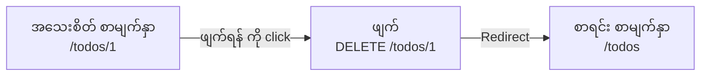
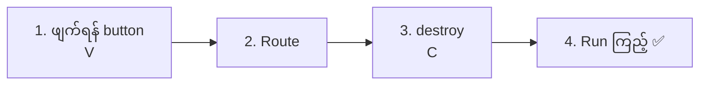
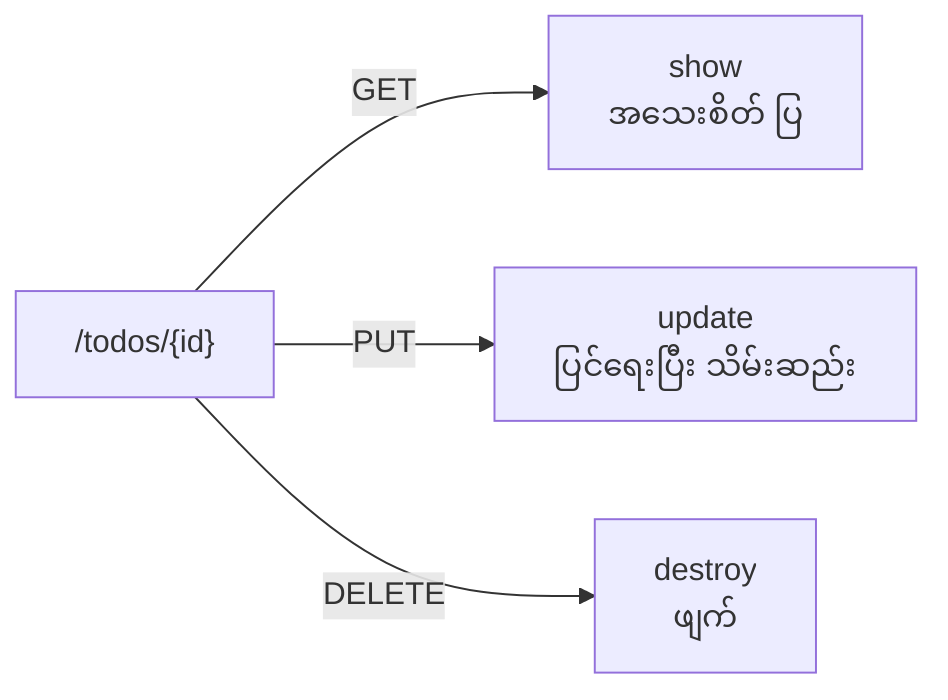
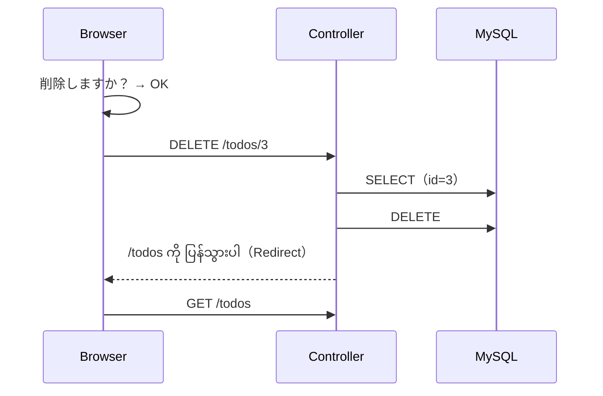
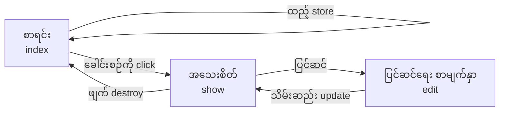

# Laravel မိတ်ဆက် — Todo ကို ဖျက်ကြည့်ရအောင်（DELETE）

> 🇯🇵 မူရင်း (ဂျပန်ဘာသာဖြင့်): [20261029_資料_3.md](<../../../1年生_データ設計とアプリ開発/後期/20261029/20261029_資料_3.md>) <!-- original-ja-link -->

[သင်ခန်းစာ 1](./20261029_資料_1.md)・[သင်ခန်းစာ 2](./20261029_資料_2.md) မှာ Todo ကို ပြင်ဆင်နိုင်လာပါပြီ။ နောက်တစ်ဆင့်အနေနဲ့ **Todo ကို ဖျက်နိုင်တဲ့ လုပ်ဆောင်ချက်** ကို တည်ဆောက်ပါမယ်။

## ဒီနေ့ရဲ့ ပန်းတိုင်
- DELETE နဲ့ `@method('DELETE')` ကို သုံးပြီး ဖျက်ခြင်း request ကို ပို့နိုင်မယ်
- `delete()` နဲ့ Todo ကို database ကနေ ဖျက်နိုင်မယ်
- ထည့်ခြင်း・ပြသခြင်း・ပြင်ဆင်ခြင်း・ဖျက်ခြင်း（CRUD）တစ်ခုလုံးကို နားလည်မယ်

> သင်ခန်းစာ 2 ရဲ့ 「ပြီးဆုံး・မပြီးသေး ပြောင်းခြင်း」 ပြီးနေတဲ့ အခြေအနေကနေ စပါမယ်။

---

## 1. ဖျက်ခြင်းရဲ့ အလုပ်လုပ်ပုံ

ပြင်ဆင်ခြင်းနဲ့ မတူဘဲ ဖျက်ခြင်းက **စာမျက်နှာ မဖွင့်ဘဲ button တစ်ချက်နှိပ်ရုံနဲ့ ပြီးပါတယ်**။



| URL | အမျိုးအစား | တာဝန်ယူသူ | လုပ်မယ့်အရာ |
|-----|------|------|---------|
| `/todos/1` | **DELETE** | `destroy` | Todo ကို ဖျက်မယ် |

### DELETE နဲ့ `@method('DELETE')`

「Data ကို ဖျက်တဲ့」 အခါ **DELETE** ဆိုတဲ့ အမျိုးအစားကို သုံးတာက Laravel ရဲ့ စည်းမျဉ်း ဖြစ်ပါတယ်။
PUT လိုပဲ HTML form က DELETE ကို မပို့နိုင်လို့ `@method('DELETE')` ကို သုံးပါတယ်။

| အမျိုးအစား | သုံးမယ့် အခြေအနေ | ရေးပုံ |
|------|---------|--------|
| PUT | ပြင်ရေးတယ် | Form မှာ `@method('PUT')` |
| PATCH | တစ်စိတ်တစ်ပိုင်းကိုပဲ ပြင်ရေးတယ် | Form မှာ `@method('PATCH')` |
| **DELETE** | ဖျက်တယ် | Form မှာ `@method('DELETE')` |

> **ဘာကြောင့် link（`<a>`）မဟုတ်ဘဲ form ရဲ့ button ဖြစ်ရတာလဲ？**
> Link က GET နဲ့ ဖွင့်ပါတယ်။ GET က 「ကြည့်ရုံပဲ」 ဆိုတဲ့ စည်းမျဉ်း ဖြစ်လို့ data ဖျက်တဲ့ processing မှာ မသုံးပါဘူး။
> တကယ်လို့ link နဲ့ ဖျက်လို့ရရင် URL ကို ဖွင့်လိုက်ရုံနဲ့ Todo ပျောက်သွားပါလိမ့်မယ်။
> Data ကို ပြောင်းလဲတဲ့（ထည့်ခြင်း・ပြင်ဆင်ခြင်း・ဖျက်ခြင်း）အခါ **form ရဲ့ button နဲ့ ပို့ရတယ်** လို့ မှတ်ထားပါ။

---

## 2. လုပ်ကြည့်ရအောင်



ပြင်ရမယ့် file တွေက အောက်ပါ 3 ခု ဖြစ်ပါတယ်（`src` ထဲမှာ）။

```
src/
├─ resources/views/todos/
│   └─ show.blade.php ················· 1. ဖျက်ရန် button ကို ထပ်ရေးမယ်
├─ routes/
│   └─ web.php ························ 2. route ကို ထပ်ရေးမယ်
└─ app/Http/Controllers/
    └─ TodoController.php ············· 3. destroy method ကို ထပ်ရေးမယ်
```

---

### 1. အသေးစိတ် စာမျက်နှာမှာ 「ဖျက်ရန်」 button ထည့်ခြင်း（V）

> အခု ဒီနေရာ：**🟢 1. ဖျက်ရန် button** → 2. Route → 3. destroy → 4. Run ကြည့်

`resources/views/todos/show.blade.php` မှာ ★ ပါတဲ့ form ကို ထပ်ရေးပါ။

```html
    <a href="/todos/{{ $todo->id }}/edit">編集</a>

    {{-- ★ ဒီကနေ စထည့် --}}
    <form method="POST" action="/todos/{{ $todo->id }}" onsubmit="return confirm('削除しますか？');">
        @csrf
        @method('DELETE')
        <button type="submit">削除</button>
    </form>
    {{-- ★ ဒီအထိ --}}

    <a href="/todos">一覧にもどる</a>
```

| Code | အဓိပ္ပာယ် |
|--------|------|
| `action="/todos/{{ $todo->id }}"` | `/todos/1` လိုမျိုး ဖျက်ချင်တဲ့ Todo ရဲ့ `id` ပါတဲ့ URL သို့ request ပို့တယ် |
| `@method('DELETE')` | 「တကယ်တော့ DELETE ပါ」 လို့ Laravel ကို ပြောပြတယ် |
| `onsubmit="return confirm('削除しますか？');"` | မပို့ခင် အတည်ပြု dialog ကို ပြတယ်（`削除しますか？` ＝ ဖျက်မှာလား？）။ 「キャンセル」（မလုပ်တော့ပါ）ကို ရွေးရင် မပို့ဘူး |

Input ကွက် မရှိပါဘူး။ **ဘယ် Todo ကို ဖျက်မလဲဆိုတာ URL ထဲက `id` နဲ့တင် သိနိုင်လို့** ဖြစ်ပါတယ်။

> **ပထမ စာသင်နှစ်ဝက်ရဲ့ todo.php မှာလည်း လုပ်ခဲ့တယ်**
> `confirm()` နဲ့ အတည်ပြုပြီးမှ ဖျက်တာက ပထမ စာသင်နှစ်ဝက်ရဲ့ `todo.php` နဲ့ အတူတူ ဖြစ်ပါတယ်။
> ဖျက်ပြီးရင် မူလအတိုင်း ပြန်မရနိုင်လို့ အတည်ပြုချက် ပြထားရင် စိတ်ချရပါတယ်။

---

### 2. Route ရေးခြင်း

> အခု ဒီနေရာ：1. ဖျက်ရန် button → **🟢 2. Route** → 3. destroy → 4. Run ကြည့်

`routes/web.php` မှာ ★ ပါတဲ့ စာကြောင်း 1 ကြောင်းကို ထပ်ရေးပါ။

```php
Route::get('/todos', [TodoController::class, 'index']);
Route::post('/todos', [TodoController::class, 'store']);
Route::get('/todos/{id}', [TodoController::class, 'show']);
Route::get('/todos/{id}/edit', [TodoController::class, 'edit']);
Route::put('/todos/{id}', [TodoController::class, 'update']);
Route::patch('/todos/{id}/toggle', [TodoController::class, 'toggle']);
Route::delete('/todos/{id}', [TodoController::class, 'destroy']);  // ★ ထပ်ထည့်
```

`destroy`（ဒစ်စထရွိုင်）ဆိုတာ 「ဖျက်ဆီးတယ်・ဖျက်တယ်」 ဆိုတဲ့ အဓိပ္ပာယ်ပါ။ Laravel မှာ ဖျက်တဲ့ method ကို `destroy` လို့ နာမည်ပေးလေ့ရှိပါတယ်။

ဒါဆိုရင် `/todos/{id}` ကို **GET ဆိုရင် `show`၊ PUT ဆိုရင် `update`၊ DELETE ဆိုရင် `destroy`** က တာဝန်ယူပါတယ်။

URL တူပေမယ့် ပို့ပုံ（အမျိုးအစား）အလိုက် တာဝန်ယူသူ ကွဲသွားပါတယ်။



---

### 3. destroy method ရေးခြင်း（C）

> အခု ဒီနေရာ：1. ဖျက်ရန် button → 2. Route → **🟢 3. destroy** → 4. Run ကြည့်

`TodoController.php` မှာ ★ ပါတဲ့ `destroy` method ကို ထပ်ရေးပါ။

```php
    // ★ ဒီကနေ စထည့်
    public function destroy($id)
    {
        // ① id ဖြင့် ဖျက်ချင်တဲ့ Todo တစ်ခုကို ယူလာမယ်
        $todo = Todo::findOrFail($id);

        // ② Database ကနေ ဖျက်မယ်
        $todo->delete();

        // ③ စာရင်း စာမျက်နှာကို ပြန်သွားမယ်
        return redirect('/todos');
    }
    // ★ ဒီအထိ
```

| Code | အဓိပ္ပာယ် |
|--------|------|
| `$todo->delete()` | Database ကနေ ဖျက်တယ်။ `DELETE FROM todos WHERE id = ?` နဲ့ အတူတူ |
| `redirect('/todos')` | စာရင်း စာမျက်နှာကို ပြန်သွားတယ်（ဖျက်လိုက်တဲ့ Todo ရဲ့ အသေးစိတ် စာမျက်နှာ မရှိတော့လို့） |

ပထမ စာသင်နှစ်ဝက်ရဲ့ `todo.php` နဲ့ ယှဉ်ကြည့်ရအောင်။

```php
// ပထမ စာသင်နှစ်ဝက်
$id = (int)($_POST['id'] ?? 0);
$stmt = $pdo->prepare("DELETE FROM todos WHERE id = :id");
$stmt->execute(['id' => $id]);
header('Location: index.php');
exit;

// Laravel
$todo = Todo::findOrFail($id);
$todo->delete();
return redirect('/todos');
```

---

### 4. Run ကြည့်ခြင်း ✅

> အခု ဒီနေရာ：1. ဖျက်ရန် button → 2. Route → 3. destroy → **🟢 4. Run ကြည့်**

1. http://localhost:8000/todos ကို ဖွင့်ပါ
2. ဖျက်လို့ရတဲ့ Todo（ဥပမာ 「宿題をする」(အိမ်စာလုပ်ရန်)）ကို click လုပ်ပြီး အသေးစိတ် စာမျက်နှာကို ဖွင့်ပါ
3. 「削除」(ဖျက်ရန်) ကို နှိပ်ပါ
4. 「削除しますか？」(ဖျက်မှာလား？) လို့ ပေါ်လာရင် `OK` ကို နှိပ်ပါ
5. စာရင်း စာမျက်နှာကို ပြန်ရောက်ပြီး အဲဒီ Todo မရှိတော့ရင် အောင်မြင်ပါပြီ



✅ **စစ်ဆေးချက် 1**：phpMyAdmin မှာ `todos` table ကို ဖွင့်ပြီး ဖျက်လိုက်တဲ့ Todo ရဲ့ row မရှိတော့ဘူးလား စစ်ကြည့်ပါ။

✅ **စစ်ဆေးချက် 2**：ဖျက်လိုက်တဲ့ Todo ရဲ့ အသေးစိတ် စာမျက်နှာ URL（ဥပမာ http://localhost:8000/todos/3 ）ကို တိုက်ရိုက် ဖွင့်ကြည့်ပါ။
မရှိတော့လို့ `404 Not Found` ပေါ်လာပါမယ်။ `findOrFail` အလုပ်လုပ်နေပါတယ်။

✅ **စစ်ဆေးချက် 3**：「削除」（ဖျက်ရန်）ကို နှိပ်ပြီး အတည်ပြု dialog မှာ `キャンセル`（မလုပ်တော့ပါ）ကို နှိပ်ရင် ဘာမှ မဖျက်ဘူးဆိုတာကိုလည်း စစ်ကြည့်ပါ။

---

## 3. အဆင်မပြေတဲ့အခါ

> **🔥 အလုပ်မလုပ်ရင် log ထုတ်ကြည့်ပါ！**
> Error ရဲ့ အကြောင်းရင်းကို မသိရင် `destroy` ထဲမှာ `Log::info()` ကို သုံးပြီး `$id` ရဲ့ တန်ဖိုးကို စစ်ကြည့်ပါ → [【အရေးကြီး】Log ထုတ်နည်း](../20261022/【重要】ログの出し方.md)

| ပြဿနာ | အကြောင်းရင်းရှိတဲ့ နေရာ | ဖြေရှင်းနည်း |
|------|----------|------|
| 「削除」 ကို နှိပ်ရင် `The POST method is not supported for route todos/1.` | View | ဖျက်ခြင်း form မှာ `@method('DELETE')` ပါလား စစ်ပါ |
| 「削除」 ကို နှိပ်ရင် `The DELETE method is not supported for route todos/1.` | Route | `routes/web.php` မှာ `Route::delete('/todos/{id}', ...)` ရေးထားလား စစ်ပါ |
| `Call to undefined method App\Http\Controllers\TodoController::destroy()` | Controller | `TodoController.php` မှာ `destroy` method ရေးထားလား၊ နာမည်ရဲ့ စာလုံးပေါင်း မှန်လား စစ်ပါ |
| ဖျက်လိုက်ပေမယ့် စာရင်းထဲမှာ ကျန်နေတယ် | Controller | `destroy` ထဲမှာ `$todo->delete();` ပါလား စစ်ပါ |
| အတည်ပြု dialog မပေါ်ဘူး | View | `<form>` မှာ `onsubmit="return confirm('削除しますか？');"` ပါလား စစ်ပါ |

---

## 4. CRUD ပြည့်စုံသွားပြီ！

ဒါဆိုရင် Todo ရဲ့ **ထည့်ခြင်း・ပြသခြင်း・ပြင်ဆင်ခြင်း・ဖျက်ခြင်း** အားလုံးကို လုပ်နိုင်လာပါပြီ။
ဒီ 4 ခုကို ပေါင်းပြီး **CRUD**（ကရပ်ဒ်）လို့ ခေါ်ပါတယ်။ Web app အများစုက ဒီ CRUD တွေကို ပေါင်းစပ်ပြီး ဖန်တီးထားတာ ဖြစ်ပါတယ်။

| | အဓိပ္ပာယ် | SQL | ဒီတစ်ခါရဲ့ Todo App | လုပ်ခဲ့တဲ့ နေ့ |
|---|---|---|---|---|
| **C**reate | ထည့်ခြင်း | `INSERT` | `store` | 10/22 |
| **R**ead | ပြသခြင်း | `SELECT` | `index`・`show` | 10/15・10/22 |
| **U**pdate | ပြင်ဆင်ခြင်း | `UPDATE` | `edit`・`update`・`toggle` | ဒီနေ့ |
| **D**elete | ဖျက်ခြင်း | `DELETE` | `destroy` | ဒီနေ့ |

Route က စုစုပေါင်း 7 ခု ဖြစ်သွားပါပြီ။

| Route | တာဝန်ယူသူ | လုပ်မယ့်အရာ |
|--------|------|---------|
| `GET /todos` | `index` | စာရင်းကို ပြမယ် |
| `POST /todos` | `store` | အသစ် ထည့်မယ် |
| `GET /todos/{id}` | `show` | Todo တစ်ခုကို အသေးစိတ် ပြမယ် |
| `GET /todos/{id}/edit` | `edit` | ပြင်ဆင်ရေး စာမျက်နှာကို ပြမယ် |
| `PUT /todos/{id}` | `update` | ပြင်ရေးပြီး သိမ်းဆည်းမယ် |
| `PATCH /todos/{id}/toggle` | `toggle` | ပြီးဆုံး・မပြီးသေး ကို ပြောင်းမယ် |
| `DELETE /todos/{id}` | `destroy` | ဖျက်မယ် |



<!-- nav:start -->

---

| ⬅️ ယခင် | 🗺️ ခြုံငုံပုံ | နောက်တစ်ခု ➡️ |
|:--|:--:|--:|
| [10/29 ပြီးဆုံး/မပြီးဆုံး ပြောင်းခြင်း（PATCH）](20261029_資料_2.md) | [သင်ခန်းစာများ၏ ခြုံငုံပုံ](../../README.md) | [11/05 Seeder・Factory](../20261105/20261105_資料_1.md) |

<!-- nav:end -->
