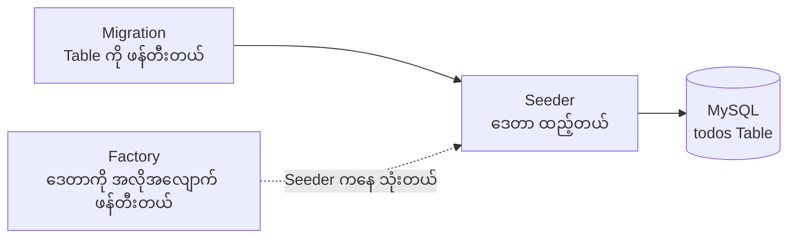
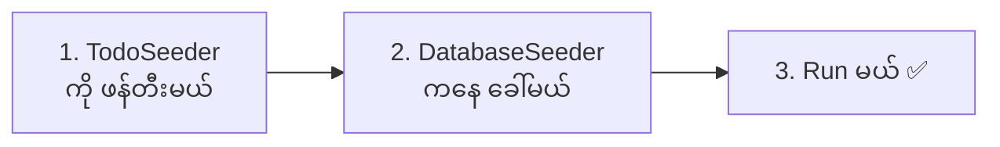
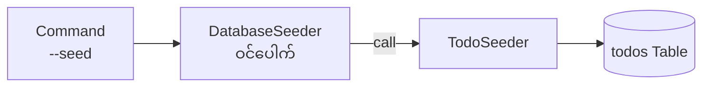
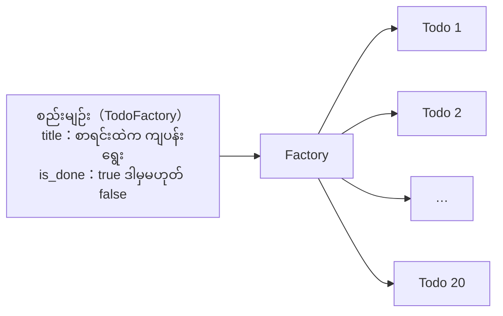
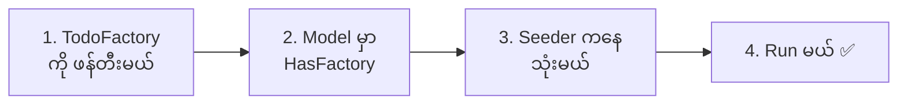
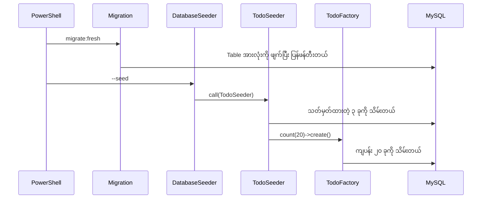
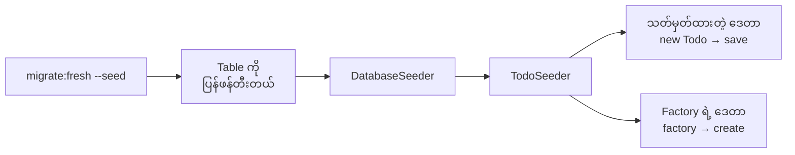

# Laravel မိတ်ဆက် — စမ်းသပ်ဒေတာ ထည့်ကြမယ် (Seeder・Factory)

> 🇯🇵 မူရင်း (ဂျပန်ဘာသာဖြင့်): [20261105_資料_1.md](<../../../1年生_データ設計とアプリ開発/後期/20261105/20261105_資料_1.md>) <!-- original-ja-link -->

အခုထိ Todo ဒေတာတွေကို phpMyAdmin မှာ တစ်ခုချင်း လက်နဲ့ရိုက်ထည့်တာ၊ ဒါမှမဟုတ် Form ကနေ ထည့်တာမျိုး လုပ်ခဲ့ပါတယ်။
ဒီနေ့တော့ **Command တစ်ကြောင်းတည်းနဲ့ စမ်းသပ်ဒေတာ ထည့်တဲ့နည်း** ကို လေ့လာပါမယ်။

## ဒီနေ့ရဲ့ ပန်းတိုင်
- Seeder (စီးဒါ) နဲ့ သတ်မှတ်ထားတဲ့ စမ်းသပ်ဒေတာကို ထည့်နိုင်ရမယ်
- Factory (ဖက်တရီ) နဲ့ စမ်းသပ်ဒေတာ အများကြီးကို အလိုအလျောက် ဖန်တီးနိုင်ရမယ်
- `migrate:fresh --seed` နဲ့ Database ကို ဘယ်အချိန်မဆို မူလအခြေအနေကို ပြန်ထားနိုင်ရမယ်

> လေ့ကျင့်ရေးပတ်ဝန်းကျင် (`php-study`) ရဲ့ mysql နဲ့ laravel ကို စတင်ပြီးမှ စပါမယ်။
> Command တွေကို PowerShell မှာ **laravel ဖိုဒါ** ထဲသို့ ပြောင်းဝင်ပြီးမှ Run ပါ။

---

## 1. စမ်းသပ်ဒေတာ ထည့်ပေးတဲ့ စနစ်က ဘာကြောင့် လိုအပ်တာလဲ?

အခုထိ ဒီလိုမျိုး ကြုံဖူးလား?

```
A：「ဖျက်တာ လေ့ကျင့်လိုက်တော့ Todo တွေ ကုန်သွားပြီ။ လက်နဲ့ ပြန်ထည့်ရဦးမှာလား…?」
B：「စာရင်းစာမျက်နှာရဲ့ ပုံစံကို ကြည့်ချင်ပေမဲ့ Todo က ၃ ခုပဲ ရှိတယ်」
C：「သူငယ်ချင်းရဲ့ PC ထဲက ဒေတာတွေနဲ့ ငါ့ PC ထဲက ဒေတာတွေ မတူဘူး」
```

စမ်းသပ်ဒေတာကို **Program နဲ့ ထည့်** အောင် လုပ်ထားရင် ဒီလို ဖြစ်လာပါတယ်။

| | phpMyAdmin မှာ လက်နဲ့ရိုက်ထည့်ခြင်း | Program နဲ့ ထည့်ခြင်း |
|---|---|---|
| ထည့်ရတဲ့ အလုပ် | တစ်ခုချင်း ရိုက်ထည့်ရ | Command တစ်ကြောင်း |
| ပျက်သွားရင် | လက်နဲ့ ပြန်ရိုက်ရ | Command တစ်ကြောင်းနဲ့ မူလအတိုင်း ပြန်ဖြစ် |
| ၁၀၀ ခု လိုချင်ရင် | အရမ်းခက် | ဂဏန်းကို ပြောင်းရုံပဲ |
| လူတိုင်းရဲ့ PC မှာ | တစ်ယောက်နဲ့တစ်ယောက် မတူ | ဒေတာ အတူတူ ဖြစ်မယ် |

Laravel မှာ ဒါကို **Seeder** နဲ့ **Factory** နဲ့ လုပ်ပါတယ်။

---

## 2. Seeder နဲ့ Factory

**Seeder** (စီးဒါ) ဆိုတာ「မျိုးစေ့ (seed) ကြဲတဲ့အရာ」လို့ အဓိပ္ပာယ်ရပါတယ်။
ဘာမှမရှိတဲ့ Table ထဲကို ပထမဆုံးဒေတာဆိုတဲ့「မျိုးစေ့」ကို ကြဲပေးပါတယ်။

| အမည် | တာဝန် | ဥပမာပေးရရင် |
|------|------|-----------|
| **Migration** | Table ကို ဖန်တီးတယ် (10/15 မှာ လေ့လာခဲ့) | လယ်ကွင်း ပြင်ဆင်တယ် |
| **Seeder** | Table ထဲကို ဒေတာ ထည့်တယ် | မျိုးစေ့ ကြဲတယ် |
| **Factory** | ဒေတာ အများကြီးကို အလိုအလျောက် ဖန်တီးတယ် | မျိုးစေ့ အများကြီး ထုတ်ပေးတဲ့ စက် |



ဒီနေ့ အောက်ပါ အစီအစဉ် ၂ ဆင့်နဲ့ ဖန်တီးပါမယ်။

1. **Seeder** နဲ့ သတ်မှတ်ထားတဲ့ Todo ၃ ခုကို ထည့်မယ်
2. **Factory** နဲ့ Todo ၂၀ ခုကို အလိုအလျောက် ဖန်တီးပြီး ထည့်မယ်

ဖိုင်တွေရဲ့ နေရာက `src` ထဲမှာ ဒီလိုပါ။

```
src/
└─ database/
    ├─ migrations/ ··········· Table ရဲ့ ဒီဇိုင်းပုံ (10/15 မှာ ဖန်တီးခဲ့)
    ├─ seeders/
    │   ├─ DatabaseSeeder.php ··· အစကတည်းက ရှိတယ်။ ဒီကနေ Seeder အားလုံးကို Run တယ်
    │   └─ TodoSeeder.php ······· ဒီနေ့ ဖန်တီးမယ်
    └─ factories/
        └─ TodoFactory.php ······ ဒီနေ့ ဖန်တီးမယ်
```

---

## 3. Seeder နဲ့ သတ်မှတ်ထားတဲ့ ဒေတာ ထည့်ကြမယ်



### 1. TodoSeeder ကို ဖန်တီးမယ်

> အခုရောက်နေတဲ့နေရာ：**🟢 1. TodoSeeder** → 2. DatabaseSeeder → 3. Run မယ်

အောက်ပါ Command နဲ့ Seeder ဖိုင်ကို ဖန်တီးပါ။

```powershell
docker compose exec laravel php artisan make:seeder TodoSeeder
```

`database/seeders/TodoSeeder.php` ဖိုင် ထွက်လာမှာဖြစ်လို့ အထဲက Code ကို အောက်ပါအတိုင်း ပြင်ရေးပါ။ `牛乳を買う` ဆိုတာ နွားနို့ဝယ်ရန်၊ `レポートを出す` ဆိုတာ အစီရင်ခံစာတင်ရန်၊ `宿題をする` ဆိုတာ အိမ်စာလုပ်ရန် ဖြစ်ပါတယ်။

```php
<?php

namespace Database\Seeders;

use App\Models\Todo;  // ← Todo Model ကို သုံးဖို့အတွက် တစ်ကြောင်း
use Illuminate\Database\Seeder;

class TodoSeeder extends Seeder
{
    public function run(): void
    {
        // ထည့်ချင်တဲ့ ဒေတာကို Array နဲ့ ပြင်ဆင်ထားမယ်
        $todos = [
            ['title' => '牛乳を買う',     'is_done' => false],
            ['title' => 'レポートを出す', 'is_done' => true],
            ['title' => '宿題をする',     'is_done' => false],
        ];

        // တစ်ခုချင်းစီ Todo ကို ဖန်တီးပြီး သိမ်းမယ်
        foreach ($todos as $data) {
            $todo = new Todo();
            $todo->title = $data['title'];
            $todo->is_done = $data['is_done'];
            $todo->save();
        }
    }
}
```

| Code | အဓိပ္ပာယ် |
|--------|------|
| `run()` | Seeder ကို Run တဲ့အခါ အလုပ်လုပ်တဲ့ Method |
| `$todos = [ ... ]` | ထည့်ချင်တဲ့ ဒေတာရဲ့ Array (ပထမစာသင်နှစ်ဝက်မှာ လေ့လာခဲ့တဲ့ Associative Array) |
| `foreach` | Array ထဲက တစ်ခုချင်း ထုတ်ယူပြီး ထပ်ခါထပ်ခါ လုပ်တယ် |
| `new Todo()` 〜 `save()` | 10/22 မှာ လေ့လာခဲ့တဲ့ `store` နဲ့ ရေးပုံတူတူသုံးပြီး Todo တစ်ခုကို သိမ်းတယ် |

`store` မှာတော့ Form ကနေ လက်ခံရရှိတဲ့ တန်ဖိုးကို ထည့်ခဲ့ပေမဲ့ Seeder မှာတော့ **Array ထဲက တန်ဖိုး** ကို ထည့်ပါတယ်။ ကွာခြားချက်က ဒါတစ်ခုတည်းပါ။

---

### 2. DatabaseSeeder ကနေ ခေါ်မယ်

> အခုရောက်နေတဲ့နေရာ：1. TodoSeeder → **🟢 2. DatabaseSeeder** → 3. Run မယ်

`database/seeders/DatabaseSeeder.php` က **Seeder တွေရဲ့ ဝင်ပေါက်** ပါ။
Seeder ကို Run တဲ့ Command ကို ရိုက်လိုက်ရင် ဒီဖိုင်က အရင်ဆုံး အလုပ်လုပ်ပါတယ်။

ဖွင့်ကြည့်ရင် 「စမ်းသပ်ဖို့ User တစ်ယောက် ဖန်တီးတဲ့」 Code က အစကတည်းက ရေးထားပါတယ်။
အခု User ကို မသုံးသေးတဲ့အတွက် အထဲက Code ကို အောက်ပါအတိုင်း ပြင်ရေးပါ။

```php
<?php

namespace Database\Seeders;

use Illuminate\Database\Seeder;

class DatabaseSeeder extends Seeder
{
    public function run(): void
    {
        // TodoSeeder ကို Run မယ်
        $this->call(TodoSeeder::class);
    }
}
```

`$this->call(TodoSeeder::class)` ဆိုတာ「`TodoSeeder` ကို Run ပေးပါ」လို့ အဓိပ္ပာယ်ရပါတယ်။
Seeder တွေ များလာရင် ဒီနေရာမှာ `$this->call(...)` ကို ထပ်ဖြည့်ရေးသွားပါ။



---

### 3. Run မယ် ✅

> အခုရောက်နေတဲ့နေရာ：1. TodoSeeder → 2. DatabaseSeeder → **🟢 3. Run မယ်**

အောက်ပါ Command ကို Run ပါ။

```powershell
docker compose exec laravel php artisan migrate:fresh --seed
```

| အပိုင်း | အဓိပ္ပာယ် |
|------|------|
| `migrate:fresh` | **Table အားလုံးကို ဖျက်ပြီး** Migration နဲ့ ပြန်ဖန်တီးတယ် |
| `--seed` | ပြန်ဖန်တီးပြီးနောက် Seeder နဲ့ ဒေတာ ထည့်တယ် |

> ⚠️ **`migrate:fresh` က ဒေတာအားလုံးကို ဖျက်ပစ်ပါတယ်**
> phpMyAdmin ဒါမှမဟုတ် Form ကနေ ထည့်ခဲ့တဲ့ Todo တွေလည်း အားလုံး ပျက်သွားပါမယ်။
> လေ့ကျင့်ရေးသုံး Database ဖြစ်လို့ ပြဿနာမရှိပေမဲ့ **တကယ်သုံးနေတဲ့ (Production) Database မှာ လုံးဝ မသုံးပါနဲ့**။

✅ **စစ်ဆေးချက် 1**：http://localhost:8000/todos ကို ဖွင့်ပြီး Todo ၃ ခု ပေါ်လာရင် OK ပါ။

✅ **စစ်ဆေးချက် 2**：phpMyAdmin မှာ `todos` Table ကို ဖွင့်ကြည့်ပါ။
`save()` နဲ့ ထည့်ခဲ့တဲ့အတွက် `created_at` နဲ့ `updated_at` မှာလည်း ရက်စွဲနဲ့အချိန် ဝင်နေပါတယ် (လက်နဲ့ရိုက်ထည့်တုန်းက ဗလာ ဖြစ်နေခဲ့ပါတယ်)။

✅ **စစ်ဆေးချက် 3**：Todo အချို့ကို ဖျက်ပြီးနောက် `migrate:fresh --seed` ကို နောက်တစ်ခါ Run ကြည့်ပါ။
**မူလ Todo ၃ ခုကို ပြန်ရပါမယ်။** ဒါကြောင့် ဘယ်အချိန်မဆို လေ့ကျင့်ခန်းကို အစကနေ ပြန်လုပ်နိုင်ပါတယ်။

---

## 4. Factory နဲ့ ဒေတာ အများကြီး ဖန်တီးကြမယ်

၃ ခုဆိုရင် လက်နဲ့ ရေးနိုင်ပေမဲ့ ၂၀ ခု၊ ၁၀၀ ခုဆိုရင်တော့ ခက်ပါတယ်။
**Factory** ကို သုံးရင်「ဒီလိုမျိုး ဒေတာကို ဖန်တီးပေးပါ」ဆိုတဲ့ စည်းမျဉ်းတစ်ခု ရေးရုံနဲ့ လိုသလောက် အလိုအလျောက် ဖန်တီးနိုင်ပါတယ်။





### 1. TodoFactory ကို ဖန်တီးမယ်

> အခုရောက်နေတဲ့နေရာ：**🟢 1. TodoFactory** → 2. HasFactory → 3. Seeder ကနေ သုံးမယ် → 4. Run မယ်

```powershell
docker compose exec laravel php artisan make:factory TodoFactory
```

`database/factories/TodoFactory.php` ဖိုင် ထွက်လာမှာဖြစ်လို့ `definition()` ရဲ့ အထဲကို အောက်ပါအတိုင်း ပြင်ရေးပါ။ `部屋のそうじ` ဆိုတာ အခန်းသန့်ရှင်းရေးလုပ်ရန်၊ `本を返す` ဆိုတာ စာအုပ်ပြန်အပ်ရန်၊ `ゴミを出す` ဆိုတာ အမှိုက်ပစ်ရန် ဖြစ်ပါတယ်။

```php
    public function definition(): array
    {
        return [
            'title' => fake()->randomElement([
                '牛乳を買う',
                'レポートを出す',
                '宿題をする',
                '部屋のそうじ',
                '本を返す',
                'ゴミを出す',
            ]),
            'is_done' => fake()->boolean(),
        ];
    }
```

| Code | အဓိပ္ပာယ် |
|--------|------|
| `definition()` | 「Todo တစ်ခုကို ဘယ်လို တန်ဖိုးတွေနဲ့ ဖန်တီးမလဲ」ဆိုတဲ့ စည်းမျဉ်းကို ရေးတဲ့နေရာ |
| `fake()` | စမ်းသပ်ဒေတာအတွက် ကျပန်းတန်ဖိုးတွေ ဖန်တီးပေးတဲ့ ကိရိယာ (Faker) |
| `fake()->randomElement([...])` | Array ထဲကနေ တစ်ခုကို ကျပန်း ရွေးတယ် |
| `fake()->boolean()` | `true` ဒါမှမဟုတ် `false` ကို ကျပန်း ရွေးတယ် |

`id`・`created_at`・`updated_at` တို့က အရင်လိုပဲ အလိုအလျောက် ဝင်သွားမှာဖြစ်လို့ မရေးပါဘူး။

---

### 2. Model မှာ HasFactory ကို ရေးမယ်

> အခုရောက်နေတဲ့နေရာ：1. TodoFactory → **🟢 2. HasFactory** → 3. Seeder ကနေ သုံးမယ် → 4. Run မယ်

Factory ကို သုံးဖို့အတွက် Model ထဲမှာ「Factory ကို သုံးလို့ရအောင် လုပ်ပေးတဲ့」Code တစ်ကြောင်း လိုပါတယ်။
`app/Models/Todo.php` ကို ဖွင့်ပြီး ★ ပါတဲ့ ၂ ကြောင်းကို ထပ်ဖြည့်ရေးပါ။

```php
<?php

namespace App\Models;

use Illuminate\Database\Eloquent\Factories\HasFactory;  // ★ ထပ်ဖြည့်
use Illuminate\Database\Eloquent\Model;

class Todo extends Model
{
    use HasFactory;  // ★ ထပ်ဖြည့်
}
```

ဒါဆိုရင် `Todo::factory()` လို့ ရေးလိုက်တာနဲ့ `TodoFactory` ကို သုံးလို့ရသွားပါပြီ။
(Laravel က Model အမည် `Todo` ကနေ `TodoFactory` ကို အလိုအလျောက် ရှာပေးပါတယ်)

---

### 3. Seeder ကနေ Factory ကို သုံးမယ်

> အခုရောက်နေတဲ့နေရာ：1. TodoFactory → 2. HasFactory → **🟢 3. Seeder ကနေ သုံးမယ်** → 4. Run မယ်

`database/seeders/TodoSeeder.php` ရဲ့ `run()` အဆုံးမှာ ★ ပါတဲ့ တစ်ကြောင်းကို ထပ်ဖြည့်ရေးပါ။

```php
    public function run(): void
    {
        $todos = [
            ['title' => '牛乳を買う',     'is_done' => false],
            ['title' => 'レポートを出す', 'is_done' => true],
            ['title' => '宿題をする',     'is_done' => false],
        ];

        foreach ($todos as $data) {
            $todo = new Todo();
            $todo->title = $data['title'];
            $todo->is_done = $data['is_done'];
            $todo->save();
        }

        // ★ Factory နဲ့ Todo ၂၀ ခု ဖန်တီးပြီး သိမ်းမယ်
        Todo::factory()->count(20)->create();
    }
```

```
Todo::factory() -> count(20) -> create();
~~~~~~~~~~~~~~~    ~~~~~~~~~    ~~~~~~~~
TodoFactory နဲ့    ၂၀ ခု        ဖန်တီးပြီး သိမ်းမယ်
```

---

### 4. Run မယ် ✅

> အခုရောက်နေတဲ့နေရာ：1. TodoFactory → 2. HasFactory → 3. Seeder ကနေ သုံးမယ် → **🟢 4. Run မယ်**

```powershell
docker compose exec laravel php artisan migrate:fresh --seed
```

✅ **စစ်ဆေးချက် 1**：http://localhost:8000/todos ကို ဖွင့်ပြီး Todo **၂၃ ခု** (သတ်မှတ်ထားတဲ့ ၃ ခု ＋ Factory ရဲ့ ၂၀ ခု) ပေါ်လာရင် OK ပါ။

✅ **စစ်ဆေးချက် 2**：`migrate:fresh --seed` ကို နောက်တစ်ခါ Run ကြည့်ပါ။
မူလ ၃ ခုကတော့ အတူတူပဲ ဖြစ်ပေမဲ့ Factory နဲ့ ဖန်တီးခဲ့တဲ့ ၂၀ ခုကတော့ **Run တိုင်း ခေါင်းစဉ်နဲ့ ပြီး/မပြီး အခြေအနေ ပြောင်းသွားပါတယ်**။ ကျပန်း ဖန်တီးထားလို့ပါ။



---

## 5. Command အနှစ်ချုပ်

| Command | လုပ်ဆောင်ချက် |
|---------|---------|
| `php artisan make:seeder TodoSeeder` | Seeder ဖိုင်ကို ဖန်တီးတယ် |
| `php artisan make:factory TodoFactory` | Factory ဖိုင်ကို ဖန်တီးတယ် |
| `php artisan migrate:fresh --seed` | Table အားလုံးကို ပြန်ဖန်တီးပြီး Seeder နဲ့ ဒေတာ ထည့်တယ် |
| `php artisan db:seed` | Table ကို ဒီအတိုင်းထားပြီး Seeder နဲ့ ဒေတာကို **ထပ်ပေါင်းထည့်** တယ် |

> **`db:seed` တစ်ခုတည်းကို ရိုက်ရင် ဒေတာတွေ တိုးလာနေမယ်**
> `db:seed` က လက်ရှိဒေတာကို မဖျက်ဘဲ **ထပ်ပေါင်းထည့်** ပါတယ်။ ၂ ခါ ရိုက်ရင် Todo လည်း ၂ ဆ ဖြစ်သွားပါမယ်။
> 「မူလအခြေအနေကို ပြန်ထားချင်တယ်」ဆိုရင် `migrate:fresh --seed` ကို သုံးပါ။

(Command အားလုံးကို ရှေ့မှာ `docker compose exec laravel` ထည့်ပြီး Run ပါ)

---

## 6. အဆင်မပြေတဲ့အခါ

> **🔥 အလုပ်မလုပ်ရင် Log ထုတ်ကြည့်ပါ!**
> Seeder ထဲမှာလည်း `Log::info()` ကို သုံးလို့ရပါတယ် → [【အရေးကြီး】Log ထုတ်နည်း](../20261022/【重要】ログの出し方.md)

| ပြဿနာ | အကြောင်းရင်းရှိတဲ့နေရာ | ဖြေရှင်းနည်း |
|------|----------|------|
| `Class "Database\Seeders\Todo" not found` | Seeder | `TodoSeeder.php` ရဲ့ အပေါ်ပိုင်းမှာ `use App\Models\Todo;` ပါမပါ စစ်ပါ |
| `Call to undefined method App\Models\Todo::factory()` | Model | `Todo.php` မှာ `use HasFactory;` ရေးထားမထား စစ်ပါ (အပေါ်က `use Illuminate\...\HasFactory;` လည်း လိုပါတယ်) |
| `Class "Database\Factories\TodoFactory" not found` | Factory | `database/factories/TodoFactory.php` ရှိမရှိ၊ ဖိုင်အမည်နဲ့ Class အမည်ကို စစ်ပါ |
| `Duplicate entry 'test@example.com'` | DatabaseSeeder | စမ်းသပ်ဖို့ User ဖန်တီးတဲ့ Code ကျန်နေတုန်း `db:seed` ကို ၂ ခါ ရိုက်ခဲ့တယ်။ `DatabaseSeeder.php` ကို ပြင်ရေးပါ၊ ဒါမှမဟုတ် `migrate:fresh --seed` ကို သုံးပါ |
| Todo တွေ ၂ ဆ၊ ၃ ဆ တိုးလာတယ် | Command | `db:seed` ကို အကြိမ်ကြိမ် ရိုက်ခဲ့တယ်။ `migrate:fresh --seed` နဲ့ အစကနေ ပြန်လုပ်ပါ |
| Run ပေမဲ့ Todo မဝင်ဘူး | DatabaseSeeder | `DatabaseSeeder.php` မှာ `$this->call(TodoSeeder::class);` ပါမပါ စစ်ပါ |

---

## 7. အနှစ်ချုပ်



| ဒီနေ့ ရေးခဲ့တာ | တစ်ခွန်းတည်းနဲ့ ပြောရရင် |
|--------------|-----------|
| `TodoSeeder` | သတ်မှတ်ထားတဲ့ စမ်းသပ်ဒေတာကို ထည့်တယ် |
| `DatabaseSeeder` ရဲ့ `$this->call(...)` | Seeder တွေရဲ့ ဝင်ပေါက်။ ဒီကနေ Seeder တစ်ခုချင်းစီကို Run တယ် |
| `TodoFactory` ရဲ့ `definition()` | ဒေတာ တစ်ခုကို ဘယ်လို တန်ဖိုးတွေနဲ့ ဖန်တီးမလဲဆိုတဲ့ စည်းမျဉ်း |
| Model ရဲ့ `use HasFactory;` | `Todo::factory()` ကို သုံးလို့ရအောင် လုပ်ပေးတယ် |
| `Todo::factory()->count(20)->create()` | စည်းမျဉ်းအတိုင်း ၂၀ ခု ဖန်တီးပြီး သိမ်းတယ် |
| `migrate:fresh --seed` | Database ကို ဘယ်အချိန်မဆို မူလအခြေအနေသို့ ပြန်ထားပေးတယ် |

---

## 8. ထပ်စမ်းကြည့်ကြမယ် (အချိန်ပိုနေတဲ့သူတွေအတွက်)

1. Factory နဲ့ ဖန်တီးမယ့် အရေအတွက်ကို **၁၀၀ ခု** ပြောင်းပြီး စာရင်းစာမျက်နှာ ဘယ်လိုဖြစ်သွားလဲ ကြည့်ပါ။
2. Factory ရဲ့ `randomElement` စာရင်းထဲကို ကိုယ်တိုင်စဉ်းစားထားတဲ့ Todo ၅ ခု ထပ်ဖြည့်ကြည့်ပါ။

<details>
<summary>အရိပ်အမြွက်</summary>

1. `TodoSeeder.php` ထဲက `count(20)` ကို `count(100)` လို့ ပြောင်းပြီး `migrate:fresh --seed` ကို Run ပါ။
2. `TodoFactory.php` ထဲက `randomElement([...])` ရဲ့ Array ထဲမှာ `'買い物に行く',` (ဈေးဝယ်ထွက်မယ်) လိုမျိုး ထပ်ဖြည့်ရေးပါ။

</details>

<!-- nav:start -->

---

| ⬅️ ယခင် | 🗺️ ခြုံငုံပုံ | နောက်တစ်ခု ➡️ |
|:--|:--:|--:|
| [10/29 Todo ဖျက်ခြင်း（DELETE）](../20261029/20261029_資料_3.md) | [သင်ခန်းစာများ၏ ခြုံငုံပုံ](../../README.md) | [11/05 Validation](20261105_資料_2.md) |

<!-- nav:end -->
