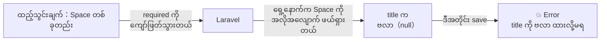
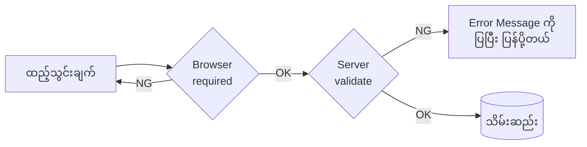
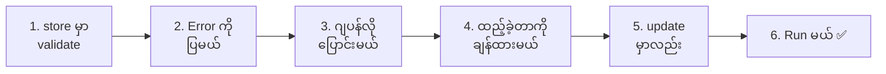
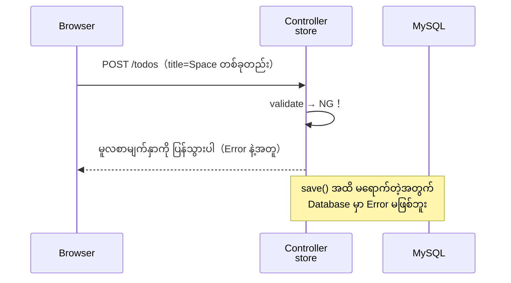
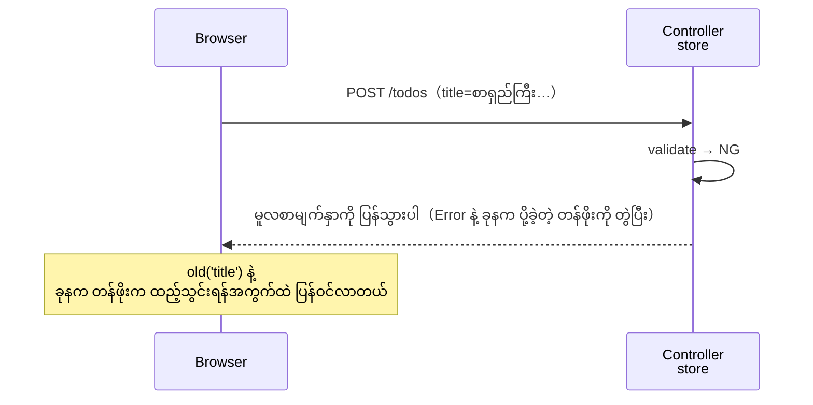
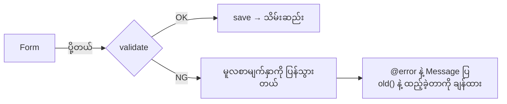

# Laravel မိတ်ဆက် — ထည့်သွင်းချက်ကို စစ်ဆေးကြမယ် (Validation)

> 🇯🇵 မူရင်း (ဂျပန်ဘာသာဖြင့်): [20261105_資料_2.md](<../../../1年生_データ設計とアプリ開発/後期/20261105/20261105_資料_2.md>) <!-- original-ja-link -->

Todo ထည့်တာ・ပြင်တာ လုပ်နိုင်လာပြီဆိုပေမဲ့ တကယ်တော့ **မှားယွင်းတဲ့ တန်ဖိုး ထည့်လိုက်ရင် Error စာမျက်နှာ ပေါ်လာတဲ့** ပြဿနာ ရှိနေပါတယ်။
ဒီနေ့တော့ ထည့်သွင်းလိုက်တဲ့ တန်ဖိုးကို Server ဘက်မှာ စစ်ဆေးပေးတဲ့ **Validation** ကို လေ့လာပါမယ်။

## ဒီနေ့ရဲ့ ပန်းတိုင်
- Browser ရဲ့ စစ်ဆေးမှု (`required`) တစ်ခုတည်းနဲ့ ဘာကြောင့် မလုံလောက်လဲ နားလည်ရမယ်
- `$request->validate()` နဲ့ ထည့်သွင်းချက်ကို စစ်ဆေးနိုင်ရမယ်
- Error Message ကို စာမျက်နှာပေါ်မှာ ပြပြီး ထည့်ခဲ့တဲ့ တန်ဖိုးကို ချန်ထားနိုင်ရမယ်

> 10/29 ရဲ့「Todo ကို ပြင်ဆင်ခြင်း」အထိ ပြီးနေတဲ့ အခြေအနေကနေ စပါမယ်။

---

## 1. စမ်းကြည့်ကြမယ်：Space တစ်ခုတည်းနဲ့ ထည့်လိုက်ရင်…?

http://localhost:8000/todos ကို ဖွင့်ပြီး ထည့်သွင်းရန်အကွက်ထဲမှာ **Half-width Space တစ်ခုတည်း** ကို ထည့်ပြီး `追加` (ထည့်မယ်) ကို နှိပ်ကြည့်ပါ။

```
SQLSTATE[23000]: Integrity constraint violation: 1048 Column 'title' cannot be null
```

Error စာမျက်နှာ ပေါ်လာပါပြီ။ ဘာတွေ ဖြစ်သွားတာလဲ။



1. HTML ရဲ့ `required` က「တစ်ခုခု ထည့်ထားလား」ဆိုတာကိုပဲ ကြည့်ပါတယ်။ Space ကိုလည်း「ထည့်ထားတယ်」လို့ ယူဆလို့ ကျော်ဖြတ်သွားပါတယ်
2. Laravel က ပို့လိုက်တဲ့ တန်ဖိုးရဲ့ **ရှေ့နောက်က Space တွေကို အလိုအလျောက် ဖယ်ရှားပါတယ်** (10/22 မှာ လေ့လာခဲ့ပါတယ်)။ အဲဒီအတွက် ခေါင်းစဉ်က ဗလာ (`null`) ဖြစ်သွားပါတယ်
3. `todos` Table ရဲ့ `title` ကို ဗလာ ထားလို့မရတဲ့အတွက် သိမ်းတဲ့အချိန်မှာ Error ဖြစ်ပါတယ်

ဒါ့အပြင် Browser ရဲ့ Developer Tools (F12) ကို သုံးပြီး `required` ကို ဖျက်ပြီး ပို့လို့လည်း ရနေပါတယ်။

---

## 2. Validation ဆိုတာ

**Validation** (validation) ဆိုတာ「ထည့်သွင်းလိုက်တဲ့ တန်ဖိုး မှန်ကန်ရဲ့လားဆိုတာကို **မသိမ်းခင်** စစ်ဆေးခြင်း」ပါ။

စစ်ဆေးမှုကို Browser နဲ့ Server ဆိုပြီး နေရာ ၂ ခုမှာ လုပ်နိုင်ပါတယ်။

| | Browser မှာ စစ်ဆေးခြင်း | Server မှာ စစ်ဆေးခြင်း (Validation) |
|---|---|---|
| ရေးတဲ့နေရာ | HTML (`required` စသည်) | Controller (`$request->validate()`) |
| ကောင်းတဲ့အချက် | မပို့ခင် ချက်ချင်း အသိပေးတယ် | **ကျော်ဖြတ်လို့ မရဘူး** |
| အားနည်းချက် | Developer Tools နဲ့ ဖျက်လို့ရတယ်・Space တစ်ခုတည်းနဲ့ ကျော်ဖြတ်လို့ရတယ် | Server ကို တစ်ခါ ပို့ရတယ် |



Browser ရဲ့ စစ်ဆေးမှုက「သုံးတဲ့သူအတွက် ကူညီပေးမှု」ဖြစ်ပြီး Server ရဲ့ စစ်ဆေးမှုကတော့「App ကို ကာကွယ်ပေးတဲ့ သော့」ပါ။
**Server ဘက်က စစ်ဆေးမှုကို အမြဲ ရေးရမယ်** ဆိုတာ မှတ်ထားပါ။

---

## 3. ဖန်တီးကြည့်ကြမယ်



ပြင်ရမယ့် ဖိုင်က အောက်ပါ ၃ ခုပါ (`src` ထဲမှာ)။

```
src/
├─ app/Http/Controllers/
│   └─ TodoController.php ············· 1・3・5. validate ကို ထပ်ဖြည့်ရေးမယ်
└─ resources/views/todos/
    ├─ index.blade.php ················ 2・4. Error ပြသခြင်းနဲ့ old() ကို ထပ်ဖြည့်ရေးမယ်
    └─ edit.blade.php ················· 5. Error ပြသခြင်းနဲ့ old() ကို ထပ်ဖြည့်ရေးမယ်
```

---

### 1. store မှာ validate ကို ရေးမယ် (C)

> အခုရောက်နေတဲ့နေရာ：**🟢 1. validate** → 2. Error ပြသခြင်း → 3. ဂျပန်လို → 4. ထည့်ခဲ့တာကို ချန်ထားမယ် → 5. update မှာလည်း → 6. Run မယ်

`app/Http/Controllers/TodoController.php` ရဲ့ `store` Method ရဲ့ **အစဆုံး** မှာ ★ ပါတဲ့ အပိုင်းကို ထပ်ဖြည့်ရေးပါ။

```php
    public function store(Request $request)
    {
        // ★ ထည့်သွင်းချက်ကို စစ်ဆေးမယ်
        $request->validate([
            'title' => 'required|max:255',
        ]);

        $todo = new Todo();
        $todo->title = $request->input('title');
        $todo->save();

        return redirect('/todos');
    }
```

| Code | အဓိပ္ပာယ် |
|--------|------|
| `$request->validate([...])` | ပို့လိုက်တဲ့ တန်ဖိုးကို စစ်ဆေးတယ် |
| `'title' => ...` | Form ရဲ့ `name="title"` တန်ဖိုးကို စစ်ဆေးတယ် |
| `required` | ဗလာ ဖြစ်လို့မရ (Space တစ်ခုတည်းလည်း Laravel က ဖယ်ရှားလိုက်လို့ ဗလာ ဖြစ်သွားတယ်) |
| `max:255` | စာလုံး ၂၅၅ လုံးအထိ (`title` Column က `VARCHAR(255)` ဖြစ်လို့) |
| `\|` | စည်းမျဉ်းတွေကို ခွဲတဲ့ သင်္ကေတ။「`required` ဖြစ်ပြီး `max:255` လည်း ဖြစ်ရမယ်」လို့ အဓိပ္ပာယ်ရတယ် |

**စစ်ဆေးမှုမှာ မအောင်ရင် အဲဒီနေရာမှာ ရပ်သွားပြီး ထည့်သွင်းတဲ့ စာမျက်နှာကို အလိုအလျောက် ပြန်ပို့ပေးပါတယ်။** အောက်က `save()` ကို Run လုပ်မှာ မဟုတ်ပါဘူး။



✅ **စစ်ဆေးချက်**：Space တစ်ခုတည်းနဲ့ `追加` (ထည့်မယ်) ကို နောက်တစ်ခါ နှိပ်ကြည့်ပါ။
Error စာမျက်နှာ မပေါ်တော့ဘဲ စာရင်းစာမျက်နှာကို ပြန်ရောက်ပါမယ်။ Todo လည်း မတိုးလာပါဘူး။
……ဒါပေမဲ့ **ဘာကြောင့် ပြန်ပို့ခံရတာလဲဆိုတာ စာမျက်နှာကနေ မသိနိုင်ပါဘူး**။ နောက်တစ်ဆင့်မှာ Error Message ကို ပြပါမယ်။

---

### 2. Error Message ကို ပြမယ် (V)

> အခုရောက်နေတဲ့နေရာ：1. validate → **🟢 2. Error ပြသခြင်း** → 3. ဂျပန်လို → 4. ထည့်ခဲ့တာကို ချန်ထားမယ် → 5. update မှာလည်း → 6. Run မယ်

`resources/views/todos/index.blade.php` ရဲ့ Form ထဲမှာ ★ ပါတဲ့ အပိုင်းကို ထပ်ဖြည့်ရေးပါ။ `新しいTODOを入力` ဆိုတာ “Todo အသစ်ကို ထည့်ပါ” လို့ အဓိပ္ပာယ်ရပါတယ်။

```html
    <form method="POST" action="/todos">
        @csrf
        <input type="text" name="title" placeholder="新しいTODOを入力" required>
        <button type="submit">追加</button>

        {{-- ★ ဒီကနေ ထပ်ဖြည့် --}}
        @error('title')
            <p style="color: red;">{{ $message }}</p>
        @enderror
        {{-- ★ ဒီအထိ --}}
    </form>
```

| Code | အဓိပ္ပာယ် |
|--------|------|
| `@error('title')` 〜 `@enderror` | `title` ရဲ့ စစ်ဆေးမှုမှာ မအောင်တဲ့အခါမှသာ အထဲက အရာကို ပြတယ် |
| `{{ $message }}` | Error Message |

✅ **စစ်ဆေးချက်**：Space တစ်ခုတည်းနဲ့ `追加` (ထည့်မယ်) ကို နှိပ်ရင် အနီရောင်စာလုံးနဲ့ ဒီလို ပေါ်လာပါမယ်။

```
The title field is required.
```

အင်္ဂလိပ်လို ပေါ်လာပါတယ်။ နောက်တစ်ဆင့်မှာ ဂျပန်လို ပြောင်းပါမယ်။

---

### 3. Error Message ကို ဂျပန်လို ပြောင်းမယ် (C)

> အခုရောက်နေတဲ့နေရာ：1. validate → 2. Error ပြသခြင်း → **🟢 3. ဂျပန်လို** → 4. ထည့်ခဲ့တာကို ချန်ထားမယ် → 5. update မှာလည်း → 6. Run မယ်

`validate` ရဲ့ ဒုတိယ Argument အဖြစ် **Message တွေပါဝင်တဲ့ Array** ကို ထပ်ဖြည့်ရေးပါ။ `タイトルは255文字以内で入力してください。` ဆိုတာ “ခေါင်းစဉ်ကို စာလုံး ၂၅၅ လုံးအတွင်း ထည့်ပါ” လို့ အဓိပ္ပာယ်ရပါတယ်။

```php
        $request->validate([
            'title' => 'required|max:255',
        ], [
            'title.required' => 'タイトルを入力してください。',        // ★ ထပ်ဖြည့်
            'title.max' => 'タイトルは255文字以内で入力してください。',  // ★ ထပ်ဖြည့်
        ]);
```

| Code | အဓိပ္ပာယ် |
|--------|------|
| `'title.required' => '...'` | `title` က `required` မှာ မအောင်တဲ့အခါ ပြမယ့် Message |
| `'title.max' => '...'` | `title` က `max` မှာ မအောင်တဲ့အခါ ပြမယ့် Message |

`'Column အမည်.စည်းမျဉ်း'` ပုံစံနဲ့ စည်းမျဉ်းတစ်ခုချင်းစီအတွက် Message ကို သတ်မှတ်နိုင်ပါတယ်။

✅ **စစ်ဆေးချက်**：Space တစ်ခုတည်းနဲ့ `追加` (ထည့်မယ်) ကို နှိပ်ရင်「タイトルを入力してください。」(ခေါင်းစဉ်ကို ထည့်ပါ။) လို့ ပေါ်လာရင် OK ပါ။

---

### 4. ထည့်ခဲ့တဲ့ တန်ဖိုးကို ချန်ထားမယ် (V)

> အခုရောက်နေတဲ့နေရာ：1. validate → 2. Error ပြသခြင်း → 3. ဂျပန်လို → **🟢 4. ထည့်ခဲ့တာကို ချန်ထားမယ်** → 5. update မှာလည်း → 6. Run မယ်

Error ကြောင့် ပြန်ပို့ခံရရင် ထည့်သွင်းရန်အကွက်က ဗလာ ဖြစ်သွားပါတယ်။
စာရှည်ကြီး ရိုက်ထားခဲ့ရင် အစကနေ ပြန်ရိုက်ရပါလိမ့်မယ်။

`index.blade.php` ရဲ့ `<input>` မှာ ★ ပါတဲ့ `value` ကို ထပ်ဖြည့်ရေးပါ။

```html
        <input type="text" name="title" value="{{ old('title') }}" placeholder="新しいTODOを入力" required>
        {{--                            ~~~~~~~~~~~~~~~~~~~~~~~~~ ★ ထပ်ဖြည့် --}}
```

`old('title')` ဆိုတာ「**ခုနက ပို့လိုက်တဲ့ `title` ရဲ့ တန်ဖိုး**」ပါ။
Error ကြောင့် ပြန်ပို့ခံရတဲ့အခါ ထည့်သွင်းရန်အကွက်ထဲမှာ ခုနက တန်ဖိုးကို ထည့်ထားပေးနိုင်ပါတယ်။

ပြန်ပို့တဲ့အချိန်မှာ Laravel က「ခုနက ပို့လိုက်တဲ့ တန်ဖိုး」ကိုပါ တစ်ခါတည်း မှတ်ထားပေးလို့ `old()` နဲ့ ပြန်ထုတ်ယူနိုင်ပါတယ်။



---

### 5. update မှာလည်း Validation ထည့်မယ်

> အခုရောက်နေတဲ့နေရာ：1. validate → 2. Error ပြသခြင်း → 3. ဂျပန်လို → 4. ထည့်ခဲ့တာကို ချန်ထားမယ် → **🟢 5. update မှာလည်း** → 6. Run မယ်

ပြင်ဆင်တဲ့အခါမှာလည်း Space တစ်ခုတည်းနဲ့ သိမ်းရင် အတူတူ Error ဖြစ်ပါတယ်။
`TodoController.php` ရဲ့ `update` မှာလည်း `store` နဲ့ အတူတူ `validate` ကို ထပ်ဖြည့်ရေးပါ။

```php
    public function update(Request $request, $id)
    {
        // ★ store နဲ့ အတူတူ စစ်ဆေးမှု
        $request->validate([
            'title' => 'required|max:255',
        ], [
            'title.required' => 'タイトルを入力してください。',
            'title.max' => 'タイトルは255文字以内で入力してください。',
        ]);

        $todo = Todo::findOrFail($id);
        $todo->title = $request->input('title');
        $todo->is_done = $request->has('is_done');
        $todo->save();

        return redirect('/todos/' . $todo->id);
    }
```

`resources/views/todos/edit.blade.php` ရဲ့ Form ကိုလည်း ★ ပါတဲ့အတိုင်း ပြင်ရေးပါ။ `完了` ဆိုတာ “ပြီးစီးပြီ” လို့ အဓိပ္ပာယ်ရပါတယ်။

```html
    <form method="POST" action="/todos/{{ $todo->id }}">
        @csrf
        @method('PUT')
        <input type="text" name="title" value="{{ old('title', $todo->title) }}" required>  {{-- ★ old ကို သုံးမယ် --}}
        <label>
            <input type="checkbox" name="is_done" value="1" @checked($todo->is_done)>
            完了
        </label>
        <button type="submit">保存</button>

        {{-- ★ ဒီကနေ ထပ်ဖြည့် --}}
        @error('title')
            <p style="color: red;">{{ $message }}</p>
        @enderror
        {{-- ★ ဒီအထိ --}}
    </form>
```

`old('title', $todo->title)` ဆိုတာ「ခုနက ပို့လိုက်တဲ့ တန်ဖိုး ရှိရင် အဲဒါ၊ **မရှိရင် လက်ရှိ ခေါင်းစဉ်**」လို့ အဓိပ္ပာယ်ရပါတယ်။

| အခြေအနေ | ထည့်သွင်းရန်အကွက်ထဲ ဝင်မယ့်အရာ |
|------|----------------|
| ပြင်ဆင်ရန် စာမျက်နှာကို ပထမဆုံး ဖွင့်တဲ့အခါ | လက်ရှိ ခေါင်းစဉ် (`$todo->title`) |
| Error ကြောင့် ပြန်ရောက်လာတဲ့အခါ | ခုနက ပို့လိုက်တဲ့ တန်ဖိုး (`old('title')`) |

---

### 6. Run မယ် ✅

> အခုရောက်နေတဲ့နေရာ：1. validate → 2. Error ပြသခြင်း → 3. ဂျပန်လို → 4. ထည့်ခဲ့တာကို ချန်ထားမယ် → 5. update မှာလည်း → **🟢 6. Run မယ်**

အောက်ပါ ၄ ခုကို စမ်းကြည့်ပါ။

| | လုပ်ရမယ့်အရာ | ဒီလိုဖြစ်ရင် OK |
|---|---|---|
| ① | ထည့်တဲ့နေရာမှာ Space တစ်ခုတည်း ထည့်ပြီး `追加` (ထည့်မယ်) | 「タイトルを入力してください。」(ခေါင်းစဉ်ကို ထည့်ပါ။) လို့ ပေါ်တယ်။ Todo မတိုးဘူး |
| ② | ထည့်တဲ့နေရာမှာ ပုံမှန်အတိုင်း Todo ထည့်ပြီး `追加` (ထည့်မယ်) | အရင်လိုပဲ ထည့်ပေးတယ် |
| ③ | ပြင်ဆင်တဲ့နေရာမှာ ခေါင်းစဉ်ကို Space တစ်ခုတည်း ထားပြီး `保存` (သိမ်းမယ်) | ပြင်ဆင်ရန် စာမျက်နှာကို ပြန်ရောက်ပြီး「タイトルを入力してください。」လို့ ပေါ်တယ် |
| ④ | Developer Tools (F12) နဲ့ `<input>` ရဲ့ `required` ကို ဖျက်ပြီး ဗလာအတိုင်း `追加` (ထည့်မယ်) | Browser ရဲ့ စစ်ဆေးမှု မရှိလည်း Server ရဲ့ စစ်ဆေးမှုမှာ ရပ်သွားတယ် |

> **④ ကို လုပ်နည်း**
> 1. ထည့်သွင်းရန်အကွက်ကို Right-click →「検証」(Inspect) (ဒါမှမဟုတ်「調べる」)
> 2. Developer Tools မှာ `<input ... required>` ရဲ့ `required` ကို Double-click နှိပ်ပြီး ဖျက်ပါ
> 3. ထည့်သွင်းရန်အကွက်ကို ဗလာအတိုင်းထားပြီး `追加` (ထည့်မယ်) ကို နှိပ်ပါ

✅ ④ မှာ「タイトルを入力してください。」လို့ ပေါ်လာရင် **Browser ရဲ့ စစ်ဆေးမှုကို ကျော်ဖြတ်ခဲ့ရင်တောင် App က ကာကွယ်ထားဆဲ ဖြစ်တယ်** ဆိုတာ အတည်ပြုနိုင်ပါတယ်။

---

## 4. အဆင်မပြေတဲ့အခါ

> **🔥 အလုပ်မလုပ်ရင် Log ထုတ်ကြည့်ပါ!** → [【အရေးကြီး】Log ထုတ်နည်း](../20261022/【重要】ログの出し方.md)
> ဒါပေမဲ့ Validation မှာ မအောင်တာကိုတော့ Log ထဲမှာ ရေးမှတ်မှာ မဟုတ်ပါဘူး (ပုံမှန် လုပ်ဆောင်ချက်ဖြစ်လို့ Error မဟုတ်တဲ့အတွက်ပါ)။

| ပြဿနာ | အကြောင်းရင်းရှိတဲ့နေရာ | ဖြေရှင်းနည်း |
|------|----------|------|
| Space တစ်ခုတည်းနဲ့ ပို့ရင် `Column 'title' cannot be null` Error ဖြစ်နေတုန်းပဲ | Controller | `validate` ကို `save()` ရဲ့ **ရှေ့** မှာ ရေးထားလား စစ်ပါ |
| ပြန်ပို့ခံရပေမဲ့ Message မပေါ်ဘူး | View | `@error('title')` 〜 `@enderror` ကို ရေးထားလား၊ `'title'` ရဲ့ စာလုံးပေါင်းကို စစ်ပါ |
| Message က အင်္ဂလိပ်လိုပဲ ဖြစ်နေတယ် | Controller | `'title.required'` ရဲ့ စာလုံးပေါင်းကို စစ်ပါ (`.` နဲ့ ဆက်ရမယ်) |
| ပြန်ရောက်လာတဲ့အခါ ထည့်သွင်းရန်အကွက် ဗလာ ဖြစ်နေတယ် | View | `value="{{ old('title') }}"` ကို ရေးထားလား စစ်ပါ |
| ပြင်ဆင်ရန် စာမျက်နှာကို ဖွင့်ရင် ထည့်သွင်းရန်အကွက် ဗလာ ဖြစ်နေတယ် | View | `old('title', $todo->title)` ရဲ့ ဒုတိယ Argument (`$todo->title`) ကို ရေးထားလား စစ်ပါ |
| ပြင်ဆင်တဲ့အခါ Space တစ်ခုတည်း ထားရင် Error စာမျက်နှာ ပေါ်တယ် | Controller | `update` မှာလည်း `validate` ကို ရေးထားလား စစ်ပါ |

---

## 5. အနှစ်ချုပ်



| ဒီနေ့ ရေးခဲ့တာ | တစ်ခွန်းတည်းနဲ့ ပြောရရင် |
|--------------|-----------|
| `$request->validate([...])` | မသိမ်းခင် Server မှာ ထည့်သွင်းချက်ကို စစ်ဆေးတယ် |
| `'required\|max:255'` | ဗလာ မဖြစ်ရ・စာလုံး ၂၅၅ လုံးအထိ |
| `'title.required' => '...'` | Error Message ကို ဂျပန်လို ပြောင်းတယ် |
| `@error('title')` 〜 `@enderror` | Error Message ကို ပြတယ် |
| `old('title')` | Error ကြောင့် ပြန်ရောက်လာတဲ့အခါ ခုနက ထည့်ခဲ့တာကို ချန်ထားတယ် |

**Browser ရဲ့ စစ်ဆေးမှုက ကူညီပေးမှု၊ Server ရဲ့ စစ်ဆေးမှုက သော့။ Server ဘက်က စစ်ဆေးမှုကို အမြဲ ရေးပါ။**

---

## 6. ထပ်စမ်းကြည့်ကြမယ် (အချိန်ပိုနေတဲ့သူတွေအတွက်)

ခေါင်းစဉ်ကို **စာလုံး ၂၀ အထိ** လို့ ကန့်သတ်ကြည့်ပါ။ စာလုံး ၂၁ လုံးနဲ့အထက် ရှိတဲ့ Todo ကို ထည့်ဖို့ ကြိုးစားရင်「タイトルは20文字以内で入力してください。」(ခေါင်းစဉ်ကို စာလုံး ၂၀ အတွင်း ထည့်ပါ။) လို့ ပေါ်လာအောင် လုပ်ပါ။

<details>
<summary>အရိပ်အမြွက်</summary>

`store` နဲ့ `update` နှစ်ခုလုံးမှာ `max:255` ကို `max:20` လို့ ပြောင်းပြီး Message ကိုလည်း「20文字以内」(စာလုံး ၂၀ အတွင်း) လို့ ပြောင်းပါ။

```php
        $request->validate([
            'title' => 'required|max:20',
        ], [
            'title.required' => 'タイトルを入力してください。',
            'title.max' => 'タイトルは20文字以内で入力してください。',
        ]);
```

</details>

<!-- nav:start -->

---

| ⬅️ ယခင် | 🗺️ ခြုံငုံပုံ | နောက်တစ်ခု ➡️ |
|:--|:--:|--:|
| [11/05 Seeder・Factory](20261105_資料_1.md) | [သင်ခန်းစာများ၏ ခြုံငုံပုံ](../../README.md) | [11/12 ဘုံအပိုင်းကို အစိတ်အပိုင်းအဖြစ် ခွဲထုတ်ခြင်း (@include)](../20261112/20261112_資料_1.md) |

<!-- nav:end -->
