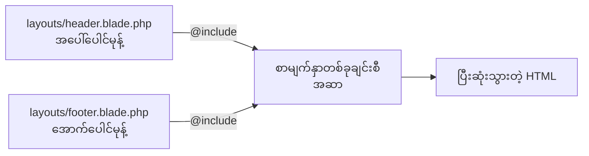
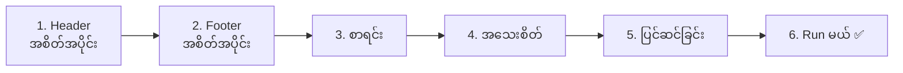
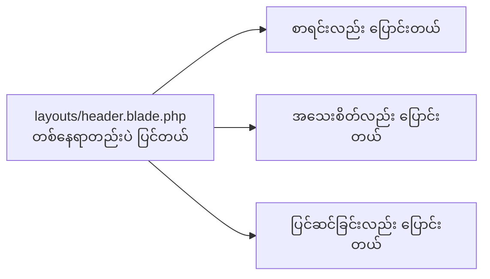
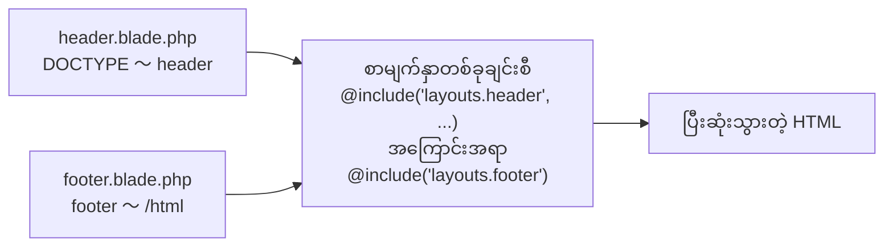

# Laravel မိတ်ဆက် — ဘုံအပိုင်းကို အစိတ်အပိုင်းအဖြစ် ခွဲထုတ်ကြမယ် (@include)

> 🇯🇵 မူရင်း (ဂျပန်ဘာသာဖြင့်): [20261112_資料_1.md](<../../../1年生_データ設計とアプリ開発/後期/20261112/20261112_資料_1.md>) <!-- original-ja-link -->

စာရင်း・အသေးစိတ်・ပြင်ဆင်ခြင်း ဆိုပြီး စာမျက်နှာ ၃ ခု ဖြစ်လာပါပြီ။
ဒါပေမဲ့ ဖိုင်တိုင်းမှာ **HTML အတူတူ** ကို အကြိမ်ကြိမ် ရေးနေရပါတယ်။ ဒီနေ့တော့ အဲဒီ ဘုံအပိုင်းကို **အစိတ်အပိုင်းဖိုင်** အဖြစ် ခွဲထုတ်ပြီး ခေါ်သုံးတဲ့နည်းကို လေ့လာပါမယ်။

## ဒီနေ့ရဲ့ ပန်းတိုင်
- ဘုံအပိုင်းကို အစိတ်အပိုင်းအဖြစ် ခွဲထုတ်ရင် ဘာအကျိုးရှိလဲ နားလည်ရမယ်
- Header・Footer ကို အစိတ်အပိုင်းဖိုင်အဖြစ် ခွဲထုတ်ပြီး `@include` နဲ့ ခေါ်သုံးနိုင်ရမယ်
- `@include` ကို တန်ဖိုး ပေးပို့ပြီး စာမျက်နှာတစ်ခုချင်းစီအလိုက် ခေါင်းစဉ်ကို ပြောင်းနိုင်ရမယ်
- အစိတ်အပိုင်းကို တစ်နေရာတည်း ပြင်ရင် စာမျက်နှာအားလုံး ပြောင်းသွားတာကို အတည်ပြုနိုင်ရမယ်

> 11/5 ရဲ့「Validation」အထိ ပြီးနေတဲ့ အခြေအနေကနေ စပါမယ်။

---

## 1. HTML အတူတူကို အကြိမ်ကြိမ် ရေးနေရတယ်

လက်ရှိ View ၃ ခုကို နှိုင်းယှဉ်ကြည့်ကြရအောင်။

```
index.blade.php（စာရင်း）      show.blade.php（အသေးစိတ်）     edit.blade.php（ပြင်ဆင်ခြင်း）
┌─────────────────────────┐   ┌─────────────────────────┐   ┌─────────────────────────┐
│ <!DOCTYPE html>         │   │ <!DOCTYPE html>         │   │ <!DOCTYPE html>         │
│ <html lang="ja">        │   │ <html lang="ja">        │   │ <html lang="ja">        │
│ <head>                  │   │ <head>                  │   │ <head>                  │
│   <meta charset=...>    │   │   <meta charset=...>    │   │   <meta charset=...>    │
│   <title>TODOアプリ     │   │   <title>TODOの詳細     │   │   <title>TODOの編集     │
│ </head>                 │   │ </head>                 │   │ </head>                 │
│ <body>                  │   │ <body>                  │   │ <body>                  │
│ ┌─────────────────────┐ │   │ ┌─────────────────────┐ │   │ ┌─────────────────────┐ │
│ │ စာရင်းရဲ့ အကြောင်းအရာ │ │   │ │ အသေးစိတ်ရဲ့ အကြောင်းအရာ │ │   │ │ ပြင်ဆင်ခြင်းရဲ့ အကြောင်းအရာ │ │
│ └─────────────────────┘ │   │ └─────────────────────┘ │   │ └─────────────────────┘ │
│ </body>                 │   │ </body>                 │   │ </body>                 │
│ </html>                 │   │ </html>                 │   │ </html>                 │
└─────────────────────────┘   └─────────────────────────┘   └─────────────────────────┘
```

စာမျက်နှာအလိုက် ကွာခြားတာက **`<title>` နဲ့ `<body>` ရဲ့ အထဲက အကြောင်းအရာ ပဲ** ဖြစ်ပါတယ်။ ကျန်တာတွေကတော့ ၃ ခုလုံး အတူတူပါပဲ။ （「TODOアプリ」= TODO App၊「TODOの詳細」= TODO အသေးစိတ်၊「TODOの編集」= TODO ပြင်ဆင်ခြင်း）

အတူတူကို အကြိမ်ကြိမ် ရေးနေရင် ဒီလိုမျိုး ဖြစ်လာပါတယ်။

```
A：「စာမျက်နှာအားလုံးရဲ့ အပေါ်မှာ『TODOアプリ』ကို သွားတဲ့ Link ထည့်ချင်တယ်။ ဖိုင် ၃ ခုလုံးကို ပြင်ရမှာလား…?」
B：「စာမျက်နှာအားလုံးရဲ့ အောက်မှာ Footer ထည့်တော့ အသေးစိတ်စာမျက်နှာမှာပဲ ထည့်ဖို့ မေ့သွားတယ်」
C：「စာမျက်နှာ ၁၀ ခုအထိ များလာရင် ၁၀ နေရာ ပြင်ရမယ်」
```

---

## 2. ဘုံအပိုင်းကို「အစိတ်အပိုင်း」အဖြစ် ခွဲထုတ်မယ်

ဒါကြောင့် ဘုံအပိုင်းကို **အပေါ်တစ်ဝက်** နဲ့ **အောက်တစ်ဝက်** ဆိုပြီး အစိတ်အပိုင်းဖိုင် ၂ ခု ခွဲထုတ်ပါမယ်။
စာမျက်နှာတစ်ခုချင်းစီမှာတော့ အစမှာ အပေါ်တစ်ဝက်ကို၊ အဆုံးမှာ အောက်တစ်ဝက်ကို **ခေါ်သုံး** ရုံပါပဲ။

```
layouts/header.blade.php（အပေါ်တစ်ဝက်ရဲ့ အစိတ်အပိုင်း）
┌─────────────────────────┐
│ <!DOCTYPE html>         │
│ <html> <head> … </head> │
│ <body>                  │
│ <header>…</header>      │ ← စာမျက်နှာရဲ့ အပေါ်မှာ ပေါ်တဲ့အပိုင်း
└─────────────────────────┘
            ＋
todos/index.blade.php（စာမျက်နှာတစ်ခုချင်းစီ）
┌─────────────────────────┐
│ စာရင်းရဲ့ အကြောင်းအရာပဲ    │
└─────────────────────────┘
            ＋
layouts/footer.blade.php（အောက်တစ်ဝက်ရဲ့ အစိတ်အပိုင်း）
┌─────────────────────────┐
│ <footer>…</footer>      │ ← စာမျက်နှာရဲ့ အောက်မှာ ပေါ်တဲ့အပိုင်း
│ </body>                 │
│ </html>                 │
└─────────────────────────┘
```

ဥပမာပေးရရင် **Sandwich** နဲ့ တူပါတယ်။
အပေါ်ပေါင်မုန့် (Header) နဲ့ အောက်ပေါင်မုန့် (Footer) က အမြဲ အတူတူဖြစ်ပြီး ကြားမှာ ညှပ်ထားတဲ့ အဆာ (စာမျက်နှာတစ်ခုချင်းစီရဲ့ အကြောင်းအရာ) ပဲ ကွာခြားပါတယ်။

အစိတ်အပိုင်းကို ခေါ်သုံးဖို့ Blade ရဲ့ **`@include`** ကို သုံးပါတယ်။

| ရေးပုံ | အဓိပ္ပာယ် |
|--------|------|
| `@include('layouts.header')` | `resources/views/layouts/header.blade.php` ရဲ့ အကြောင်းအရာကို **ဒီနေရာမှာ ဒီအတိုင်း ထည့်တယ်** |
| `@include('layouts.header', ['title' => '一覧'])` | အစိတ်အပိုင်းကို ထည့်တဲ့အခါ `$title` ဆိုတဲ့ အမည်နဲ့「一覧」(စာရင်း) ကို ပေးပို့တယ် |



> **`<head>` နဲ့ `<header>` က မတူတဲ့အရာတွေပါ**
> အမည် ဆင်တူပေမဲ့ တာဝန်ချင်း မတူပါဘူး။
>
> | Tag | တာဝန် | စာမျက်နှာပေါ်မှာ မြင်ရလား? |
> |------|------|-------------|
> | `<head>` | စာမျက်နှာရဲ့ အချက်အလက် (Character Encoding・Tab ရဲ့ ခေါင်းစဉ် စသည်)။ Browser အတွက်ပါ | မမြင်ရဘူး |
> | `<header>` | စာမျက်နှာရဲ့ အပေါ်မှာ ပေါ်တဲ့အပိုင်း (App အမည်・Menu စသည်) | မြင်ရတယ် |
>
> ဒီနေ့ရဲ့ `header.blade.php` ထဲမှာ ဒီ **နှစ်ခုလုံး** ပါဝင်ပါတယ်။

---

## 3. ဖန်တီးကြည့်ကြမယ်



ပြင်ရမယ့် ဖိုင်က အောက်ပါ ၅ ခုပါ (`src` ထဲမှာ)။

```
src/
└─ resources/views/
    ├─ layouts/
    │   ├─ header.blade.php ········· 1. Header အစိတ်အပိုင်း (အသစ် ဖန်တီးမယ်)
    │   └─ footer.blade.php ········· 2. Footer အစိတ်အပိုင်း (အသစ် ဖန်တီးမယ်)
    └─ todos/
        ├─ index.blade.php ·········· 3. အစိတ်အပိုင်းကို ခေါ်သုံးအောင် ပြင်ရေးမယ်
        ├─ show.blade.php ··········· 4. အစိတ်အပိုင်းကို ခေါ်သုံးအောင် ပြင်ရေးမယ်
        └─ edit.blade.php ··········· 5. အစိတ်အပိုင်းကို ခေါ်သုံးအောင် ပြင်ရေးမယ်
```

---

### 1. Header အစိတ်အပိုင်းကို ဖန်တီးမယ်

> အခုရောက်နေတဲ့နေရာ：**🟢 1. Header** → 2. Footer → 3. စာရင်း → 4. အသေးစိတ် → 5. ပြင်ဆင်ခြင်း → 6. Run မယ်

`resources/views` ထဲမှာ `layouts` ဖိုဒါကို ဖန်တီးပြီး `header.blade.php` ဆိုတဲ့ ဖိုင်ကို ဖန်တီးပါ။

```html
<!DOCTYPE html>
<html lang="ja">
<head>
    <meta charset="UTF-8">
    <title>{{ $title }} | TODOアプリ</title>
</head>
<body>
    <header>
        <a href="/todos">TODOアプリ</a>
    </header>
```

| Code | အဓိပ္ပာယ် |
|--------|------|
| `{{ $title }}` | စာမျက်နှာတစ်ခုချင်းစီက ပေးပို့လိုက်တဲ့ ခေါင်းစဉ် ဝင်လာတယ်။ Browser ရဲ့ Tab မှာ ပေါ်တယ် |
| `<header>` 〜 `</header>` | စာမျက်နှာအားလုံးရဲ့ အပေါ်မှာ ပေါ်တဲ့အပိုင်း |

`</body>` နဲ့ `</html>` ကို ဒီမှာ မရေးပါဘူး။ **Footer အစိတ်အပိုင်း** မှာ ရေးပါမယ်။

---

### 2. Footer အစိတ်အပိုင်းကို ဖန်တီးမယ်

> အခုရောက်နေတဲ့နေရာ：1. Header → **🟢 2. Footer** → 3. စာရင်း → 4. အသေးစိတ် → 5. ပြင်ဆင်ခြင်း → 6. Run မယ်

အလားတူပဲ `resources/views/layouts` ထဲမှာ `footer.blade.php` ကို ဖန်တီးပါ။

```html
    <footer>
        <p>© 2026 TODOアプリ</p>
    </footer>
</body>
</html>
```

Header မှာ ဖွင့်ခဲ့တဲ့ `<body>` နဲ့ `<html>` ကို ဒီမှာ ပိတ်ပါတယ်။

---

### 3. စာရင်းစာမျက်နှာကို ပြင်ရေးမယ်

> အခုရောက်နေတဲ့နေရာ：1. Header → 2. Footer → **🟢 3. စာရင်း** → 4. အသေးစိတ် → 5. ပြင်ဆင်ခြင်း → 6. Run မယ်

`resources/views/todos/index.blade.php` ကို အောက်ပါအတိုင်း ပြင်ရေးပါ။ （「新しいTODOを入力」= TODO အသစ်ကို ထည့်ပါ၊「追加」= ထည့်မယ်）

```html
@include('layouts.header', ['title' => '一覧'])

    <h1>TODOアプリ</h1>

    <form method="POST" action="/todos">
        @csrf
        <input type="text" name="title" value="{{ old('title') }}" placeholder="新しいTODOを入力" required>
        <button type="submit">追加</button>

        @error('title')
            <p style="color: red;">{{ $message }}</p>
        @enderror
    </form>

    <ul>
        @foreach ($todos as $todo)
            <li>
                <form method="POST" action="/todos/{{ $todo->id }}/toggle" style="display: inline;">
                    @csrf
                    @method('PATCH')
                    <input type="checkbox" name="is_done" value="1" onchange="this.form.submit()" @checked($todo->is_done)>
                </form>
                <a href="/todos/{{ $todo->id }}">{{ $todo->title }}</a>
            </li>
        @endforeach
    </ul>

@include('layouts.footer')
```

ပြင်ရေးခင်နဲ့ နှိုင်းယှဉ်ကြည့်ရင် ဒီလိုဖြစ်နေပါတယ်။

| | ပြင်ရေးခင် | ပြင်ရေးပြီးနောက် |
|---|---|---|
| `<!DOCTYPE html>` 〜 `<body>` | ရေးထားတယ် | `@include('layouts.header', ['title' => '一覧'])` တစ်ကြောင်းတည်း ဖြစ်သွားတယ် |
| `<body>` ရဲ့ အထဲက အကြောင်းအရာ | ဒီအတိုင်း | ဒီအတိုင်း |
| `</body>` `</html>` | ရေးထားတယ် | `@include('layouts.footer')` တစ်ကြောင်းတည်း ဖြစ်သွားတယ် |

`['title' => '一覧']` က Controller မှာ `view('todos.index', ['todos' => $todos])` လို့ ရေးခဲ့တာနဲ့ ပုံစံ အတူတူပါပဲ။
အစိတ်အပိုင်းထဲမှာ `$title` ဆိုတဲ့ အမည်နဲ့「一覧」(စာရင်း) ကို သုံးလို့ရပါတယ်။

✅ **စစ်ဆေးချက်**：http://localhost:8000/todos ကို ဖွင့်ပြီး စာရင်းရဲ့ အပေါ်မှာ「TODOアプリ」(TODO App) Link၊ အောက်မှာ「© 2026 TODOアプリ」ပေါ်လာရင် OK ပါ။
Browser ရဲ့ Tab မှာ「一覧 | TODOアプリ」(စာရင်း | TODO App) လို့ ပေါ်နေတာကိုလည်း စစ်ကြည့်ပါ။

---

### 4. အသေးစိတ်စာမျက်နှာကို ပြင်ရေးမယ်

> အခုရောက်နေတဲ့နေရာ：1. Header → 2. Footer → 3. စာရင်း → **🟢 4. အသေးစိတ်** → 5. ပြင်ဆင်ခြင်း → 6. Run မယ်

`resources/views/todos/show.blade.php` ကို အောက်ပါအတိုင်း ပြင်ရေးပါ။ （「番号」= နံပါတ်၊「状態」= အခြေအနေ၊「完了」= ပြီးပြီ၊「未完了」= မပြီးသေး၊「編集」= ပြင်ဆင်မယ်၊「削除しますか？」= ဖျက်မှာလား၊「削除」= ဖျက်မယ်၊「一覧にもどる」= စာရင်းသို့ ပြန်သွားမယ်）

```html
@include('layouts.header', ['title' => $todo->title])

    <h1>{{ $todo->title }}</h1>

    <p>番号：{{ $todo->id }}</p>

    <p>
        状態：
        @if ($todo->is_done)
            完了 ✅
        @else
            未完了
        @endif
    </p>

    <a href="/todos/{{ $todo->id }}/edit">編集</a>

    <form method="POST" action="/todos/{{ $todo->id }}" onsubmit="return confirm('削除しますか？');">
        @csrf
        @method('DELETE')
        <button type="submit">削除</button>
    </form>

    <a href="/todos">一覧にもどる</a>

@include('layouts.footer')
```

`['title' => $todo->title]` လိုမျိုး **Variable** ကိုလည်း ပေးပို့နိုင်ပါတယ်။
「牛乳を買う」(နွားနို့ဝယ်မယ်) ရဲ့ အသေးစိတ်စာမျက်နှာဆိုရင် Tab မှာ「牛乳を買う | TODOアプリ」လို့ ပေါ်ပါမယ်။

✅ **စစ်ဆေးချက်**：စာရင်းကနေ Todo ကို Click နှိပ်ပြီး အသေးစိတ်စာမျက်နှာမှာလည်း Header နဲ့ Footer ပေါ်လာရင် OK ပါ။

---

### 5. ပြင်ဆင်ရန် စာမျက်နှာကို ပြင်ရေးမယ်

> အခုရောက်နေတဲ့နေရာ：1. Header → 2. Footer → 3. စာရင်း → 4. အသေးစိတ် → **🟢 5. ပြင်ဆင်ခြင်း** → 6. Run မယ်

`resources/views/todos/edit.blade.php` ကို အောက်ပါအတိုင်း ပြင်ရေးပါ။ （「編集」= ပြင်ဆင်ခြင်း၊「TODOの編集」= TODO ပြင်ဆင်ခြင်း၊「完了」= ပြီးပြီ၊「保存」= သိမ်းမယ်၊「もどる」= ပြန်သွားမယ်）

```html
@include('layouts.header', ['title' => '編集'])

    <h1>TODOの編集</h1>

    <form method="POST" action="/todos/{{ $todo->id }}">
        @csrf
        @method('PUT')
        <input type="text" name="title" value="{{ old('title', $todo->title) }}" required>
        <label>
            <input type="checkbox" name="is_done" value="1" @checked($todo->is_done)>
            完了
        </label>
        <button type="submit">保存</button>

        @error('title')
            <p style="color: red;">{{ $message }}</p>
        @enderror
    </form>

    <a href="/todos/{{ $todo->id }}">もどる</a>

@include('layouts.footer')
```

✅ **စစ်ဆေးချက်**：အသေးစိတ်စာမျက်နှာကနေ「編集」(ပြင်ဆင်မယ်) ကို နှိပ်ပြီး ပြင်ဆင်ရန် စာမျက်နှာမှာလည်း Header နဲ့ Footer ပေါ်လာရင် OK ပါ။

---

### 6. Run မယ် ✅：အစိတ်အပိုင်းကို တစ်နေရာတည်း ပြင်လိုက်ရင်…?

> အခုရောက်နေတဲ့နေရာ：1. Header → 2. Footer → 3. စာရင်း → 4. အသေးစိတ် → 5. ပြင်ဆင်ခြင်း → **🟢 6. Run မယ်**

ဒီနေရာကစပြီး အစိတ်အပိုင်းအဖြစ် ခွဲထုတ်ခြင်းရဲ့ အကောင်းဆုံး အကျိုးကျေးဇူးကို တွေ့ရပါမယ်။
`layouts/header.blade.php` **တစ်ခုတည်း** ကို ဖွင့်ပြီး「TODOアプリ」ကို「わたしのTODO」(ကျွန်ုပ်ရဲ့ TODO) လို့ ပြင်ရေးကြည့်ပါ။

```html
    <header>
        <a href="/todos">わたしのTODO</a>  {{-- ★ ပြင်ရေး --}}
    </header>
```

✅ **စစ်ဆေးချက်**：စာရင်း・အသေးစိတ်・ပြင်ဆင်ခြင်း **စာမျက်နှာ ၃ ခုလုံးကို** ပြန်ဖွင့်ကြည့်ပါ။
**စာမျက်နှာတိုင်းမှာ** Header က「わたしのTODO」လို့ ပြောင်းသွားရင် အောင်မြင်ပါပြီ။



အစိတ်အပိုင်းအဖြစ် မခွဲထုတ်ထားရင် ဖိုင် ၃ ခုလုံးကို ပြင်ဖို့ လိုခဲ့မှာပါ။
**ပြင်တာက တစ်နေရာတည်း၊ ပြောင်းတာက စာမျက်နှာအားလုံး**။ ဒါက အစိတ်အပိုင်းအဖြစ် ခွဲထုတ်ခြင်းရဲ့ စွမ်းအားပါ။

---

## 4. အဆင်မပြေတဲ့အခါ

> **🔥 အလုပ်မလုပ်ရင် Log ထုတ်ကြည့်ပါ!** → [【အရေးကြီး】Log ထုတ်နည်း](../20261022/【重要】ログの出し方.md)

| ပြဿနာ | အကြောင်းရင်းရှိတဲ့နေရာ | ဖြေရှင်းနည်း |
|------|----------|------|
| `View [layouts.header] not found.` | အစိတ်အပိုင်း | `resources/views/layouts/header.blade.php` ရဲ့ နေရာနဲ့ ဖိုင်အမည်ကို စစ်ပါ (`layouts` မှာ `s` ပါတယ်။ `footer` လည်း အတူတူပါ) |
| `Undefined variable $title` | စာမျက်နှာတစ်ခုချင်းစီ | `@include('layouts.header', ['title' => ...])` ထဲက `['title' => ...]` ကို ရေးဖို့ မေ့နေလား စစ်ပါ |
| Tab ရဲ့ ခေါင်းစဉ် မှားနေတယ် | စာမျက်နှာတစ်ခုချင်းစီ | `['title' => ...]` ရဲ့ `'title'` နဲ့ အစိတ်အပိုင်းထဲက `{{ $title }}` ရဲ့ အမည် တူမတူ စစ်ပါ |
| Footer မပေါ်ဘူး | စာမျက်နှာတစ်ခုချင်းစီ | စာမျက်နှာရဲ့ အဆုံးမှာ `@include('layouts.footer')` ကို ရေးထားလား စစ်ပါ |
| `<!DOCTYPE html>` က ၂ ခါ ပေါ်နေတယ် | စာမျက်နှာတစ်ခုချင်းစီ | စာမျက်နှာတစ်ခုချင်းစီမှာ `<!DOCTYPE html>` 〜 `<body>` ကျန်နေသေးလား စစ်ပါ (Header အစိတ်အပိုင်းမှာ ပါပြီးသားမို့ ဖျက်ပါ) |

> **`@include` က အစနဲ့ အဆုံး ၂ နေရာ**
> စာမျက်နှာတစ်ခုချင်းစီမှာ `@include('layouts.header', ...)` နဲ့ `@include('layouts.footer')` ဆိုတဲ့ **၂ နေရာ** ကို အမြဲ ရေးရပါမယ်။
> Footer ကို ရေးဖို့ မေ့သွားရင် `</body>` နဲ့ `</html>` မပါတဲ့ HTML ဖြစ်သွားပါမယ် (Browser က ပြပေးပေမဲ့ မှန်ကန်တဲ့ HTML မဟုတ်ပါဘူး)။

---

## 5. အနှစ်ချုပ်



| ဒီနေ့ ရေးခဲ့တာ | တစ်ခွန်းတည်းနဲ့ ပြောရရင် |
|--------------|-----------|
| `layouts/header.blade.php` | စာမျက်နှာအားလုံးရဲ့ အပေါ်တစ်ဝက် (`<!DOCTYPE html>` 〜 `<header>`) |
| `layouts/footer.blade.php` | စာမျက်နှာအားလုံးရဲ့ အောက်တစ်ဝက် (`<footer>` 〜 `</html>`) |
| `@include('layouts.header', ['title' => ...])` | အပေါ်တစ်ဝက် အစိတ်အပိုင်းကို ခေါ်သုံးပြီး ခေါင်းစဉ်ကို ပေးပို့တယ် |
| `@include('layouts.footer')` | အောက်တစ်ဝက် အစိတ်အပိုင်းကို ခေါ်သုံးတယ် |

**ဘုံအပိုင်းကို အစိတ်အပိုင်းအဖြစ် ခွဲထုတ်ပါ။ ပြင်တာက တစ်နေရာတည်း၊ ပြောင်းတာက စာမျက်နှာအားလုံး။**

> **တခြား ရေးနည်းတွေလည်း ရှိပါတယ်**
> Laravel မှာ စာမျက်နှာတစ်ခုလုံးရဲ့「ဘောင်」ကို ဖိုင်တစ်ခုတည်းမှာ ထားတဲ့ `@extends`・`@section`・`@yield` တို့၊ `<x-layout>` လိုမျိုး ရေးတဲ့ **Component** ဆိုတဲ့ ဖန်တီးနည်းတွေလည်း ရှိပါတယ်။
> အင်တာနက်ပေါ်မှာ တွေ့ခဲ့ရင်「အလုပ်အတူတူကို တခြားရေးနည်းနဲ့ လုပ်နေတာပဲ」လို့ မှတ်ယူလိုက်ပါ။

<!-- nav:start -->

---

| ⬅️ ယခင် | 🗺️ ခြုံငုံပုံ | နောက်တစ်ခု ➡️ |
|:--|:--:|--:|
| [11/05 Validation](../20261105/20261105_資料_2.md) | [သင်ခန်းစာများ၏ ခြုံငုံပုံ](../../README.md) | [11/12 Category ထည့်ခြင်း](20261112_資料_2.md) |

<!-- nav:end -->
