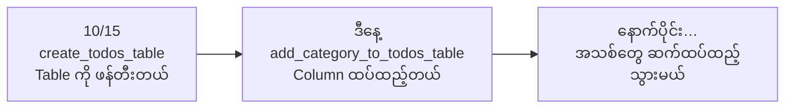
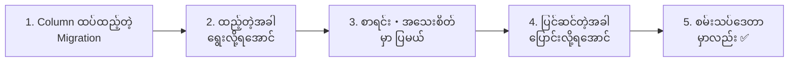
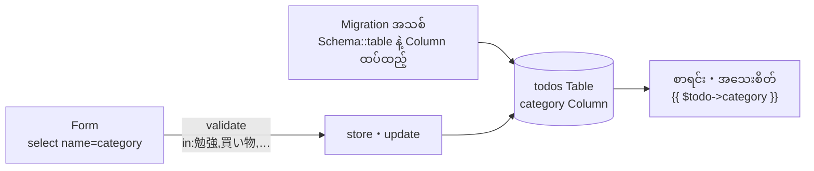

# Laravel မိတ်ဆက် — Todo မှာ Category ထည့်ကြမယ် (Column ထပ်ထည့်တဲ့ Migration)

> 🇯🇵 မူရင်း (ဂျပန်ဘာသာဖြင့်): [20261112_資料_2.md](<../../../1年生_データ設計とアプリ開発/後期/20261112/20261112_資料_2.md>) <!-- original-ja-link -->

Todo တွေ များလာရင်「ဒါက စာလေ့လာတဲ့ကိစ္စ」「ဒါက ဈေးဝယ်တာ」ဆိုပြီး **အမျိုးအစား ခွဲ** ချင်လာပါတယ်။
ဒီနေ့တော့ Todo မှာ **Category** ထည့်လို့ရအောင် လုပ်ပါမယ်။

## ဒီနေ့ရဲ့ ပန်းတိုင်
- ရှိပြီးသား Table ထဲကို **Migration နဲ့ Column ထပ်ထည့်** နိုင်ရမယ်
- Select Box နဲ့ သတ်မှတ်ထားတဲ့ ရွေးချယ်စရာတွေထဲကနေ Category ကို ရွေးနိုင်ရမယ်
- ရွေးလို့ရတဲ့ Category မဟုတ်တာတွေ ပို့မလာအောင် Validation (`in`) နဲ့ စစ်ဆေးနိုင်ရမယ်

> [သင်ခန်းစာ 1](./20261112_資料_1.md) ရဲ့「ဘုံအပိုင်းကို အစိတ်အပိုင်းအဖြစ် ခွဲထုတ်ကြမယ်」အထိ ပြီးနေတဲ့ အခြေအနေကနေ စပါမယ်။

---

## 1. ဒီနေ့ ဖန်တီးမယ့်အရာ

Category ကို အောက်ပါ **၄ ခုထဲကနေ ရွေး** ရအောင် လုပ်ပါမယ်။ အောက်ပါ နမူနာမှာ「TODOアプリ」က Todo အက်ပ်၊「新しいTODOを入力」က Todo အသစ်ထည့်ရန်၊「追加」က ထည့်ရန် ဆိုလိုပါတယ်။「レポートを書く」က အစီရင်ခံစာရေးရန်၊「牛乳を買う」က နွားနို့ဝယ်ရန်၊「部屋のそうじ」က အခန်းသန့်ရှင်းရေးလုပ်ရန် ဆိုလိုပါတယ်။

| Category |
|---------|
| 勉強 (စာလေ့လာခြင်း) |
| 買い物 (ဈေးဝယ်ခြင်း) |
| 家のこと (အိမ်အလုပ်) |
| その他 (အခြား) |

```
TODOアプリ

[ 新しいTODOを入力 ] [ 勉強 ▼ ] [追加]

☐ [勉強] レポートを書く
☑ [買い物] 牛乳を買う
☐ [家のこと] 部屋のそうじ
```

`todos` Table ထဲကို `category` (Category) Column တစ်ခု ထပ်ထည့်ပါမယ်။

| id | title | **category** | is_done | created_at | updated_at |
|----|-------|-------------|---------|-----------|-----------|
| 1 | レポートを書く | **勉強** | 0 | … | … |
| 2 | 牛乳を買う | **買い物** | 1 | … | … |

---

## 2. အသစ်ပါလာမယ့်အရာ：Column ထပ်ထည့်တဲ့ Migration

10/15 မှာ Migration နဲ့ `todos` Table ကို **ဖန်တီး** ခဲ့ပါတယ်။
ဒီနေ့တော့ ရှိပြီးသား `todos` Table ထဲကို **Column ထပ်ထည့်** ပါမယ်။

ဒီနေရာမှာ အရေးကြီးတဲ့ စည်းကမ်းတစ်ခု ရှိပါတယ်။

> **တစ်ကြိမ် Run ပြီးသား Migration ကို ပြင်မရေးပါနဲ့။ Migration အသစ်ကို ထပ်ထည့်ပါ။**



10/15 ရဲ့ Migration (`create_todos_table`) ထဲမှာ `category` ကို ထပ်ဖြည့်ရေးရင်တောင် **Run ပြီးသားဖြစ်နေလို့ `migrate` လုပ်လည်း အလုပ်မလုပ်ပါဘူး**။
Migration ဆိုတာ Table ရဲ့ **ပြောင်းလဲမှုမှတ်တမ်း (နေ့စဉ်မှတ်တမ်း)** ပါ။ အရင်နေ့ရဲ့ မှတ်တမ်းကို မပြင်ဘဲ စာမျက်နှာအသစ်မှာ「ဒီနေ့ Column ထပ်ထည့်ခဲ့တယ်」လို့ ဆက်ရေးသွားပါတယ်။

| | Table ဖန်တီးခြင်း (10/15) | Column ထပ်ထည့်ခြင်း (ဒီနေ့) |
|---|---|---|
| ဖိုင်အမည် | `create_todos_table` | `add_category_to_todos_table` |
| အကြောင်းအရာ | `Schema::create('todos', ...)` | `Schema::table('todos', ...)` |
| အဓိပ္ပာယ် | Table အသစ် ဖန်တီးတယ် | ရှိပြီးသား Table ကို ပြောင်းတယ် |

---

## 3. ဖန်တီးကြည့်ကြမယ်



ပြင်ရမယ့် ဖိုင်တွေက အောက်ပါအတိုင်းပါ (`src` ထဲမှာ)။

```
src/
├─ database/
│   ├─ migrations/
│   │   └─ xxxx_add_category_to_todos_table.php ··· 1. အသစ် ဖန်တီးမယ်
│   ├─ seeders/TodoSeeder.php ····················· 5. Category ထပ်ထည့်မယ်
│   └─ factories/TodoFactory.php ·················· 5. Category ထပ်ထည့်မယ်
├─ resources/views/todos/
│   ├─ index.blade.php ···························· 2・3. Select Box နဲ့ ပြသခြင်း
│   ├─ show.blade.php ····························· 3. ပြသခြင်း
│   └─ edit.blade.php ····························· 4. Select Box
└─ app/Http/Controllers/
    └─ TodoController.php ························· 2・4. store နဲ့ update
```

---

### 1. Column ထပ်ထည့်တဲ့ Migration ကို ဖန်တီးမယ်

> အခုရောက်နေတဲ့နေရာ：**🟢 1. Migration** → 2. ထည့်ခြင်း → 3. ပြသခြင်း → 4. ပြင်ဆင်ခြင်း → 5. စမ်းသပ်ဒေတာ

အောက်ပါ Command နဲ့ Migration ဖိုင်ကို ဖန်တီးပါ။

```powershell
docker compose exec laravel php artisan make:migration add_category_to_todos_table
```

အမည်ကို `add_〇〇_to_△△_table` လို့ ပေးလိုက်ရင် Laravel က「`△△` Table ကို ပြောင်းမှာပဲ」လို့ နားလည်ပြီး ပုံစံကြမ်း (Template) ကို ဖန်တီးပေးပါတယ်။

`database/migrations/` ထဲမှာ `2026_11_12_xxxxxx_add_category_to_todos_table.php` ထွက်လာမှာဖြစ်လို့ `up()` နဲ့ `down()` ရဲ့ အထဲကို အောက်ပါအတိုင်း ရေးပါ။

```php
    public function up(): void
    {
        Schema::table('todos', function (Blueprint $table) {
            $table->string('category')->default('その他')->after('title');
        });
    }

    public function down(): void
    {
        Schema::table('todos', function (Blueprint $table) {
            $table->dropColumn('category');
        });
    }
```

| Code | အဓိပ္ပာယ် |
|--------|------|
| `Schema::table('todos', ...)` | ရှိပြီးသား `todos` Table ကို ပြောင်းတယ် (ဖန်တီးတဲ့အခါကတော့ `Schema::create`) |
| `$table->string('category')` | `category` ဆိုတဲ့ စာသား Column ကို ထပ်ထည့်တယ် |
| `->default('その他')` | ဘာမှ မထည့်ခဲ့ရင်「その他」(အခြား) လို့ ထားမယ် |
| `->after('title')` | `title` Column ရဲ့ နောက်မှာ ထည့်မယ် (phpMyAdmin မှာ ကြည့်ရလွယ်အောင်) |
| `up()` | `migrate` လုပ်တဲ့အခါ လုပ်မယ့်အရာ (Column ထပ်ထည့်တယ်) |
| `down()` | မူလအတိုင်း ပြန်ထားတဲ့အခါ လုပ်မယ့်အရာ (Column ကို ဖျက်တယ်) |

> **ဘာကြောင့် `default('その他')` ထည့်တာလဲ?**
> `todos` Table ထဲမှာ Todo အချို့ ရှိနေပြီးသားပါ။
> Column ထပ်ထည့်လိုက်ရင် ရှိပြီးသား Todo တွေရဲ့ `category` မှာ ဘာထည့်ရမလဲ? `default` ရှိရင် ရှိပြီးသား Todo အားလုံးက「その他」(အခြား) ဖြစ်သွားပါမယ်။

သိမ်းပြီးရင် Migration ကို Run ပါ။

```powershell
docker compose exec laravel php artisan migrate
```

✅ **စစ်ဆေးချက်**：phpMyAdmin မှာ `todos` Table ကို ဖွင့်ကြည့်ပါ။
`title` ရဲ့ နောက်မှာ `category` Column ပေါ်လာပြီး ရှိပြီးသား Todo အားလုံးက「その他」(အခြား) ဖြစ်နေရင် OK ပါ။
**ရှိပြီးသား Todo တွေ မပျက်သွားပါဘူး**။ `migrate` က မ Run ရသေးတဲ့ Migration (ဒီနေ့ရဲ့ တစ်ခု) ကိုပဲ Run လို့ပါ။

| Command | လုပ်ဆောင်ချက် | ရှိပြီးသား ဒေတာ |
|---------|---------|------------|
| `migrate` | မ Run ရသေးတဲ့ Migration တွေကိုပဲ Run တယ် | **ကျန်နေတယ်** |
| `migrate:fresh` | Table အားလုံးကို ဖျက်ပြီး Migration အားလုံးကို အစကနေ Run တယ် | ပျက်သွားတယ် |

---

### 2. ထည့်တဲ့အခါ Category ကို ရွေးလို့ရအောင် လုပ်မယ်

> အခုရောက်နေတဲ့နေရာ：1. Migration → **🟢 2. ထည့်ခြင်း** → 3. ပြသခြင်း → 4. ပြင်ဆင်ခြင်း → 5. စမ်းသပ်ဒေတာ

#### ① ထည့်ရန် Form မှာ Select Box ထပ်ထည့်မယ် (V)

`resources/views/todos/index.blade.php` ရဲ့ ထည့်ရန် Form မှာ ★ ပါတဲ့ Select Box ကို ထပ်ဖြည့်ရေးပါ။

```html
    <form method="POST" action="/todos">
        @csrf
        <input type="text" name="title" value="{{ old('title') }}" placeholder="新しいTODOを入力" required>

        {{-- ★ ဒီကနေ ထပ်ဖြည့် --}}
        <select name="category">
            <option value="勉強">勉強</option>
            <option value="買い物">買い物</option>
            <option value="家のこと">家のこと</option>
            <option value="その他">その他</option>
        </select>
        {{-- ★ ဒီအထိ --}}

        <button type="submit">追加</button>

        @error('title')
            <p style="color: red;">{{ $message }}</p>
        @enderror
    </form>
```

| Code | အဓိပ္ပာယ် |
|--------|------|
| `<select name="category">` | `category` ဆိုတဲ့ အမည်နဲ့ ရွေးထားတာကို ပို့တယ် |
| `<option value="勉強">勉強</option>` | ရွေးချယ်စရာ။ `value` ရဲ့ တန်ဖိုးကို ပို့တယ် |

#### ② store မှာ Category ကိုပါ သိမ်းမယ် (C)

`app/Http/Controllers/TodoController.php` ရဲ့ `store` မှာ ★ ပါတဲ့ အပိုင်းကို ထပ်ဖြည့်ရေးပါ။ အောက်ပါ စစ်ဆေးမှု မအောင်မြင်ကြောင်း စာများမှာ「タイトルを入力してください。」က ခေါင်းစဉ်ထည့်ပါ၊「タイトルは255文字以内で入力してください。」က ခေါင်းစဉ်ကို စာလုံးရေ ၂၅၅ လုံးအတွင်း ထည့်ပါ၊「カテゴリを選んでください。」က Category ရွေးပါ၊「カテゴリは、リストの中から選んでください。」က Category ကို စာရင်းထဲမှ ရွေးပါ ဆိုလိုပါတယ်။

```php
    public function store(Request $request)
    {
        $request->validate([
            'title' => 'required|max:255',
            'category' => 'required|in:勉強,買い物,家のこと,その他',  // ★ ထပ်ဖြည့်
        ], [
            'title.required' => 'タイトルを入力してください。',
            'title.max' => 'タイトルは255文字以内で入力してください。',
            'category.required' => 'カテゴリを選んでください。',           // ★ ထပ်ဖြည့်
            'category.in' => 'カテゴリは、リストの中から選んでください。',  // ★ ထပ်ဖြည့်
        ]);

        $todo = new Todo();
        $todo->title = $request->input('title');
        $todo->category = $request->input('category');  // ★ ထပ်ဖြည့်
        $todo->save();

        return redirect('/todos');
    }
```

| Code | အဓိပ္ပာယ် |
|--------|------|
| `'category' => 'required\|in:勉強,買い物,家のこと,その他'` | `category` က ဒီ ၄ ခုထဲက **တစ်ခုခု** ဖြစ်ရမယ် |
| `$todo->category = $request->input('category')` | ရွေးထားတဲ့ Category ကို ထည့်တယ် |

> **Select Box ဖြစ်ပေမဲ့ ဘာကြောင့် `in` နဲ့ စစ်ဆေးတာလဲ?**
> Select Box မှာ ရွေးချယ်စရာ ၄ ခုပဲ ရှိပေမဲ့ 11/5 မှာ လေ့လာခဲ့သလို **Browser ရဲ့ စစ်ဆေးမှုကို ကျော်ဖြတ်လို့ ရပါတယ်**။
> Developer Tools နဲ့ `<option value="勉強">` ကို `<option value="ゲーム">` (ဂိမ်း) လို့ ပြင်ရေးပြီး ပို့လို့လည်း ရနေပါတယ်။
> Server ဘက်က `in` နဲ့ သတ်မှတ်ထားတဲ့ ၄ ခု မဟုတ်တာတွေကို ပယ်ချပါတယ်။

---

### 3. စာရင်းနဲ့ အသေးစိတ်မှာ Category ကို ပြမယ်

> အခုရောက်နေတဲ့နေရာ：1. Migration → 2. ထည့်ခြင်း → **🟢 3. ပြသခြင်း** → 4. ပြင်ဆင်ခြင်း → 5. စမ်းသပ်ဒေတာ

#### ① စာရင်း (V)

`index.blade.php` ရဲ့ `<li>` ထဲမှာ ★ ပါတဲ့ အပိုင်းကို ထပ်ဖြည့်ရေးပါ။

```html
            <li>
                <form method="POST" action="/todos/{{ $todo->id }}/toggle" style="display: inline;">
                    @csrf
                    @method('PATCH')
                    <input type="checkbox" name="is_done" value="1" onchange="this.form.submit()" @checked($todo->is_done)>
                </form>
                [{{ $todo->category }}]  {{-- ★ ထပ်ဖြည့် --}}
                <a href="/todos/{{ $todo->id }}">{{ $todo->title }}</a>
            </li>
```

#### ② အသေးစိတ် (V)

`show.blade.php` ရဲ့「番号」(နံပါတ်) အောက်မှာ ★ ပါတဲ့ တစ်ကြောင်းကို ထပ်ဖြည့်ရေးပါ။

```html
    <p>番号：{{ $todo->id }}</p>

    <p>カテゴリ：{{ $todo->category }}</p>  {{-- ★ ထပ်ဖြည့် --}}
```

✅ **စစ်ဆေးချက်**：စာရင်းစာမျက်နှာမှာ Category ကို ရွေးပြီး Todo ထည့်ကြည့်ပါ။
စာရင်းမှာ `[勉強] レポートを書く` လိုမျိုး ပေါ်ပြီး အသေးစိတ်စာမျက်နှာမှာလည်း「カテゴリ：勉強」(Category：စာလေ့လာခြင်း) လို့ ပေါ်လာရင် OK ပါ။

---

### 4. ပြင်ဆင်တဲ့အခါ Category ကို ပြောင်းလို့ရအောင် လုပ်မယ်

> အခုရောက်နေတဲ့နေရာ：1. Migration → 2. ထည့်ခြင်း → 3. ပြသခြင်း → **🟢 4. ပြင်ဆင်ခြင်း** → 5. စမ်းသပ်ဒေတာ

#### ① ပြင်ဆင်ရန် Form မှာ Select Box ထပ်ထည့်မယ် (V)

`edit.blade.php` ရဲ့ Form မှာ ★ ပါတဲ့ Select Box ကို ထပ်ဖြည့်ရေးပါ။ Form ထဲက「完了」က ပြီးစီးပြီ၊「保存」က သိမ်းဆည်းရန် ဆိုလိုပါတယ်။

```html
    <form method="POST" action="/todos/{{ $todo->id }}">
        @csrf
        @method('PUT')
        <input type="text" name="title" value="{{ old('title', $todo->title) }}" required>

        {{-- ★ ဒီကနေ ထပ်ဖြည့် --}}
        <select name="category">
            <option value="勉強" @selected($todo->category === '勉強')>勉強</option>
            <option value="買い物" @selected($todo->category === '買い物')>買い物</option>
            <option value="家のこと" @selected($todo->category === '家のこと')>家のこと</option>
            <option value="その他" @selected($todo->category === 'その他')>その他</option>
        </select>
        {{-- ★ ဒီအထိ --}}

        <label>
            <input type="checkbox" name="is_done" value="1" @checked($todo->is_done)>
            完了
        </label>
        <button type="submit">保存</button>

        @error('title')
            <p style="color: red;">{{ $message }}</p>
        @enderror
    </form>
```

| Code | အဓိပ္ပာယ် |
|--------|------|
| `@selected($todo->category === '勉強')` | လက်ရှိ Category က「勉強」(စာလေ့လာခြင်း) ဆိုရင် ဒီရွေးချယ်စရာကို အစကတည်းက ရွေးထားမယ် |

`@selected` က Checkbox ရဲ့ `@checked` ရဲ့ Select Box ဗားရှင်းပါ။
`( )` ထဲက `true` ဖြစ်တဲ့အခါမှသာ `<option>` မှာ `selected` ကို ထည့်ပေးပါတယ်။

#### ② update မှာ Category ကိုပါ သိမ်းမယ် (C)

`TodoController.php` ရဲ့ `update` မှာလည်း `store` လိုပဲ ★ ပါတဲ့ အပိုင်းကို ထပ်ဖြည့်ရေးပါ။

```php
    public function update(Request $request, $id)
    {
        $request->validate([
            'title' => 'required|max:255',
            'category' => 'required|in:勉強,買い物,家のこと,その他',  // ★ ထပ်ဖြည့်
        ], [
            'title.required' => 'タイトルを入力してください。',
            'title.max' => 'タイトルは255文字以内で入力してください。',
            'category.required' => 'カテゴリを選んでください。',           // ★ ထပ်ဖြည့်
            'category.in' => 'カテゴリは、リストの中から選んでください。',  // ★ ထပ်ဖြည့်
        ]);

        $todo = Todo::findOrFail($id);
        $todo->title = $request->input('title');
        $todo->category = $request->input('category');  // ★ ထပ်ဖြည့်
        $todo->is_done = $request->has('is_done');
        $todo->save();

        return redirect('/todos/' . $todo->id);
    }
```

✅ **စစ်ဆေးချက်**：ပြင်ဆင်ရန် စာမျက်နှာကို ဖွင့်တဲ့အခါ လက်ရှိ Category ကို အစကတည်းက ရွေးထားလား စစ်ကြည့်ပါ။
Category ကို ပြောင်းပြီး `保存` (သိမ်းမယ်) ကို နှိပ်လိုက်ရင် အသေးစိတ်စာမျက်နှာရဲ့ Category ပြောင်းသွားရင် OK ပါ။

---

### 5. စမ်းသပ်ဒေတာမှာလည်း Category ထည့်မယ်

> အခုရောက်နေတဲ့နေရာ：1. Migration → 2. ထည့်ခြင်း → 3. ပြသခြင်း → 4. ပြင်ဆင်ခြင်း → **🟢 5. စမ်းသပ်ဒေတာ**

11/5 မှာ ဖန်တီးခဲ့တဲ့ Seeder နဲ့ Factory မှာလည်း Category ကို ထပ်ထည့်ထားပါမယ်။

#### ① TodoSeeder (သတ်မှတ်ထားတဲ့ ဒေတာ)

`database/seeders/TodoSeeder.php` ရဲ့ Array နဲ့ `foreach` မှာ ★ ပါတဲ့ အပိုင်းကို ထပ်ဖြည့်ရေးပါ။

```php
        $todos = [
            ['title' => '牛乳を買う',     'category' => '買い物', 'is_done' => false],  // ★ category ကို ထပ်ဖြည့်
            ['title' => 'レポートを出す', 'category' => '勉強',   'is_done' => true],   // ★
            ['title' => '宿題をする',     'category' => '勉強',   'is_done' => false],  // ★
        ];

        foreach ($todos as $data) {
            $todo = new Todo();
            $todo->title = $data['title'];
            $todo->category = $data['category'];  // ★ ထပ်ဖြည့်
            $todo->is_done = $data['is_done'];
            $todo->save();
        }
```

#### ② TodoFactory (အလိုအလျောက် ဖန်တီးတဲ့ ဒေတာ)

`database/factories/TodoFactory.php` ရဲ့ `definition()` မှာ ★ ပါတဲ့ တစ်ကြောင်းကို ထပ်ဖြည့်ရေးပါ။ အောက်ပါ နမူနာဒေတာမှာ「レポートを出す」က အစီရင်ခံစာတင်ရန်၊「宿題をする」က အိမ်စာလုပ်ရန်၊「本を返す」က စာအုပ်ပြန်အပ်ရန်၊「ゴミを出す」က အမှိုက်ထုတ်ပစ်ရန် ဆိုလိုပါတယ်။

```php
        return [
            'title' => fake()->randomElement([
                '牛乳を買う',
                'レポートを出す',
                '宿題をする',
                '部屋のそうじ',
                '本を返す',
                'ゴミを出す',
            ]),
            'category' => fake()->randomElement(['勉強', '買い物', '家のこと', 'その他']),  // ★ ထပ်ဖြည့်
            'is_done' => fake()->boolean(),
        ];
```

```powershell
docker compose exec laravel php artisan migrate:fresh --seed
```

✅ **စစ်ဆေးချက်**：စာရင်းကို ဖွင့်ပြီး Todo ၂၃ ခု တစ်ခုချင်းစီမှာ Category ပါနေရင် OK ပါ။
`migrate:fresh` က Migration အားလုံးကို အစကနေ Run တဲ့အတွက် **ဒီနေ့ရဲ့ Migration ကိုလည်း တစ်ခါတည်း** Run ပေးပါတယ်။

---

## 4. အဆင်မပြေတဲ့အခါ

> **🔥 အလုပ်မလုပ်ရင် Log ထုတ်ကြည့်ပါ!** → [【အရေးကြီး】Log ထုတ်နည်း](../20261022/【重要】ログの出し方.md)

| ပြဿနာ | အကြောင်းရင်းရှိတဲ့နေရာ | ဖြေရှင်းနည်း |
|------|----------|------|
| `Unknown column 'category'` | Migration | `php artisan migrate` ကို Run ခဲ့လား စစ်ပါ |
| `migrate` လုပ်ပေမဲ့ `category` Column မပေါ်လာဘူး | Migration | 10/15 ရဲ့ Migration ထဲမှာ ထပ်ဖြည့်ရေးခဲ့လား စစ်ပါ (**Migration အသစ်** မှာ ရေးရမယ်) |
| 「カテゴリは、リストの中から選んでください。」(Category ကို စာရင်းထဲကနေ ရွေးပါ။) လို့ ပေါ်တယ် | View・Controller | `<option value="...">` နဲ့ `in:...` ရဲ့ Category အမည်တွေ **စာလုံးတစ်လုံးမှ မကွာဘဲ** တူညီလား စစ်ပါ |
| ထည့်လိုက်ပေမဲ့ Category အားလုံးက「その他」(အခြား) ဖြစ်နေတယ် | Controller | `store` မှာ `$todo->category = $request->input('category');` ပါမပါ စစ်ပါ |
| ပြင်ဆင်ရန် စာမျက်နှာမှာ လက်ရှိ Category ကို ရွေးမထားဘူး | View | `@selected($todo->category === '...')` ကို ရေးထားလား၊ Category အမည်ကို စစ်ပါ |

---

## 5. အနှစ်ချုပ်



| ဒီနေ့ ရေးခဲ့တာ | တစ်ခွန်းတည်းနဲ့ ပြောရရင် |
|--------------|-----------|
| `make:migration add_category_to_todos_table` | ရှိပြီးသား Table ထဲကို Column ထပ်ထည့်တဲ့ Migration ကို ဖန်တီးတယ် |
| `Schema::table(...)` နဲ့ `->default(...)` | Column ထပ်ထည့်တယ်။ ရှိပြီးသား ဒေတာတွေမှာ `default` ရဲ့ တန်ဖိုး ဝင်သွားတယ် |
| `php artisan migrate` | မ Run ရသေးတဲ့ Migration တွေကိုပဲ Run တယ် (ဒေတာ ကျန်နေတယ်) |
| `<select>` နဲ့ `<option>` | သတ်မှတ်ထားတဲ့ ရွေးချယ်စရာတွေထဲကနေ ရွေးတယ် |
| `@selected(...)` | လက်ရှိ တန်ဖိုးကို အစကတည်းက ရွေးထားတယ် (`@checked` ရဲ့ Select Box ဗားရှင်း) |
| `'in:勉強,買い物,…'` | သတ်မှတ်ထားတဲ့ တန်ဖိုး မဟုတ်တာတွေကို Server ဘက်မှာ ပယ်ချတယ် |

**တစ်ကြိမ် Run ပြီးသား Migration ကို ပြင်မရေးပါနဲ့။ ပြောင်းလဲမှုတွေကို Migration အသစ်နဲ့ ထပ်ထည့်သွားပါ။**

---

## 6. ထပ်စမ်းကြည့်ကြမယ် (အချိန်ပိုနေတဲ့သူတွေအတွက်)

Category မှာ「部活」(ကျောင်းအသင်းလှုပ်ရှားမှု) ကို ထပ်ထည့်ကြည့်ပါ။
ဘယ်ဖိုင်တွေကို ပြင်ရမလဲဆိုတာ ကိုယ်တိုင် စဉ်းစားကြည့်ပါ။

<details>
<summary>အရိပ်အမြွက်</summary>

「部活」ကို အောက်ပါ **၄ နေရာ** မှာ ထပ်ထည့်ပါ။

1. `index.blade.php` ရဲ့ ထည့်ရန် Form ထဲက `<option>`
2. `edit.blade.php` ရဲ့ ပြင်ဆင်ရန် Form ထဲက `<option>` (`@selected` ပါ)
3. `TodoController.php` ရဲ့ `store` ထဲက `in:...`
4. `TodoController.php` ရဲ့ `update` ထဲက `in:...`

(Factory မှာလည်း「部活」ကို ထွက်စေချင်ရင် `TodoFactory.php` ရဲ့ `randomElement` မှာလည်း ထပ်ထည့်ပါ)

Category စာရင်း အတူတူကို **၄ နေရာမှာ ရေးနေတာ** သတိထားမိလား?
တစ်နေရာမှာ ထည့်ဖို့ မေ့သွားရင်「ရွေးလို့ရပေမဲ့ သိမ်းလို့မရဘူး」ဆိုတာမျိုး Bug ဖြစ်လာပါတယ်။ ဒီလိုနေရာတွေကိုလည်း တကယ်တော့ စာရွက် 1 လိုပဲ **ဘုံအဖြစ် စုစည်း** ချင်တဲ့ နေရာတွေပါ။

</details>

<!-- nav:start -->

---

| ⬅️ ယခင် | 🗺️ ခြုံငုံပုံ | နောက်တစ်ခု ➡️ |
|:--|:--:|--:|
| [11/12 ဘုံအပိုင်းကို အစိတ်အပိုင်းအဖြစ် ခွဲထုတ်ခြင်း (@include)](20261112_資料_1.md) | [သင်ခန်းစာများ၏ ခြုံငုံပုံ](../../README.md) | [11/19 ကျောင်းသားစီမံခန့်ခွဲမှု ① စာရင်း・အသေးစိတ်](../20261119/20261119_資料_1.md) |

<!-- nav:end -->
