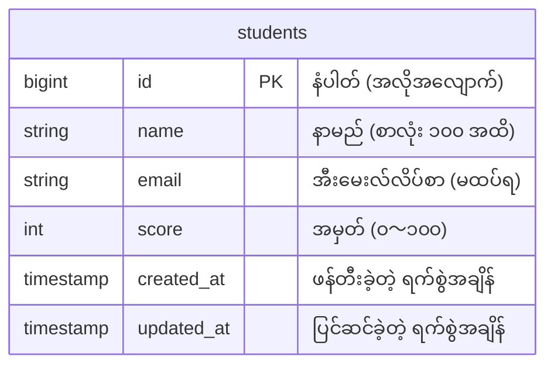
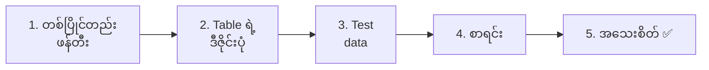
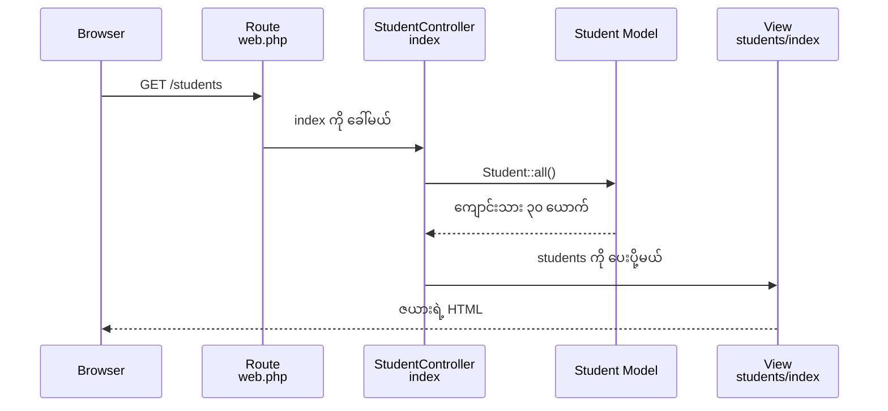

# ကျောင်းသားစီမံခန့်ခွဲမှု App ကို တည်ဆောက်ကြမယ် ① — ကြိုတင်ပြင်ဆင်မှုနှင့် စာရင်း・အသေးစိတ်

> 🇯🇵 မူရင်း (ဂျပန်ဘာသာဖြင့်): [20261119_資料_1.md](<../../../1年生_データ設計とアプリ開発/後期/20261119/20261119_資料_1.md>) <!-- original-ja-link -->

ဒီနေ့ကစပြီး **ကျောင်းသားစီမံခန့်ခွဲမှု App** အသစ်တစ်ခုကို တည်ဆောက်ပါမယ်။
Todo App မှာ သင်ခဲ့တာတွေကို အသုံးချပြီး ဒီတစ်ခါတော့ **ကိုယ့်အစွမ်းနဲ့ကိုယ်** တည်ဆောက်ကြည့်ကြရအောင်။

## ဒီနေ့ရဲ့ ပန်းတိုင်
- `make:model -mf` နဲ့ Model・Migration・Factory ကို တစ်ပြိုင်တည်း ဖန်တီးနိုင်မယ်
- ကျောင်းသား table ကို ဖန်တီးပြီး test data ထည့်နိုင်မယ်
- ကျောင်းသားစာရင်း page နဲ့ အသေးစိတ် page ကို ဖန်တီးနိုင်မယ်

> လေ့ကျင့်ရေးပတ်ဝန်းကျင် (`php-study`) ရဲ့ mysql နဲ့ laravel ကို စတင်ပြီးမှ စပါမယ်။
> Todo App နဲ့ **project တစ်ခုတည်း (`src`)** ထဲမှာပဲ ကျောင်းသားစီမံခန့်ခွဲမှု App ကို ထပ်ဖြည့်သွားပါမယ်။

---

## 1. ကျောင်းသားစီမံခန့်ခွဲမှု App ဆိုတာ

ဆရာက ကျောင်းသားတွေရဲ့ **နာမည်・အီးမေးလ်လိပ်စာ・အမှတ်** ကို စီမံခန့်ခွဲတဲ့ App ပါ။ （「生徒管理アプリ」= ကျောင်းသား စီမံခန့်ခွဲမှု App၊「生徒を追加」= ကျောင်းသား ထည့်ရန်၊「名前」= နာမည်၊「点数」= အမှတ်）

```
生徒管理アプリ

[ 生徒を追加 ]

| 名前       | 点数 |
|------------|------|
| 山田 太郎  |  85  |
| 佐藤 花子  |  92  |
| 鈴木 一郎  |  70  |
```

ဒီ App ကို ဒီနေ့ကစပြီး သင်ခန်းစာ ၃ ကြိမ်အတွင်း တစ်ဆင့်ချင်း တည်ဆောက်သွားပါမယ်။

| အကြိမ် | ဖန်တီးမယ့်အရာ |
|----|---------|
| **ပထမအကြိမ် (ဒီနေ့)** | ကျောင်းသားစာရင်း・အသေးစိတ်・ထည့်ခြင်း・ပြင်ဆင်ခြင်း・ဖျက်ခြင်း (CRUD) |
| ဒုတိယအကြိမ် | Login (ဆရာတွေပဲ သုံးနိုင်အောင် လုပ်မယ်) |
| တတိယအကြိမ် | Relation (ဘယ်ဆရာက မှတ်ပုံတင်ခဲ့တဲ့ ကျောင်းသားလဲဆိုတာ မှတ်တမ်းတင်မယ်) |

> **ဒုတိယနှစ်နဲ့ ဆက်စပ်နေတဲ့ App**
> ဒုတိယနှစ်ရောက်ရင် ဒီ App ကို **API** (မျက်နှာပြင်မဟုတ်ဘဲ data ကိုပဲ ပြန်ပေးတဲ့ စနစ်) အဖြစ် ပြောင်းလဲတည်ဆောက်ပါမယ်။
> ဒီနေ့ ဖန်တီးမယ့် table နဲ့ URL တွေကို ဒုတိယနှစ်မှာလည်း ဒီအတိုင်း ဆက်သုံးပါမယ်။

### Todo App နဲ့ နှိုင်းယှဉ်ကြည့်ရအောင်

တည်ဆောက်ပုံက Todo App နဲ့ အတော်လေး တူပါတယ်။

| | Todo App | ကျောင်းသားစီမံခန့်ခွဲမှု App |
|---|---|---|
| Table | `todos` | `students` |
| Model | `Todo` | `Student` |
| Controller | `TodoController` | `StudentController` |
| URL | `/todos` | `/students` |
| View folder | `resources/views/todos/` | `resources/views/students/` |

### ကျောင်းသား table



Todo table နဲ့ ဒီနေရာတွေမှာ ကွာပါတယ်။

| Column | အသစ်ဖြစ်တဲ့ အချက် |
|----|------------|
| `email` | **အီးမေးလ်လိပ်စာ တူတဲ့ ကျောင်းသား ၂ ယောက်ကို မှတ်ပုံတင်လို့မရ** (မထပ်ရ) |
| `score` | စာသားမဟုတ်ဘဲ **ကိန်းပြည့်** (`integer`) ကို ထည့်မယ် |

---

## 2. တည်ဆောက်ကြည့်ကြရအောင်



### 1. Model・Migration・Factory ကို တစ်ပြိုင်တည်း ဖန်တီးမယ်

> အခုရောက်နေတဲ့နေရာ：**🟢 1. တစ်ပြိုင်တည်းဖန်တီး** → 2. ဒီဇိုင်းပုံ → 3. Test data → 4. စာရင်း → 5. အသေးစိတ်

Todo တုန်းက Migration・Model・Factory ကို တစ်ခုချင်း ဖန်တီးခဲ့ပါတယ်။
ဒီတစ်ခါတော့ **command တစ်ကြောင်းတည်းနဲ့ တစ်ပြိုင်တည်း** ဖန်တီးပါမယ်။

```powershell
docker compose exec laravel php artisan make:model Student -mf
```

| အပိုင်း | အဓိပ္ပာယ် |
|------|------|
| `make:model Student` | `Student` Model ကို ဖန်တီးမယ် |
| `-m` | Migration ကိုပါ တစ်ခါတည်း ဖန်တီးမယ် (**m**igration) |
| `-f` | Factory ကိုပါ တစ်ခါတည်း ဖန်တီးမယ် (**f**actory) |

အောက်ပါ ဖိုင် ၃ ခု ထွက်လာပါမယ်။

```
src/
├─ app/Models/Student.php ··································· Model
├─ database/migrations/xxxx_create_students_table.php ······· Migration
└─ database/factories/StudentFactory.php ···················· Factory
```

`-f` ထည့်ခဲ့လို့ Model ထဲမှာ အစကတည်းက `HasFactory` ပါနေပါတယ် (Todo တုန်းက ကိုယ်တိုင် ရေးထည့်ခဲ့ရပါတယ်)။

```php
class Student extends Model
{
    /** @use HasFactory<\Database\Factories\StudentFactory> */
    use HasFactory;
}
```

---

### 2. Table ရဲ့ ဒီဇိုင်းပုံကို ရေးမယ် (Migration)

> အခုရောက်နေတဲ့နေရာ：1. တစ်ပြိုင်တည်းဖန်တီး → **🟢 2. ဒီဇိုင်းပုံ** → 3. Test data → 4. စာရင်း → 5. အသေးစိတ်

`database/migrations/xxxx_create_students_table.php` ကိုဖွင့်ပြီး `up()` ထဲကို အောက်ပါအတိုင်း ပြင်ပါ။

```php
    public function up(): void
    {
        Schema::create('students', function (Blueprint $table) {
            $table->id();
            $table->string('name', 100);
            $table->string('email')->unique();
            $table->integer('score')->default(0);
            $table->timestamps();
        });
    }
```

| Code | အဓိပ္ပာယ် |
|--------|------|
| `$table->string('name', 100)` | နာမည်။ စာလုံး ၁၀၀ အထိ |
| `$table->string('email')->unique()` | အီးမေးလ်လိပ်စာ။ **တန်ဖိုးတူကို ၂ ခါ ထည့်လို့မရ** |
| `$table->integer('score')->default(0)` | အမှတ်။ ကိန်းပြည့်ဖြစ်ပြီး ဘာမှမထည့်ရင် 0 |

👀 **Run မလုပ်ခင် ကြည့်ထားပါ**：phpMyAdmin (http://localhost:8080) ရဲ့ `laravel` database ထဲမှာ `students` table **မရှိသေးဘူး** ဆိုတာ စစ်ကြည့်ပါ။
ဒီဇိုင်းပုံကို ရေးရုံနဲ့တော့ table မဖြစ်လာသေးပါဘူး။

```powershell
docker compose exec laravel php artisan migrate
```

✅ **စစ်ဆေးရန်**：phpMyAdmin မှာ `students` table ဖြစ်လာရင် OK ပါ။

---

### 3. Test data ထည့်မယ် (Factory・Seeder)

> အခုရောက်နေတဲ့နေရာ：1. တစ်ပြိုင်တည်းဖန်တီး → 2. ဒီဇိုင်းပုံ → **🟢 3. Test data** → 4. စာရင်း → 5. အသေးစိတ်

#### ① Factory ထဲမှာ ကျောင်းသားကို ဘယ်လိုဖန်တီးမလဲ ရေးမယ်

`database/factories/StudentFactory.php` ရဲ့ `definition()` ထဲကို အောက်ပါအတိုင်း ပြင်ပါ။

```php
    public function definition(): array
    {
        return [
            'name' => fake('ja_JP')->name(),
            'email' => fake()->unique()->safeEmail(),
            'score' => fake()->numberBetween(0, 100),
        ];
    }
```

| Code | အဓိပ္ပာယ် |
|--------|------|
| `fake('ja_JP')->name()` | **ဂျပန်နာမည်** ကို ကျပန်း ဖန်တီးမယ် (ဥပမာ：山田 太郎) |
| `fake()->unique()->safeEmail()` | အီးမေးလ်လိပ်စာကို ကျပန်း ဖန်တီးမယ်။ `unique()` နဲ့ တူတာ မထွက်အောင် လုပ်မယ် |
| `fake()->numberBetween(0, 100)` | 0〜100 ကြား ကိန်းပြည့်ကို ကျပန်း ဖန်တီးမယ် |

> တကယ့်ကျောင်းသားတွေရဲ့ နာမည်နဲ့ အီးမေးလ်လိပ်စာကို လေ့ကျင့်ဖို့ မသုံးပါဘူး။ Factory နဲ့ **စိတ်ကူးယဉ် data** ကို ဖန်တီးပါမယ်။

#### ② Seeder ကို ဖန်တီးပြီး ၃၀ ယောက် ထည့်မယ်

```powershell
docker compose exec laravel php artisan make:seeder StudentSeeder
```

`database/seeders/StudentSeeder.php` ရဲ့ `run()` ထဲကို အောက်ပါအတိုင်း ပြင်ပါ။

```php
<?php

namespace Database\Seeders;

use App\Models\Student;
use Illuminate\Database\Seeder;

class StudentSeeder extends Seeder
{
    public function run(): void
    {
        Student::factory()->count(30)->create();
    }
}
```

`database/seeders/DatabaseSeeder.php` မှာ ★ ပါတဲ့ စာကြောင်း ၁ ကြောင်းကို ထပ်ရေးပါ။

```php
    public function run(): void
    {
        $this->call(TodoSeeder::class);
        $this->call(StudentSeeder::class);  // ★ ထပ်ထည့်
    }
```

```powershell
docker compose exec laravel php artisan migrate:fresh --seed
```

✅ **စစ်ဆေးရန်**：phpMyAdmin မှာ `students` table ကိုဖွင့်ပြီး ကျောင်းသား ၃၀ ယောက် ဝင်နေရင် OK ပါ။
(`migrate:fresh` ဖြစ်လို့ Todo ရဲ့ data တွေလည်း မူလအခြေအနေကို ပြန်ရောက်သွားပါမယ်)

---

### 4. စာရင်း page ကို ဖန်တီးမယ်

> အခုရောက်နေတဲ့နေရာ：1. တစ်ပြိုင်တည်းဖန်တီး → 2. ဒီဇိုင်းပုံ → 3. Test data → **🟢 4. စာရင်း** → 5. အသေးစိတ်

#### ① Controller ကို ဖန်တီးမယ်

```powershell
docker compose exec laravel php artisan make:controller StudentController
```

`app/Http/Controllers/StudentController.php` ကို အောက်ပါအတိုင်း ပြင်ပါ။

```php
<?php

namespace App\Http\Controllers;

use App\Models\Student;
use Illuminate\Http\Request;

class StudentController extends Controller
{
    public function index()
    {
        $students = Student::all();

        return view('students.index', ['students' => $students]);
    }
}
```

`TodoController` ရဲ့ `index` နဲ့ ယှဉ်ရင် `Todo` က `Student` ဖြစ်သွားတာပဲ ကွာပါတယ်။

#### ② Route ကို ရေးမယ်

`routes/web.php` မှာ ★ ပါတဲ့ စာကြောင်း ၂ ကြောင်းကို ထပ်ရေးပါ။

```php
use App\Http\Controllers\StudentController;  // ★ ထပ်ထည့် (အပေါ်ပိုင်းမှာ ရေးပါ)

// (Todo ရဲ့ route တွေကို ချန်ထားပါတယ်)

Route::get('/students', [StudentController::class, 'index']);  // ★ ထပ်ထည့်
```

#### ③ View ကို ဖန်တီးမယ်

`resources/views` ထဲမှာ `students` folder ကိုဖန်တီးပြီး `index.blade.php` ကို ဖန်တီးပါ။
11/12 မှာ ဖန်တီးခဲ့တဲ့ **header・footer အစိတ်အပိုင်း** တွေကို ဒီမှာလည်း သုံးပါမယ်။

```html
@include('layouts.header', ['title' => '生徒一覧'])

    <h1>生徒一覧</h1>

    <table border="1">
        <tr>
            <th>名前</th>
            <th>点数</th>
        </tr>
        @foreach ($students as $student)
            <tr>
                <td><a href="/students/{{ $student->id }}">{{ $student->name }}</a></td>
                <td>{{ $student->score }}</td>
            </tr>
        @endforeach
    </table>

@include('layouts.footer')
```

| Code | အဓိပ္ပာယ် |
|--------|------|
| `<table>` | ဇယားကို ဖန်တီးမယ်။ `<tr>` က အတန်း ၁ တန်း၊ `<th>` က ခေါင်းစဉ်၊ `<td>` က အကွက် |
| `border="1"` | ဇယားကို ဘောင်မျဉ်း ထည့်မယ် |

#### ④ Header မှာ 「生徒管理」(ကျောင်းသားစီမံခန့်ခွဲမှု) ကို သွားတဲ့ link ထပ်ထည့်မယ်

`resources/views/layouts/header.blade.php` မှာ ★ ပါတဲ့ link ကို ထပ်ရေးပါ။

```html
    <header>
        <a href="/todos">TODOアプリ</a>
        <a href="/students">生徒管理</a>  {{-- ★ ထပ်ထည့် --}}
    </header>
```

**အစိတ်အပိုင်းကို တစ်နေရာတည်း ပြင်လိုက်ရုံနဲ့ Todo page မှာရော ကျောင်းသား page မှာပါ link ပေါ်လာပါတယ်** (11/12 မှာ သင်ခဲ့တဲ့ ဘုံအစိတ်အပိုင်းခွဲထုတ်ခြင်းရဲ့ အစွမ်းပါ)။

`/students` ကိုဖွင့်ပြီး စာရင်းပေါ်လာတဲ့အထိ လုပ်ငန်းစဉ်က Todo တုန်းကနဲ့ အတူတူပါပဲ။



✅ **စစ်ဆေးရန်**：http://localhost:8000/students ကိုဖွင့်ပြီး ကျောင်းသား ၃၀ ယောက်ကို ဇယားနဲ့ ပြရင် OK ပါ။

---

### 5. အသေးစိတ် page ကို ဖန်တီးမယ်

> အခုရောက်နေတဲ့နေရာ：1. တစ်ပြိုင်တည်းဖန်တီး → 2. ဒီဇိုင်းပုံ → 3. Test data → 4. စာရင်း → **🟢 5. အသေးစိတ်**

#### ① Controller မှာ show ကို ထပ်ရေးမယ်

`StudentController.php` မှာ ★ ပါတဲ့ `show` ကို ထပ်ရေးပါ။

```php
    // ★ ဒီကနေစပြီး ထပ်ထည့်
    public function show($id)
    {
        $student = Student::findOrFail($id);

        return view('students.show', ['student' => $student]);
    }
    // ★ ဒီအထိ
```

#### ② Route ကို ထပ်ရေးမယ်

```php
Route::get('/students', [StudentController::class, 'index']);
Route::get('/students/{id}', [StudentController::class, 'show']);  // ★ ထပ်ထည့်
```

#### ③ View ကို ဖန်တီးမယ်

`resources/views/students/show.blade.php` ကို ဖန်တီးပါ။ （「番号」= နံပါတ်၊「メールアドレス」= အီးမေးလ်လိပ်စာ၊「点数」/「点」= အမှတ်၊「一覧にもどる」= စာရင်းသို့ ပြန်သွားရန်）

```html
@include('layouts.header', ['title' => $student->name])

    <h1>{{ $student->name }}</h1>

    <p>番号：{{ $student->id }}</p>
    <p>メールアドレス：{{ $student->email }}</p>
    <p>点数：{{ $student->score }}点</p>

    <a href="/students">一覧にもどる</a>

@include('layouts.footer')
```

✅ **စစ်ဆေးရန်**：စာရင်းထဲက ကျောင်းသားနာမည်ကို click လုပ်ပြီး အသေးစိတ် page ပေါ်လာရင် OK ပါ။
http://localhost:8000/students/999 လိုမျိုး မရှိတဲ့ ကျောင်းသားရဲ့ URL ကိုဖွင့်ရင် `404 Not Found` ဖြစ်တာကိုလည်း စစ်ကြည့်ပါ။

---

## 3. အဆင်မပြေတဲ့အခါ

> **🔥 အလုပ်မလုပ်ရင် log ထုတ်ကြည့်ပါ！** → [【အရေးကြီး】Log ထုတ်နည်း](../20261022/【重要】ログの出し方.md)

| လက္ခဏာ | အကြောင်းရင်းရှိတဲ့နေရာ | ဖြေရှင်းနည်း |
|------|----------|------|
| `Table 'laravel.students' doesn't exist` | Migration | `php artisan migrate` (သို့မဟုတ် `migrate:fresh --seed`) ကို run ခဲ့သလား စစ်ပါ |
| `Call to undefined method App\Models\Student::factory()` | Model | `make:model` မှာ `-f` ထည့်ဖို့ မေ့သွားတာပါ။ `Student.php` မှာ `use HasFactory;` ကို ထပ်ရေးပါ |
| နာမည်တွေက အင်္ဂလိပ်လို (ဥပမာ：John Smith) ဖြစ်နေတယ် | Factory | `fake('ja_JP')->name()` ရဲ့ `'ja_JP'` ကို ရေးခဲ့သလား စစ်ပါ |
| `Target class [StudentController] does not exist.` | Route | `web.php` ရဲ့ အပေါ်ပိုင်းမှာ `use App\Http\Controllers\StudentController;` ရှိသလား စစ်ပါ |
| `View [students.index] not found.` | View | `resources/views/students/index.blade.php` ရဲ့ တည်နေရာကို စစ်ပါ (`students` မှာ `s` ပါရမယ်) |
| `Undefined variable $title` | View | `@include('layouts.header', ['title' => ...])` ရဲ့ `['title' => ...]` ကို ရေးဖို့ မေ့နေသလား စစ်ပါ |

---

## 4. အနှစ်ချုပ်

| ဒီနေ့ ရေးခဲ့တာ | တစ်ခွန်းတည်းနဲ့ပြောရရင် |
|--------------|-----------|
| `make:model Student -mf` | Model・Migration・Factory ကို တစ်ပြိုင်တည်း ဖန်တီးမယ် |
| `->unique()` (Migration) | တန်ဖိုးတူကို ၂ ခါ ထည့်လို့မရတဲ့ column ဖြစ်အောင် လုပ်မယ် |
| `$table->integer(...)` | ကိန်းပြည့် column |
| `fake('ja_JP')->name()` | ဂျပန်နာမည်ကို ကျပန်း ဖန်တီးမယ် |
| `index` နဲ့ `show` | Todo နဲ့ ပုံစံတူ စာရင်းနဲ့ အသေးစိတ်ကို ဖန်တီးမယ် |
| `<table>` | စာရင်းကို ဇယားနဲ့ ပြမယ် |

**တည်ဆောက်ပုံက Todo နဲ့ အတူတူပါပဲ။ နာမည်ကို `Todo` ကနေ `Student` လို့ ပြောင်းပြီး စဉ်းစားရင် ကိုယ်တိုင် တည်ဆောက်နိုင်ပါတယ်။**

နောက်တစ်ဆင့်မှာ ကျောင်းသားကို ထည့်ခြင်း・ပြင်ဆင်ခြင်း・ဖျက်ခြင်း လုပ်နိုင်အောင် လုပ်ပါမယ် → [ကျောင်းသားစီမံခန့်ခွဲမှု App ကို တည်ဆောက်ကြမယ် ② — ထည့်ခြင်း・ပြင်ဆင်ခြင်း・ဖျက်ခြင်း](./20261119_資料_2.md)

<!-- nav:start -->

---

| ⬅️ ယခင် | 🗺️ ခြုံငုံပုံ | နောက်တစ်ခု ➡️ |
|:--|:--:|--:|
| [11/12 Category ထည့်ခြင်း](../20261112/20261112_資料_2.md) | [သင်ခန်းစာများ၏ ခြုံငုံပုံ](../../README.md) | [11/19 ကျောင်းသားစီမံခန့်ခွဲမှု ② ထည့်ခြင်း・ပြင်ဆင်ခြင်း・ဖျက်ခြင်း](20261119_資料_2.md) |

<!-- nav:end -->
