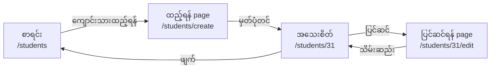
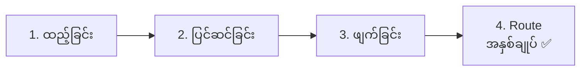
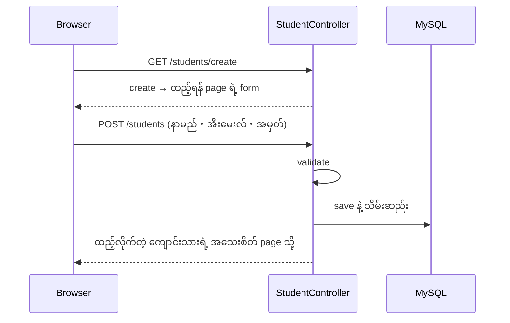
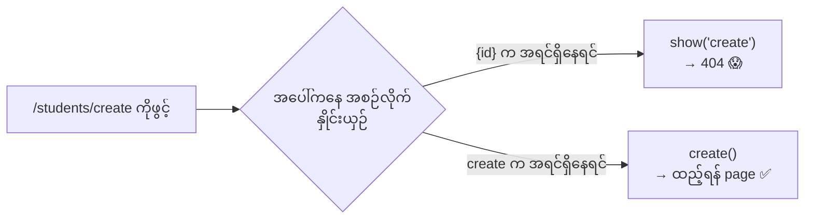
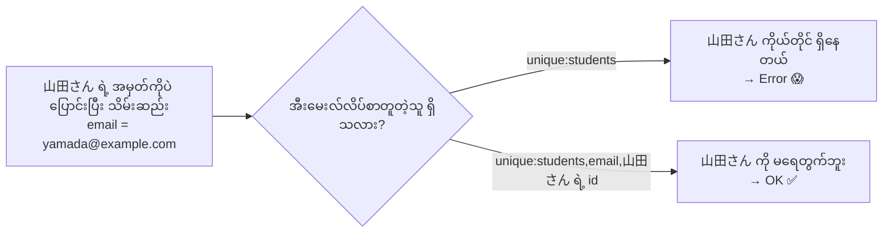

# ကျောင်းသားစီမံခန့်ခွဲမှု App ကို တည်ဆောက်ကြမယ် ② — ထည့်ခြင်း・ပြင်ဆင်ခြင်း・ဖျက်ခြင်း

> 🇯🇵 မူရင်း (ဂျပန်ဘာသာဖြင့်): [20261119_資料_2.md](<../../../1年生_データ設計とアプリ開発/後期/20261119/20261119_資料_2.md>) <!-- original-ja-link -->

[သင်ခန်းစာ 1](./20261119_資料_1.md) မှာ ကျောင်းသားစာရင်းနဲ့ အသေးစိတ်ကို ဖန်တီးပြီးပါပြီ။
နောက်တစ်ဆင့်မှာ ကျောင်းသားကို **ထည့်ခြင်း・ပြင်ဆင်ခြင်း・ဖျက်ခြင်း** လုပ်နိုင်အောင် လုပ်ပါမယ်။

## ဒီနေ့ရဲ့ ပန်းတိုင်
- ဖြည့်စရာကွက်များတဲ့ form ကို ထည့်ဖို့သီးသန့် page အဖြစ် ဖန်တီးနိုင်မယ်
- အီးမေးလ်လိပ်စာ ထပ်နေခြင်း (`unique`) နဲ့ အမှတ်ရဲ့ အပိုင်းအခြား (`integer`・`min`・`max`) ကို စစ်ဆေးနိုင်မယ်
- ပြင်ဆင်တဲ့အခါ **မိမိရဲ့ အီးမေးလ်လိပ်စာကို ထပ်နေခြင်းစစ်ဆေးမှုကနေ ဖယ်ထား** နိုင်မယ်

> သင်ခန်းစာ ၁ ရဲ့ 「စာရင်း・အသေးစိတ်」 ပြီးနေတဲ့ အခြေအနေကနေ စပါမယ်။

---

## 1. Todo နဲ့ ကွာခြားချက်

တည်ဆောက်ပုံက Todo နဲ့ အတော်လေးတူပေမယ့် ကွာခြားချက် ၂ ခု ရှိပါတယ်။

| | Todo App | ကျောင်းသားစီမံခန့်ခွဲမှု App |
|---|---|---|
| ထည့်ရန် form ရဲ့ နေရာ | စာရင်း page ရဲ့ အပေါ်ပိုင်း | **ထည့်ဖို့သီးသန့် page** (`/students/create`) ကို ဖန်တီးမယ် |
| ဖြည့်စရာကွက် | ခေါင်းစဉ်တစ်ခုတည်း | နာမည်・အီးမေးလ်လိပ်စာ・အမှတ် **၃ ခု** |

ဖြည့်စရာကွက်များလို့ စာရင်းရဲ့ အပေါ်မှာထားရင် ကြည့်ရခက်သွားပါမယ်။ ဒါကြောင့် **ထည့်ဖို့သီးသန့် page** ကို သပ်သပ် ဖန်တီးပါမယ်။



---

## 2. တည်ဆောက်ကြည့်ကြရအောင်



### 1. ထည့်နိုင်အောင် လုပ်မယ်

> အခုရောက်နေတဲ့နေရာ：**🟢 1. ထည့်ခြင်း** → 2. ပြင်ဆင်ခြင်း → 3. ဖျက်ခြင်း → 4. Route အနှစ်ချုပ်

#### ① ထည့်ရန် page ကို ပြမယ် (create)

`StudentController.php` မှာ ★ ပါတဲ့ `create` ကို ထပ်ရေးပါ။

```php
    // ★ ဒီကနေစပြီး ထပ်ထည့်
    public function create()
    {
        return view('students.create');
    }
    // ★ ဒီအထိ
```

`create` က **ထည့်ရန် form ကို ပြရုံသက်သက်** ပဲ လုပ်တဲ့ method ပါ။ Database ကို မသုံးပါဘူး။

#### ② ထည့်ရန် page ရဲ့ View ကို ဖန်တီးမယ်

`resources/views/students/create.blade.php` ကို ဖန်တီးပါ။ 「生徒の追加」 က ကျောင်းသားထည့်ခြင်း၊ 「名前」 က နာမည်၊ 「メールアドレス」 က အီးမေးလ်လိပ်စာ၊ 「点数」 က အမှတ်၊ 「登録」 က မှတ်ပုံတင်ရန်၊ 「一覧にもどる」 က စာရင်းသို့ ပြန်သွားရန် ဖြစ်ပါတယ်။

```html
@include('layouts.header', ['title' => '生徒の追加'])

    <h1>生徒の追加</h1>

    <form method="POST" action="/students">
        @csrf

        <p>
            名前：
            <input type="text" name="name" value="{{ old('name') }}" required>
            @error('name') <span style="color: red;">{{ $message }}</span> @enderror
        </p>

        <p>
            メールアドレス：
            <input type="email" name="email" value="{{ old('email') }}" required>
            @error('email') <span style="color: red;">{{ $message }}</span> @enderror
        </p>

        <p>
            点数：
            <input type="number" name="score" value="{{ old('score') }}" min="0" max="100" required>
            @error('score') <span style="color: red;">{{ $message }}</span> @enderror
        </p>

        <button type="submit">登録</button>
    </form>

    <a href="/students">一覧にもどる</a>

@include('layouts.footer')
```

| Code | အဓိပ္ပာယ် |
|--------|------|
| `type="email"` | အီးမေးလ်လိပ်စာအတွက် ဖြည့်စရာကွက်။ အီးမေးလ်လိပ်စာ ပုံစံဟုတ်မဟုတ် browser က စစ်ပေးပါတယ် |
| `type="number" min="0" max="100"` | ဂဏန်းအတွက် ဖြည့်စရာကွက်။ 0〜100 ပဲ ထည့်လို့ရအောင် လုပ်မယ် |
| `@error('name')` 〜 `@enderror` | ဖြည့်စရာကွက်တစ်ခုချင်းစီအလိုက် error message ကို ပြမယ် (11/5 နဲ့ အတူတူ) |
| `old('name')` | Error ကြောင့် ပြန်ရောက်လာတဲ့အခါ ထည့်ခဲ့တဲ့ တန်ဖိုးကို ချန်ထားမယ် (11/5 နဲ့ အတူတူ) |

စာရင်း page (`students/index.blade.php`) ရဲ့ `<h1>` အောက်မှာ ထည့်ရန် page ကို သွားတဲ့ link ကိုလည်း ထပ်ထည့်ထားပါ။

```html
    <h1>生徒一覧</h1>

    <a href="/students/create">生徒を追加</a>  {{-- ★ ထပ်ထည့် --}}
```

#### ③ သိမ်းဆည်းမယ် (store)

`StudentController.php` မှာ ★ ပါတဲ့ `store` ကို ထပ်ရေးပါ။

```php
    // ★ ဒီကနေစပြီး ထပ်ထည့်
    public function store(Request $request)
    {
        $request->validate([
            'name' => 'required|max:100',
            'email' => 'required|email|unique:students',
            'score' => 'required|integer|min:0|max:100',
        ], [
            'name.required' => '名前を入力してください。',
            'name.max' => '名前は100文字以内で入力してください。',
            'email.required' => 'メールアドレスを入力してください。',
            'email.email' => 'メールアドレスの形で入力してください。',
            'email.unique' => 'そのメールアドレスは、すでに登録されています。',
            'score.required' => '点数を入力してください。',
            'score.integer' => '点数は整数で入力してください。',
            'score.min' => '点数は0以上で入力してください。',
            'score.max' => '点数は100以下で入力してください。',
        ]);

        $student = new Student();
        $student->name = $request->input('name');
        $student->email = $request->input('email');
        $student->score = $request->input('score');
        $student->save();

        return redirect('/students/' . $student->id);
    }
    // ★ ဒီအထိ
```

အသစ်ပါလာတဲ့ validation rule တွေပါ။

| Rule | အဓိပ္ပာယ် |
|--------|------|
| `email` | အီးမေးလ်လိပ်စာ ပုံစံဟုတ်သလား (`@` ပါသလား စသည်) |
| `unique:students` | `students` table ထဲမှာ **တန်ဖိုးတူ မရှိသေးဘူးလား** |
| `integer` | ကိန်းပြည့်ဟုတ်သလား |
| `min:0`・`max:100` | 0 နဲ့အထက်・100 နဲ့အောက် ဟုတ်သလား (`integer` နဲ့ တွဲသုံးရင် **ဂဏန်းရဲ့ တန်ဖိုး** နဲ့ စစ်ပါတယ်) |

> **`max:100` က နေရာ ၂ ခုမှာ အဓိပ္ပာယ်မတူပါဘူး**
> `name` ရဲ့ `max:100` က 「**စာလုံး ၁၀၀** အထိ」၊ `score` ရဲ့ `max:100` က 「**100 နဲ့အောက်**」 ပါ။
> `integer` ပါရင် ဂဏန်းရဲ့ တန်ဖိုးနဲ့၊ မပါရင် စာလုံးအရေအတွက်နဲ့ စစ်ပါတယ်။

သိမ်းဆည်းပြီးရင် ထည့်လိုက်တဲ့ ကျောင်းသားရဲ့ အသေးစိတ် page ကို ပြန်သွားပါမယ်။

ထည့်ခြင်းက 「form ကို ပြမယ် (`create`)」 နဲ့ 「သိမ်းဆည်းမယ် (`store`)」 ဆိုတဲ့ **အပြန်အလှန် ၂ ကြိမ်** ခွဲထားပါတယ်။



#### ④ Route ကို ထပ်ရေးမယ်

`routes/web.php` မှာ ★ ပါတဲ့ စာကြောင်း ၂ ကြောင်းကို ထပ်ရေးပါ။ **ရေးတဲ့ အစီအစဉ်ကို သတိထားပါ**။

```php
Route::get('/students', [StudentController::class, 'index']);
Route::get('/students/create', [StudentController::class, 'create']);  // ★ ထပ်ထည့် ({id} ရဲ့ အပေါ်မှာ!)
Route::post('/students', [StudentController::class, 'store']);         // ★ ထပ်ထည့်
Route::get('/students/{id}', [StudentController::class, 'show']);
```

> ⚠️ **`/students/create` ကို `/students/{id}` ရဲ့ အပေါ်မှာ ရေးပါ**
> Route တွေကို **အပေါ်ကနေ အစဉ်လိုက်** နှိုင်းယှဉ်ပါတယ်။
> `/students/{id}` ကို အရင်ရေးထားရင် `/students/create` ထဲက `create` ကို `{id}` လို့ ထင်သွားပါမယ်။
> ဒါဆိုရင် `show('create')` အလုပ်လုပ်ပြီး `id` က `create` ဖြစ်တဲ့ ကျောင်းသားကို ရှာတာကြောင့် `404 Not Found` ဖြစ်သွားပါမယ်။



✅ **စစ်ဆေးရန်**：စာရင်းထဲက 「生徒を追加」(ကျောင်းသားထည့်ရန်) ကနေ ကျောင်းသား ၁ ယောက် မှတ်ပုံတင်ကြည့်ပါ။ အောက်ပါ ၃ ခုကိုလည်း စမ်းကြည့်ပါ။

| လုပ်ရမယ့်အရာ | ဒီလိုဖြစ်ရင် OK |
|---------|------------|
| ပုံမှန်အတိုင်း မှတ်ပုံတင်မယ် | အသေးစိတ် page ပေါ်လာမယ် |
| စာရင်းထဲမှာရှိတဲ့ ကျောင်းသားနဲ့ **အီးမေးလ်လိပ်စာတူ** နဲ့ မှတ်ပုံတင်မယ် | 「そのメールアドレスは、すでに登録されています。」(ဒီအီးမေးလ်လိပ်စာကို မှတ်ပုံတင်ပြီးသားပါ) လို့ ပေါ်လာမယ် |
| Developer tools နဲ့ အမှတ်ရဲ့ `max="100"` ကို ဖျက်ပြီး `150` နဲ့ မှတ်ပုံတင်မယ် | 「点数は100以下で入力してください。」(အမှတ်ကို 100 နဲ့အောက် ထည့်ပါ) လို့ ပေါ်လာမယ် |

---

### 2. ပြင်ဆင်နိုင်အောင် လုပ်မယ်

> အခုရောက်နေတဲ့နေရာ：1. ထည့်ခြင်း → **🟢 2. ပြင်ဆင်ခြင်း** → 3. ဖျက်ခြင်း → 4. Route အနှစ်ချုပ်

#### ① ပြင်ဆင်ရန် page ကို ပြမယ် (edit)

`StudentController.php` မှာ ★ ပါတဲ့ `edit` ကို ထပ်ရေးပါ။

```php
    // ★ ဒီကနေစပြီး ထပ်ထည့်
    public function edit($id)
    {
        $student = Student::findOrFail($id);

        return view('students.edit', ['student' => $student]);
    }
    // ★ ဒီအထိ
```

#### ② ပြင်ဆင်ရန် page ရဲ့ View ကို ဖန်တီးမယ်

`resources/views/students/edit.blade.php` ကို ဖန်တီးပါ။ ထည့်ရန် page နဲ့ ကွာတဲ့နေရာတွေမှာ ★ ပြထားပါတယ်။

```html
@include('layouts.header', ['title' => '生徒の編集'])

    <h1>生徒の編集</h1>

    <form method="POST" action="/students/{{ $student->id }}">  {{-- ★ ပို့မယ့်နေရာ --}}
        @csrf
        @method('PUT')  {{-- ★ PUT --}}

        <p>
            名前：
            <input type="text" name="name" value="{{ old('name', $student->name) }}" required>  {{-- ★ လက်ရှိတန်ဖိုး --}}
            @error('name') <span style="color: red;">{{ $message }}</span> @enderror
        </p>

        <p>
            メールアドレス：
            <input type="email" name="email" value="{{ old('email', $student->email) }}" required>  {{-- ★ လက်ရှိတန်ဖိုး --}}
            @error('email') <span style="color: red;">{{ $message }}</span> @enderror
        </p>

        <p>
            点数：
            <input type="number" name="score" value="{{ old('score', $student->score) }}" min="0" max="100" required>  {{-- ★ လက်ရှိတန်ဖိုး --}}
            @error('score') <span style="color: red;">{{ $message }}</span> @enderror
        </p>

        <button type="submit">保存</button>
    </form>

    <a href="/students/{{ $student->id }}">もどる</a>

@include('layouts.footer')
```

အသေးစိတ် page (`students/show.blade.php`) မှာလည်း ပြင်ဆင်ရန် page ကို သွားတဲ့ link ကို ထပ်ထည့်ထားပါ။

```html
    <p>点数：{{ $student->score }}点</p>

    <a href="/students/{{ $student->id }}/edit">編集</a>  {{-- ★ ထပ်ထည့် --}}
```

#### ③ သိမ်းဆည်းမယ် (update)

`StudentController.php` မှာ ★ ပါတဲ့ `update` ကို ထပ်ရေးပါ။

```php
    // ★ ဒီကနေစပြီး ထပ်ထည့်
    public function update(Request $request, $id)
    {
        // ① အရင်ဆုံး ပြင်မယ့် ကျောင်းသားကို ယူလာမယ်
        $student = Student::findOrFail($id);

        // ② စစ်ဆေးမယ် (email မှာ ဒီကျောင်းသားကိုယ်တိုင်ကို ထပ်နေခြင်းစစ်ဆေးမှုကနေ ဖယ်ထားမယ်)
        $request->validate([
            'name' => 'required|max:100',
            'email' => 'required|email|unique:students,email,' . $student->id,
            'score' => 'required|integer|min:0|max:100',
        ], [
            'name.required' => '名前を入力してください。',
            'name.max' => '名前は100文字以内で入力してください。',
            'email.required' => 'メールアドレスを入力してください。',
            'email.email' => 'メールアドレスの形で入力してください。',
            'email.unique' => 'そのメールアドレスは、すでに登録されています。',
            'score.required' => '点数を入力してください。',
            'score.integer' => '点数は整数で入力してください。',
            'score.min' => '点数は0以上で入力してください。',
            'score.max' => '点数は100以下で入力してください。',
        ]);

        // ③ ပြင်ရေးပြီး သိမ်းဆည်းမယ်
        $student->name = $request->input('name');
        $student->email = $request->input('email');
        $student->score = $request->input('score');
        $student->save();

        return redirect('/students/' . $student->id);
    }
    // ★ ဒီအထိ
```

##### `unique:students,email,` ရဲ့ နောက်မှာ `$student->id` ကို ထည့်ရတဲ့ အကြောင်းရင်း

ပြင်ဆင်ရန် page မှာ **အမှတ်ကိုပဲ** ပြောင်းပြီး သိမ်းဆည်းတယ်လို့ ဆိုကြပါစို့။
အီးမေးလ်လိပ်စာကို မပြောင်းထားလို့ `students` table ထဲမှာ **ကိုယ့်အီးမေးလ်လိပ်စာ** က ရှိပြီးသား ဖြစ်နေပါတယ်။
`store` နဲ့ အတူတူ `unique:students` အတိုင်းဆိုရင် 「すでに登録されています」 (မှတ်ပုံတင်ပြီးသားပါ) လို့ ပြောခံရပါလိမ့်မယ်။



| ရေးနည်း | အဓိပ္ပာယ် |
|--------|------|
| `unique:students` | `students` table ထဲမှာ တန်ဖိုးတူ မရှိဘူးလား |
| `unique:students,email,` . `$student->id` | `students` table ရဲ့ `email` column ထဲမှာ တန်ဖိုးတူ မရှိဘူးလား။ **ဒါပေမဲ့ ဒီကျောင်းသား (`$student->id`) ကိုတော့ မရေတွက်ဘူး** |

> **ဘာလို့ `$id` မဟုတ်ဘဲ `$student->id` ကို သုံးတာလဲ?**
> `$id` က URL ကနေ လာတဲ့ တန်ဖိုးပါ။ URL ကို သုံးတဲ့သူက စိတ်ကြိုက် ပြင်ရေးလို့ရပါတယ်။
> `findOrFail` နဲ့ တစ်ခါ ယူလာပြီးသား `$student->id` ကတော့ **database ကနေလာတဲ့ ယုံကြည်ရတဲ့ တန်ဖိုး** ပါ။
> Laravel ရဲ့ တရားဝင် documentation မှာလည်း ထပ်နေခြင်းစစ်ဆေးမှုကနေ ဖယ်ထားမယ့် ID အတွက် 「သုံးတဲ့သူ ပို့လိုက်တဲ့ တန်ဖိုးကို မသုံးပါနဲ့」 လို့ သတိပေးထားပါတယ်။
> ဒါကြောင့် **`findOrFail` နဲ့ အရင်ယူလာတဲ့** အစီအစဉ်အတိုင်း ရေးထားတာပါ။

#### ④ Route ကို ထပ်ရေးမယ်

```php
Route::get('/students/{id}', [StudentController::class, 'show']);
Route::get('/students/{id}/edit', [StudentController::class, 'edit']);  // ★ ထပ်ထည့်
Route::put('/students/{id}', [StudentController::class, 'update']);     // ★ ထပ်ထည့်
```

✅ **စစ်ဆေးရန်**：အောက်ပါ ၃ ခုကို စမ်းကြည့်ပါ။

| လုပ်ရမယ့်အရာ | ဒီလိုဖြစ်ရင် OK |
|---------|------------|
| အမှတ်ကိုပဲ ပြောင်းပြီး သိမ်းဆည်းမယ် | Error မဖြစ်ဘဲ အသေးစိတ် page ရဲ့ အမှတ် ပြောင်းသွားမယ် |
| နာမည်ကို ပြောင်းပြီး သိမ်းဆည်းမယ် | အသေးစိတ် page ရဲ့ နာမည် ပြောင်းသွားမယ် |
| အီးမေးလ်လိပ်စာကို **တခြားကျောင်းသား** နဲ့ တူအောင်လုပ်ပြီး သိမ်းဆည်းမယ် | 「そのメールアドレスは、すでに登録されています。」(ဒီအီးမေးလ်လိပ်စာကို မှတ်ပုံတင်ပြီးသားပါ) လို့ ပေါ်လာမယ် |

---

### 3. ဖျက်နိုင်အောင် လုပ်မယ်

> အခုရောက်နေတဲ့နေရာ：1. ထည့်ခြင်း → 2. ပြင်ဆင်ခြင်း → **🟢 3. ဖျက်ခြင်း** → 4. Route အနှစ်ချုပ်

#### ① destroy ကို ရေးမယ်

`StudentController.php` မှာ ★ ပါတဲ့ `destroy` ကို ထပ်ရေးပါ။

```php
    // ★ ဒီကနေစပြီး ထပ်ထည့်
    public function destroy($id)
    {
        $student = Student::findOrFail($id);
        $student->delete();

        return redirect('/students');
    }
    // ★ ဒီအထိ
```

#### ② အသေးစိတ် page မှာ ဖျက်ရန်ခလုတ် ထပ်ထည့်မယ်

`students/show.blade.php` ရဲ့ ပြင်ဆင်ရန် link အောက်မှာ ★ ပါတဲ့ form ကို ထပ်ရေးပါ။ 「編集」 က ပြင်ဆင်ရန်၊ 「削除しますか？」 က ဖျက်မှာလားလို့ အတည်ပြုမေးခြင်း၊ 「削除」 က ဖျက်ရန် ဖြစ်ပါတယ်။

```html
    <a href="/students/{{ $student->id }}/edit">編集</a>

    {{-- ★ ဒီကနေစပြီး ထပ်ထည့် --}}
    <form method="POST" action="/students/{{ $student->id }}" onsubmit="return confirm('削除しますか？');">
        @csrf
        @method('DELETE')
        <button type="submit">削除</button>
    </form>
    {{-- ★ ဒီအထိ --}}
```

#### ③ Route ကို ထပ်ရေးမယ်

```php
Route::delete('/students/{id}', [StudentController::class, 'destroy']);  // ★ ထပ်ထည့်
```

✅ **စစ်ဆေးရန်**：အသေးစိတ် page မှာ 「削除」(ဖျက်ရန်) ကို နှိပ်ပြီး အဲဒီကျောင်းသား စာရင်းထဲကနေ ပျောက်သွားရင် OK ပါ။

---

### 4. Route အနှစ်ချုပ် ✅

> အခုရောက်နေတဲ့နေရာ：1. ထည့်ခြင်း → 2. ပြင်ဆင်ခြင်း → 3. ဖျက်ခြင်း → **🟢 4. Route အနှစ်ချုပ်**

ကျောင်းသားစီမံခန့်ခွဲမှု App ရဲ့ route တွေက စုစုပေါင်း **၇ ခု** ဖြစ်လာပါပြီ။ `routes/web.php` က အောက်ပါအတိုင်း ဖြစ်နေပါတယ်။

```php
Route::get('/students', [StudentController::class, 'index']);
Route::get('/students/create', [StudentController::class, 'create']);
Route::post('/students', [StudentController::class, 'store']);
Route::get('/students/{id}', [StudentController::class, 'show']);
Route::get('/students/{id}/edit', [StudentController::class, 'edit']);
Route::put('/students/{id}', [StudentController::class, 'update']);
Route::delete('/students/{id}', [StudentController::class, 'destroy']);
```

| Route | တာဝန်ယူသူ | လုပ်တဲ့အရာ | မျက်နှာပြင် |
|--------|------|---------|------|
| `GET /students` | `index` | စာရင်းကို ပြမယ် | ရှိ |
| `GET /students/create` | `create` | ထည့်ရန် page ကို ပြမယ် | ရှိ |
| `POST /students` | `store` | ထည့်ပြီး သိမ်းဆည်းမယ် | မရှိ (အသေးစိတ်သို့) |
| `GET /students/{id}` | `show` | အသေးစိတ်ကို ပြမယ် | ရှိ |
| `GET /students/{id}/edit` | `edit` | ပြင်ဆင်ရန် page ကို ပြမယ် | ရှိ |
| `PUT /students/{id}` | `update` | ပြင်ရေးပြီး သိမ်းဆည်းမယ် | မရှိ (အသေးစိတ်သို့) |
| `DELETE /students/{id}` | `destroy` | ဖျက်မယ် | မရှိ (စာရင်းသို့) |

> **ဒီ ၇ ခုက Laravel ရဲ့ သတ်မှတ်ထားတဲ့ ပုံစံပါ**
> စာရင်း・ထည့်ခြင်း・အသေးစိတ်・ပြင်ဆင်ခြင်း・ဖျက်ခြင်း အားလုံးစုံအောင် လုပ်ရင် App အများစုမှာ ဒီ route ၇ ခု ဖြစ်လာပါတယ်။
> ဒါကြောင့် Laravel မှာ ဒီ ၇ ခုကို **တစ်ကြောင်းတည်းနဲ့ ရေးနိုင်တဲ့** `Route::resource('students', StudentController::class);` ဆိုတဲ့ ရေးနည်းလည်း ရှိပါတယ်။
> ဒီနေ့တော့ တစ်ခုချင်းစီရဲ့ အဓိပ္ပာယ်ကို နားလည်အောင် ၇ ကြောင်းနဲ့ ရေးခဲ့ပါတယ်။
>
> **ဒုတိယနှစ်မှာ** ဒီထဲက **မျက်နှာပြင်ကို ပြရုံသက်သက်ဖြစ်တဲ့ `create`・`edit` ကို မသုံးဘဲ ကျန်တဲ့ ၅ ခု** ကို API အဖြစ် ပြောင်းလဲတည်ဆောက်ပါမယ်။

---

## 3. အဆင်မပြေတဲ့အခါ

> **🔥 အလုပ်မလုပ်ရင် log ထုတ်ကြည့်ပါ！** → [【အရေးကြီး】Log ထုတ်နည်း](../20261022/【重要】ログの出し方.md)

| လက္ခဏာ | အကြောင်းရင်းရှိတဲ့နေရာ | ဖြေရှင်းနည်း |
|------|----------|------|
| 「生徒を追加」(ကျောင်းသားထည့်ရန်) ကို နှိပ်ရင် `404 Not Found` ဖြစ်တယ် | Route | `/students/create` ရဲ့ route က `/students/{id}` ရဲ့ **အပေါ်** မှာ ရှိသလား စစ်ပါ |
| အမှတ်ကိုပဲ ပြောင်းပြီး သိမ်းဆည်းရင် 「すでに登録されています」 (မှတ်ပုံတင်ပြီးသားပါ) လို့ ပေါ်တယ် | Controller | `update` ရဲ့ `unique:students,email,` နောက်မှာ `. $student->id` ပါသလား စစ်ပါ |
| တခြားကျောင်းသားနဲ့ တူညီတဲ့ အီးမေးလ်လိပ်စာကို သုံးပြီး မှတ်ပုံတင်လို့ ရသွားတယ် | Controller | `store` မှာ `unique:students` ပါသလား စစ်ပါ |
| `SQLSTATE[23000]: ... Duplicate entry` | Controller | Validation ရဲ့ `unique` ကို ရေးဖို့ မေ့နေသလား စစ်ပါ (database ဘက်က `unique` ကြောင့် ရပ်သွားတာပါ) |
| အမှတ်မှာ `150` ထည့်ရင်တောင် မှတ်ပုံတင်လို့ ရသွားတယ် | Controller | `score` မှာ `integer` ပါသလား စစ်ပါ (မပါရင် ဂဏန်းတန်ဖိုးမဟုတ်ဘဲ **စာလုံးအရေအတွက်** (စာလုံး ၃ လုံး) နဲ့ စစ်သွားပါတယ်) |
| Error ကြောင့် ပြန်ရောက်လာရင် ဖြည့်စရာကွက်တွေ ဗလာ ဖြစ်သွားတယ် | View | `value="{{ old('...') }}"` ကို ရေးခဲ့သလား စစ်ပါ |

---

## 4. အနှစ်ချုပ်

| ဒီနေ့ ရေးခဲ့တာ | တစ်ခွန်းတည်းနဲ့ပြောရရင် |
|--------------|-----------|
| `create` နဲ့ `create.blade.php` | ထည့်ရန် form ကို ပြရုံသက်သက် page |
| `email`・`unique:students` | အီးမေးလ်လိပ်စာ ပုံစံဟုတ်သလား・ထပ်မနေဘူးလား |
| `integer`・`min:0`・`max:100` | 0〜100 ကြား ကိန်းပြည့်ဟုတ်သလား |
| `unique:students,email,` . `$student->id` | ပြင်ဆင်တဲ့အခါ ကိုယ့်ကိုယ်ကို ထပ်နေခြင်းစစ်ဆေးမှုကနေ ဖယ်ထားမယ် |
| `/students/create` ကို `{id}` ရဲ့ အပေါ်မှာ | Route တွေကို အပေါ်ကနေ အစဉ်လိုက် နှိုင်းယှဉ်တယ် |
| Route ၇ ခု | စာရင်း・ထည့်ခြင်း・အသေးစိတ်・ပြင်ဆင်ခြင်း・ဖျက်ခြင်း အတွက် Laravel ရဲ့ သတ်မှတ်ထားတဲ့ ပုံစံ |

**Todo မှာ သင်ခဲ့တာတွေနဲ့တင် App အသစ်တစ်ခုကို တည်ဆောက်နိုင်ခဲ့ပါပြီ။** နောက်တစ်ကြိမ်မှာ ဒီ App ကို **Login** ထည့်ပြီး ဆရာတွေပဲ သုံးနိုင်အောင် လုပ်ပါမယ်။

<!-- nav:start -->

---

| ⬅️ ယခင် | 🗺️ ခြုံငုံပုံ | နောက်တစ်ခု ➡️ |
|:--|:--:|--:|
| [11/19 ကျောင်းသားစီမံခန့်ခွဲမှု ① စာရင်း・အသေးစိတ်](20261119_資料_1.md) | [သင်ခန်းစာများ၏ ခြုံငုံပုံ](../../README.md) | [11/26 ကျောင်းသားစီမံခန့်ခွဲမှု ③ Login](../20261126/20261126_資料_1.md) |

<!-- nav:end -->
