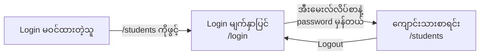
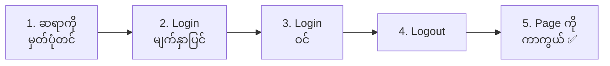
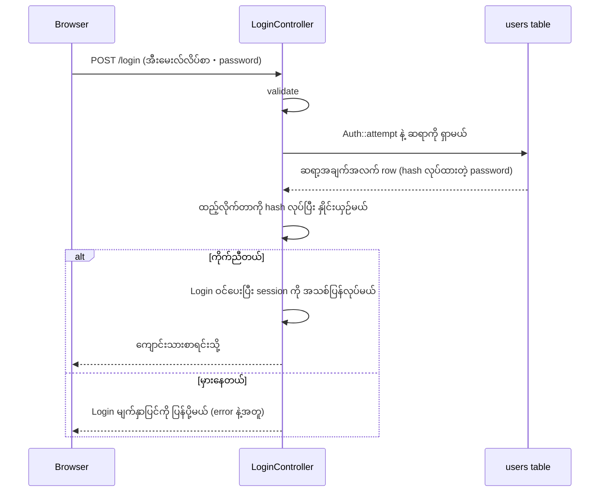
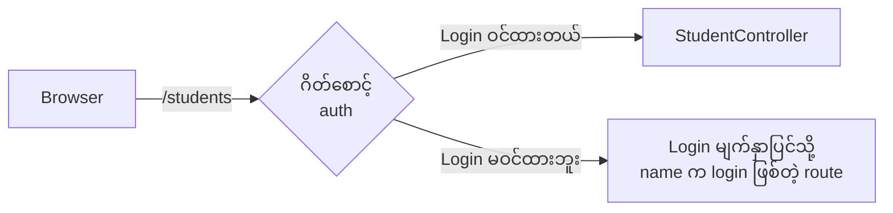
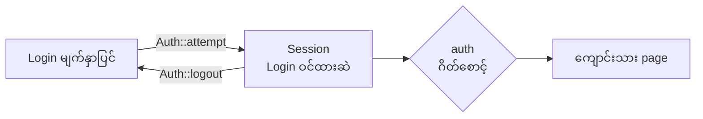

# ကျောင်းသားစီမံခန့်ခွဲမှု App ကို တည်ဆောက်ကြမယ် ③ — Login

> 🇯🇵 မူရင်း (ဂျပန်ဘာသာဖြင့်): [20261126_資料_1.md](<../../../1年生_データ設計とアプリ開発/後期/20261126/20261126_資料_1.md>) <!-- original-ja-link -->

ကျောင်းသားတွေရဲ့ နာမည်နဲ့ အီးမေးလ်လိပ်စာက **ဘယ်သူမဆို ကြည့်ရှုခွင့် မရှိသင့်တဲ့ အချက်အလက်** ပါ။
ဒီနေ့မှာ ကျောင်းသားစီမံခန့်ခွဲမှု App ကို **Login** ထည့်ပြီး ဆရာတွေပဲ သုံးနိုင်အောင် လုပ်ပါမယ်။

## ဒီနေ့ရဲ့ ပန်းတိုင်
- Login ရဲ့ အလုပ်လုပ်ပုံ (password ကို hash လုပ်ခြင်း・session) ကို နားလည်မယ်
- Login မျက်နှာပြင်နဲ့ logout ကို ဖန်တီးနိုင်မယ်
- Login မဝင်ထားတဲ့သူက ကျောင်းသား page တွေကို မကြည့်နိုင်အောင် လုပ်နိုင်မယ် (`auth`)

> 11/19 ရဲ့ 「ကျောင်းသားစီမံခန့်ခွဲမှု App (ထည့်ခြင်း・ပြင်ဆင်ခြင်း・ဖျက်ခြင်း)」 ပြီးနေတဲ့ အခြေအနေကနေ စပါမယ်။

---

## 1. Login ရဲ့ အလုပ်လုပ်ပုံ

### ဒီနေ့ ဖန်တီးမယ့်အရာ



- Login မဝင်ထားတဲ့သူက `/students` ကိုဖွင့်ရင် **Login မျက်နှာပြင်ကို အလိုအလျောက် ပို့လိုက်မယ်**
- မှန်ကန်တဲ့ အီးမေးလ်လိပ်စာနဲ့ password ကို ထည့်ရင် ကျောင်းသား page တွေကို သုံးလို့ရမယ်
- Todo App ရဲ့ page တွေကတော့ အရင်အတိုင်း ဘယ်သူမဆို သုံးလို့ရမယ်

### ဆရာတွေကို `users` table ထဲမှာ ထည့်မယ်

Login ဝင်မယ့် ဆရာတွေကို Laravel မှာ **အစကတည်းက ပါပြီးသား `users` table** ထဲမှာ ထည့်ပါမယ်။
(တကယ်တော့ လေ့ကျင့်ရေးပတ်ဝန်းကျင်ကို ပထမဆုံး စတင်ခဲ့တဲ့အချိန်ကတည်းက အမြဲရှိနေခဲ့ပါတယ်)

| Column | အဓိပ္ပာယ် |
|----|------|
| `name` | ဆရာရဲ့ နာမည် |
| `email` | Login ဝင်ဖို့ သုံးတဲ့ အီးမေးလ်လိပ်စာ |
| `password` | Password (**hash လုပ်ပြီး** ထည့်မယ်) |

### Password ကို 「hash လုပ်ခြင်း」

Password ကို **ဒီအတိုင်း database ထဲ မထည့်ရပါဘူး**။
Database ထဲက အချက်အလက်တွေ ပေါက်ကြားသွားရင် လူတိုင်းရဲ့ password ကို သိသွားမှာ ဖြစ်လို့ပါ။

ဒါကြောင့် password ကို **hash လုပ်ပြီး** (မူလအတိုင်း ပြန်မရနိုင်တဲ့ ရှုပ်ထွေးနေတဲ့ စာလုံးတွေအဖြစ် ပြောင်းပြီး) မှ ထည့်ပါတယ်။

```
ထည့်လိုက်တဲ့ password         Database ထဲ ဝင်သွားတဲ့အရာ
password          ─→     $2y$12$Kx8f3...（စာလုံး ၆၀ လောက်ရှိတဲ့ ရှုပ်ထွေးနေတဲ့ စာလုံးတွေ）
```

| | ပုံမှန် encryption | Hash လုပ်ခြင်း |
|---|---|---|
| မူလအတိုင်း ပြန်ရနိုင်လား? | ပြန်ရနိုင်တယ် (key ရှိရင်) | **ပြန်မရနိုင်ဘူး** |
| Login ဝင်တဲ့အခါ? | — | ထည့်လိုက်တဲ့ password ကိုလည်း အလားတူ hash လုပ်ပြီး **နှိုင်းယှဉ်တယ်** |

Hash လုပ်တာကို Laravel က အလိုအလျောက် လုပ်ပေးပါတယ်။

### Session：「Login ဝင်ထားဆဲ」 ဆိုတာကို မှတ်ထားပေးတဲ့ စနစ်

တစ်ခါ login ဝင်ပြီးရင် page ပြောင်းတိုင်း password ပြန်ထည့်နေရတာ အရမ်းပင်ပန်းပါတယ်။
Laravel က **session** ဆိုတဲ့ စနစ်နဲ့ 「ဒီလူက login ဝင်ထားဆဲ」 ဆိုတာကို မှတ်ထားပေးပါတယ်။

> ဥပမာပေးရရင် **အပန်းဖြေကစားကွင်းရဲ့ ဝင်ခွင့်လက်ပတ်** လိုပါပဲ။
> ဝင်ပေါက် (login မျက်နှာပြင်) မှာ လက်မှတ် (password) ကို ပြရင် လက်ပတ်ကို ရပါတယ်။
> အဲဒီနောက်မှာတော့ လက်ပတ်ကို ပြရုံနဲ့ ဘယ်ကစားစရာ (page) ကိုမဆို ဝင်လို့ရပါတယ်။

---

## 2. တည်ဆောက်ကြည့်ကြရအောင်



ပြင်ရမယ့် ဖိုင်တွေက အောက်ပါအတိုင်းပါ (`src` ထဲမှာ)။

```
src/
├─ database/seeders/
│   ├─ UserSeeder.php ·················· 1. ဆရာကို မှတ်ပုံတင်မယ် (အသစ်ဖန်တီး)
│   └─ DatabaseSeeder.php ·············· 1. UserSeeder ကို ခေါ်မယ်
├─ app/Http/Controllers/
│   └─ LoginController.php ············· 2・3・4. Login・Logout (အသစ်ဖန်တီး)
├─ resources/views/
│   ├─ login.blade.php ················· 2. Login မျက်နှာပြင် (အသစ်ဖန်တီး)
│   └─ layouts/header.blade.php ········ 4. ဆရာရဲ့ နာမည်နဲ့ logout ခလုတ်
└─ routes/web.php ······················ 2・3・4・5. Route
```

---

### 1. ဆရာကို မှတ်ပုံတင်မယ် (Seeder)

> အခုရောက်နေတဲ့နေရာ：**🟢 1. ဆရာကို မှတ်ပုံတင်** → 2. Login မျက်နှာပြင် → 3. Login → 4. Logout → 5. Page ကို ကာကွယ်

```powershell
docker compose exec laravel php artisan make:seeder UserSeeder
```

`database/seeders/UserSeeder.php` ကို အောက်ပါအတိုင်း ပြင်ပါ။

```php
<?php

namespace Database\Seeders;

use App\Models\User;
use Illuminate\Database\Seeder;

class UserSeeder extends Seeder
{
    public function run(): void
    {
        $user = new User();
        $user->name = '山田先生';
        $user->email = 'teacher@example.com';
        $user->password = 'password';  // သိမ်းဆည်းတဲ့အခါ အလိုအလျောက် hash လုပ်ပေးမယ်
        $user->save();
    }
}
```

`database/seeders/DatabaseSeeder.php` ရဲ့ **အပေါ်ဆုံး** မှာ ★ ပါတဲ့ စာကြောင်း ၁ ကြောင်းကို ထပ်ရေးပါ။

```php
    public function run(): void
    {
        $this->call(UserSeeder::class);  // ★ ထပ်ထည့်
        $this->call(TodoSeeder::class);
        $this->call(StudentSeeder::class);
    }
```

```powershell
docker compose exec laravel php artisan migrate:fresh --seed
```

✅ **စစ်ဆေးရန်**：phpMyAdmin မှာ `users` table ကို ဖွင့်ကြည့်ပါ။
山田先生 (ဆရာ Yamada) ရဲ့ `password` က `password` မဟုတ်ဘဲ **`$2y$12$...` လိုမျိုး ရှုပ်ထွေးနေတဲ့ စာလုံးတွေ** ဖြစ်နေရင် OK ပါ။

> **ဘာလို့ အလိုအလျောက် hash လုပ်ပေးတာလဲ?**
> `app/Models/User.php` ကို ဖွင့်ကြည့်ရင် `'password' => 'hashed'` ဆိုတဲ့ စာကြောင်း ၁ ကြောင်း ရှိပါတယ်။
> ဒါက 「`password` ထဲ တန်ဖိုးထည့်ရင် အလိုအလျောက် hash လုပ်ပေးပါ」 ဆိုတဲ့ setting ပါ။ Laravel က အစကတည်းက ရေးပေးထားပါတယ်။

> ⚠️ **phpMyAdmin ကနေ ဆရာကို တိုက်ရိုက် မထည့်ပါနဲ့**
> phpMyAdmin မှာ `password` ထဲ `password` လို့ ထည့်ရင် hash မလုပ်ဘဲ ဒီအတိုင်း ဝင်သွားလို့ login ဝင်လို့ မရတော့ပါဘူး။
> ဆရာတွေကို Seeder (သို့မဟုတ် နောက်ပိုင်းမှာ ဖန်တီးမယ့် မျက်နှာပြင်လိုမျိုး) ကနေ မှတ်ပုံတင်ပါ။

---

### 2. Login မျက်နှာပြင်ကို ဖန်တီးမယ်

> အခုရောက်နေတဲ့နေရာ：1. ဆရာကို မှတ်ပုံတင် → **🟢 2. Login မျက်နှာပြင်** → 3. Login → 4. Logout → 5. Page ကို ကာကွယ်

#### ① Controller ကို ဖန်တီးမယ်

```powershell
docker compose exec laravel php artisan make:controller LoginController
```

`app/Http/Controllers/LoginController.php` ကို အောက်ပါအတိုင်း ပြင်ပါ။

```php
<?php

namespace App\Http\Controllers;

use Illuminate\Http\Request;
use Illuminate\Support\Facades\Auth;

class LoginController extends Controller
{
    // Login မျက်နှာပြင်ကို ပြမယ်
    public function showForm()
    {
        return view('login');
    }
}
```

#### ② View ကို ဖန်တီးမယ်

`resources/views/login.blade.php` ကို ဖန်တီးပါ။ အောက်ပါ မျက်နှာပြင်မှာ 「ログイン」 ဆိုတာ login ဝင်ခြင်း၊ 「メールアドレス」 ဆိုတာ အီးမေးလ်လိပ်စာ၊ 「パスワード」 ဆိုတာ password ကို ဆိုလိုပါတယ်။

```html
@include('layouts.header', ['title' => 'ログイン'])

    <h1>ログイン</h1>

    <form method="POST" action="/login">
        @csrf

        <p>
            メールアドレス：
            <input type="email" name="email" value="{{ old('email') }}" required>
        </p>

        <p>
            パスワード：
            <input type="password" name="password" required>
        </p>

        @error('email')
            <p style="color: red;">{{ $message }}</p>
        @enderror

        <button type="submit">ログイン</button>
    </form>

@include('layouts.footer')
```

| Code | အဓိပ္ပာယ် |
|--------|------|
| `type="password"` | ရိုက်ထည့်တဲ့ စာလုံးတွေကို `●●●` အဖြစ် ပြတဲ့ ဖြည့်စရာကွက် |
| Password မှာ `old()` မပါဘူး | လုံခြုံရေးအတွက် error ကြောင့် ပြန်ရောက်လာရင်တောင် password ကို မချန်ထားဘူး |

#### ③ Route ကို ရေးမယ်

`routes/web.php` မှာ ★ ပါတဲ့ အပိုင်းကို ထပ်ရေးပါ။

```php
use App\Http\Controllers\LoginController;  // ★ ထပ်ထည့် (အပေါ်ပိုင်းမှာ ရေးပါ)

Route::get('/login', [LoginController::class, 'showForm'])->name('login');  // ★ ထပ်ထည့်
```

| Code | အဓိပ္ပာယ် |
|--------|------|
| `->name('login')` | ဒီ route ကို `login` ဆိုတဲ့ **နာမည်** ပေးမယ် |

> **ဘာလို့ နာမည်ပေးတာလဲ?**
> နောက်ပိုင်း 「5. Page ကို ကာကွယ်」 မှာ login မဝင်ထားတဲ့သူကို **login မျက်နှာပြင်ကို ပို့လိုက်တဲ့** စနစ်ကို သုံးပါမယ်။
> Laravel က အဲဒီအချိန်မှာ `login` ဆိုတဲ့ နာမည်ရှိတဲ့ route ကို ရှာပြီး အဲဒီကို ပို့ပါတယ်။ နာမည်မရှိရင် ဘယ်ကို ပို့ရမလဲ မသိပါဘူး။

✅ **စစ်ဆေးရန်**：http://localhost:8000/login ကိုဖွင့်ပြီး login မျက်နှာပြင် ပေါ်လာရင် OK ပါ။

---

### 3. Login ဝင်နိုင်အောင် လုပ်မယ်

> အခုရောက်နေတဲ့နေရာ：1. ဆရာကို မှတ်ပုံတင် → 2. Login မျက်နှာပြင် → **🟢 3. Login** → 4. Logout → 5. Page ကို ကာကွယ်

#### ① login method ကို ရေးမယ်

`LoginController.php` မှာ ★ ပါတဲ့ `login` ကို ထပ်ရေးပါ။

```php
    // ★ ဒီကနေစပြီး ထပ်ထည့်
    public function login(Request $request)
    {
        // ① ထည့်လိုက်တာကို စစ်ဆေးမယ်
        $credentials = $request->validate([
            'email' => 'required|email',
            'password' => 'required',
        ]);

        // ② အီးမေးလ်လိပ်စာနဲ့ password မှန်သလား စစ်ကြည့်မယ်
        if (Auth::attempt($credentials)) {
            // ③ မှန်ရင် session ကို အသစ်ပြန်လုပ်ပြီး ကျောင်းသားစာရင်းကို သွားမယ်
            $request->session()->regenerate();

            return redirect()->intended('/students');
        }

        // ④ မှားနေရင် login မျက်နှာပြင်ကို ပြန်ပို့မယ်
        return back()->withErrors([
            'email' => 'メールアドレスかパスワードがちがいます。',
        ])->onlyInput('email');
    }
    // ★ ဒီအထိ
```

| Code | အဓိပ္ပာယ် |
|--------|------|
| `$credentials = $request->validate([...])` | စစ်ဆေးပြီးမှ `email` နဲ့ `password` ကို ထုတ်ယူမယ် |
| `Auth::attempt($credentials)` | `users` table ထဲကနေ အဲဒီအီးမေးလ်လိပ်စာရှိတဲ့ ဆရာကို ရှာပြီး password ကို hash လုပ်ကာ နှိုင်းယှဉ်မယ်။ ကိုက်ညီရင် **login ဝင်ပေးပြီး** `true` ပြန်ပေးမယ် |
| `$request->session()->regenerate()` | Session (လက်ပတ်) ကို အသစ်ပြန်လုပ်မယ်။ တခြားသူရဲ့ လက်ပတ်ကို အသုံးမချနိုင်အောင်ပါ |
| `redirect()->intended('/students')` | Login မဝင်ခင် ဖွင့်ဖို့ကြိုးစားခဲ့တဲ့ page ကို ပြန်သွားမယ်။ မရှိရင် `/students` ကို သွားမယ် |
| `back()->withErrors([...])` | ယခင် page (login မျက်နှာပြင်) ကို ပြန်ပို့ပြီး error message ကို ပြမယ် |
| `->onlyInput('email')` | ပြန်ရောက်လာတဲ့အခါ အီးမေးလ်လိပ်စာကိုပဲ ချန်ထားမယ် (password ကို မချန်ထားဘူး) |

Login ရဲ့ လုပ်ငန်းစဉ်ကို ပုံနဲ့ပြရရင် အောက်ပါအတိုင်း ဖြစ်ပါတယ်။



> **「အီးမေးလ်လိပ်စာ ဒါမှမဟုတ် password မှားနေပါတယ်」 လို့ ပေါင်းပြီး ပြောရတဲ့ အကြောင်းရင်း**
> 「ဒီအီးမေးလ်လိပ်စာကို မှတ်ပုံမတင်ထားပါဘူး」 လို့ ပြောလိုက်ရင် လူဆိုးတွေက 「ဒီအီးမေးလ်လိပ်စာကတော့ မှတ်ပုံတင်ထားတယ်」 ဆိုတာ သိသွားပါလိမ့်မယ်။
> ဘယ်ဟာမှားနေလဲဆိုတာကို တမင် မပြောပြပါဘူး။

#### ② Route ကို ထပ်ရေးမယ်

```php
Route::get('/login', [LoginController::class, 'showForm'])->name('login');
Route::post('/login', [LoginController::class, 'login']);  // ★ ထပ်ထည့်
```

✅ **စစ်ဆေးရန်**：Login မျက်နှာပြင်မှာ အောက်ပါ ၂ ခုကို စမ်းကြည့်ပါ။

| ထည့်မယ့်အရာ | ဒီလိုဖြစ်ရင် OK |
|------|------------|
| `teacher@example.com` ／ `password` | ကျောင်းသားစာရင်းကို ရောက်သွားမယ် |
| `teacher@example.com` ／ `abc` | 「メールアドレスかパスワードがちがいます。」(အီးမေးလ်လိပ်စာ ဒါမှမဟုတ် password မှားနေပါတယ်) လို့ ပေါ်လာမယ် |

---

### 4. Logout နဲ့ login ဝင်ထားဆဲဖြစ်ကြောင်း ပြသခြင်း

> အခုရောက်နေတဲ့နေရာ：1. ဆရာကို မှတ်ပုံတင် → 2. Login မျက်နှာပြင် → 3. Login → **🟢 4. Logout** → 5. Page ကို ကာကွယ်

#### ① logout method ကို ရေးမယ်

`LoginController.php` မှာ ★ ပါတဲ့ `logout` ကို ထပ်ရေးပါ။

```php
    // ★ ဒီကနေစပြီး ထပ်ထည့်
    public function logout(Request $request)
    {
        Auth::logout();

        $request->session()->invalidate();
        $request->session()->regenerateToken();

        return redirect('/login');
    }
    // ★ ဒီအထိ
```

| Code | အဓိပ္ပာယ် |
|--------|------|
| `Auth::logout()` | Logout လုပ်မယ် |
| `$request->session()->invalidate()` | Session (လက်ပတ်) ကို သုံးလို့မရအောင် လုပ်မယ် |
| `$request->session()->regenerateToken()` | `@csrf` ရဲ့ စကားဝှက်ကိုလည်း အသစ်ပြန်လုပ်မယ် |

#### ② Route ကို ထပ်ရေးမယ်

```php
Route::post('/logout', [LoginController::class, 'logout']);  // ★ ထပ်ထည့်
```

> **Logout ကလည်း POST ပါ**
> Logout က 「login ဝင်ထားဆဲ」 ဆိုတဲ့ **အခြေအနေကို ပြောင်းလဲတဲ့** လုပ်ဆောင်ချက်ဖြစ်လို့ link (GET) မဟုတ်ဘဲ form ရဲ့ ခလုတ် (POST) နဲ့ ပို့ပါတယ်။
> (10/29 ရဲ့ 「data ကို ပြောင်းလဲတဲ့အခါ form ရဲ့ ခလုတ်နဲ့ ပို့ပါ」 ဆိုတဲ့ အတွေးအခေါ်နဲ့ အတူတူပါပဲ)

#### ③ Header မှာ ဆရာရဲ့ နာမည်နဲ့ logout ခလုတ်ကို ပြမယ်

`resources/views/layouts/header.blade.php` မှာ ★ ပါတဲ့ အပိုင်းကို ထပ်ရေးပါ။

```html
    <header>
        <a href="/todos">TODOアプリ</a>
        <a href="/students">生徒管理</a>

        {{-- ★ ဒီကနေစပြီး ထပ်ထည့် --}}
        @auth
            {{ Auth::user()->name }} さん
            <form method="POST" action="/logout" style="display: inline;">
                @csrf
                <button type="submit">ログアウト</button>
            </form>
        @endauth

        @guest
            <a href="/login">ログイン</a>
        @endguest
        {{-- ★ ဒီအထိ --}}
    </header>
```

| Code | အဓိပ္ပာယ် |
|--------|------|
| `@auth` 〜 `@endauth` | **Login ဝင်ထားတဲ့အခါ** မှသာ ပြမယ် |
| `@guest` 〜 `@endguest` | **Login မဝင်ထားတဲ့အခါ** မှသာ ပြမယ် |
| `Auth::user()->name` | Login ဝင်ထားတဲ့ ဆရာရဲ့ နာမည် |

✅ **စစ်ဆေးရန်**：Login ဝင်လိုက်ရင် header မှာ 「山田先生 さん」(ဆရာ Yamada) နဲ့ 「ログアウト」(Logout) ခလုတ် ပေါ်လာပါမယ်။
「ログアウト」(Logout) ကို နှိပ်လိုက်ရင် login မျက်နှာပြင်ကို ပြန်ရောက်ပြီး header က 「ログイン」(Login) link အဖြစ် ပြောင်းသွားရင် OK ပါ။
(Header က အစိတ်အပိုင်းဖြစ်လို့ Todo page တွေမှာလည်း အလားတူ ပေါ်ပါတယ်)

---

### 5. Login မဝင်ထားတဲ့သူတွေကနေ page တွေကို ကာကွယ်မယ်

> အခုရောက်နေတဲ့နေရာ：1. ဆရာကို မှတ်ပုံတင် → 2. Login မျက်နှာပြင် → 3. Login → 4. Logout → **🟢 5. Page ကို ကာကွယ်**

ဒီအထိဆိုရင် login မဝင်ထားလည်း `/students` ကို ဖွင့်လို့ရနေပါသေးတယ်။
`routes/web.php` ထဲက ကျောင်းသား route တွေကို ★ အတိုင်း **`auth` group** နဲ့ ဝိုင်းထားပါ။

```php
// ★ ဒီကနေစပြီး：login ဝင်ထားတဲ့သူတွေပဲ သုံးလို့ရတဲ့ route တွေ
Route::middleware('auth')->group(function () {
    Route::get('/students', [StudentController::class, 'index']);
    Route::get('/students/create', [StudentController::class, 'create']);
    Route::post('/students', [StudentController::class, 'store']);
    Route::get('/students/{id}', [StudentController::class, 'show']);
    Route::get('/students/{id}/edit', [StudentController::class, 'edit']);
    Route::put('/students/{id}', [StudentController::class, 'update']);
    Route::delete('/students/{id}', [StudentController::class, 'destroy']);
});
// ★ ဒီအထိ
```

| Code | အဓိပ္ပာယ် |
|--------|------|
| `Route::middleware('auth')` | 「Login ဝင်ထားသလား」 ဆိုတာကို route ရဲ့ **အရင်မှာ** စစ်ဆေးမယ် |
| `->group(function () { ... })` | `{ }` ထဲက route **အားလုံး** ကို အဲဒီစစ်ဆေးမှု ထည့်မယ် |

**Middleware** ဆိုတာ controller ရဲ့ **ရှေ့မှာ ရပ်စောင့်နေတဲ့ ဂိတ်စောင့်** လိုမျိုးပါ။



✅ **စစ်ဆေးရန်**：အောက်ပါ အစီအစဉ်အတိုင်း စမ်းကြည့်ပါ။

1. Logout လုပ်ပြီးမှ http://localhost:8000/students ကိုဖွင့် → **Login မျက်နှာပြင်ကို ပို့လိုက်မယ်**
2. အဲဒီအတိုင်း login ဝင် → **ကျောင်းသားစာရင်းကို ပြန်ရောက်မယ်** (`intended` ကြောင့်ပါ)
3. Logout လုပ်ပြီး http://localhost:8000/todos ကိုဖွင့် → **Todo ကို login မဝင်ဘဲ သုံးလို့ရမယ်**

---

## 3. Route အနှစ်ချုပ်

`routes/web.php` ထဲက login နဲ့ ကျောင်းသား route တွေက အောက်ပါအတိုင်း ဖြစ်လာပါပြီ။

```php
// Login・Logout
Route::get('/login', [LoginController::class, 'showForm'])->name('login');
Route::post('/login', [LoginController::class, 'login']);
Route::post('/logout', [LoginController::class, 'logout']);

// Login ဝင်ထားတဲ့သူတွေပဲ
Route::middleware('auth')->group(function () {
    Route::get('/students', [StudentController::class, 'index']);
    // … (ကျောင်းသားရဲ့ route ၇ ခု)
});
```

---

## 4. အဆင်မပြေတဲ့အခါ

> **🔥 အလုပ်မလုပ်ရင် log ထုတ်ကြည့်ပါ！** → [【အရေးကြီး】Log ထုတ်နည်း](../20261022/【重要】ログの出し方.md)

| လက္ခဏာ | အကြောင်းရင်းရှိတဲ့နေရာ | ဖြေရှင်းနည်း |
|------|----------|------|
| `Route [login] not defined.` | Route | `/login` route မှာ `->name('login')` ထည့်ခဲ့သလား စစ်ပါ |
| အချက်အလက်တွေ မှန်တယ်လို့ ယူဆထားပေမယ့် login ဝင်လို့ မရဘူး | Data | phpMyAdmin မှာ ဆရာရဲ့ `password` က `$2y$...` ပုံစံ ဖြစ်နေသလား စစ်ပါ။ Hash မလုပ်ထားဘဲ မူလစာသားအတိုင်း ဖြစ်နေရင် `migrate:fresh --seed` နဲ့ Seeder ကနေ ပြန်ထည့်ပါ |
| `Class "App\Http\Controllers\Auth" not found` | Controller | `LoginController.php` ရဲ့ အပေါ်ပိုင်းမှာ `use Illuminate\Support\Facades\Auth;` ရှိသလား စစ်ပါ |
| Logout ကို နှိပ်ရင် `419 Page Expired` ဖြစ်တယ် | View | Logout form မှာ `@csrf` ပါသလား စစ်ပါ (လေ့ကျင့်ရေးပတ်ဝန်းကျင်မှာ `@csrf` မပါရင်တောင် မပေါ်တာမျိုး ရှိပါတယ်) |
| Logout link ကို နှိပ်ရင် `The GET method is not supported` ဖြစ်တယ် | View | Logout ကို `<a>` မဟုတ်ဘဲ `<form method="POST">` ရဲ့ ခလုတ်အဖြစ် လုပ်ပါ |
| Login မဝင်ထားပေမယ့် ကျောင်းသား page တွေကို ကြည့်လို့ရနေတယ် | Route | ကျောင်းသား route တွေက `Route::middleware('auth')->group(...)` ရဲ့ `{ }` **ထဲမှာ** ရှိသလား စစ်ပါ |

---

## 5. အနှစ်ချုပ်



| ဒီနေ့ ရေးခဲ့တာ | တစ်ခွန်းတည်းနဲ့ပြောရရင် |
|--------------|-----------|
| `'password' => 'hashed'` (User Model) | Password ကို အလိုအလျောက် hash လုပ်မယ် (အစကတည်းက ရေးထားပြီးသား) |
| `Auth::attempt($credentials)` | အီးမေးလ်လိပ်စာနဲ့ password မှန်ရင် login ဝင်ပေးမယ် |
| `$request->session()->regenerate()` | Login ဝင်ပြီးရင် session ကို အသစ်ပြန်လုပ်မယ် |
| `Auth::logout()` | Logout လုပ်မယ် |
| `@auth`・`@guest` | Login ဝင်ထားတဲ့အခါ・မဝင်ထားတဲ့အခါမှသာ ပြမယ် |
| `Auth::user()` | Login ဝင်ထားတဲ့ ဆရာ |
| `Route::middleware('auth')->group(...)` | Login ဝင်ထားတဲ့သူတွေပဲ သုံးလို့ရတဲ့ route ဖြစ်အောင် လုပ်မယ် |
| `->name('login')` | Login မဝင်ထားတဲ့သူကို ပို့မယ့်နေရာ |

**Password ကို hash လုပ်မယ်။ Login ဝင်ထားဆဲဆိုတာကို session နဲ့မှတ်မယ်။ Page တွေကို middleware နဲ့ ကာကွယ်မယ်။**

> **ဒုတိယနှစ်မှာ** ဒီ session အစား **token** (Sanctum) နဲ့ login ကို စစ်ဆေးတဲ့ စနစ်အဖြစ် ပြောင်းလဲတည်ဆောက်ပါမယ်။
> မျက်နှာပြင်မရှိတဲ့ API မှာ 「လက်ပတ်」 အစား 「စကားဝှက် စာကြောင်း」 ကို အကြိမ်တိုင်း တွဲပို့ရလို့ပါ။

နောက်တစ်ကြိမ်မှာ ကျောင်းသားကို **ဘယ်ဆရာက မှတ်ပုံတင်ခဲ့လဲ** ဆိုတာကို မှတ်တမ်းတင်နိုင်အောင် လုပ်ပါမယ် (Relation)။

<!-- nav:start -->

---

| ⬅️ ယခင် | 🗺️ ခြုံငုံပုံ | နောက်တစ်ခု ➡️ |
|:--|:--:|--:|
| [11/19 ကျောင်းသားစီမံခန့်ခွဲမှု ② ထည့်ခြင်း・ပြင်ဆင်ခြင်း・ဖျက်ခြင်း](../20261119/20261119_資料_2.md) | [သင်ခန်းစာများ၏ ခြုံငုံပုံ](../../README.md) | [12/03 ကျောင်းသားစီမံခန့်ခွဲမှု ④ Relation](../20261203/20261203_資料_1.md) |

<!-- nav:end -->
